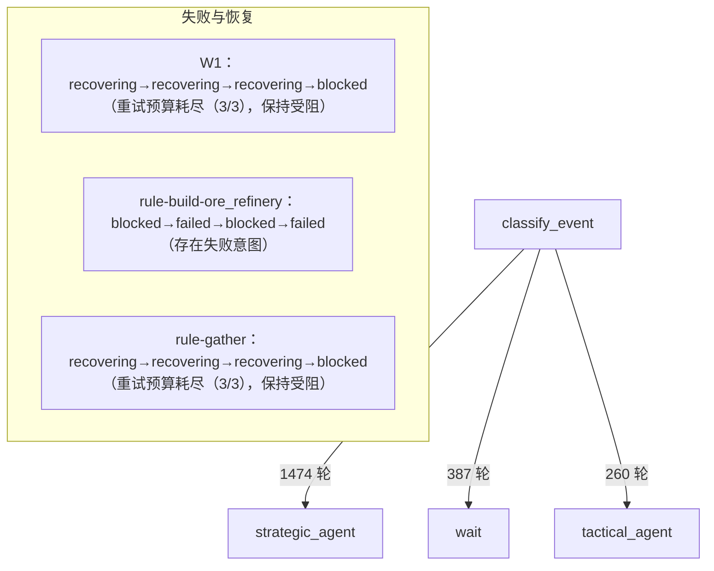

# AI 副官运行时追踪：真实对局时间表（修改 1 交付）

本报告由 `tools/dev/export_adjutant_runtime_trace.py` 从**真实对局**的运行时追踪生成。
追踪合同：`graph/trace.py`（schema=airts-adjutant-runtime-trace-export v1）。

## 运行身份

| 项目 | 值 |
|---|---|
| 对局目录 | `G:\AIRTS\AI_RTS\agent\runs\2026-10-15-adjutant-phase1\round-04\match-600s-b` |
| 状态 | observed |
| 观察秒数（墙钟） | 600.0004610000005 |
| 入口 | normal Main/Play/Loading/Match menu callbacks |
| 引擎 / 战术 | langgraph / on |
| 模型 | minicpm5-adj-16k |
| 模型参数 SHA-256 | ff4ea8cf1265af9e |
| 端口 | {"game": 25140, "dcs": 25141, "mcp": 25142, "ollama": 11434, "tee": 25145} |
| 源码变更 | 无 |

## 汇总指标

| 指标 | 值 |
|---|---:|
| rounds | 2121 |
| trace_events | 76257 |
| node_spans | 38178 |
| edges | 2121 |
| candidate_evals | 27469 |
| task_events | 156 |
| command_events | 1682 |
| model_calls | 291 |
| notes | 2118 |
| diagnostic_errors | 0 |
| events_per_round_avg | 36.0 |
| events_per_round_max | 41 |
| trace_file_bytes | 43381089 |
| balance_samples | 2121 |
| 余额 首→末 | 10000 → 600 |

路由分布：{"战略分支": 1474, "战术分支": 260, "等待（不发新决策）": 387}

任务事件分布：{"进展更新": 29, "等待玩家": 6, "未知（证据不足）": 57, "成功关闭": 22, "失败": 5, "diagnosing": 20, "恢复尝试": 9, "受阻": 7, "timed_out": 1}

命令状态分布：{"已接受": 111, "被拒绝": 12, "已丢弃": 1559}

模型结果分布：{"成功": 111, "调用异常": 5, "过期结果被拒": 2}

首次交货证据：未观测到（上下文 ）

最长轮次间隔（正常等待形态）：{"round_seq": 912, "server_tick": 5982, "route": "strategic", "since_previous": 20.165}

### 里程碑时间线

| tick | 里程碑 | 状态 | 之前 |
|---:|---|---|---|
| 532 | M01 | pending | - |
| 532 | M02 | pending | - |
| 532 | M03 | pending | - |
| 532 | M04 | pending | - |
| 532 | M05 | pending | - |
| 532 | M06 | pending | - |
| 532 | M07 | pending | - |
| 532 | M08 | pending | - |
| 636 | M02 | done | pending |
| 1043 | M04 | done | pending |
| 1647 | M03 | done | pending |

## 实际分支图（由本局追踪生成）

边上的数字是本局**真实发生**的轮次数；失败/超时/受阻/恢复的任务单列。

## 逐轮时间表

每轮一行：轮次（round_seq，不用 tick 构造）/ tick / 墙钟 / 路由与选边原因 /
节点 span 数 / 候选评估 / 任务事件 / 命令事件 / 模型调用。

| 轮 | tick | 墙钟 | 选边（原因） | span | 候选 | 任务 | 命令 | 模型 |
|---:|---:|---|---|---:|---:|---:|---:|---:|
| 1 | 532 | 22:05:58 | 战略分支（战略复核到期：提交或采纳战略计划） | 18 | 10 | 0 | 2 | 1 |
| 2 | 532 | 22:05:58 | 战术分支（战术节拍到期或决策结果已返回：落地任务修改） | 18 | 10 | 4 | 0 | 1 |
| 3 | 532 | 22:05:58 | 等待（不发新决策）（无需新决策：等待既有任务进展） | 18 | 10 | 0 | 0 | 0 |
| 4 | 532 | 0000.2s | 等待（不发新决策）（无需新决策：等待既有任务进展） | 18 | 10 | 0 | 0 | 0 |
| 5 | 551 | 0000.5s | 战术分支（战术节拍到期或决策结果已返回：落地任务修改） | 18 | 10 | 0 | 0 | 1 |
| 6 | 551 | 0000.8s | 等待（不发新决策）（无需新决策：等待既有任务进展） | 18 | 10 | 0 | 0 | 0 |
| 7 | 551 | 0001.1s | 等待（不发新决策）（无需新决策：等待既有任务进展） | 18 | 10 | 0 | 0 | 1 |
| 8 | 551 | 0001.3s | 等待（不发新决策）（无需新决策：等待既有任务进展） | 18 | 10 | 0 | 0 | 0 |
| 9 | 573 | 0001.6s | 战术分支（战术节拍到期或决策结果已返回：落地任务修改） | 18 | 10 | 0 | 0 | 1 |
| 10 | 573 | 0001.8s | 等待（不发新决策）（无需新决策：等待既有任务进展） | 18 | 10 | 0 | 0 | 0 |
| 11 | 573 | 0002.1s | 等待（不发新决策）（无需新决策：等待既有任务进展） | 18 | 10 | 0 | 0 | 0 |
| 12 | 573 | 0002.3s | 等待（不发新决策）（无需新决策：等待既有任务进展） | 18 | 10 | 0 | 0 | 0 |
| 13 | 594 | 0002.6s | 战术分支（战术节拍到期或决策结果已返回：落地任务修改） | 18 | 10 | 0 | 0 | 1 |
| 14 | 594 | 0002.8s | 等待（不发新决策）（无需新决策：等待既有任务进展） | 18 | 10 | 0 | 0 | 0 |
| 15 | 594 | 0003.1s | 等待（不发新决策）（无需新决策：等待既有任务进展） | 18 | 10 | 0 | 0 | 0 |
| 16 | 606 | 0003.3s | 等待（不发新决策）（无需新决策：等待既有任务进展） | 18 | 10 | 2 | 1 | 0 |
| 17 | 616 | 0003.7s | 战术分支（战术节拍到期或决策结果已返回：落地任务修改） | 18 | 10 | 0 | 0 | 1 |
| 18 | 616 | 0004.0s | 等待（不发新决策）（无需新决策：等待既有任务进展） | 18 | 10 | 0 | 0 | 0 |
| 19 | 616 | 0004.2s | 等待（不发新决策）（无需新决策：等待既有任务进展） | 18 | 10 | 0 | 0 | 0 |
| 20 | 616 | 0004.5s | 等待（不发新决策）（无需新决策：等待既有任务进展） | 18 | 10 | 0 | 0 | 0 |
| 21 | 636 | 0004.8s | 战术分支（战术节拍到期或决策结果已返回：落地任务修改） | 18 | 11 | 1 | 1 | 1 |
| 22 | 636 | 0005.0s | 等待（不发新决策）（无需新决策：等待既有任务进展） | 18 | 11 | 2 | 0 | 0 |
| 23 | 636 | 0005.2s | 等待（不发新决策）（无需新决策：等待既有任务进展） | 18 | 11 | 0 | 0 | 0 |
| 24 | 636 | 0005.5s | 等待（不发新决策）（无需新决策：等待既有任务进展） | 18 | 11 | 0 | 0 | 0 |
| 25 | 656 | 0005.7s | 战术分支（战术节拍到期或决策结果已返回：落地任务修改） | 18 | 11 | 0 | 0 | 1 |
| 26 | 656 | 0006.0s | 等待（不发新决策）（无需新决策：等待既有任务进展） | 18 | 11 | 0 | 0 | 0 |
| 27 | 656 | 0006.3s | 等待（不发新决策）（无需新决策：等待既有任务进展） | 18 | 11 | 0 | 0 | 0 |
| 28 | 656 | 0006.5s | 等待（不发新决策）（无需新决策：等待既有任务进展） | 18 | 11 | 0 | 0 | 0 |
| 29 | 677 | 0006.8s | 战术分支（战术节拍到期或决策结果已返回：落地任务修改） | 18 | 11 | 0 | 0 | 1 |
| 30 | 677 | 0007.0s | 等待（不发新决策）（无需新决策：等待既有任务进展） | 18 | 11 | 0 | 0 | 0 |
| 31 | 677 | 0007.3s | 等待（不发新决策）（无需新决策：等待既有任务进展） | 18 | 11 | 0 | 0 | 0 |
| 32 | 690 | 0007.5s | 等待（不发新决策）（无需新决策：等待既有任务进展） | 18 | 11 | 1 | 1 | 0 |
| 33 | 697 | 0007.8s | 战术分支（战术节拍到期或决策结果已返回：落地任务修改） | 18 | 11 | 0 | 0 | 1 |
| 34 | 697 | 0008.0s | 等待（不发新决策）（无需新决策：等待既有任务进展） | 18 | 11 | 0 | 0 | 0 |
| 35 | 697 | 0008.3s | 等待（不发新决策）（无需新决策：等待既有任务进展） | 18 | 11 | 0 | 0 | 0 |
| 36 | 697 | 0008.5s | 等待（不发新决策）（无需新决策：等待既有任务进展） | 18 | 11 | 0 | 0 | 0 |
| 37 | 717 | 0008.8s | 战术分支（战术节拍到期或决策结果已返回：落地任务修改） | 18 | 11 | 0 | 0 | 1 |
| 38 | 717 | 0009.0s | 等待（不发新决策）（无需新决策：等待既有任务进展） | 18 | 11 | 0 | 0 | 0 |
| 39 | 717 | 0009.3s | 等待（不发新决策）（无需新决策：等待既有任务进展） | 18 | 11 | 0 | 0 | 0 |
| 40 | 729 | 0009.5s | 等待（不发新决策）（无需新决策：等待既有任务进展） | 18 | 11 | 1 | 1 | 0 |
| 41 | 737 | 0009.8s | 战略分支（战略复核到期：提交或采纳战略计划） | 18 | 12 | 2 | 1 | 1 |
| 42 | 742 | 0010.0s | 战术分支（战术节拍到期或决策结果已返回：落地任务修改） | 18 | 12 | 3 | 1 | 1 |
| 43 | 737 | 0010.3s | 等待（不发新决策）（无需新决策：等待既有任务进展） | 18 | 12 | 1 | 0 | 0 |
| 44 | 737 | 0010.5s | 等待（不发新决策）（无需新决策：等待既有任务进展） | 18 | 12 | 0 | 0 | 0 |
| 45 | 757 | 0010.8s | 战术分支（战术节拍到期或决策结果已返回：落地任务修改） | 18 | 13 | 0 | 0 | 1 |
| 46 | 757 | 0011.0s | 等待（不发新决策）（无需新决策：等待既有任务进展） | 18 | 13 | 0 | 0 | 0 |
| 47 | 757 | 0011.4s | 等待（不发新决策）（无需新决策：等待既有任务进展） | 18 | 13 | 0 | 0 | 0 |
| 48 | 757 | 0011.7s | 等待（不发新决策）（无需新决策：等待既有任务进展） | 18 | 13 | 0 | 0 | 0 |
| 49 | 780 | 0012.0s | 战术分支（战术节拍到期或决策结果已返回：落地任务修改） | 18 | 13 | 0 | 0 | 1 |
| 50 | 780 | 0012.2s | 等待（不发新决策）（无需新决策：等待既有任务进展） | 18 | 13 | 0 | 0 | 0 |
| 51 | 780 | 0012.4s | 等待（不发新决策）（无需新决策：等待既有任务进展） | 18 | 13 | 0 | 0 | 0 |
| 52 | 780 | 0012.7s | 等待（不发新决策）（无需新决策：等待既有任务进展） | 18 | 13 | 0 | 0 | 0 |
| 53 | 801 | 0013.0s | 战术分支（战术节拍到期或决策结果已返回：落地任务修改） | 18 | 13 | 0 | 0 | 2 |
| 54 | 801 | 0013.2s | 等待（不发新决策）（无需新决策：等待既有任务进展） | 18 | 13 | 0 | 0 | 0 |
| 55 | 809 | 0013.4s | 等待（不发新决策）（无需新决策：等待既有任务进展） | 18 | 13 | 1 | 1 | 0 |
| 56 | 801 | 0013.7s | 等待（不发新决策）（无需新决策：等待既有任务进展） | 18 | 13 | 0 | 0 | 0 |
| 57 | 821 | 0014.0s | 战术分支（战术节拍到期或决策结果已返回：落地任务修改） | 18 | 13 | 0 | 0 | 1 |
| 58 | 825 | 0014.2s | 等待（不发新决策）（无需新决策：等待既有任务进展） | 18 | 13 | 1 | 1 | 0 |
| 59 | 821 | 0014.4s | 等待（不发新决策）（无需新决策：等待既有任务进展） | 18 | 13 | 2 | 0 | 0 |
| 60 | 821 | 0014.7s | 等待（不发新决策）（无需新决策：等待既有任务进展） | 18 | 13 | 0 | 0 | 0 |
| 61 | 841 | 0015.0s | 战术分支（战术节拍到期或决策结果已返回：落地任务修改） | 18 | 13 | 0 | 1 | 1 |
| 62 | 846 | 0015.2s | 等待（不发新决策）（无需新决策：等待既有任务进展） | 18 | 13 | 1 | 1 | 0 |
| 63 | 841 | 0015.5s | 等待（不发新决策）（无需新决策：等待既有任务进展） | 18 | 13 | 2 | 0 | 0 |
| 64 | 841 | 0015.7s | 等待（不发新决策）（无需新决策：等待既有任务进展） | 18 | 13 | 0 | 0 | 0 |
| 65 | 861 | 0016.0s | 战术分支（战术节拍到期或决策结果已返回：落地任务修改） | 18 | 13 | 0 | 0 | 1 |
| 66 | 861 | 0016.2s | 等待（不发新决策）（无需新决策：等待既有任务进展） | 18 | 13 | 0 | 0 | 0 |
| 67 | 861 | 0016.5s | 等待（不发新决策）（无需新决策：等待既有任务进展） | 18 | 13 | 0 | 0 | 0 |
| 68 | 861 | 0016.7s | 等待（不发新决策）（无需新决策：等待既有任务进展） | 18 | 13 | 0 | 0 | 0 |
| 69 | 881 | 0017.0s | 战术分支（战术节拍到期或决策结果已返回：落地任务修改） | 18 | 13 | 0 | 0 | 1 |
| 70 | 881 | 0017.2s | 等待（不发新决策）（无需新决策：等待既有任务进展） | 18 | 13 | 0 | 0 | 0 |
| 71 | 881 | 0017.5s | 等待（不发新决策）（无需新决策：等待既有任务进展） | 18 | 13 | 0 | 0 | 0 |
| 72 | 881 | 0017.7s | 等待（不发新决策）（无需新决策：等待既有任务进展） | 18 | 13 | 0 | 0 | 0 |
| 73 | 901 | 0018.0s | 战术分支（战术节拍到期或决策结果已返回：落地任务修改） | 18 | 13 | 0 | 0 | 1 |
| 74 | 901 | 0018.2s | 等待（不发新决策）（无需新决策：等待既有任务进展） | 18 | 13 | 0 | 0 | 0 |
| 75 | 901 | 0018.5s | 等待（不发新决策）（无需新决策：等待既有任务进展） | 18 | 13 | 0 | 0 | 0 |
| 76 | 901 | 0018.7s | 等待（不发新决策）（无需新决策：等待既有任务进展） | 18 | 13 | 0 | 0 | 0 |
| 77 | 921 | 0019.0s | 战术分支（战术节拍到期或决策结果已返回：落地任务修改） | 18 | 13 | 0 | 0 | 1 |
| 78 | 921 | 0019.2s | 等待（不发新决策）（无需新决策：等待既有任务进展） | 18 | 13 | 0 | 0 | 0 |
| 79 | 921 | 0019.5s | 等待（不发新决策）（无需新决策：等待既有任务进展） | 18 | 13 | 0 | 0 | 0 |
| 80 | 921 | 0019.7s | 等待（不发新决策）（无需新决策：等待既有任务进展） | 18 | 13 | 0 | 0 | 0 |
| 81 | 941 | 0020.0s | 战术分支（战术节拍到期或决策结果已返回：落地任务修改） | 18 | 13 | 1 | 1 | 1 |
| 82 | 941 | 0020.2s | 等待（不发新决策）（无需新决策：等待既有任务进展） | 18 | 13 | 0 | 0 | 0 |
| 83 | 941 | 0020.5s | 等待（不发新决策）（无需新决策：等待既有任务进展） | 18 | 13 | 0 | 0 | 0 |
| 84 | 941 | 0020.7s | 等待（不发新决策）（无需新决策：等待既有任务进展） | 18 | 13 | 0 | 0 | 0 |
| 85 | 961 | 0021.0s | 战术分支（战术节拍到期或决策结果已返回：落地任务修改） | 18 | 13 | 0 | 0 | 1 |
| 86 | 961 | 0021.2s | 等待（不发新决策）（无需新决策：等待既有任务进展） | 18 | 13 | 0 | 0 | 0 |
| 87 | 961 | 0021.5s | 等待（不发新决策）（无需新决策：等待既有任务进展） | 18 | 13 | 0 | 0 | 0 |
| 88 | 961 | 0021.7s | 等待（不发新决策）（无需新决策：等待既有任务进展） | 18 | 13 | 0 | 0 | 0 |
| 89 | 981 | 0022.0s | 战术分支（战术节拍到期或决策结果已返回：落地任务修改） | 18 | 13 | 0 | 0 | 1 |
| 90 | 981 | 0022.2s | 等待（不发新决策）（无需新决策：等待既有任务进展） | 18 | 13 | 0 | 0 | 0 |
| 91 | 981 | 0022.5s | 等待（不发新决策）（无需新决策：等待既有任务进展） | 18 | 13 | 0 | 0 | 0 |
| 92 | 981 | 0022.7s | 等待（不发新决策）（无需新决策：等待既有任务进展） | 18 | 13 | 0 | 0 | 0 |
| 93 | 1002 | 0023.0s | 战略分支（战略复核到期：提交或采纳战略计划） | 18 | 13 | 0 | 0 | 1 |
| 94 | 1002 | 0023.2s | 战术分支（战术节拍到期或决策结果已返回：落地任务修改） | 18 | 13 | 0 | 0 | 1 |
| 95 | 1011 | 0023.5s | 等待（不发新决策）（无需新决策：等待既有任务进展） | 18 | 13 | 1 | 1 | 0 |
| 96 | 1002 | 0023.8s | 等待（不发新决策）（无需新决策：等待既有任务进展） | 18 | 13 | 1 | 0 | 0 |
| 97 | 1023 | 0024.1s | 战术分支（战术节拍到期或决策结果已返回：落地任务修改） | 18 | 13 | 1 | 0 | 1 |
| 98 | 1023 | 0024.3s | 等待（不发新决策）（无需新决策：等待既有任务进展） | 18 | 13 | 0 | 0 | 0 |
| 99 | 1023 | 0024.5s | 等待（不发新决策）（无需新决策：等待既有任务进展） | 18 | 13 | 0 | 0 | 1 |
| 100 | 1023 | 0024.8s | 等待（不发新决策）（无需新决策：等待既有任务进展） | 18 | 13 | 0 | 0 | 0 |
| 101 | 1043 | 0025.1s | 战术分支（战术节拍到期或决策结果已返回：落地任务修改） | 18 | 13 | 0 | 0 | 1 |
| 102 | 1043 | 0025.3s | 等待（不发新决策）（无需新决策：等待既有任务进展） | 18 | 13 | 0 | 0 | 0 |
| 103 | 1043 | 0025.5s | 等待（不发新决策）（无需新决策：等待既有任务进展） | 18 | 13 | 0 | 0 | 0 |
| 104 | 1043 | 0025.8s | 等待（不发新决策）（无需新决策：等待既有任务进展） | 18 | 13 | 0 | 0 | 0 |
| 105 | 1063 | 0026.1s | 战术分支（战术节拍到期或决策结果已返回：落地任务修改） | 18 | 13 | 1 | 1 | 1 |
| 106 | 1063 | 0026.3s | 等待（不发新决策）（无需新决策：等待既有任务进展） | 18 | 13 | 0 | 0 | 0 |
| 107 | 1063 | 0026.5s | 等待（不发新决策）（无需新决策：等待既有任务进展） | 18 | 13 | 0 | 0 | 0 |
| 108 | 1063 | 0026.8s | 等待（不发新决策）（无需新决策：等待既有任务进展） | 18 | 13 | 0 | 0 | 0 |
| 109 | 1083 | 0027.1s | 战术分支（战术节拍到期或决策结果已返回：落地任务修改） | 18 | 13 | 0 | 0 | 1 |
| 110 | 1083 | 0027.3s | 等待（不发新决策）（无需新决策：等待既有任务进展） | 18 | 13 | 0 | 0 | 0 |
| 111 | 1083 | 0027.5s | 等待（不发新决策）（无需新决策：等待既有任务进展） | 18 | 13 | 0 | 0 | 0 |
| 112 | 1083 | 0027.8s | 等待（不发新决策）（无需新决策：等待既有任务进展） | 18 | 13 | 0 | 0 | 0 |
| 113 | 1103 | 0028.1s | 战术分支（战术节拍到期或决策结果已返回：落地任务修改） | 18 | 13 | 1 | 2 | 1 |
| 114 | 1103 | 0028.3s | 等待（不发新决策）（无需新决策：等待既有任务进展） | 18 | 13 | 1 | 0 | 0 |
| 115 | 1103 | 0028.5s | 等待（不发新决策）（无需新决策：等待既有任务进展） | 18 | 13 | 0 | 0 | 0 |
| 116 | 1103 | 0028.8s | 等待（不发新决策）（无需新决策：等待既有任务进展） | 18 | 13 | 0 | 0 | 0 |
| 117 | 1123 | 0029.1s | 战术分支（战术节拍到期或决策结果已返回：落地任务修改） | 18 | 13 | 0 | 0 | 1 |
| 118 | 1123 | 0029.3s | 等待（不发新决策）（无需新决策：等待既有任务进展） | 18 | 13 | 0 | 0 | 0 |
| 119 | 1123 | 0029.5s | 等待（不发新决策）（无需新决策：等待既有任务进展） | 18 | 13 | 0 | 0 | 0 |
| 120 | 1123 | 0029.8s | 等待（不发新决策）（无需新决策：等待既有任务进展） | 18 | 13 | 0 | 0 | 0 |
| 121 | 1143 | 0030.1s | 战术分支（战术节拍到期或决策结果已返回：落地任务修改） | 18 | 13 | 0 | 0 | 1 |
| 122 | 1143 | 0030.3s | 等待（不发新决策）（无需新决策：等待既有任务进展） | 18 | 13 | 0 | 0 | 0 |
| 123 | 1143 | 0030.6s | 等待（不发新决策）（无需新决策：等待既有任务进展） | 18 | 13 | 0 | 0 | 0 |
| 124 | 1143 | 0030.8s | 等待（不发新决策）（无需新决策：等待既有任务进展） | 18 | 13 | 0 | 0 | 0 |
| 125 | 1163 | 0031.1s | 战术分支（战术节拍到期或决策结果已返回：落地任务修改） | 18 | 13 | 0 | 0 | 1 |
| 126 | 1163 | 0031.3s | 等待（不发新决策）（无需新决策：等待既有任务进展） | 18 | 13 | 0 | 0 | 0 |
| 127 | 1163 | 0031.6s | 等待（不发新决策）（无需新决策：等待既有任务进展） | 18 | 13 | 0 | 0 | 0 |
| 128 | 1163 | 0031.8s | 等待（不发新决策）（无需新决策：等待既有任务进展） | 18 | 13 | 0 | 0 | 0 |
| 129 | 1183 | 0032.1s | 战术分支（战术节拍到期或决策结果已返回：落地任务修改） | 18 | 13 | 0 | 0 | 1 |
| 130 | 1183 | 0032.3s | 等待（不发新决策）（无需新决策：等待既有任务进展） | 18 | 13 | 0 | 0 | 0 |
| 131 | 1183 | 0032.6s | 等待（不发新决策）（无需新决策：等待既有任务进展） | 18 | 13 | 0 | 0 | 0 |
| 132 | 1197 | 0032.8s | 等待（不发新决策）（无需新决策：等待既有任务进展） | 18 | 13 | 2 | 2 | 0 |
| 133 | 1203 | 0033.1s | 战术分支（战术节拍到期或决策结果已返回：落地任务修改） | 18 | 13 | 1 | 1 | 1 |
| 134 | 1203 | 0033.3s | 等待（不发新决策）（无需新决策：等待既有任务进展） | 18 | 13 | 0 | 0 | 0 |
| 135 | 1203 | 0033.6s | 等待（不发新决策）（无需新决策：等待既有任务进展） | 18 | 13 | 0 | 0 | 0 |
| 136 | 1203 | 0033.8s | 等待（不发新决策）（无需新决策：等待既有任务进展） | 18 | 13 | 0 | 0 | 0 |
| 137 | 1223 | 0034.1s | 战术分支（战术节拍到期或决策结果已返回：落地任务修改） | 18 | 13 | 0 | 0 | 1 |
| 138 | 1223 | 0034.3s | 等待（不发新决策）（无需新决策：等待既有任务进展） | 18 | 13 | 0 | 0 | 0 |
| 139 | 1223 | 0034.6s | 等待（不发新决策）（无需新决策：等待既有任务进展） | 18 | 13 | 0 | 0 | 0 |
| 140 | 1223 | 0034.8s | 战略分支（战略复核到期：提交或采纳战略计划） | 18 | 13 | 0 | 0 | 1 |
| 141 | 1243 | 0035.1s | 战术分支（战术节拍到期或决策结果已返回：落地任务修改） | 18 | 13 | 0 | 0 | 1 |
| 142 | 1243 | 0035.3s | 等待（不发新决策）（无需新决策：等待既有任务进展） | 18 | 13 | 0 | 0 | 0 |
| 143 | 1243 | 0035.6s | 等待（不发新决策）（无需新决策：等待既有任务进展） | 18 | 13 | 0 | 0 | 0 |
| 144 | 1243 | 0035.8s | 等待（不发新决策）（无需新决策：等待既有任务进展） | 18 | 13 | 0 | 0 | 0 |
| 145 | 1263 | 0036.1s | 战术分支（战术节拍到期或决策结果已返回：落地任务修改） | 18 | 13 | 1 | 1 | 2 |
| 146 | 1263 | 0036.3s | 等待（不发新决策）（无需新决策：等待既有任务进展） | 18 | 13 | 0 | 0 | 0 |
| 147 | 1263 | 0036.6s | 等待（不发新决策）（无需新决策：等待既有任务进展） | 18 | 13 | 0 | 0 | 0 |
| 148 | 1263 | 0036.8s | 等待（不发新决策）（无需新决策：等待既有任务进展） | 18 | 13 | 0 | 0 | 0 |
| 149 | 1283 | 0037.1s | 战术分支（战术节拍到期或决策结果已返回：落地任务修改） | 18 | 13 | 0 | 0 | 1 |
| 150 | 1283 | 0037.3s | 等待（不发新决策）（无需新决策：等待既有任务进展） | 18 | 13 | 0 | 0 | 0 |
| 151 | 1292 | 0037.6s | 等待（不发新决策）（无需新决策：等待既有任务进展） | 18 | 13 | 1 | 1 | 0 |
| 152 | 1283 | 0037.8s | 等待（不发新决策）（无需新决策：等待既有任务进展） | 18 | 13 | 1 | 0 | 0 |
| 153 | 1303 | 0038.1s | 战术分支（战术节拍到期或决策结果已返回：落地任务修改） | 18 | 13 | 0 | 1 | 1 |
| 154 | 1303 | 0038.3s | 等待（不发新决策）（无需新决策：等待既有任务进展） | 18 | 13 | 0 | 0 | 0 |
| 155 | 1303 | 0038.6s | 等待（不发新决策）（无需新决策：等待既有任务进展） | 18 | 13 | 0 | 0 | 0 |
| 156 | 1303 | 0038.8s | 等待（不发新决策）（无需新决策：等待既有任务进展） | 18 | 13 | 0 | 0 | 0 |
| 157 | 1323 | 0039.1s | 战术分支（战术节拍到期或决策结果已返回：落地任务修改） | 18 | 13 | 0 | 0 | 1 |
| 158 | 1323 | 0039.3s | 等待（不发新决策）（无需新决策：等待既有任务进展） | 18 | 13 | 0 | 0 | 0 |
| 159 | 1323 | 0039.6s | 等待（不发新决策）（无需新决策：等待既有任务进展） | 18 | 13 | 0 | 0 | 0 |
| 160 | 1323 | 0039.8s | 等待（不发新决策）（无需新决策：等待既有任务进展） | 18 | 13 | 0 | 0 | 0 |
| 161 | 1343 | 0040.1s | 战术分支（战术节拍到期或决策结果已返回：落地任务修改） | 18 | 13 | 0 | 0 | 1 |
| 162 | 1343 | 0040.3s | 等待（不发新决策）（无需新决策：等待既有任务进展） | 18 | 13 | 0 | 0 | 0 |
| 163 | 1343 | 0040.6s | 等待（不发新决策）（无需新决策：等待既有任务进展） | 18 | 13 | 0 | 0 | 0 |
| 164 | 1343 | 0040.8s | 等待（不发新决策）（无需新决策：等待既有任务进展） | 18 | 13 | 0 | 0 | 0 |
| 165 | 1363 | 0041.1s | 战术分支（战术节拍到期或决策结果已返回：落地任务修改） | 18 | 13 | 0 | 0 | 1 |
| 166 | 1363 | 0041.3s | 等待（不发新决策）（无需新决策：等待既有任务进展） | 18 | 13 | 0 | 0 | 0 |
| 167 | 1363 | 0041.6s | 等待（不发新决策）（无需新决策：等待既有任务进展） | 18 | 13 | 0 | 0 | 0 |
| 168 | 1363 | 0041.8s | 等待（不发新决策）（无需新决策：等待既有任务进展） | 18 | 13 | 0 | 0 | 0 |
| 169 | 1383 | 0042.1s | 战术分支（战术节拍到期或决策结果已返回：落地任务修改） | 18 | 13 | 1 | 1 | 1 |
| 170 | 1385 | 0042.3s | 等待（不发新决策）（无需新决策：等待既有任务进展） | 18 | 13 | 1 | 1 | 0 |
| 171 | 1383 | 0042.6s | 等待（不发新决策）（无需新决策：等待既有任务进展） | 18 | 13 | 1 | 0 | 0 |
| 172 | 1383 | 0042.8s | 等待（不发新决策）（无需新决策：等待既有任务进展） | 18 | 13 | 0 | 0 | 0 |
| 173 | 1404 | 0043.1s | 战术分支（战术节拍到期或决策结果已返回：落地任务修改） | 18 | 13 | 0 | 1 | 1 |
| 174 | 1404 | 0043.3s | 等待（不发新决策）（无需新决策：等待既有任务进展） | 18 | 13 | 0 | 0 | 0 |
| 175 | 1404 | 0043.6s | 等待（不发新决策）（无需新决策：等待既有任务进展） | 18 | 13 | 0 | 0 | 0 |
| 176 | 1404 | 0043.8s | 等待（不发新决策）（无需新决策：等待既有任务进展） | 18 | 13 | 0 | 0 | 0 |
| 177 | 1424 | 0044.1s | 战术分支（战术节拍到期或决策结果已返回：落地任务修改） | 18 | 13 | 0 | 0 | 1 |
| 178 | 1424 | 0044.3s | 等待（不发新决策）（无需新决策：等待既有任务进展） | 18 | 13 | 0 | 0 | 0 |
| 179 | 1424 | 0044.6s | 等待（不发新决策）（无需新决策：等待既有任务进展） | 18 | 13 | 0 | 0 | 0 |
| 180 | 1424 | 0044.8s | 等待（不发新决策）（无需新决策：等待既有任务进展） | 18 | 13 | 0 | 0 | 0 |
| 181 | 1444 | 0045.1s | 战术分支（战术节拍到期或决策结果已返回：落地任务修改） | 18 | 13 | 0 | 0 | 1 |
| 182 | 1444 | 0045.3s | 等待（不发新决策）（无需新决策：等待既有任务进展） | 18 | 13 | 0 | 0 | 0 |
| 183 | 1444 | 0045.6s | 等待（不发新决策）（无需新决策：等待既有任务进展） | 18 | 13 | 0 | 0 | 0 |
| 184 | 1444 | 0045.8s | 等待（不发新决策）（无需新决策：等待既有任务进展） | 18 | 13 | 0 | 0 | 0 |
| 185 | 1464 | 0046.1s | 战术分支（战术节拍到期或决策结果已返回：落地任务修改） | 18 | 13 | 0 | 0 | 1 |
| 186 | 1464 | 0046.3s | 等待（不发新决策）（无需新决策：等待既有任务进展） | 18 | 13 | 0 | 0 | 0 |
| 187 | 1464 | 0046.6s | 等待（不发新决策）（无需新决策：等待既有任务进展） | 18 | 13 | 0 | 0 | 0 |
| 188 | 1464 | 0046.8s | 战略分支（战略复核到期：提交或采纳战略计划） | 18 | 13 | 0 | 0 | 1 |
| 189 | 1483 | 0047.1s | 战术分支（战术节拍到期或决策结果已返回：落地任务修改） | 18 | 13 | 0 | 0 | 1 |
| 190 | 1483 | 0047.3s | 等待（不发新决策）（无需新决策：等待既有任务进展） | 18 | 13 | 0 | 0 | 0 |
| 191 | 1483 | 0047.6s | 等待（不发新决策）（无需新决策：等待既有任务进展） | 18 | 13 | 0 | 0 | 0 |
| 192 | 1483 | 0047.8s | 等待（不发新决策）（无需新决策：等待既有任务进展） | 18 | 13 | 0 | 0 | 0 |
| 193 | 1504 | 0048.1s | 战术分支（战术节拍到期或决策结果已返回：落地任务修改） | 18 | 13 | 0 | 0 | 1 |
| 194 | 1504 | 0048.3s | 等待（不发新决策）（无需新决策：等待既有任务进展） | 18 | 13 | 0 | 0 | 0 |
| 195 | 1504 | 0048.6s | 等待（不发新决策）（无需新决策：等待既有任务进展） | 18 | 13 | 0 | 0 | 0 |
| 196 | 1504 | 0048.8s | 等待（不发新决策）（无需新决策：等待既有任务进展） | 18 | 13 | 0 | 0 | 0 |
| 197 | 1524 | 0049.1s | 战术分支（战术节拍到期或决策结果已返回：落地任务修改） | 18 | 13 | 0 | 0 | 1 |
| 198 | 1524 | 0049.3s | 等待（不发新决策）（无需新决策：等待既有任务进展） | 18 | 13 | 0 | 0 | 0 |
| 199 | 1524 | 0049.6s | 等待（不发新决策）（无需新决策：等待既有任务进展） | 18 | 13 | 0 | 0 | 0 |
| 200 | 1524 | 0049.8s | 等待（不发新决策）（无需新决策：等待既有任务进展） | 18 | 13 | 0 | 0 | 0 |
| 201 | 1544 | 0050.1s | 战术分支（战术节拍到期或决策结果已返回：落地任务修改） | 18 | 13 | 0 | 0 | 1 |
| 202 | 1544 | 0050.3s | 等待（不发新决策）（无需新决策：等待既有任务进展） | 18 | 13 | 0 | 0 | 1 |
| 203 | 1544 | 0050.6s | 等待（不发新决策）（无需新决策：等待既有任务进展） | 18 | 13 | 0 | 0 | 0 |
| 204 | 1544 | 0051.0s | 等待（不发新决策）（无需新决策：等待既有任务进展） | 18 | 13 | 0 | 0 | 0 |
| 205 | 1566 | 0051.2s | 战术分支（战术节拍到期或决策结果已返回：落地任务修改） | 18 | 13 | 1 | 1 | 1 |
| 206 | 1569 | 0051.5s | 等待（不发新决策）（无需新决策：等待既有任务进展） | 18 | 13 | 1 | 1 | 0 |
| 207 | 1566 | 0051.7s | 等待（不发新决策）（无需新决策：等待既有任务进展） | 18 | 13 | 1 | 0 | 0 |
| 208 | 1566 | 0052.0s | 等待（不发新决策）（无需新决策：等待既有任务进展） | 18 | 13 | 0 | 0 | 0 |
| 209 | 1587 | 0052.3s | 战术分支（战术节拍到期或决策结果已返回：落地任务修改） | 18 | 13 | 0 | 0 | 1 |
| 210 | 1587 | 0052.5s | 等待（不发新决策）（无需新决策：等待既有任务进展） | 18 | 13 | 0 | 0 | 0 |
| 211 | 1587 | 0052.7s | 等待（不发新决策）（无需新决策：等待既有任务进展） | 18 | 13 | 0 | 0 | 0 |
| 212 | 1587 | 0053.0s | 等待（不发新决策）（无需新决策：等待既有任务进展） | 18 | 13 | 0 | 0 | 0 |
| 213 | 1607 | 0053.2s | 战术分支（战术节拍到期或决策结果已返回：落地任务修改） | 18 | 13 | 0 | 0 | 1 |
| 214 | 1607 | 0053.5s | 等待（不发新决策）（无需新决策：等待既有任务进展） | 18 | 13 | 0 | 0 | 0 |
| 215 | 1607 | 0053.7s | 等待（不发新决策）（无需新决策：等待既有任务进展） | 18 | 13 | 0 | 0 | 0 |
| 216 | 1607 | 0054.0s | 等待（不发新决策）（无需新决策：等待既有任务进展） | 18 | 13 | 0 | 0 | 0 |
| 217 | 1628 | 0054.2s | 战术分支（战术节拍到期或决策结果已返回：落地任务修改） | 18 | 13 | 1 | 1 | 1 |
| 218 | 1626 | 0054.5s | 等待（不发新决策）（无需新决策：等待既有任务进展） | 18 | 13 | 0 | 0 | 0 |
| 219 | 1626 | 0054.7s | 等待（不发新决策）（无需新决策：等待既有任务进展） | 18 | 13 | 0 | 0 | 0 |
| 220 | 1626 | 0055.0s | 等待（不发新决策）（无需新决策：等待既有任务进展） | 18 | 13 | 0 | 0 | 0 |
| 221 | 1647 | 0055.3s | 战术分支（战术节拍到期或决策结果已返回：落地任务修改） | 18 | 13 | 2 | 0 | 1 |
| 222 | 1647 | 0055.5s | 等待（不发新决策）（无需新决策：等待既有任务进展） | 18 | 13 | 0 | 0 | 0 |
| 223 | 1712 | 0058.5s | 战略分支（战略复核到期：提交或采纳战略计划） | 18 | 13 | 0 | 0 | 0 |
| 224 | 1712 | 0058.8s | 战略分支（战略复核到期：提交或采纳战略计划） | 18 | 13 | 0 | 0 | 0 |
| 225 | 1712 | 0059.0s | 战略分支（战略复核到期：提交或采纳战略计划） | 18 | 13 | 0 | 0 | 0 |
| 226 | 1712 | 0059.3s | 战略分支（战略复核到期：提交或采纳战略计划） | 18 | 13 | 0 | 0 | 0 |
| 227 | 1732 | 0059.5s | 战略分支（战略复核到期：提交或采纳战略计划） | 18 | 13 | 0 | 0 | 0 |
| 228 | 1732 | 0059.8s | 战略分支（战略复核到期：提交或采纳战略计划） | 18 | 13 | 0 | 0 | 0 |
| 229 | 1732 | 0060.0s | 战略分支（战略复核到期：提交或采纳战略计划） | 18 | 13 | 0 | 0 | 0 |
| 230 | 1732 | 0060.3s | 战略分支（战略复核到期：提交或采纳战略计划） | 18 | 13 | 0 | 0 | 0 |
| 231 | 1752 | 0060.5s | 战略分支（战略复核到期：提交或采纳战略计划） | 18 | 13 | 1 | 1 | 0 |
| 232 | 1752 | 0060.8s | 战略分支（战略复核到期：提交或采纳战略计划） | 18 | 13 | 1 | 0 | 0 |
| 233 | 1760 | 0061.0s | 战略分支（战略复核到期：提交或采纳战略计划） | 18 | 13 | 1 | 1 | 0 |
| 234 | 1752 | 0061.3s | 战略分支（战略复核到期：提交或采纳战略计划） | 18 | 13 | 0 | 0 | 0 |
| 235 | 1772 | 0061.5s | 战略分支（战略复核到期：提交或采纳战略计划） | 18 | 13 | 0 | 0 | 0 |
| 236 | 1772 | 0061.8s | 战略分支（战略复核到期：提交或采纳战略计划） | 18 | 13 | 0 | 0 | 0 |
| 237 | 1772 | 0062.0s | 战略分支（战略复核到期：提交或采纳战略计划） | 18 | 13 | 0 | 0 | 0 |
| 238 | 1772 | 0062.3s | 战略分支（战略复核到期：提交或采纳战略计划） | 18 | 13 | 0 | 0 | 0 |
| 239 | 1792 | 0062.5s | 战略分支（战略复核到期：提交或采纳战略计划） | 18 | 13 | 0 | 0 | 0 |
| 240 | 1792 | 0062.8s | 战略分支（战略复核到期：提交或采纳战略计划） | 18 | 13 | 0 | 0 | 0 |
| 241 | 1792 | 0063.0s | 战略分支（战略复核到期：提交或采纳战略计划） | 18 | 13 | 0 | 0 | 0 |
| 242 | 1792 | 0063.3s | 战略分支（战略复核到期：提交或采纳战略计划） | 18 | 13 | 0 | 0 | 0 |
| 243 | 1812 | 0063.5s | 战略分支（战略复核到期：提交或采纳战略计划） | 18 | 13 | 0 | 0 | 0 |
| 244 | 1812 | 0063.8s | 战略分支（战略复核到期：提交或采纳战略计划） | 18 | 13 | 0 | 0 | 0 |
| 245 | 1812 | 0064.0s | 战略分支（战略复核到期：提交或采纳战略计划） | 18 | 13 | 0 | 0 | 0 |
| 246 | 1812 | 0064.3s | 战略分支（战略复核到期：提交或采纳战略计划） | 18 | 13 | 0 | 0 | 0 |
| 247 | 1833 | 0064.6s | 战略分支（战略复核到期：提交或采纳战略计划） | 18 | 13 | 0 | 0 | 0 |
| 248 | 1833 | 0064.8s | 战略分支（战略复核到期：提交或采纳战略计划） | 18 | 13 | 0 | 0 | 0 |
| 249 | 1833 | 0065.0s | 战略分支（战略复核到期：提交或采纳战略计划） | 18 | 13 | 0 | 0 | 0 |
| 250 | 1833 | 0065.3s | 战略分支（战略复核到期：提交或采纳战略计划） | 18 | 13 | 0 | 0 | 0 |
| 251 | 1853 | 0065.6s | 战略分支（战略复核到期：提交或采纳战略计划） | 18 | 13 | 0 | 0 | 0 |
| 252 | 1853 | 0065.8s | 战略分支（战略复核到期：提交或采纳战略计划） | 18 | 13 | 0 | 0 | 0 |
| 253 | 1853 | 0066.0s | 战略分支（战略复核到期：提交或采纳战略计划） | 18 | 13 | 0 | 0 | 0 |
| 254 | 1853 | 0066.3s | 战略分支（战略复核到期：提交或采纳战略计划） | 18 | 13 | 0 | 0 | 0 |
| 255 | 1873 | 0066.6s | 战略分支（战略复核到期：提交或采纳战略计划） | 18 | 13 | 0 | 0 | 0 |
| 256 | 1873 | 0066.8s | 战略分支（战略复核到期：提交或采纳战略计划） | 18 | 13 | 0 | 0 | 0 |
| 257 | 1873 | 0067.0s | 战略分支（战略复核到期：提交或采纳战略计划） | 18 | 13 | 0 | 0 | 0 |
| 258 | 1873 | 0067.3s | 战略分支（战略复核到期：提交或采纳战略计划） | 18 | 13 | 0 | 0 | 0 |
| 259 | 1893 | 0067.6s | 战略分支（战略复核到期：提交或采纳战略计划） | 18 | 13 | 0 | 0 | 0 |
| 260 | 1893 | 0067.8s | 战略分支（战略复核到期：提交或采纳战略计划） | 18 | 13 | 0 | 0 | 0 |
| 261 | 1893 | 0068.0s | 战略分支（战略复核到期：提交或采纳战略计划） | 18 | 13 | 0 | 0 | 0 |
| 262 | 1893 | 0068.3s | 战略分支（战略复核到期：提交或采纳战略计划） | 18 | 13 | 0 | 0 | 0 |
| 263 | 1913 | 0068.6s | 战略分支（战略复核到期：提交或采纳战略计划） | 18 | 13 | 0 | 0 | 0 |
| 264 | 1913 | 0068.8s | 战略分支（战略复核到期：提交或采纳战略计划） | 18 | 13 | 0 | 0 | 0 |
| 265 | 1913 | 0069.0s | 战略分支（战略复核到期：提交或采纳战略计划） | 18 | 13 | 0 | 0 | 0 |
| 266 | 1913 | 0069.3s | 战略分支（战略复核到期：提交或采纳战略计划） | 18 | 13 | 0 | 0 | 0 |
| 267 | 1933 | 0069.6s | 战略分支（战略复核到期：提交或采纳战略计划） | 18 | 13 | 1 | 1 | 0 |
| 268 | 1933 | 0069.8s | 战略分支（战略复核到期：提交或采纳战略计划） | 18 | 13 | 1 | 0 | 0 |
| 269 | 1933 | 0070.0s | 战略分支（战略复核到期：提交或采纳战略计划） | 18 | 13 | 0 | 0 | 0 |
| 270 | 1933 | 0070.3s | 战略分支（战略复核到期：提交或采纳战略计划） | 18 | 13 | 0 | 0 | 0 |
| 271 | 1952 | 0070.5s | 战略分支（战略复核到期：提交或采纳战略计划） | 18 | 13 | 0 | 0 | 0 |
| 272 | 1952 | 0070.8s | 战略分支（战略复核到期：提交或采纳战略计划） | 18 | 13 | 0 | 0 | 0 |
| 273 | 1952 | 0071.0s | 战略分支（战略复核到期：提交或采纳战略计划） | 18 | 13 | 0 | 0 | 0 |
| 274 | 1952 | 0071.3s | 战略分支（战略复核到期：提交或采纳战略计划） | 18 | 13 | 0 | 0 | 0 |
| 275 | 1973 | 0071.6s | 战略分支（战略复核到期：提交或采纳战略计划） | 18 | 13 | 1 | 1 | 0 |
| 276 | 1973 | 0071.8s | 战略分支（战略复核到期：提交或采纳战略计划） | 18 | 13 | 0 | 0 | 0 |
| 277 | 1973 | 0072.0s | 战略分支（战略复核到期：提交或采纳战略计划） | 18 | 13 | 0 | 0 | 0 |
| 278 | 1973 | 0072.3s | 战略分支（战略复核到期：提交或采纳战略计划） | 18 | 13 | 0 | 0 | 0 |
| 279 | 1992 | 0072.5s | 战略分支（战略复核到期：提交或采纳战略计划） | 18 | 13 | 0 | 0 | 0 |
| 280 | 1992 | 0072.8s | 战略分支（战略复核到期：提交或采纳战略计划） | 18 | 13 | 0 | 0 | 0 |
| 281 | 1992 | 0073.0s | 战略分支（战略复核到期：提交或采纳战略计划） | 18 | 13 | 0 | 0 | 0 |
| 282 | 1992 | 0073.3s | 战略分支（战略复核到期：提交或采纳战略计划） | 18 | 13 | 0 | 0 | 0 |
| 283 | 2013 | 0073.6s | 战略分支（战略复核到期：提交或采纳战略计划） | 18 | 13 | 0 | 0 | 0 |
| 284 | 2013 | 0073.8s | 战略分支（战略复核到期：提交或采纳战略计划） | 18 | 13 | 0 | 0 | 0 |
| 285 | 2013 | 0074.3s | 战略分支（战略复核到期：提交或采纳战略计划） | 18 | 13 | 0 | 0 | 0 |
| 286 | 2013 | 0074.4s | 战略分支（战略复核到期：提交或采纳战略计划） | 18 | 13 | 0 | 0 | 0 |
| 287 | 2035 | 0074.7s | 战略分支（战略复核到期：提交或采纳战略计划） | 18 | 13 | 0 | 0 | 0 |
| 288 | 2035 | 0074.9s | 战略分支（战略复核到期：提交或采纳战略计划） | 18 | 13 | 0 | 0 | 0 |
| 289 | 2035 | 0075.2s | 战略分支（战略复核到期：提交或采纳战略计划） | 18 | 13 | 0 | 0 | 0 |
| 290 | 2035 | 0075.4s | 战略分支（战略复核到期：提交或采纳战略计划） | 18 | 13 | 0 | 0 | 0 |
| 291 | 2056 | 0075.7s | 战略分支（战略复核到期：提交或采纳战略计划） | 18 | 13 | 0 | 0 | 0 |
| 292 | 2056 | 0075.9s | 战略分支（战略复核到期：提交或采纳战略计划） | 18 | 13 | 0 | 0 | 0 |
| 293 | 2056 | 0076.2s | 战略分支（战略复核到期：提交或采纳战略计划） | 18 | 13 | 0 | 0 | 0 |
| 294 | 2056 | 0076.4s | 战略分支（战略复核到期：提交或采纳战略计划） | 18 | 13 | 0 | 0 | 0 |
| 295 | 2076 | 0076.7s | 战略分支（战略复核到期：提交或采纳战略计划） | 18 | 13 | 0 | 0 | 0 |
| 296 | 2076 | 0076.9s | 战略分支（战略复核到期：提交或采纳战略计划） | 18 | 13 | 0 | 0 | 0 |
| 297 | 2076 | 0077.2s | 战略分支（战略复核到期：提交或采纳战略计划） | 18 | 13 | 0 | 0 | 0 |
| 298 | 2076 | 0077.4s | 战略分支（战略复核到期：提交或采纳战略计划） | 18 | 13 | 0 | 0 | 0 |
| 299 | 2096 | 0077.7s | 战略分支（战略复核到期：提交或采纳战略计划） | 18 | 13 | 0 | 0 | 0 |
| 300 | 2096 | 0077.9s | 战略分支（战略复核到期：提交或采纳战略计划） | 18 | 13 | 0 | 0 | 0 |
| 301 | 2104 | 0078.2s | 战略分支（战略复核到期：提交或采纳战略计划） | 18 | 13 | 1 | 1 | 0 |
| 302 | 2096 | 0078.4s | 战略分支（战略复核到期：提交或采纳战略计划） | 18 | 13 | 0 | 0 | 0 |
| 303 | 2116 | 0078.7s | 战略分支（战略复核到期：提交或采纳战略计划） | 18 | 13 | 1 | 1 | 1 |
| 304 | 2116 | 0078.9s | 战略分支（战略复核到期：提交或采纳战略计划） | 18 | 13 | 1 | 0 | 1 |
| 305 | 2116 | 0079.2s | 战略分支（战略复核到期：提交或采纳战略计划） | 18 | 13 | 0 | 0 | 0 |
| 306 | 2116 | 0079.4s | 战略分支（战略复核到期：提交或采纳战略计划） | 18 | 13 | 0 | 0 | 0 |
| 307 | 2136 | 0079.7s | 战略分支（战略复核到期：提交或采纳战略计划） | 18 | 13 | 0 | 0 | 0 |
| 308 | 2136 | 0079.9s | 战略分支（战略复核到期：提交或采纳战略计划） | 18 | 13 | 0 | 0 | 0 |
| 309 | 2136 | 0080.2s | 战略分支（战略复核到期：提交或采纳战略计划） | 18 | 13 | 0 | 0 | 0 |
| 310 | 2136 | 0080.4s | 战略分支（战略复核到期：提交或采纳战略计划） | 18 | 13 | 0 | 0 | 0 |
| 311 | 2156 | 0080.7s | 战略分支（战略复核到期：提交或采纳战略计划） | 18 | 13 | 0 | 0 | 0 |
| 312 | 2156 | 0080.9s | 战略分支（战略复核到期：提交或采纳战略计划） | 18 | 13 | 0 | 0 | 0 |
| 313 | 2156 | 0081.2s | 战略分支（战略复核到期：提交或采纳战略计划） | 18 | 13 | 0 | 0 | 0 |
| 314 | 2156 | 0081.4s | 战略分支（战略复核到期：提交或采纳战略计划） | 18 | 13 | 0 | 0 | 0 |
| 315 | 2176 | 0081.7s | 战略分支（战略复核到期：提交或采纳战略计划） | 18 | 13 | 0 | 0 | 0 |
| 316 | 2176 | 0081.9s | 战略分支（战略复核到期：提交或采纳战略计划） | 18 | 13 | 0 | 0 | 0 |
| 317 | 2176 | 0082.2s | 战略分支（战略复核到期：提交或采纳战略计划） | 18 | 13 | 0 | 0 | 0 |
| 318 | 2176 | 0082.4s | 战略分支（战略复核到期：提交或采纳战略计划） | 18 | 13 | 0 | 0 | 0 |
| 319 | 2582 | 0102.0s | 战略分支（战略复核到期：提交或采纳战略计划） | 18 | 13 | 4 | 1 | 0 |
| 320 | 2584 | 0102.1s | 战略分支（战略复核到期：提交或采纳战略计划） | 18 | 13 | 2 | 1 | 0 |
| 321 | 2587 | 0102.4s | 战略分支（战略复核到期：提交或采纳战略计划） | 18 | 13 | 0 | 1 | 0 |
| 322 | 2584 | 0102.6s | 战略分支（战略复核到期：提交或采纳战略计划） | 18 | 13 | 2 | 0 | 0 |
| 323 | 2584 | 0102.9s | 战略分支（战略复核到期：提交或采纳战略计划） | 18 | 13 | 1 | 0 | 0 |
| 324 | 2605 | 0103.2s | 战略分支（战略复核到期：提交或采纳战略计划） | 18 | 13 | 0 | 0 | 0 |
| 325 | 2605 | 0103.4s | 战略分支（战略复核到期：提交或采纳战略计划） | 18 | 13 | 0 | 0 | 0 |
| 326 | 2605 | 0103.6s | 战略分支（战略复核到期：提交或采纳战略计划） | 18 | 13 | 0 | 0 | 0 |
| 327 | 2605 | 0103.9s | 战略分支（战略复核到期：提交或采纳战略计划） | 18 | 13 | 0 | 0 | 0 |
| 328 | 2625 | 0104.2s | 战略分支（战略复核到期：提交或采纳战略计划） | 18 | 13 | 0 | 0 | 0 |
| 329 | 2625 | 0104.4s | 战略分支（战略复核到期：提交或采纳战略计划） | 18 | 13 | 0 | 0 | 0 |
| 330 | 2625 | 0104.6s | 战略分支（战略复核到期：提交或采纳战略计划） | 18 | 13 | 0 | 0 | 0 |
| 331 | 2625 | 0104.9s | 战略分支（战略复核到期：提交或采纳战略计划） | 18 | 13 | 0 | 0 | 0 |
| 332 | 2645 | 0105.2s | 战略分支（战略复核到期：提交或采纳战略计划） | 18 | 13 | 0 | 1 | 0 |
| 333 | 2645 | 0105.4s | 战略分支（战略复核到期：提交或采纳战略计划） | 18 | 13 | 0 | 0 | 0 |
| 334 | 2645 | 0105.6s | 战略分支（战略复核到期：提交或采纳战略计划） | 18 | 13 | 0 | 0 | 0 |
| 335 | 2645 | 0105.9s | 战略分支（战略复核到期：提交或采纳战略计划） | 18 | 13 | 0 | 0 | 0 |
| 336 | 2665 | 0106.2s | 战略分支（战略复核到期：提交或采纳战略计划） | 18 | 13 | 0 | 0 | 0 |
| 337 | 2665 | 0106.4s | 战略分支（战略复核到期：提交或采纳战略计划） | 18 | 13 | 0 | 0 | 0 |
| 338 | 2665 | 0106.6s | 战略分支（战略复核到期：提交或采纳战略计划） | 18 | 13 | 0 | 0 | 0 |
| 339 | 2665 | 0106.9s | 战略分支（战略复核到期：提交或采纳战略计划） | 18 | 13 | 0 | 0 | 0 |
| 340 | 2685 | 0107.2s | 战略分支（战略复核到期：提交或采纳战略计划） | 18 | 13 | 0 | 0 | 0 |
| 341 | 2685 | 0107.4s | 战略分支（战略复核到期：提交或采纳战略计划） | 18 | 13 | 0 | 0 | 0 |
| 342 | 2685 | 0107.6s | 战略分支（战略复核到期：提交或采纳战略计划） | 18 | 13 | 0 | 0 | 0 |
| 343 | 2698 | 0107.9s | 战略分支（战略复核到期：提交或采纳战略计划） | 18 | 13 | 1 | 1 | 0 |
| 344 | 2705 | 0108.2s | 战略分支（战略复核到期：提交或采纳战略计划） | 18 | 13 | 1 | 0 | 0 |
| 345 | 2705 | 0108.4s | 战略分支（战略复核到期：提交或采纳战略计划） | 18 | 13 | 0 | 0 | 0 |
| 346 | 2705 | 0108.6s | 战略分支（战略复核到期：提交或采纳战略计划） | 18 | 13 | 0 | 0 | 0 |
| 347 | 2705 | 0108.9s | 战略分支（战略复核到期：提交或采纳战略计划） | 18 | 13 | 0 | 0 | 0 |
| 348 | 2725 | 0109.2s | 战略分支（战略复核到期：提交或采纳战略计划） | 18 | 13 | 0 | 0 | 0 |
| 349 | 2725 | 0109.4s | 战略分支（战略复核到期：提交或采纳战略计划） | 18 | 13 | 0 | 0 | 0 |
| 350 | 2725 | 0109.6s | 战略分支（战略复核到期：提交或采纳战略计划） | 18 | 13 | 0 | 0 | 0 |
| 351 | 2725 | 0109.9s | 战略分支（战略复核到期：提交或采纳战略计划） | 18 | 13 | 0 | 0 | 0 |
| 352 | 2745 | 0110.2s | 战略分支（战略复核到期：提交或采纳战略计划） | 18 | 13 | 1 | 1 | 0 |
| 353 | 2745 | 0110.4s | 战略分支（战略复核到期：提交或采纳战略计划） | 18 | 13 | 0 | 0 | 0 |
| 354 | 2745 | 0110.6s | 战略分支（战略复核到期：提交或采纳战略计划） | 18 | 13 | 0 | 0 | 0 |
| 355 | 2745 | 0110.9s | 战略分支（战略复核到期：提交或采纳战略计划） | 18 | 13 | 0 | 0 | 0 |
| 356 | 2765 | 0111.2s | 战略分支（战略复核到期：提交或采纳战略计划） | 18 | 13 | 0 | 0 | 0 |
| 357 | 2765 | 0111.4s | 战略分支（战略复核到期：提交或采纳战略计划） | 18 | 13 | 0 | 0 | 0 |
| 358 | 2765 | 0111.6s | 战略分支（战略复核到期：提交或采纳战略计划） | 18 | 13 | 0 | 0 | 0 |
| 359 | 2765 | 0111.9s | 战略分支（战略复核到期：提交或采纳战略计划） | 18 | 13 | 0 | 0 | 0 |
| 360 | 2785 | 0112.2s | 战略分支（战略复核到期：提交或采纳战略计划） | 18 | 13 | 0 | 0 | 0 |
| 361 | 2785 | 0112.4s | 战略分支（战略复核到期：提交或采纳战略计划） | 18 | 13 | 0 | 0 | 0 |
| 362 | 2785 | 0112.6s | 战略分支（战略复核到期：提交或采纳战略计划） | 18 | 13 | 0 | 0 | 0 |
| 363 | 2785 | 0112.9s | 战略分支（战略复核到期：提交或采纳战略计划） | 18 | 13 | 0 | 0 | 0 |
| 364 | 2805 | 0113.2s | 战略分支（战略复核到期：提交或采纳战略计划） | 18 | 13 | 2 | 0 | 0 |
| 365 | 2805 | 0113.4s | 战略分支（战略复核到期：提交或采纳战略计划） | 18 | 13 | 0 | 0 | 0 |
| 366 | 2805 | 0113.6s | 战略分支（战略复核到期：提交或采纳战略计划） | 18 | 13 | 0 | 0 | 0 |
| 367 | 2805 | 0113.9s | 战略分支（战略复核到期：提交或采纳战略计划） | 18 | 13 | 0 | 0 | 0 |
| 368 | 2825 | 0114.2s | 战略分支（战略复核到期：提交或采纳战略计划） | 18 | 13 | 0 | 0 | 0 |
| 369 | 2825 | 0114.4s | 战略分支（战略复核到期：提交或采纳战略计划） | 18 | 13 | 0 | 0 | 0 |
| 370 | 2825 | 0114.6s | 战略分支（战略复核到期：提交或采纳战略计划） | 18 | 13 | 0 | 0 | 0 |
| 371 | 2825 | 0115.0s | 战略分支（战略复核到期：提交或采纳战略计划） | 18 | 13 | 0 | 0 | 0 |
| 372 | 2847 | 0115.3s | 战略分支（战略复核到期：提交或采纳战略计划） | 18 | 13 | 0 | 0 | 0 |
| 373 | 2847 | 0115.5s | 战略分支（战略复核到期：提交或采纳战略计划） | 18 | 13 | 0 | 0 | 0 |
| 374 | 2847 | 0115.8s | 战略分支（战略复核到期：提交或采纳战略计划） | 18 | 13 | 0 | 0 | 0 |
| 375 | 2847 | 0116.0s | 战略分支（战略复核到期：提交或采纳战略计划） | 18 | 13 | 0 | 0 | 0 |
| 376 | 2867 | 0116.3s | 战略分支（战略复核到期：提交或采纳战略计划） | 18 | 13 | 0 | 0 | 0 |
| 377 | 2867 | 0116.5s | 战略分支（战略复核到期：提交或采纳战略计划） | 18 | 13 | 0 | 0 | 0 |
| 378 | 2867 | 0116.8s | 战略分支（战略复核到期：提交或采纳战略计划） | 18 | 13 | 0 | 0 | 0 |
| 379 | 2881 | 0117.0s | 战略分支（战略复核到期：提交或采纳战略计划） | 18 | 13 | 1 | 1 | 0 |
| 380 | 2887 | 0117.3s | 战略分支（战略复核到期：提交或采纳战略计划） | 18 | 13 | 1 | 0 | 0 |
| 381 | 2887 | 0117.5s | 战略分支（战略复核到期：提交或采纳战略计划） | 18 | 13 | 0 | 0 | 0 |
| 382 | 2887 | 0117.8s | 战略分支（战略复核到期：提交或采纳战略计划） | 18 | 13 | 0 | 0 | 0 |
| 383 | 2887 | 0118.0s | 战略分支（战略复核到期：提交或采纳战略计划） | 18 | 13 | 0 | 0 | 0 |
| 384 | 2908 | 0118.3s | 战略分支（战略复核到期：提交或采纳战略计划） | 18 | 13 | 0 | 1 | 0 |
| 385 | 2908 | 0118.5s | 战略分支（战略复核到期：提交或采纳战略计划） | 18 | 13 | 0 | 0 | 0 |
| 386 | 2908 | 0118.8s | 战略分支（战略复核到期：提交或采纳战略计划） | 18 | 13 | 0 | 0 | 0 |
| 387 | 2908 | 0119.0s | 战略分支（战略复核到期：提交或采纳战略计划） | 18 | 13 | 0 | 0 | 0 |
| 388 | 2927 | 0119.3s | 战略分支（战略复核到期：提交或采纳战略计划） | 18 | 13 | 0 | 0 | 0 |
| 389 | 2927 | 0119.5s | 战略分支（战略复核到期：提交或采纳战略计划） | 18 | 13 | 0 | 0 | 0 |
| 390 | 2927 | 0119.8s | 战略分支（战略复核到期：提交或采纳战略计划） | 18 | 13 | 0 | 0 | 0 |
| 391 | 2927 | 0120.0s | 战略分支（战略复核到期：提交或采纳战略计划） | 18 | 13 | 0 | 0 | 0 |
| 392 | 2948 | 0120.3s | 战略分支（战略复核到期：提交或采纳战略计划） | 18 | 13 | 0 | 0 | 0 |
| 393 | 2948 | 0120.5s | 战略分支（战略复核到期：提交或采纳战略计划） | 18 | 13 | 0 | 0 | 0 |
| 394 | 2948 | 0120.8s | 战略分支（战略复核到期：提交或采纳战略计划） | 18 | 13 | 0 | 0 | 0 |
| 395 | 2948 | 0121.0s | 战略分支（战略复核到期：提交或采纳战略计划） | 18 | 13 | 0 | 0 | 0 |
| 396 | 2968 | 0121.3s | 战略分支（战略复核到期：提交或采纳战略计划） | 18 | 13 | 0 | 0 | 0 |
| 397 | 2968 | 0121.5s | 战略分支（战略复核到期：提交或采纳战略计划） | 18 | 13 | 0 | 0 | 0 |
| 398 | 2968 | 0121.8s | 战略分支（战略复核到期：提交或采纳战略计划） | 18 | 13 | 0 | 0 | 0 |
| 399 | 2981 | 0122.0s | 战略分支（战略复核到期：提交或采纳战略计划） | 18 | 13 | 1 | 1 | 0 |
| 400 | 2988 | 0122.3s | 战略分支（战略复核到期：提交或采纳战略计划） | 18 | 13 | 0 | 0 | 0 |
| 401 | 2988 | 0122.5s | 战略分支（战略复核到期：提交或采纳战略计划） | 18 | 13 | 0 | 0 | 0 |
| 402 | 2988 | 0122.8s | 战略分支（战略复核到期：提交或采纳战略计划） | 18 | 13 | 0 | 0 | 0 |
| 403 | 2988 | 0123.0s | 战略分支（战略复核到期：提交或采纳战略计划） | 18 | 13 | 0 | 0 | 0 |
| 404 | 3007 | 0123.3s | 战略分支（战略复核到期：提交或采纳战略计划） | 18 | 13 | 0 | 1 | 0 |
| 405 | 3007 | 0123.5s | 战略分支（战略复核到期：提交或采纳战略计划） | 18 | 13 | 0 | 0 | 0 |
| 406 | 3007 | 0123.8s | 战略分支（战略复核到期：提交或采纳战略计划） | 18 | 13 | 0 | 0 | 0 |
| 407 | 3007 | 0124.0s | 战略分支（战略复核到期：提交或采纳战略计划） | 18 | 13 | 0 | 0 | 0 |
| 408 | 3028 | 0124.3s | 战略分支（战略复核到期：提交或采纳战略计划） | 18 | 13 | 0 | 0 | 0 |
| 409 | 3028 | 0124.5s | 战略分支（战略复核到期：提交或采纳战略计划） | 18 | 13 | 0 | 0 | 0 |
| 410 | 3028 | 0124.8s | 战略分支（战略复核到期：提交或采纳战略计划） | 18 | 13 | 0 | 0 | 0 |
| 411 | 3028 | 0125.0s | 战略分支（战略复核到期：提交或采纳战略计划） | 18 | 13 | 0 | 0 | 0 |
| 412 | 3047 | 0125.3s | 战略分支（战略复核到期：提交或采纳战略计划） | 18 | 13 | 0 | 0 | 0 |
| 413 | 3047 | 0125.5s | 战略分支（战略复核到期：提交或采纳战略计划） | 18 | 13 | 0 | 0 | 0 |
| 414 | 3047 | 0125.8s | 战略分支（战略复核到期：提交或采纳战略计划） | 18 | 13 | 0 | 0 | 0 |
| 415 | 3047 | 0126.0s | 战略分支（战略复核到期：提交或采纳战略计划） | 18 | 13 | 0 | 0 | 0 |
| 416 | 3068 | 0126.3s | 战略分支（战略复核到期：提交或采纳战略计划） | 18 | 13 | 1 | 1 | 0 |
| 417 | 3068 | 0126.5s | 战略分支（战略复核到期：提交或采纳战略计划） | 18 | 13 | 1 | 0 | 0 |
| 418 | 3068 | 0126.8s | 战略分支（战略复核到期：提交或采纳战略计划） | 18 | 13 | 0 | 0 | 0 |
| 419 | 3068 | 0127.0s | 战略分支（战略复核到期：提交或采纳战略计划） | 18 | 13 | 0 | 0 | 0 |
| 420 | 3088 | 0127.3s | 战略分支（战略复核到期：提交或采纳战略计划） | 18 | 13 | 0 | 0 | 0 |
| 421 | 3088 | 0127.5s | 战略分支（战略复核到期：提交或采纳战略计划） | 18 | 13 | 0 | 0 | 0 |
| 422 | 3088 | 0127.8s | 战略分支（战略复核到期：提交或采纳战略计划） | 18 | 13 | 0 | 0 | 0 |
| 423 | 3088 | 0128.0s | 战略分支（战略复核到期：提交或采纳战略计划） | 18 | 13 | 0 | 0 | 0 |
| 424 | 3108 | 0128.3s | 战略分支（战略复核到期：提交或采纳战略计划） | 18 | 13 | 0 | 1 | 0 |
| 425 | 3108 | 0128.5s | 战略分支（战略复核到期：提交或采纳战略计划） | 18 | 13 | 0 | 0 | 0 |
| 426 | 3108 | 0128.8s | 战略分支（战略复核到期：提交或采纳战略计划） | 18 | 13 | 0 | 0 | 0 |
| 427 | 3108 | 0129.0s | 战略分支（战略复核到期：提交或采纳战略计划） | 18 | 13 | 0 | 0 | 0 |
| 428 | 3128 | 0129.3s | 战略分支（战略复核到期：提交或采纳战略计划） | 18 | 13 | 0 | 0 | 0 |
| 429 | 3128 | 0129.5s | 战略分支（战略复核到期：提交或采纳战略计划） | 18 | 13 | 0 | 0 | 0 |
| 430 | 3128 | 0129.8s | 战略分支（战略复核到期：提交或采纳战略计划） | 18 | 13 | 0 | 0 | 0 |
| 431 | 3128 | 0130.0s | 战略分支（战略复核到期：提交或采纳战略计划） | 18 | 13 | 0 | 0 | 0 |
| 432 | 3148 | 0130.3s | 战略分支（战略复核到期：提交或采纳战略计划） | 18 | 13 | 0 | 0 | 0 |
| 433 | 3148 | 0130.5s | 战略分支（战略复核到期：提交或采纳战略计划） | 18 | 13 | 0 | 0 | 0 |
| 434 | 3148 | 0130.8s | 战略分支（战略复核到期：提交或采纳战略计划） | 18 | 13 | 0 | 0 | 0 |
| 435 | 3148 | 0131.0s | 战略分支（战略复核到期：提交或采纳战略计划） | 18 | 13 | 0 | 0 | 0 |
| 436 | 3168 | 0131.3s | 战略分支（战略复核到期：提交或采纳战略计划） | 18 | 13 | 0 | 0 | 0 |
| 437 | 3168 | 0131.5s | 战略分支（战略复核到期：提交或采纳战略计划） | 18 | 13 | 0 | 0 | 0 |
| 438 | 3168 | 0131.8s | 战略分支（战略复核到期：提交或采纳战略计划） | 18 | 13 | 0 | 0 | 0 |
| 439 | 3168 | 0132.0s | 战略分支（战略复核到期：提交或采纳战略计划） | 18 | 13 | 0 | 0 | 0 |
| 440 | 3188 | 0132.3s | 战略分支（战略复核到期：提交或采纳战略计划） | 18 | 13 | 1 | 1 | 0 |
| 441 | 3188 | 0132.5s | 战略分支（战略复核到期：提交或采纳战略计划） | 18 | 13 | 0 | 0 | 0 |
| 442 | 3188 | 0132.8s | 战略分支（战略复核到期：提交或采纳战略计划） | 18 | 13 | 0 | 0 | 0 |
| 443 | 3188 | 0133.0s | 战略分支（战略复核到期：提交或采纳战略计划） | 18 | 13 | 0 | 0 | 0 |
| 444 | 3208 | 0133.3s | 战略分支（战略复核到期：提交或采纳战略计划） | 18 | 13 | 0 | 1 | 0 |
| 445 | 3208 | 0133.5s | 战略分支（战略复核到期：提交或采纳战略计划） | 18 | 13 | 0 | 0 | 0 |
| 446 | 3208 | 0133.8s | 战略分支（战略复核到期：提交或采纳战略计划） | 18 | 13 | 0 | 0 | 0 |
| 447 | 3208 | 0134.2s | 战略分支（战略复核到期：提交或采纳战略计划） | 18 | 13 | 0 | 0 | 0 |
| 448 | 3231 | 0134.5s | 战略分支（战略复核到期：提交或采纳战略计划） | 18 | 13 | 0 | 0 | 0 |
| 449 | 3231 | 0134.7s | 战略分支（战略复核到期：提交或采纳战略计划） | 18 | 13 | 0 | 0 | 0 |
| 450 | 3231 | 0134.9s | 战略分支（战略复核到期：提交或采纳战略计划） | 18 | 13 | 0 | 0 | 0 |
| 451 | 3231 | 0135.2s | 战略分支（战略复核到期：提交或采纳战略计划） | 18 | 13 | 0 | 0 | 0 |
| 452 | 3251 | 0135.5s | 战略分支（战略复核到期：提交或采纳战略计划） | 18 | 13 | 1 | 1 | 0 |
| 453 | 3251 | 0135.7s | 战略分支（战略复核到期：提交或采纳战略计划） | 18 | 13 | 1 | 0 | 0 |
| 454 | 3251 | 0135.9s | 战略分支（战略复核到期：提交或采纳战略计划） | 18 | 13 | 0 | 0 | 0 |
| 455 | 3251 | 0136.2s | 战略分支（战略复核到期：提交或采纳战略计划） | 18 | 13 | 0 | 0 | 0 |
| 456 | 3271 | 0136.5s | 战略分支（战略复核到期：提交或采纳战略计划） | 18 | 13 | 0 | 0 | 0 |
| 457 | 3271 | 0136.7s | 战略分支（战略复核到期：提交或采纳战略计划） | 18 | 13 | 0 | 0 | 0 |
| 458 | 3271 | 0136.9s | 战略分支（战略复核到期：提交或采纳战略计划） | 18 | 13 | 0 | 0 | 0 |
| 459 | 3271 | 0137.2s | 战略分支（战略复核到期：提交或采纳战略计划） | 18 | 13 | 0 | 0 | 0 |
| 460 | 3291 | 0137.5s | 战略分支（战略复核到期：提交或采纳战略计划） | 18 | 13 | 0 | 0 | 0 |
| 461 | 3291 | 0137.7s | 战略分支（战略复核到期：提交或采纳战略计划） | 18 | 13 | 0 | 0 | 0 |
| 462 | 3291 | 0137.9s | 战略分支（战略复核到期：提交或采纳战略计划） | 18 | 13 | 0 | 0 | 0 |
| 463 | 3291 | 0138.2s | 战略分支（战略复核到期：提交或采纳战略计划） | 18 | 13 | 0 | 0 | 0 |
| 464 | 3311 | 0138.5s | 战略分支（战略复核到期：提交或采纳战略计划） | 18 | 13 | 0 | 0 | 0 |
| 465 | 3311 | 0138.7s | 战略分支（战略复核到期：提交或采纳战略计划） | 18 | 13 | 0 | 0 | 0 |
| 466 | 3319 | 0138.9s | 战略分支（战略复核到期：提交或采纳战略计划） | 18 | 13 | 1 | 1 | 0 |
| 467 | 3311 | 0139.2s | 战略分支（战略复核到期：提交或采纳战略计划） | 18 | 13 | 0 | 0 | 0 |
| 468 | 3331 | 0139.5s | 战略分支（战略复核到期：提交或采纳战略计划） | 18 | 13 | 0 | 0 | 0 |
| 469 | 3331 | 0139.7s | 战略分支（战略复核到期：提交或采纳战略计划） | 18 | 13 | 0 | 0 | 0 |
| 470 | 3331 | 0139.9s | 战略分支（战略复核到期：提交或采纳战略计划） | 18 | 13 | 0 | 0 | 0 |
| 471 | 3331 | 0140.2s | 战略分支（战略复核到期：提交或采纳战略计划） | 18 | 13 | 0 | 0 | 0 |
| 472 | 3351 | 0140.5s | 战略分支（战略复核到期：提交或采纳战略计划） | 18 | 13 | 0 | 0 | 1 |
| 473 | 3351 | 0140.7s | 战术分支（战术节拍到期或决策结果已返回：落地任务修改） | 18 | 13 | 0 | 0 | 1 |
| 474 | 3351 | 0140.9s | 等待（不发新决策）（无需新决策：等待既有任务进展） | 18 | 13 | 0 | 0 | 0 |
| 475 | 3351 | 0141.2s | 等待（不发新决策）（无需新决策：等待既有任务进展） | 18 | 13 | 0 | 0 | 0 |
| 476 | 3371 | 0141.5s | 战术分支（战术节拍到期或决策结果已返回：落地任务修改） | 18 | 13 | 0 | 0 | 1 |
| 477 | 3373 | 0141.7s | 战术分支（战术节拍到期或决策结果已返回：落地任务修改） | 18 | 13 | 0 | 1 | 1 |
| 478 | 3371 | 0141.9s | 等待（不发新决策）（无需新决策：等待既有任务进展） | 18 | 13 | 2 | 0 | 0 |
| 479 | 3371 | 0142.2s | 战术分支（战术节拍到期或决策结果已返回：落地任务修改） | 18 | 13 | 0 | 0 | 1 |
| 480 | 3391 | 0142.5s | 战术分支（战术节拍到期或决策结果已返回：落地任务修改） | 18 | 13 | 0 | 0 | 1 |
| 481 | 3391 | 0142.7s | 等待（不发新决策）（无需新决策：等待既有任务进展） | 18 | 13 | 0 | 0 | 0 |
| 482 | 3391 | 0142.9s | 等待（不发新决策）（无需新决策：等待既有任务进展） | 18 | 13 | 0 | 0 | 0 |
| 483 | 3391 | 0143.2s | 战术分支（战术节拍到期或决策结果已返回：落地任务修改） | 18 | 13 | 0 | 0 | 1 |
| 484 | 3411 | 0143.5s | 战术分支（战术节拍到期或决策结果已返回：落地任务修改） | 18 | 13 | 0 | 0 | 1 |
| 485 | 3411 | 0143.7s | 等待（不发新决策）（无需新决策：等待既有任务进展） | 18 | 13 | 0 | 0 | 0 |
| 486 | 3411 | 0144.0s | 等待（不发新决策）（无需新决策：等待既有任务进展） | 18 | 13 | 0 | 0 | 0 |
| 487 | 3411 | 0144.2s | 战术分支（战术节拍到期或决策结果已返回：落地任务修改） | 18 | 13 | 0 | 0 | 2 |
| 488 | 3431 | 0144.5s | 战术分支（战术节拍到期或决策结果已返回：落地任务修改） | 18 | 13 | 0 | 0 | 1 |
| 489 | 3433 | 0144.7s | 等待（不发新决策）（无需新决策：等待既有任务进展） | 18 | 13 | 1 | 1 | 0 |
| 490 | 3431 | 0144.9s | 战术分支（战术节拍到期或决策结果已返回：落地任务修改） | 18 | 13 | 1 | 0 | 1 |
| 491 | 3431 | 0145.2s | 等待（不发新决策）（无需新决策：等待既有任务进展） | 18 | 13 | 0 | 0 | 0 |
| 492 | 3451 | 0145.5s | 战术分支（战术节拍到期或决策结果已返回：落地任务修改） | 18 | 13 | 0 | 0 | 1 |
| 493 | 3451 | 0145.7s | 等待（不发新决策）（无需新决策：等待既有任务进展） | 18 | 13 | 0 | 0 | 0 |
| 494 | 3451 | 0145.9s | 战术分支（战术节拍到期或决策结果已返回：落地任务修改） | 18 | 13 | 0 | 0 | 1 |
| 495 | 3451 | 0146.2s | 等待（不发新决策）（无需新决策：等待既有任务进展） | 18 | 13 | 0 | 0 | 0 |
| 496 | 3471 | 0146.5s | 战术分支（战术节拍到期或决策结果已返回：落地任务修改） | 18 | 13 | 0 | 0 | 1 |
| 497 | 3471 | 0146.7s | 等待（不发新决策）（无需新决策：等待既有任务进展） | 18 | 13 | 0 | 0 | 0 |
| 498 | 3471 | 0146.9s | 战术分支（战术节拍到期或决策结果已返回：落地任务修改） | 18 | 13 | 0 | 0 | 1 |
| 499 | 3471 | 0147.2s | 等待（不发新决策）（无需新决策：等待既有任务进展） | 18 | 13 | 0 | 0 | 0 |
| 500 | 3491 | 0147.5s | 战术分支（战术节拍到期或决策结果已返回：落地任务修改） | 18 | 13 | 0 | 0 | 1 |
| 501 | 3491 | 0147.7s | 等待（不发新决策）（无需新决策：等待既有任务进展） | 18 | 13 | 0 | 0 | 0 |
| 502 | 3491 | 0148.0s | 战术分支（战术节拍到期或决策结果已返回：落地任务修改） | 18 | 13 | 0 | 0 | 1 |
| 503 | 3491 | 0148.2s | 等待（不发新决策）（无需新决策：等待既有任务进展） | 18 | 13 | 0 | 0 | 0 |
| 504 | 3511 | 0148.5s | 战术分支（战术节拍到期或决策结果已返回：落地任务修改） | 18 | 13 | 0 | 0 | 1 |
| 505 | 3511 | 0148.7s | 等待（不发新决策）（无需新决策：等待既有任务进展） | 18 | 13 | 0 | 0 | 0 |
| 506 | 3511 | 0149.0s | 战术分支（战术节拍到期或决策结果已返回：落地任务修改） | 18 | 13 | 0 | 0 | 1 |
| 507 | 3511 | 0149.2s | 等待（不发新决策）（无需新决策：等待既有任务进展） | 18 | 13 | 0 | 0 | 0 |
| 508 | 3531 | 0149.5s | 战术分支（战术节拍到期或决策结果已返回：落地任务修改） | 18 | 13 | 0 | 0 | 1 |
| 509 | 3531 | 0149.7s | 等待（不发新决策）（无需新决策：等待既有任务进展） | 18 | 13 | 0 | 0 | 0 |
| 510 | 3531 | 0150.0s | 战术分支（战术节拍到期或决策结果已返回：落地任务修改） | 18 | 13 | 0 | 0 | 1 |
| 511 | 3531 | 0150.2s | 等待（不发新决策）（无需新决策：等待既有任务进展） | 18 | 13 | 0 | 0 | 0 |
| 512 | 3551 | 0150.5s | 战术分支（战术节拍到期或决策结果已返回：落地任务修改） | 18 | 13 | 1 | 1 | 1 |
| 513 | 3551 | 0150.7s | 等待（不发新决策）（无需新决策：等待既有任务进展） | 18 | 13 | 0 | 0 | 0 |
| 514 | 3551 | 0151.0s | 战术分支（战术节拍到期或决策结果已返回：落地任务修改） | 18 | 13 | 0 | 0 | 1 |
| 515 | 3551 | 0151.2s | 等待（不发新决策）（无需新决策：等待既有任务进展） | 18 | 13 | 0 | 0 | 0 |
| 516 | 3571 | 0151.5s | 战术分支（战术节拍到期或决策结果已返回：落地任务修改） | 18 | 13 | 0 | 0 | 1 |
| 517 | 3571 | 0151.7s | 等待（不发新决策）（无需新决策：等待既有任务进展） | 18 | 13 | 0 | 0 | 0 |
| 518 | 3571 | 0152.1s | 等待（不发新决策）（无需新决策：等待既有任务进展） | 18 | 13 | 0 | 0 | 0 |
| 519 | 3571 | 0152.4s | 战术分支（战术节拍到期或决策结果已返回：落地任务修改） | 18 | 13 | 0 | 0 | 1 |
| 520 | 3594 | 0152.6s | 战略分支（战略复核到期：提交或采纳战略计划） | 18 | 13 | 0 | 0 | 1 |
| 521 | 3594 | 0152.9s | 战术分支（战术节拍到期或决策结果已返回：落地任务修改） | 18 | 13 | 0 | 0 | 1 |
| 522 | 3594 | 0153.1s | 等待（不发新决策）（无需新决策：等待既有任务进展） | 18 | 13 | 0 | 0 | 0 |
| 523 | 3594 | 0153.4s | 等待（不发新决策）（无需新决策：等待既有任务进展） | 18 | 13 | 0 | 0 | 0 |
| 524 | 3614 | 0153.6s | 战术分支（战术节拍到期或决策结果已返回：落地任务修改） | 18 | 13 | 0 | 0 | 1 |
| 525 | 3614 | 0153.9s | 等待（不发新决策）（无需新决策：等待既有任务进展） | 18 | 13 | 0 | 0 | 0 |
| 526 | 3621 | 0154.1s | 等待（不发新决策）（无需新决策：等待既有任务进展） | 18 | 13 | 1 | 1 | 0 |
| 527 | 3614 | 0154.4s | 等待（不发新决策）（无需新决策：等待既有任务进展） | 18 | 13 | 1 | 0 | 0 |
| 528 | 3634 | 0154.7s | 战术分支（战术节拍到期或决策结果已返回：落地任务修改） | 18 | 13 | 0 | 0 | 1 |
| 529 | 3634 | 0154.9s | 等待（不发新决策）（无需新决策：等待既有任务进展） | 18 | 13 | 0 | 0 | 0 |
| 530 | 3634 | 0155.1s | 等待（不发新决策）（无需新决策：等待既有任务进展） | 18 | 13 | 0 | 0 | 0 |
| 531 | 3634 | 0155.4s | 战术分支（战术节拍到期或决策结果已返回：落地任务修改） | 18 | 13 | 0 | 0 | 1 |
| 532 | 3654 | 0155.7s | 战术分支（战术节拍到期或决策结果已返回：落地任务修改） | 18 | 13 | 0 | 0 | 1 |
| 533 | 3654 | 0155.9s | 等待（不发新决策）（无需新决策：等待既有任务进展） | 18 | 13 | 0 | 0 | 0 |
| 534 | 3654 | 0156.1s | 等待（不发新决策）（无需新决策：等待既有任务进展） | 18 | 13 | 0 | 0 | 0 |
| 535 | 3654 | 0156.4s | 战术分支（战术节拍到期或决策结果已返回：落地任务修改） | 18 | 13 | 0 | 0 | 1 |
| 536 | 3674 | 0156.6s | 战术分支（战术节拍到期或决策结果已返回：落地任务修改） | 18 | 13 | 0 | 0 | 1 |
| 537 | 3674 | 0156.9s | 等待（不发新决策）（无需新决策：等待既有任务进展） | 18 | 13 | 0 | 0 | 1 |
| 538 | 3674 | 0157.1s | 战术分支（战术节拍到期或决策结果已返回：落地任务修改） | 18 | 13 | 0 | 0 | 1 |
| 539 | 3674 | 0157.4s | 等待（不发新决策）（无需新决策：等待既有任务进展） | 18 | 13 | 0 | 0 | 0 |
| 540 | 3694 | 0157.6s | 战术分支（战术节拍到期或决策结果已返回：落地任务修改） | 18 | 13 | 0 | 0 | 1 |
| 541 | 3694 | 0157.9s | 等待（不发新决策）（无需新决策：等待既有任务进展） | 18 | 13 | 0 | 0 | 0 |
| 542 | 3694 | 0158.1s | 战术分支（战术节拍到期或决策结果已返回：落地任务修改） | 18 | 13 | 0 | 0 | 1 |
| 543 | 3694 | 0158.4s | 等待（不发新决策）（无需新决策：等待既有任务进展） | 18 | 13 | 0 | 0 | 0 |
| 544 | 3714 | 0158.6s | 战术分支（战术节拍到期或决策结果已返回：落地任务修改） | 18 | 13 | 0 | 0 | 1 |
| 545 | 3714 | 0158.9s | 等待（不发新决策）（无需新决策：等待既有任务进展） | 18 | 13 | 0 | 0 | 0 |
| 546 | 3714 | 0159.1s | 战术分支（战术节拍到期或决策结果已返回：落地任务修改） | 18 | 13 | 0 | 0 | 1 |
| 547 | 3714 | 0159.4s | 等待（不发新决策）（无需新决策：等待既有任务进展） | 18 | 13 | 0 | 0 | 0 |
| 548 | 3736 | 0159.6s | 战术分支（战术节拍到期或决策结果已返回：落地任务修改） | 18 | 13 | 1 | 1 | 1 |
| 549 | 3734 | 0159.9s | 等待（不发新决策）（无需新决策：等待既有任务进展） | 18 | 13 | 0 | 0 | 0 |
| 550 | 3734 | 0160.1s | 战术分支（战术节拍到期或决策结果已返回：落地任务修改） | 18 | 13 | 0 | 0 | 1 |
| 551 | 3734 | 0160.4s | 等待（不发新决策）（无需新决策：等待既有任务进展） | 18 | 13 | 0 | 0 | 0 |
| 552 | 3754 | 0160.6s | 战术分支（战术节拍到期或决策结果已返回：落地任务修改） | 18 | 13 | 0 | 0 | 1 |
| 553 | 3754 | 0160.9s | 等待（不发新决策）（无需新决策：等待既有任务进展） | 18 | 13 | 0 | 0 | 0 |
| 554 | 3754 | 0161.1s | 战术分支（战术节拍到期或决策结果已返回：落地任务修改） | 18 | 13 | 0 | 0 | 1 |
| 555 | 3754 | 0161.4s | 等待（不发新决策）（无需新决策：等待既有任务进展） | 18 | 13 | 0 | 0 | 0 |
| 556 | 3775 | 0161.7s | 战术分支（战术节拍到期或决策结果已返回：落地任务修改） | 18 | 13 | 0 | 0 | 1 |
| 557 | 3775 | 0161.9s | 等待（不发新决策）（无需新决策：等待既有任务进展） | 18 | 13 | 0 | 0 | 0 |
| 558 | 3775 | 0162.1s | 战术分支（战术节拍到期或决策结果已返回：落地任务修改） | 18 | 13 | 0 | 0 | 1 |
| 559 | 3775 | 0162.4s | 等待（不发新决策）（无需新决策：等待既有任务进展） | 18 | 13 | 0 | 0 | 0 |
| 560 | 3795 | 0162.7s | 战术分支（战术节拍到期或决策结果已返回：落地任务修改） | 18 | 13 | 0 | 0 | 1 |
| 561 | 3795 | 0162.9s | 等待（不发新决策）（无需新决策：等待既有任务进展） | 18 | 13 | 0 | 0 | 0 |
| 562 | 3795 | 0163.1s | 战术分支（战术节拍到期或决策结果已返回：落地任务修改） | 18 | 13 | 0 | 0 | 1 |
| 563 | 3795 | 0163.4s | 战略分支（战略复核到期：提交或采纳战略计划） | 18 | 13 | 1 | 1 | 0 |
| 564 | 3815 | 0163.7s | 战略分支（战略复核到期：提交或采纳战略计划） | 18 | 13 | 0 | 1 | 0 |
| 565 | 3815 | 0163.9s | 战略分支（战略复核到期：提交或采纳战略计划） | 18 | 13 | 0 | 1 | 0 |
| 566 | 3815 | 0164.1s | 战略分支（战略复核到期：提交或采纳战略计划） | 18 | 13 | 0 | 1 | 0 |
| 567 | 3815 | 0164.4s | 战略分支（战略复核到期：提交或采纳战略计划） | 18 | 13 | 0 | 1 | 0 |
| 568 | 3835 | 0164.7s | 战略分支（战略复核到期：提交或采纳战略计划） | 18 | 13 | 0 | 1 | 0 |
| 569 | 3835 | 0164.9s | 战略分支（战略复核到期：提交或采纳战略计划） | 18 | 13 | 0 | 1 | 0 |
| 570 | 3835 | 0165.1s | 战略分支（战略复核到期：提交或采纳战略计划） | 18 | 13 | 0 | 1 | 0 |
| 571 | 3835 | 0165.4s | 战略分支（战略复核到期：提交或采纳战略计划） | 18 | 13 | 0 | 1 | 0 |
| 572 | 3855 | 0165.7s | 战略分支（战略复核到期：提交或采纳战略计划） | 18 | 13 | 1 | 2 | 0 |
| 573 | 3855 | 0165.9s | 战略分支（战略复核到期：提交或采纳战略计划） | 18 | 13 | 0 | 1 | 0 |
| 574 | 3855 | 0166.1s | 战略分支（战略复核到期：提交或采纳战略计划） | 18 | 13 | 0 | 1 | 0 |
| 575 | 3855 | 0166.4s | 战略分支（战略复核到期：提交或采纳战略计划） | 18 | 13 | 0 | 1 | 0 |
| 576 | 3875 | 0166.7s | 战术分支（战术节拍到期或决策结果已返回：落地任务修改） | 18 | 13 | 0 | 1 | 1 |
| 577 | 3875 | 0166.9s | 等待（不发新决策）（无需新决策：等待既有任务进展） | 18 | 13 | 0 | 1 | 0 |
| 578 | 3875 | 0167.1s | 等待（不发新决策）（无需新决策：等待既有任务进展） | 18 | 13 | 0 | 1 | 0 |
| 579 | 3875 | 0167.4s | 战术分支（战术节拍到期或决策结果已返回：落地任务修改） | 18 | 13 | 0 | 1 | 1 |
| 580 | 3895 | 0167.7s | 战术分支（战术节拍到期或决策结果已返回：落地任务修改） | 18 | 13 | 0 | 1 | 1 |
| 581 | 3895 | 0167.9s | 等待（不发新决策）（无需新决策：等待既有任务进展） | 18 | 13 | 0 | 1 | 0 |
| 582 | 3895 | 0168.2s | 战术分支（战术节拍到期或决策结果已返回：落地任务修改） | 18 | 13 | 0 | 1 | 1 |
| 583 | 3895 | 0168.4s | 等待（不发新决策）（无需新决策：等待既有任务进展） | 18 | 13 | 0 | 1 | 0 |
| 584 | 3915 | 0168.7s | 战略分支（战略复核到期：提交或采纳战略计划） | 18 | 13 | 0 | 1 | 0 |
| 585 | 3915 | 0168.9s | 战略分支（战略复核到期：提交或采纳战略计划） | 18 | 13 | 0 | 1 | 0 |
| 586 | 3915 | 0169.2s | 战略分支（战略复核到期：提交或采纳战略计划） | 18 | 13 | 0 | 1 | 0 |
| 587 | 3915 | 0169.4s | 战略分支（战略复核到期：提交或采纳战略计划） | 18 | 13 | 0 | 1 | 0 |
| 588 | 3935 | 0169.7s | 战略分支（战略复核到期：提交或采纳战略计划） | 18 | 13 | 0 | 1 | 0 |
| 589 | 3935 | 0170.1s | 战略分支（战略复核到期：提交或采纳战略计划） | 18 | 13 | 0 | 1 | 0 |
| 590 | 3935 | 0170.4s | 战略分支（战略复核到期：提交或采纳战略计划） | 18 | 13 | 0 | 1 | 0 |
| 591 | 3935 | 0170.6s | 战略分支（战略复核到期：提交或采纳战略计划） | 18 | 13 | 0 | 1 | 0 |
| 592 | 3959 | 0170.9s | 战略分支（战略复核到期：提交或采纳战略计划） | 18 | 13 | 0 | 1 | 0 |
| 593 | 3959 | 0171.1s | 战略分支（战略复核到期：提交或采纳战略计划） | 18 | 13 | 0 | 1 | 0 |
| 594 | 3959 | 0171.4s | 战略分支（战略复核到期：提交或采纳战略计划） | 18 | 13 | 0 | 1 | 0 |
| 595 | 3959 | 0171.6s | 战略分支（战略复核到期：提交或采纳战略计划） | 18 | 13 | 0 | 1 | 0 |
| 596 | 3979 | 0171.9s | 战略分支（战略复核到期：提交或采纳战略计划） | 18 | 13 | 0 | 1 | 0 |
| 597 | 3979 | 0172.1s | 战略分支（战略复核到期：提交或采纳战略计划） | 18 | 13 | 0 | 1 | 0 |
| 598 | 3979 | 0172.4s | 战略分支（战略复核到期：提交或采纳战略计划） | 18 | 13 | 0 | 1 | 0 |
| 599 | 3979 | 0172.6s | 战略分支（战略复核到期：提交或采纳战略计划） | 18 | 13 | 0 | 1 | 0 |
| 600 | 3999 | 0172.9s | 战略分支（战略复核到期：提交或采纳战略计划） | 18 | 13 | 0 | 1 | 0 |
| 601 | 3999 | 0173.1s | 战略分支（战略复核到期：提交或采纳战略计划） | 18 | 13 | 0 | 1 | 0 |
| 602 | 3999 | 0173.4s | 战略分支（战略复核到期：提交或采纳战略计划） | 18 | 13 | 0 | 1 | 0 |
| 603 | 3999 | 0173.6s | 战略分支（战略复核到期：提交或采纳战略计划） | 18 | 13 | 0 | 1 | 0 |
| 604 | 4019 | 0173.9s | 战略分支（战略复核到期：提交或采纳战略计划） | 18 | 13 | 0 | 1 | 0 |
| 605 | 4019 | 0174.1s | 战略分支（战略复核到期：提交或采纳战略计划） | 18 | 13 | 0 | 1 | 0 |
| 606 | 4019 | 0174.4s | 战略分支（战略复核到期：提交或采纳战略计划） | 18 | 13 | 0 | 1 | 0 |
| 607 | 4019 | 0174.6s | 战略分支（战略复核到期：提交或采纳战略计划） | 18 | 13 | 0 | 1 | 0 |
| 608 | 4039 | 0174.9s | 战略分支（战略复核到期：提交或采纳战略计划） | 18 | 13 | 0 | 1 | 0 |
| 609 | 4039 | 0175.1s | 战略分支（战略复核到期：提交或采纳战略计划） | 18 | 13 | 0 | 1 | 0 |
| 610 | 4039 | 0175.4s | 战略分支（战略复核到期：提交或采纳战略计划） | 18 | 13 | 0 | 1 | 0 |
| 611 | 4039 | 0175.6s | 战略分支（战略复核到期：提交或采纳战略计划） | 18 | 13 | 0 | 1 | 0 |
| 612 | 4059 | 0175.9s | 战略分支（战略复核到期：提交或采纳战略计划） | 18 | 13 | 0 | 1 | 0 |
| 613 | 4059 | 0176.1s | 战略分支（战略复核到期：提交或采纳战略计划） | 18 | 13 | 0 | 1 | 0 |
| 614 | 4059 | 0176.4s | 战略分支（战略复核到期：提交或采纳战略计划） | 18 | 13 | 0 | 1 | 0 |
| 615 | 4059 | 0176.6s | 战略分支（战略复核到期：提交或采纳战略计划） | 18 | 13 | 0 | 1 | 0 |
| 616 | 4079 | 0176.9s | 战略分支（战略复核到期：提交或采纳战略计划） | 18 | 13 | 0 | 1 | 0 |
| 617 | 4079 | 0177.1s | 战略分支（战略复核到期：提交或采纳战略计划） | 18 | 13 | 0 | 1 | 0 |
| 618 | 4079 | 0177.4s | 战略分支（战略复核到期：提交或采纳战略计划） | 18 | 13 | 0 | 1 | 0 |
| 619 | 4079 | 0177.6s | 战略分支（战略复核到期：提交或采纳战略计划） | 18 | 13 | 0 | 1 | 0 |
| 620 | 4099 | 0177.9s | 战略分支（战略复核到期：提交或采纳战略计划） | 18 | 13 | 0 | 1 | 0 |
| 621 | 4099 | 0178.1s | 战略分支（战略复核到期：提交或采纳战略计划） | 18 | 13 | 0 | 1 | 0 |
| 622 | 4099 | 0178.4s | 战略分支（战略复核到期：提交或采纳战略计划） | 18 | 13 | 0 | 1 | 0 |
| 623 | 4099 | 0178.6s | 战略分支（战略复核到期：提交或采纳战略计划） | 18 | 13 | 0 | 1 | 0 |
| 624 | 4120 | 0178.9s | 战略分支（战略复核到期：提交或采纳战略计划） | 18 | 13 | 0 | 1 | 0 |
| 625 | 4120 | 0179.1s | 战略分支（战略复核到期：提交或采纳战略计划） | 18 | 13 | 0 | 1 | 0 |
| 626 | 4120 | 0179.4s | 战略分支（战略复核到期：提交或采纳战略计划） | 18 | 13 | 0 | 1 | 0 |
| 627 | 4120 | 0179.6s | 战略分支（战略复核到期：提交或采纳战略计划） | 18 | 13 | 0 | 1 | 0 |
| 628 | 4139 | 0179.9s | 战略分支（战略复核到期：提交或采纳战略计划） | 18 | 13 | 0 | 1 | 0 |
| 629 | 4139 | 0180.1s | 战略分支（战略复核到期：提交或采纳战略计划） | 18 | 13 | 0 | 1 | 0 |
| 630 | 4149 | 0180.4s | 战略分支（战略复核到期：提交或采纳战略计划） | 18 | 13 | 1 | 2 | 0 |
| 631 | 4139 | 0180.6s | 战略分支（战略复核到期：提交或采纳战略计划） | 18 | 13 | 0 | 1 | 0 |
| 632 | 4159 | 0180.9s | 战略分支（战略复核到期：提交或采纳战略计划） | 18 | 13 | 0 | 1 | 0 |
| 633 | 4159 | 0181.1s | 战略分支（战略复核到期：提交或采纳战略计划） | 18 | 13 | 0 | 1 | 0 |
| 634 | 4159 | 0181.4s | 战略分支（战略复核到期：提交或采纳战略计划） | 18 | 13 | 0 | 1 | 0 |
| 635 | 4159 | 0181.6s | 战略分支（战略复核到期：提交或采纳战略计划） | 18 | 13 | 0 | 1 | 0 |
| 636 | 4180 | 0181.9s | 战略分支（战略复核到期：提交或采纳战略计划） | 18 | 13 | 0 | 1 | 0 |
| 637 | 4180 | 0182.1s | 战略分支（战略复核到期：提交或采纳战略计划） | 18 | 13 | 0 | 1 | 0 |
| 638 | 4180 | 0182.4s | 战略分支（战略复核到期：提交或采纳战略计划） | 18 | 13 | 0 | 1 | 0 |
| 639 | 4180 | 0182.6s | 战略分支（战略复核到期：提交或采纳战略计划） | 18 | 13 | 0 | 1 | 0 |
| 640 | 4199 | 0182.9s | 战略分支（战略复核到期：提交或采纳战略计划） | 18 | 13 | 0 | 1 | 0 |
| 641 | 4199 | 0183.1s | 战略分支（战略复核到期：提交或采纳战略计划） | 18 | 13 | 0 | 1 | 0 |
| 642 | 4199 | 0183.4s | 战略分支（战略复核到期：提交或采纳战略计划） | 18 | 13 | 0 | 1 | 0 |
| 643 | 4199 | 0183.6s | 战略分支（战略复核到期：提交或采纳战略计划） | 18 | 13 | 0 | 1 | 0 |
| 644 | 4220 | 0183.9s | 战略分支（战略复核到期：提交或采纳战略计划） | 18 | 13 | 0 | 1 | 0 |
| 645 | 4220 | 0184.1s | 战略分支（战略复核到期：提交或采纳战略计划） | 18 | 13 | 0 | 1 | 0 |
| 646 | 4220 | 0184.4s | 战略分支（战略复核到期：提交或采纳战略计划） | 18 | 13 | 0 | 1 | 0 |
| 647 | 4220 | 0184.6s | 战略分支（战略复核到期：提交或采纳战略计划） | 18 | 13 | 0 | 1 | 0 |
| 648 | 4239 | 0184.9s | 战略分支（战略复核到期：提交或采纳战略计划） | 18 | 13 | 0 | 1 | 0 |
| 649 | 4239 | 0185.1s | 战略分支（战略复核到期：提交或采纳战略计划） | 18 | 13 | 0 | 1 | 0 |
| 650 | 4239 | 0185.4s | 战略分支（战略复核到期：提交或采纳战略计划） | 18 | 13 | 0 | 1 | 0 |
| 651 | 4239 | 0185.6s | 战略分支（战略复核到期：提交或采纳战略计划） | 18 | 13 | 0 | 1 | 0 |
| 652 | 4259 | 0185.9s | 战略分支（战略复核到期：提交或采纳战略计划） | 18 | 13 | 0 | 1 | 0 |
| 653 | 4259 | 0186.1s | 战略分支（战略复核到期：提交或采纳战略计划） | 18 | 13 | 0 | 1 | 0 |
| 654 | 4259 | 0186.4s | 战略分支（战略复核到期：提交或采纳战略计划） | 18 | 13 | 0 | 1 | 0 |
| 655 | 4259 | 0186.6s | 战略分支（战略复核到期：提交或采纳战略计划） | 18 | 13 | 0 | 1 | 0 |
| 656 | 4280 | 0186.9s | 战略分支（战略复核到期：提交或采纳战略计划） | 18 | 13 | 0 | 1 | 0 |
| 657 | 4280 | 0187.1s | 战略分支（战略复核到期：提交或采纳战略计划） | 18 | 13 | 0 | 1 | 0 |
| 658 | 4280 | 0187.4s | 战略分支（战略复核到期：提交或采纳战略计划） | 18 | 13 | 0 | 1 | 0 |
| 659 | 4280 | 0187.8s | 战略分支（战略复核到期：提交或采纳战略计划） | 18 | 13 | 0 | 1 | 0 |
| 660 | 4303 | 0188.1s | 战略分支（战略复核到期：提交或采纳战略计划） | 18 | 13 | 0 | 1 | 0 |
| 661 | 4303 | 0188.3s | 战略分支（战略复核到期：提交或采纳战略计划） | 18 | 13 | 0 | 1 | 0 |
| 662 | 4303 | 0188.6s | 战略分支（战略复核到期：提交或采纳战略计划） | 18 | 13 | 0 | 1 | 0 |
| 663 | 4303 | 0188.8s | 战略分支（战略复核到期：提交或采纳战略计划） | 18 | 13 | 0 | 1 | 0 |
| 664 | 4324 | 0189.1s | 战略分支（战略复核到期：提交或采纳战略计划） | 18 | 13 | 0 | 1 | 0 |
| 665 | 4324 | 0189.3s | 战略分支（战略复核到期：提交或采纳战略计划） | 18 | 13 | 0 | 1 | 0 |
| 666 | 4324 | 0189.6s | 战略分支（战略复核到期：提交或采纳战略计划） | 18 | 13 | 0 | 1 | 0 |
| 667 | 4324 | 0189.8s | 战略分支（战略复核到期：提交或采纳战略计划） | 18 | 13 | 0 | 1 | 0 |
| 668 | 4343 | 0190.1s | 战略分支（战略复核到期：提交或采纳战略计划） | 18 | 13 | 0 | 1 | 0 |
| 669 | 4343 | 0190.3s | 战略分支（战略复核到期：提交或采纳战略计划） | 18 | 13 | 0 | 1 | 0 |
| 670 | 4343 | 0190.6s | 战略分支（战略复核到期：提交或采纳战略计划） | 18 | 13 | 0 | 1 | 0 |
| 671 | 4343 | 0190.8s | 战略分支（战略复核到期：提交或采纳战略计划） | 18 | 13 | 0 | 1 | 0 |
| 672 | 4363 | 0191.1s | 战略分支（战略复核到期：提交或采纳战略计划） | 18 | 13 | 0 | 1 | 0 |
| 673 | 4363 | 0191.3s | 战略分支（战略复核到期：提交或采纳战略计划） | 18 | 13 | 0 | 1 | 0 |
| 674 | 4363 | 0191.6s | 战略分支（战略复核到期：提交或采纳战略计划） | 18 | 13 | 0 | 1 | 0 |
| 675 | 4363 | 0191.8s | 战略分支（战略复核到期：提交或采纳战略计划） | 18 | 13 | 0 | 1 | 0 |
| 676 | 4383 | 0192.1s | 战略分支（战略复核到期：提交或采纳战略计划） | 18 | 13 | 1 | 2 | 0 |
| 677 | 4383 | 0192.3s | 战略分支（战略复核到期：提交或采纳战略计划） | 18 | 13 | 0 | 1 | 0 |
| 678 | 4383 | 0192.6s | 战略分支（战略复核到期：提交或采纳战略计划） | 18 | 13 | 0 | 1 | 0 |
| 679 | 4383 | 0192.8s | 战略分支（战略复核到期：提交或采纳战略计划） | 18 | 13 | 0 | 1 | 0 |
| 680 | 4404 | 0193.1s | 战略分支（战略复核到期：提交或采纳战略计划） | 18 | 13 | 2 | 2 | 0 |
| 681 | 4406 | 0193.3s | 战略分支（战略复核到期：提交或采纳战略计划） | 18 | 13 | 2 | 2 | 0 |
| 682 | 4404 | 0193.6s | 战略分支（战略复核到期：提交或采纳战略计划） | 18 | 13 | 1 | 1 | 0 |
| 683 | 4404 | 0193.8s | 战略分支（战略复核到期：提交或采纳战略计划） | 18 | 13 | 0 | 1 | 0 |
| 684 | 4423 | 0194.1s | 战略分支（战略复核到期：提交或采纳战略计划） | 18 | 13 | 0 | 1 | 0 |
| 685 | 4423 | 0194.3s | 战略分支（战略复核到期：提交或采纳战略计划） | 18 | 13 | 0 | 1 | 0 |
| 686 | 4423 | 0194.6s | 战略分支（战略复核到期：提交或采纳战略计划） | 18 | 13 | 0 | 1 | 0 |
| 687 | 4423 | 0194.8s | 战略分支（战略复核到期：提交或采纳战略计划） | 18 | 13 | 0 | 1 | 0 |
| 688 | 4444 | 0195.1s | 战略分支（战略复核到期：提交或采纳战略计划） | 18 | 13 | 0 | 1 | 0 |
| 689 | 4444 | 0195.3s | 战略分支（战略复核到期：提交或采纳战略计划） | 18 | 13 | 0 | 1 | 0 |
| 690 | 4444 | 0195.6s | 战略分支（战略复核到期：提交或采纳战略计划） | 18 | 13 | 0 | 1 | 0 |
| 691 | 4444 | 0195.8s | 战略分支（战略复核到期：提交或采纳战略计划） | 18 | 13 | 0 | 1 | 0 |
| 692 | 4464 | 0196.1s | 战略分支（战略复核到期：提交或采纳战略计划） | 18 | 13 | 0 | 1 | 0 |
| 693 | 4464 | 0196.3s | 战略分支（战略复核到期：提交或采纳战略计划） | 18 | 13 | 0 | 1 | 0 |
| 694 | 4464 | 0196.6s | 战略分支（战略复核到期：提交或采纳战略计划） | 18 | 13 | 0 | 1 | 0 |
| 695 | 4464 | 0196.8s | 战略分支（战略复核到期：提交或采纳战略计划） | 18 | 13 | 0 | 1 | 0 |
| 696 | 4484 | 0197.1s | 战略分支（战略复核到期：提交或采纳战略计划） | 18 | 13 | 0 | 1 | 0 |
| 697 | 4484 | 0197.3s | 战略分支（战略复核到期：提交或采纳战略计划） | 18 | 13 | 0 | 1 | 0 |
| 698 | 4484 | 0197.6s | 战略分支（战略复核到期：提交或采纳战略计划） | 18 | 13 | 0 | 1 | 0 |
| 699 | 4484 | 0197.8s | 战略分支（战略复核到期：提交或采纳战略计划） | 18 | 13 | 0 | 1 | 0 |
| 700 | 4503 | 0198.1s | 战略分支（战略复核到期：提交或采纳战略计划） | 18 | 13 | 0 | 1 | 0 |
| 701 | 4503 | 0198.3s | 战略分支（战略复核到期：提交或采纳战略计划） | 18 | 13 | 0 | 1 | 0 |
| 702 | 4512 | 0198.6s | 战略分支（战略复核到期：提交或采纳战略计划） | 18 | 13 | 1 | 2 | 0 |
| 703 | 4503 | 0198.8s | 战略分支（战略复核到期：提交或采纳战略计划） | 18 | 13 | 0 | 1 | 0 |
| 704 | 4524 | 0199.1s | 战略分支（战略复核到期：提交或采纳战略计划） | 18 | 13 | 0 | 1 | 0 |
| 705 | 4524 | 0199.3s | 战略分支（战略复核到期：提交或采纳战略计划） | 18 | 13 | 0 | 1 | 0 |
| 706 | 4524 | 0199.6s | 战略分支（战略复核到期：提交或采纳战略计划） | 18 | 13 | 0 | 1 | 0 |
| 707 | 4524 | 0199.8s | 战略分支（战略复核到期：提交或采纳战略计划） | 18 | 13 | 0 | 1 | 0 |
| 708 | 4544 | 0200.1s | 战略分支（战略复核到期：提交或采纳战略计划） | 18 | 13 | 0 | 1 | 0 |
| 709 | 4544 | 0200.3s | 战略分支（战略复核到期：提交或采纳战略计划） | 18 | 13 | 0 | 1 | 0 |
| 710 | 4544 | 0200.6s | 战略分支（战略复核到期：提交或采纳战略计划） | 18 | 13 | 0 | 1 | 0 |
| 711 | 4544 | 0200.8s | 战略分支（战略复核到期：提交或采纳战略计划） | 18 | 13 | 0 | 1 | 0 |
| 712 | 4564 | 0201.1s | 战略分支（战略复核到期：提交或采纳战略计划） | 18 | 13 | 0 | 1 | 0 |
| 713 | 4564 | 0201.3s | 战略分支（战略复核到期：提交或采纳战略计划） | 18 | 13 | 0 | 1 | 0 |
| 714 | 4564 | 0201.6s | 战略分支（战略复核到期：提交或采纳战略计划） | 18 | 13 | 0 | 1 | 0 |
| 715 | 4576 | 0201.8s | 战略分支（战略复核到期：提交或采纳战略计划） | 18 | 13 | 1 | 2 | 0 |
| 716 | 4584 | 0202.1s | 战略分支（战略复核到期：提交或采纳战略计划） | 18 | 13 | 2 | 1 | 0 |
| 717 | 4584 | 0202.3s | 战略分支（战略复核到期：提交或采纳战略计划） | 18 | 13 | 0 | 1 | 0 |
| 718 | 4584 | 0202.6s | 战略分支（战略复核到期：提交或采纳战略计划） | 18 | 13 | 0 | 1 | 0 |
| 719 | 4584 | 0202.8s | 战略分支（战略复核到期：提交或采纳战略计划） | 18 | 13 | 0 | 1 | 0 |
| 720 | 4604 | 0203.1s | 战略分支（战略复核到期：提交或采纳战略计划） | 18 | 13 | 0 | 1 | 0 |
| 721 | 4604 | 0203.3s | 战略分支（战略复核到期：提交或采纳战略计划） | 18 | 13 | 0 | 1 | 0 |
| 722 | 4604 | 0203.6s | 战略分支（战略复核到期：提交或采纳战略计划） | 18 | 13 | 0 | 1 | 0 |
| 723 | 4604 | 0203.8s | 战略分支（战略复核到期：提交或采纳战略计划） | 18 | 13 | 0 | 1 | 0 |
| 724 | 4624 | 0204.1s | 战略分支（战略复核到期：提交或采纳战略计划） | 18 | 13 | 0 | 1 | 0 |
| 725 | 4624 | 0204.5s | 战略分支（战略复核到期：提交或采纳战略计划） | 18 | 13 | 0 | 1 | 0 |
| 726 | 4624 | 0204.8s | 战略分支（战略复核到期：提交或采纳战略计划） | 18 | 13 | 0 | 1 | 0 |
| 727 | 4624 | 0205.0s | 战略分支（战略复核到期：提交或采纳战略计划） | 18 | 13 | 0 | 1 | 0 |
| 728 | 4648 | 0205.3s | 战略分支（战略复核到期：提交或采纳战略计划） | 18 | 13 | 0 | 1 | 0 |
| 729 | 4648 | 0205.5s | 战略分支（战略复核到期：提交或采纳战略计划） | 18 | 13 | 0 | 1 | 0 |
| 730 | 4648 | 0205.8s | 战略分支（战略复核到期：提交或采纳战略计划） | 18 | 13 | 0 | 1 | 0 |
| 731 | 4648 | 0206.0s | 战略分支（战略复核到期：提交或采纳战略计划） | 18 | 13 | 0 | 1 | 0 |
| 732 | 4668 | 0206.3s | 战略分支（战略复核到期：提交或采纳战略计划） | 18 | 13 | 0 | 1 | 0 |
| 733 | 4668 | 0206.6s | 战略分支（战略复核到期：提交或采纳战略计划） | 18 | 13 | 0 | 1 | 0 |
| 734 | 4668 | 0206.8s | 战略分支（战略复核到期：提交或采纳战略计划） | 18 | 13 | 0 | 1 | 0 |
| 735 | 4668 | 0207.1s | 战略分支（战略复核到期：提交或采纳战略计划） | 18 | 13 | 0 | 1 | 0 |
| 736 | 4688 | 0207.3s | 战略分支（战略复核到期：提交或采纳战略计划） | 18 | 13 | 1 | 2 | 0 |
| 737 | 4688 | 0207.6s | 战略分支（战略复核到期：提交或采纳战略计划） | 18 | 13 | 0 | 1 | 0 |
| 738 | 4688 | 0207.8s | 战略分支（战略复核到期：提交或采纳战略计划） | 18 | 13 | 0 | 1 | 0 |
| 739 | 4688 | 0208.1s | 战略分支（战略复核到期：提交或采纳战略计划） | 18 | 13 | 0 | 1 | 0 |
| 740 | 4708 | 0208.3s | 战略分支（战略复核到期：提交或采纳战略计划） | 18 | 13 | 0 | 2 | 0 |
| 741 | 4712 | 0208.6s | 战略分支（战略复核到期：提交或采纳战略计划） | 18 | 13 | 2 | 2 | 0 |
| 742 | 4708 | 0208.8s | 战略分支（战略复核到期：提交或采纳战略计划） | 18 | 13 | 2 | 1 | 0 |
| 743 | 4708 | 0209.1s | 战略分支（战略复核到期：提交或采纳战略计划） | 18 | 13 | 0 | 1 | 0 |
| 744 | 4728 | 0209.3s | 战略分支（战略复核到期：提交或采纳战略计划） | 18 | 13 | 0 | 1 | 0 |
| 745 | 4728 | 0209.6s | 战略分支（战略复核到期：提交或采纳战略计划） | 18 | 13 | 0 | 1 | 0 |
| 746 | 4728 | 0209.8s | 战略分支（战略复核到期：提交或采纳战略计划） | 18 | 13 | 0 | 1 | 0 |
| 747 | 4728 | 0210.1s | 战略分支（战略复核到期：提交或采纳战略计划） | 18 | 13 | 0 | 1 | 0 |
| 748 | 4748 | 0210.3s | 战略分支（战略复核到期：提交或采纳战略计划） | 18 | 13 | 0 | 1 | 0 |
| 749 | 4748 | 0210.6s | 战略分支（战略复核到期：提交或采纳战略计划） | 18 | 13 | 0 | 1 | 0 |
| 750 | 4748 | 0210.8s | 战略分支（战略复核到期：提交或采纳战略计划） | 18 | 13 | 0 | 1 | 0 |
| 751 | 4748 | 0211.1s | 战略分支（战略复核到期：提交或采纳战略计划） | 18 | 13 | 0 | 1 | 0 |
| 752 | 4768 | 0211.3s | 战略分支（战略复核到期：提交或采纳战略计划） | 18 | 13 | 2 | 1 | 0 |
| 753 | 4768 | 0211.6s | 战略分支（战略复核到期：提交或采纳战略计划） | 18 | 13 | 0 | 1 | 0 |
| 754 | 4768 | 0211.8s | 战略分支（战略复核到期：提交或采纳战略计划） | 18 | 13 | 0 | 1 | 0 |
| 755 | 4768 | 0212.1s | 战略分支（战略复核到期：提交或采纳战略计划） | 18 | 13 | 0 | 1 | 0 |
| 756 | 4788 | 0212.3s | 战略分支（战略复核到期：提交或采纳战略计划） | 18 | 13 | 0 | 1 | 0 |
| 757 | 4788 | 0212.6s | 战略分支（战略复核到期：提交或采纳战略计划） | 18 | 13 | 0 | 1 | 0 |
| 758 | 4788 | 0212.8s | 战略分支（战略复核到期：提交或采纳战略计划） | 18 | 13 | 0 | 1 | 0 |
| 759 | 4788 | 0213.1s | 战略分支（战略复核到期：提交或采纳战略计划） | 18 | 13 | 0 | 1 | 0 |
| 760 | 4809 | 0213.4s | 战略分支（战略复核到期：提交或采纳战略计划） | 18 | 13 | 0 | 2 | 0 |
| 761 | 4809 | 0213.6s | 战略分支（战略复核到期：提交或采纳战略计划） | 18 | 13 | 0 | 1 | 0 |
| 762 | 4809 | 0213.8s | 战略分支（战略复核到期：提交或采纳战略计划） | 18 | 13 | 0 | 1 | 0 |
| 763 | 4809 | 0214.1s | 战略分支（战略复核到期：提交或采纳战略计划） | 18 | 13 | 0 | 1 | 0 |
| 764 | 4828 | 0214.3s | 战略分支（战略复核到期：提交或采纳战略计划） | 18 | 13 | 0 | 1 | 0 |
| 765 | 4828 | 0214.6s | 战略分支（战略复核到期：提交或采纳战略计划） | 18 | 13 | 0 | 1 | 0 |
| 766 | 4828 | 0214.8s | 战略分支（战略复核到期：提交或采纳战略计划） | 18 | 13 | 0 | 1 | 0 |
| 767 | 4828 | 0215.1s | 战略分支（战略复核到期：提交或采纳战略计划） | 18 | 13 | 0 | 1 | 0 |
| 768 | 4848 | 0215.3s | 战略分支（战略复核到期：提交或采纳战略计划） | 18 | 13 | 0 | 1 | 0 |
| 769 | 4848 | 0215.6s | 战略分支（战略复核到期：提交或采纳战略计划） | 18 | 13 | 0 | 1 | 0 |
| 770 | 4848 | 0215.8s | 战略分支（战略复核到期：提交或采纳战略计划） | 18 | 13 | 0 | 1 | 0 |
| 771 | 4848 | 0216.1s | 战略分支（战略复核到期：提交或采纳战略计划） | 18 | 13 | 0 | 1 | 0 |
| 772 | 4868 | 0216.3s | 战略分支（战略复核到期：提交或采纳战略计划） | 18 | 13 | 0 | 1 | 0 |
| 773 | 4868 | 0216.6s | 战略分支（战略复核到期：提交或采纳战略计划） | 18 | 13 | 0 | 1 | 0 |
| 774 | 4868 | 0216.8s | 战略分支（战略复核到期：提交或采纳战略计划） | 18 | 13 | 0 | 1 | 0 |
| 775 | 4868 | 0217.1s | 战略分支（战略复核到期：提交或采纳战略计划） | 18 | 13 | 0 | 1 | 0 |
| 776 | 4888 | 0217.3s | 战略分支（战略复核到期：提交或采纳战略计划） | 18 | 13 | 0 | 1 | 0 |
| 777 | 4888 | 0217.6s | 战略分支（战略复核到期：提交或采纳战略计划） | 18 | 13 | 0 | 1 | 0 |
| 778 | 4888 | 0217.8s | 战略分支（战略复核到期：提交或采纳战略计划） | 18 | 13 | 0 | 1 | 0 |
| 779 | 4888 | 0218.1s | 战略分支（战略复核到期：提交或采纳战略计划） | 18 | 13 | 0 | 1 | 0 |
| 780 | 4908 | 0218.3s | 战略分支（战略复核到期：提交或采纳战略计划） | 18 | 13 | 0 | 2 | 0 |
| 781 | 4908 | 0218.6s | 战略分支（战略复核到期：提交或采纳战略计划） | 18 | 13 | 0 | 1 | 0 |
| 782 | 4908 | 0218.8s | 战略分支（战略复核到期：提交或采纳战略计划） | 18 | 13 | 0 | 1 | 0 |
| 783 | 4908 | 0219.4s | 战略分支（战略复核到期：提交或采纳战略计划） | 18 | 13 | 0 | 1 | 0 |
| 784 | 4932 | 0219.5s | 战略分支（战略复核到期：提交或采纳战略计划） | 18 | 13 | 0 | 1 | 0 |
| 785 | 4932 | 0219.8s | 战略分支（战略复核到期：提交或采纳战略计划） | 18 | 13 | 0 | 1 | 0 |
| 786 | 4932 | 0220.0s | 战略分支（战略复核到期：提交或采纳战略计划） | 18 | 13 | 0 | 1 | 0 |
| 787 | 4932 | 0220.3s | 战略分支（战略复核到期：提交或采纳战略计划） | 18 | 13 | 0 | 1 | 0 |
| 788 | 4952 | 0220.5s | 战略分支（战略复核到期：提交或采纳战略计划） | 18 | 13 | 0 | 1 | 0 |
| 789 | 4952 | 0220.8s | 战略分支（战略复核到期：提交或采纳战略计划） | 18 | 13 | 0 | 1 | 0 |
| 790 | 4952 | 0221.0s | 战略分支（战略复核到期：提交或采纳战略计划） | 18 | 13 | 0 | 1 | 0 |
| 791 | 4952 | 0221.3s | 战略分支（战略复核到期：提交或采纳战略计划） | 18 | 13 | 0 | 1 | 0 |
| 792 | 4972 | 0221.5s | 战略分支（战略复核到期：提交或采纳战略计划） | 18 | 13 | 0 | 1 | 0 |
| 793 | 4972 | 0221.8s | 战略分支（战略复核到期：提交或采纳战略计划） | 18 | 13 | 0 | 1 | 0 |
| 794 | 4981 | 0222.0s | 战略分支（战略复核到期：提交或采纳战略计划） | 18 | 13 | 1 | 2 | 0 |
| 795 | 4972 | 0222.3s | 战略分支（战略复核到期：提交或采纳战略计划） | 18 | 13 | 0 | 1 | 0 |
| 796 | 4993 | 0222.6s | 战略分支（战略复核到期：提交或采纳战略计划） | 18 | 13 | 0 | 1 | 0 |
| 797 | 4993 | 0222.8s | 战略分支（战略复核到期：提交或采纳战略计划） | 18 | 13 | 0 | 1 | 0 |
| 798 | 4993 | 0223.0s | 战略分支（战略复核到期：提交或采纳战略计划） | 18 | 13 | 0 | 1 | 0 |
| 799 | 4993 | 0223.3s | 战略分支（战略复核到期：提交或采纳战略计划） | 18 | 13 | 0 | 1 | 0 |
| 800 | 5012 | 0223.5s | 战略分支（战略复核到期：提交或采纳战略计划） | 18 | 13 | 0 | 2 | 0 |
| 801 | 5012 | 0223.8s | 战略分支（战略复核到期：提交或采纳战略计划） | 18 | 13 | 0 | 1 | 0 |
| 802 | 5012 | 0224.0s | 战略分支（战略复核到期：提交或采纳战略计划） | 18 | 13 | 0 | 1 | 0 |
| 803 | 5012 | 0224.3s | 战略分支（战略复核到期：提交或采纳战略计划） | 18 | 13 | 0 | 1 | 0 |
| 804 | 5032 | 0224.5s | 战略分支（战略复核到期：提交或采纳战略计划） | 18 | 13 | 0 | 1 | 0 |
| 805 | 5032 | 0224.8s | 战略分支（战略复核到期：提交或采纳战略计划） | 18 | 13 | 0 | 1 | 0 |
| 806 | 5032 | 0225.0s | 战略分支（战略复核到期：提交或采纳战略计划） | 18 | 13 | 0 | 1 | 0 |
| 807 | 5032 | 0225.3s | 战略分支（战略复核到期：提交或采纳战略计划） | 18 | 13 | 0 | 1 | 0 |
| 808 | 5053 | 0225.6s | 战略分支（战略复核到期：提交或采纳战略计划） | 18 | 13 | 0 | 1 | 0 |
| 809 | 5053 | 0225.8s | 战略分支（战略复核到期：提交或采纳战略计划） | 18 | 13 | 0 | 1 | 0 |
| 810 | 5053 | 0226.0s | 战略分支（战略复核到期：提交或采纳战略计划） | 18 | 13 | 0 | 1 | 0 |
| 811 | 5053 | 0226.3s | 战略分支（战略复核到期：提交或采纳战略计划） | 18 | 13 | 0 | 1 | 0 |
| 812 | 5073 | 0226.6s | 战略分支（战略复核到期：提交或采纳战略计划） | 18 | 13 | 0 | 1 | 0 |
| 813 | 5073 | 0226.8s | 战略分支（战略复核到期：提交或采纳战略计划） | 18 | 13 | 0 | 1 | 0 |
| 814 | 5073 | 0227.0s | 战略分支（战略复核到期：提交或采纳战略计划） | 18 | 13 | 0 | 1 | 0 |
| 815 | 5073 | 0227.3s | 战略分支（战略复核到期：提交或采纳战略计划） | 18 | 13 | 0 | 1 | 0 |
| 816 | 5092 | 0227.6s | 战略分支（战略复核到期：提交或采纳战略计划） | 18 | 13 | 0 | 1 | 0 |
| 817 | 5092 | 0227.8s | 战略分支（战略复核到期：提交或采纳战略计划） | 18 | 13 | 0 | 1 | 0 |
| 818 | 5092 | 0228.0s | 战略分支（战略复核到期：提交或采纳战略计划） | 18 | 13 | 0 | 1 | 0 |
| 819 | 5092 | 0228.3s | 战略分支（战略复核到期：提交或采纳战略计划） | 18 | 13 | 0 | 1 | 0 |
| 820 | 5113 | 0228.6s | 战略分支（战略复核到期：提交或采纳战略计划） | 18 | 13 | 1 | 2 | 0 |
| 821 | 5113 | 0228.8s | 战略分支（战略复核到期：提交或采纳战略计划） | 18 | 13 | 0 | 1 | 0 |
| 822 | 5113 | 0229.0s | 战略分支（战略复核到期：提交或采纳战略计划） | 18 | 13 | 0 | 1 | 0 |
| 823 | 5113 | 0229.3s | 战略分支（战略复核到期：提交或采纳战略计划） | 18 | 13 | 0 | 1 | 0 |
| 824 | 5133 | 0229.6s | 战略分支（战略复核到期：提交或采纳战略计划） | 18 | 13 | 0 | 1 | 0 |
| 825 | 5133 | 0229.8s | 战略分支（战略复核到期：提交或采纳战略计划） | 18 | 13 | 0 | 1 | 0 |
| 826 | 5133 | 0230.0s | 战略分支（战略复核到期：提交或采纳战略计划） | 18 | 13 | 0 | 1 | 0 |
| 827 | 5133 | 0230.3s | 战略分支（战略复核到期：提交或采纳战略计划） | 18 | 13 | 0 | 1 | 0 |
| 828 | 5153 | 0230.6s | 战略分支（战略复核到期：提交或采纳战略计划） | 18 | 13 | 1 | 2 | 0 |
| 829 | 5153 | 0230.8s | 战略分支（战略复核到期：提交或采纳战略计划） | 18 | 13 | 0 | 1 | 0 |
| 830 | 5153 | 0231.0s | 战略分支（战略复核到期：提交或采纳战略计划） | 18 | 13 | 0 | 1 | 0 |
| 831 | 5153 | 0231.3s | 战略分支（战略复核到期：提交或采纳战略计划） | 18 | 13 | 0 | 1 | 0 |
| 832 | 5173 | 0231.6s | 战略分支（战略复核到期：提交或采纳战略计划） | 18 | 13 | 0 | 1 | 0 |
| 833 | 5173 | 0231.8s | 战略分支（战略复核到期：提交或采纳战略计划） | 18 | 13 | 0 | 1 | 0 |
| 834 | 5173 | 0232.0s | 战略分支（战略复核到期：提交或采纳战略计划） | 18 | 13 | 0 | 1 | 0 |
| 835 | 5173 | 0232.3s | 战略分支（战略复核到期：提交或采纳战略计划） | 18 | 13 | 0 | 1 | 0 |
| 836 | 5193 | 0232.6s | 战略分支（战略复核到期：提交或采纳战略计划） | 18 | 13 | 0 | 1 | 0 |
| 837 | 5193 | 0232.8s | 战略分支（战略复核到期：提交或采纳战略计划） | 18 | 13 | 0 | 1 | 0 |
| 838 | 5193 | 0233.0s | 战略分支（战略复核到期：提交或采纳战略计划） | 18 | 13 | 0 | 1 | 0 |
| 839 | 5193 | 0233.3s | 战略分支（战略复核到期：提交或采纳战略计划） | 18 | 13 | 0 | 1 | 0 |
| 840 | 5216 | 0233.7s | 战略分支（战略复核到期：提交或采纳战略计划） | 18 | 13 | 0 | 1 | 0 |
| 841 | 5216 | 0234.0s | 战略分支（战略复核到期：提交或采纳战略计划） | 18 | 13 | 0 | 1 | 0 |
| 842 | 5216 | 0234.2s | 战略分支（战略复核到期：提交或采纳战略计划） | 18 | 13 | 0 | 1 | 0 |
| 843 | 5216 | 0234.5s | 战略分支（战略复核到期：提交或采纳战略计划） | 18 | 13 | 0 | 1 | 0 |
| 844 | 5237 | 0234.8s | 战略分支（战略复核到期：提交或采纳战略计划） | 18 | 13 | 0 | 1 | 0 |
| 845 | 5237 | 0235.0s | 战略分支（战略复核到期：提交或采纳战略计划） | 18 | 13 | 0 | 1 | 0 |
| 846 | 5237 | 0235.2s | 战略分支（战略复核到期：提交或采纳战略计划） | 18 | 13 | 0 | 1 | 0 |
| 847 | 5237 | 0235.5s | 战略分支（战略复核到期：提交或采纳战略计划） | 18 | 13 | 0 | 1 | 0 |
| 848 | 5257 | 0235.8s | 战略分支（战略复核到期：提交或采纳战略计划） | 18 | 13 | 0 | 1 | 0 |
| 849 | 5257 | 0236.0s | 战略分支（战略复核到期：提交或采纳战略计划） | 18 | 13 | 0 | 1 | 0 |
| 850 | 5257 | 0236.2s | 战略分支（战略复核到期：提交或采纳战略计划） | 18 | 13 | 0 | 1 | 0 |
| 851 | 5257 | 0236.5s | 战略分支（战略复核到期：提交或采纳战略计划） | 18 | 13 | 0 | 1 | 0 |
| 852 | 5277 | 0236.8s | 战略分支（战略复核到期：提交或采纳战略计划） | 18 | 13 | 0 | 1 | 0 |
| 853 | 5277 | 0237.0s | 战略分支（战略复核到期：提交或采纳战略计划） | 18 | 13 | 0 | 1 | 0 |
| 854 | 5277 | 0237.2s | 战略分支（战略复核到期：提交或采纳战略计划） | 18 | 13 | 0 | 1 | 0 |
| 855 | 5277 | 0237.5s | 战略分支（战略复核到期：提交或采纳战略计划） | 18 | 13 | 0 | 1 | 0 |
| 856 | 5297 | 0237.8s | 战略分支（战略复核到期：提交或采纳战略计划） | 18 | 13 | 0 | 1 | 0 |
| 857 | 5297 | 0238.0s | 战略分支（战略复核到期：提交或采纳战略计划） | 18 | 13 | 0 | 1 | 0 |
| 858 | 5297 | 0238.2s | 战略分支（战略复核到期：提交或采纳战略计划） | 18 | 13 | 0 | 1 | 0 |
| 859 | 5297 | 0238.5s | 战略分支（战略复核到期：提交或采纳战略计划） | 18 | 13 | 0 | 1 | 0 |
| 860 | 5317 | 0238.8s | 战略分支（战略复核到期：提交或采纳战略计划） | 18 | 13 | 0 | 1 | 0 |
| 861 | 5317 | 0239.0s | 战略分支（战略复核到期：提交或采纳战略计划） | 18 | 13 | 0 | 1 | 0 |
| 862 | 5317 | 0239.2s | 战略分支（战略复核到期：提交或采纳战略计划） | 18 | 13 | 0 | 1 | 0 |
| 863 | 5317 | 0239.5s | 战略分支（战略复核到期：提交或采纳战略计划） | 18 | 13 | 0 | 1 | 0 |
| 864 | 5337 | 0239.8s | 战略分支（战略复核到期：提交或采纳战略计划） | 18 | 13 | 0 | 1 | 0 |
| 865 | 5337 | 0240.0s | 战略分支（战略复核到期：提交或采纳战略计划） | 18 | 13 | 0 | 1 | 0 |
| 866 | 5337 | 0240.2s | 战略分支（战略复核到期：提交或采纳战略计划） | 18 | 13 | 0 | 1 | 0 |
| 867 | 5353 | 0240.5s | 战略分支（战略复核到期：提交或采纳战略计划） | 18 | 13 | 1 | 2 | 0 |
| 868 | 5357 | 0240.8s | 战略分支（战略复核到期：提交或采纳战略计划） | 18 | 13 | 0 | 1 | 0 |
| 869 | 5357 | 0241.0s | 战略分支（战略复核到期：提交或采纳战略计划） | 18 | 13 | 0 | 1 | 0 |
| 870 | 5357 | 0241.2s | 战略分支（战略复核到期：提交或采纳战略计划） | 18 | 13 | 0 | 1 | 0 |
| 871 | 5357 | 0241.5s | 战略分支（战略复核到期：提交或采纳战略计划） | 18 | 13 | 0 | 1 | 0 |
| 872 | 5377 | 0241.8s | 战略分支（战略复核到期：提交或采纳战略计划） | 18 | 13 | 0 | 1 | 0 |
| 873 | 5377 | 0242.0s | 战略分支（战略复核到期：提交或采纳战略计划） | 18 | 13 | 0 | 1 | 0 |
| 874 | 5377 | 0242.2s | 战略分支（战略复核到期：提交或采纳战略计划） | 18 | 13 | 0 | 1 | 0 |
| 875 | 5377 | 0242.5s | 战略分支（战略复核到期：提交或采纳战略计划） | 18 | 13 | 0 | 1 | 0 |
| 876 | 5397 | 0242.8s | 战略分支（战略复核到期：提交或采纳战略计划） | 18 | 13 | 0 | 1 | 0 |
| 877 | 5397 | 0243.0s | 战略分支（战略复核到期：提交或采纳战略计划） | 18 | 13 | 0 | 1 | 0 |
| 878 | 5397 | 0243.2s | 战略分支（战略复核到期：提交或采纳战略计划） | 18 | 13 | 0 | 1 | 0 |
| 879 | 5397 | 0243.5s | 战略分支（战略复核到期：提交或采纳战略计划） | 18 | 13 | 0 | 1 | 0 |
| 880 | 5417 | 0243.8s | 战略分支（战略复核到期：提交或采纳战略计划） | 18 | 13 | 0 | 1 | 0 |
| 881 | 5417 | 0244.0s | 战略分支（战略复核到期：提交或采纳战略计划） | 18 | 13 | 0 | 1 | 0 |
| 882 | 5417 | 0244.2s | 战略分支（战略复核到期：提交或采纳战略计划） | 18 | 13 | 0 | 1 | 0 |
| 883 | 5417 | 0244.5s | 战略分支（战略复核到期：提交或采纳战略计划） | 18 | 13 | 0 | 1 | 0 |
| 884 | 5437 | 0244.8s | 战略分支（战略复核到期：提交或采纳战略计划） | 18 | 13 | 0 | 1 | 0 |
| 885 | 5437 | 0245.0s | 战略分支（战略复核到期：提交或采纳战略计划） | 18 | 13 | 0 | 1 | 0 |
| 886 | 5437 | 0245.2s | 战略分支（战略复核到期：提交或采纳战略计划） | 18 | 13 | 0 | 1 | 0 |
| 887 | 5437 | 0245.5s | 战略分支（战略复核到期：提交或采纳战略计划） | 18 | 13 | 0 | 1 | 0 |
| 888 | 5457 | 0245.8s | 战略分支（战略复核到期：提交或采纳战略计划） | 18 | 13 | 0 | 1 | 0 |
| 889 | 5457 | 0246.0s | 战略分支（战略复核到期：提交或采纳战略计划） | 18 | 13 | 0 | 1 | 0 |
| 890 | 5457 | 0246.2s | 战略分支（战略复核到期：提交或采纳战略计划） | 18 | 13 | 0 | 1 | 0 |
| 891 | 5457 | 0246.5s | 战略分支（战略复核到期：提交或采纳战略计划） | 18 | 13 | 0 | 1 | 0 |
| 892 | 5477 | 0246.8s | 战略分支（战略复核到期：提交或采纳战略计划） | 18 | 13 | 0 | 1 | 1 |
| 893 | 5477 | 0247.0s | 战术分支（战术节拍到期或决策结果已返回：落地任务修改） | 18 | 13 | 0 | 1 | 1 |
| 894 | 5477 | 0247.4s | 等待（不发新决策）（无需新决策：等待既有任务进展） | 18 | 13 | 0 | 1 | 0 |
| 895 | 5477 | 0247.7s | 等待（不发新决策）（无需新决策：等待既有任务进展） | 18 | 13 | 0 | 1 | 0 |
| 896 | 5501 | 0248.0s | 战术分支（战术节拍到期或决策结果已返回：落地任务修改） | 18 | 13 | 0 | 2 | 1 |
| 897 | 5501 | 0248.2s | 等待（不发新决策）（无需新决策：等待既有任务进展） | 18 | 13 | 0 | 1 | 0 |
| 898 | 5501 | 0248.4s | 等待（不发新决策）（无需新决策：等待既有任务进展） | 18 | 13 | 0 | 1 | 0 |
| 899 | 5501 | 0248.7s | 等待（不发新决策）（无需新决策：等待既有任务进展） | 18 | 13 | 0 | 1 | 0 |
| 900 | 5520 | 0248.9s | 战术分支（战术节拍到期或决策结果已返回：落地任务修改） | 18 | 13 | 0 | 1 | 1 |
| 901 | 5520 | 0249.2s | 等待（不发新决策）（无需新决策：等待既有任务进展） | 18 | 13 | 0 | 1 | 0 |
| 902 | 5520 | 0249.4s | 等待（不发新决策）（无需新决策：等待既有任务进展） | 18 | 13 | 0 | 1 | 0 |
| 903 | 5520 | 0249.7s | 战术分支（战术节拍到期或决策结果已返回：落地任务修改） | 18 | 13 | 0 | 1 | 1 |
| 904 | 5540 | 0249.9s | 战术分支（战术节拍到期或决策结果已返回：落地任务修改） | 18 | 13 | 0 | 1 | 1 |
| 905 | 5540 | 0250.2s | 等待（不发新决策）（无需新决策：等待既有任务进展） | 18 | 13 | 0 | 1 | 1 |
| 906 | 5540 | 0250.4s | 战术分支（战术节拍到期或决策结果已返回：落地任务修改） | 18 | 13 | 0 | 1 | 1 |
| 907 | 5540 | 0250.7s | 等待（不发新决策）（无需新决策：等待既有任务进展） | 18 | 13 | 0 | 1 | 0 |
| 908 | 5561 | 0251.0s | 战术分支（战术节拍到期或决策结果已返回：落地任务修改） | 18 | 13 | 0 | 1 | 1 |
| 909 | 5561 | 0251.4s | 等待（不发新决策）（无需新决策：等待既有任务进展） | 18 | 13 | 0 | 1 | 0 |
| 910 | 5561 | 0251.6s | 战术分支（战术节拍到期或决策结果已返回：落地任务修改） | 18 | 13 | 0 | 1 | 1 |
| 911 | 5561 | 0251.9s | 等待（不发新决策）（无需新决策：等待既有任务进展） | 18 | 13 | 0 | 1 | 0 |
| 912 | 5982 | 0272.0s | 战略分支（战略复核到期：提交或采纳战略计划） | 18 | 13 | 2 | 1 | 1 |
| 913 | 5985 | 0272.2s | 战术分支（战术节拍到期或决策结果已返回：落地任务修改） | 18 | 13 | 0 | 1 | 1 |
| 914 | 5985 | 0272.4s | 等待（不发新决策）（无需新决策：等待既有任务进展） | 18 | 13 | 0 | 1 | 0 |
| 915 | 5985 | 0272.7s | 等待（不发新决策）（无需新决策：等待既有任务进展） | 18 | 13 | 0 | 1 | 0 |
| 916 | 5985 | 0272.9s | 等待（不发新决策）（无需新决策：等待既有任务进展） | 18 | 13 | 0 | 1 | 0 |
| 917 | 6005 | 0273.2s | 战术分支（战术节拍到期或决策结果已返回：落地任务修改） | 18 | 13 | 0 | 1 | 1 |
| 918 | 6005 | 0273.4s | 等待（不发新决策）（无需新决策：等待既有任务进展） | 18 | 13 | 0 | 1 | 0 |
| 919 | 6005 | 0273.7s | 等待（不发新决策）（无需新决策：等待既有任务进展） | 18 | 13 | 0 | 1 | 0 |
| 920 | 6005 | 0273.9s | 等待（不发新决策）（无需新决策：等待既有任务进展） | 18 | 13 | 0 | 1 | 0 |
| 921 | 6025 | 0274.2s | 战术分支（战术节拍到期或决策结果已返回：落地任务修改） | 18 | 13 | 0 | 1 | 1 |
| 922 | 6025 | 0274.4s | 等待（不发新决策）（无需新决策：等待既有任务进展） | 18 | 13 | 0 | 1 | 0 |
| 923 | 6025 | 0274.7s | 等待（不发新决策）（无需新决策：等待既有任务进展） | 18 | 13 | 0 | 1 | 0 |
| 924 | 6025 | 0274.9s | 战术分支（战术节拍到期或决策结果已返回：落地任务修改） | 18 | 13 | 0 | 1 | 1 |
| 925 | 6045 | 0275.2s | 战术分支（战术节拍到期或决策结果已返回：落地任务修改） | 18 | 13 | 0 | 1 | 1 |
| 926 | 6045 | 0275.4s | 等待（不发新决策）（无需新决策：等待既有任务进展） | 18 | 13 | 0 | 1 | 0 |
| 927 | 6045 | 0275.7s | 等待（不发新决策）（无需新决策：等待既有任务进展） | 18 | 13 | 0 | 1 | 0 |
| 928 | 6045 | 0275.9s | 战术分支（战术节拍到期或决策结果已返回：落地任务修改） | 18 | 13 | 0 | 1 | 1 |
| 929 | 6065 | 0276.2s | 战术分支（战术节拍到期或决策结果已返回：落地任务修改） | 18 | 13 | 0 | 1 | 2 |
| 930 | 6065 | 0276.4s | 等待（不发新决策）（无需新决策：等待既有任务进展） | 18 | 13 | 0 | 1 | 0 |
| 931 | 6065 | 0276.7s | 战术分支（战术节拍到期或决策结果已返回：落地任务修改） | 18 | 13 | 0 | 1 | 1 |
| 932 | 6065 | 0276.9s | 等待（不发新决策）（无需新决策：等待既有任务进展） | 18 | 13 | 0 | 1 | 0 |
| 933 | 6086 | 0277.2s | 战术分支（战术节拍到期或决策结果已返回：落地任务修改） | 18 | 13 | 0 | 1 | 1 |
| 934 | 6086 | 0277.4s | 等待（不发新决策）（无需新决策：等待既有任务进展） | 18 | 13 | 0 | 1 | 0 |
| 935 | 6093 | 0277.7s | 战术分支（战术节拍到期或决策结果已返回：落地任务修改） | 18 | 13 | 1 | 2 | 1 |
| 936 | 6086 | 0277.9s | 等待（不发新决策）（无需新决策：等待既有任务进展） | 18 | 13 | 0 | 1 | 0 |
| 937 | 6106 | 0278.2s | 战术分支（战术节拍到期或决策结果已返回：落地任务修改） | 18 | 13 | 0 | 1 | 1 |
| 938 | 6106 | 0278.4s | 等待（不发新决策）（无需新决策：等待既有任务进展） | 18 | 13 | 0 | 1 | 0 |
| 939 | 6106 | 0278.7s | 战术分支（战术节拍到期或决策结果已返回：落地任务修改） | 18 | 13 | 0 | 1 | 1 |
| 940 | 6106 | 0278.9s | 等待（不发新决策）（无需新决策：等待既有任务进展） | 18 | 13 | 0 | 1 | 0 |
| 941 | 6125 | 0279.2s | 战术分支（战术节拍到期或决策结果已返回：落地任务修改） | 18 | 13 | 0 | 1 | 1 |
| 942 | 6125 | 0279.4s | 等待（不发新决策）（无需新决策：等待既有任务进展） | 18 | 13 | 0 | 1 | 0 |
| 943 | 6125 | 0279.7s | 战术分支（战术节拍到期或决策结果已返回：落地任务修改） | 18 | 13 | 0 | 1 | 1 |
| 944 | 6125 | 0279.9s | 等待（不发新决策）（无需新决策：等待既有任务进展） | 18 | 13 | 0 | 1 | 0 |
| 945 | 6146 | 0280.2s | 战术分支（战术节拍到期或决策结果已返回：落地任务修改） | 18 | 13 | 0 | 1 | 1 |
| 946 | 6146 | 0280.4s | 等待（不发新决策）（无需新决策：等待既有任务进展） | 18 | 13 | 0 | 1 | 0 |
| 947 | 6146 | 0280.7s | 战术分支（战术节拍到期或决策结果已返回：落地任务修改） | 18 | 13 | 0 | 1 | 1 |
| 948 | 6146 | 0280.9s | 等待（不发新决策）（无需新决策：等待既有任务进展） | 18 | 13 | 0 | 1 | 0 |
| 949 | 6166 | 0281.2s | 战术分支（战术节拍到期或决策结果已返回：落地任务修改） | 18 | 13 | 0 | 1 | 1 |
| 950 | 6166 | 0281.4s | 等待（不发新决策）（无需新决策：等待既有任务进展） | 18 | 13 | 0 | 1 | 0 |
| 951 | 6166 | 0281.7s | 战术分支（战术节拍到期或决策结果已返回：落地任务修改） | 18 | 13 | 0 | 1 | 1 |
| 952 | 6166 | 0281.9s | 等待（不发新决策）（无需新决策：等待既有任务进展） | 18 | 13 | 0 | 1 | 0 |
| 953 | 6185 | 0282.2s | 战术分支（战术节拍到期或决策结果已返回：落地任务修改） | 18 | 13 | 0 | 1 | 1 |
| 954 | 6185 | 0282.4s | 等待（不发新决策）（无需新决策：等待既有任务进展） | 18 | 13 | 0 | 1 | 0 |
| 955 | 6185 | 0282.7s | 战术分支（战术节拍到期或决策结果已返回：落地任务修改） | 18 | 13 | 0 | 1 | 1 |
| 956 | 6185 | 0282.9s | 等待（不发新决策）（无需新决策：等待既有任务进展） | 18 | 13 | 0 | 1 | 0 |
| 957 | 6209 | 0283.4s | 战术分支（战术节拍到期或决策结果已返回：落地任务修改） | 18 | 13 | 2 | 2 | 1 |
| 958 | 6209 | 0283.6s | 等待（不发新决策）（无需新决策：等待既有任务进展） | 18 | 13 | 0 | 1 | 0 |
| 959 | 6209 | 0283.9s | 战术分支（战术节拍到期或决策结果已返回：落地任务修改） | 18 | 13 | 0 | 1 | 1 |
| 960 | 6209 | 0284.1s | 等待（不发新决策）（无需新决策：等待既有任务进展） | 18 | 13 | 0 | 1 | 0 |
| 961 | 6229 | 0284.4s | 战术分支（战术节拍到期或决策结果已返回：落地任务修改） | 18 | 13 | 0 | 1 | 1 |
| 962 | 6229 | 0284.6s | 等待（不发新决策）（无需新决策：等待既有任务进展） | 18 | 13 | 0 | 1 | 0 |
| 963 | 6229 | 0284.9s | 战术分支（战术节拍到期或决策结果已返回：落地任务修改） | 18 | 13 | 0 | 1 | 1 |
| 964 | 6229 | 0285.1s | 等待（不发新决策）（无需新决策：等待既有任务进展） | 18 | 13 | 0 | 1 | 0 |
| 965 | 6249 | 0285.4s | 战术分支（战术节拍到期或决策结果已返回：落地任务修改） | 18 | 13 | 0 | 1 | 1 |
| 966 | 6249 | 0285.6s | 等待（不发新决策）（无需新决策：等待既有任务进展） | 18 | 13 | 0 | 1 | 0 |
| 967 | 6249 | 0285.9s | 战术分支（战术节拍到期或决策结果已返回：落地任务修改） | 18 | 13 | 0 | 1 | 1 |
| 968 | 6249 | 0286.1s | 等待（不发新决策）（无需新决策：等待既有任务进展） | 18 | 13 | 0 | 1 | 0 |
| 969 | 6269 | 0286.4s | 战术分支（战术节拍到期或决策结果已返回：落地任务修改） | 18 | 13 | 0 | 1 | 1 |
| 970 | 6269 | 0286.6s | 等待（不发新决策）（无需新决策：等待既有任务进展） | 18 | 13 | 0 | 1 | 0 |
| 971 | 6269 | 0286.9s | 战术分支（战术节拍到期或决策结果已返回：落地任务修改） | 18 | 13 | 0 | 1 | 1 |
| 972 | 6269 | 0287.1s | 等待（不发新决策）（无需新决策：等待既有任务进展） | 18 | 13 | 0 | 1 | 0 |
| 973 | 6289 | 0287.4s | 战术分支（战术节拍到期或决策结果已返回：落地任务修改） | 18 | 13 | 0 | 1 | 1 |
| 974 | 6289 | 0287.6s | 等待（不发新决策）（无需新决策：等待既有任务进展） | 18 | 13 | 0 | 1 | 0 |
| 975 | 6289 | 0287.9s | 战术分支（战术节拍到期或决策结果已返回：落地任务修改） | 18 | 13 | 0 | 1 | 1 |
| 976 | 6289 | 0288.1s | 战略分支（战略复核到期：提交或采纳战略计划） | 18 | 13 | 0 | 1 | 1 |
| 977 | 6309 | 0288.4s | 战术分支（战术节拍到期或决策结果已返回：落地任务修改） | 18 | 13 | 0 | 1 | 1 |
| 978 | 6309 | 0288.6s | 等待（不发新决策）（无需新决策：等待既有任务进展） | 18 | 13 | 0 | 1 | 0 |
| 979 | 6309 | 0288.9s | 等待（不发新决策）（无需新决策：等待既有任务进展） | 18 | 13 | 0 | 1 | 0 |
| 980 | 6309 | 0289.1s | 战术分支（战术节拍到期或决策结果已返回：落地任务修改） | 18 | 13 | 0 | 1 | 1 |
| 981 | 6329 | 0289.4s | 战术分支（战术节拍到期或决策结果已返回：落地任务修改） | 18 | 13 | 0 | 1 | 1 |
| 982 | 6329 | 0289.6s | 等待（不发新决策）（无需新决策：等待既有任务进展） | 18 | 13 | 0 | 1 | 0 |
| 983 | 6329 | 0289.9s | 等待（不发新决策）（无需新决策：等待既有任务进展） | 18 | 13 | 0 | 1 | 0 |
| 984 | 6329 | 0290.1s | 战术分支（战术节拍到期或决策结果已返回：落地任务修改） | 18 | 13 | 0 | 1 | 1 |
| 985 | 6349 | 0290.4s | 战术分支（战术节拍到期或决策结果已返回：落地任务修改） | 18 | 13 | 0 | 1 | 1 |
| 986 | 6349 | 0290.6s | 等待（不发新决策）（无需新决策：等待既有任务进展） | 18 | 13 | 0 | 1 | 0 |
| 987 | 6349 | 0290.9s | 等待（不发新决策）（无需新决策：等待既有任务进展） | 18 | 13 | 0 | 1 | 0 |
| 988 | 6349 | 0291.1s | 战术分支（战术节拍到期或决策结果已返回：落地任务修改） | 18 | 13 | 0 | 1 | 1 |
| 989 | 6369 | 0291.4s | 战术分支（战术节拍到期或决策结果已返回：落地任务修改） | 18 | 13 | 0 | 1 | 1 |
| 990 | 6369 | 0291.6s | 等待（不发新决策）（无需新决策：等待既有任务进展） | 18 | 13 | 0 | 1 | 0 |
| 991 | 6369 | 0291.9s | 等待（不发新决策）（无需新决策：等待既有任务进展） | 18 | 13 | 0 | 1 | 0 |
| 992 | 6369 | 0292.1s | 战术分支（战术节拍到期或决策结果已返回：落地任务修改） | 18 | 13 | 0 | 1 | 1 |
| 993 | 6389 | 0292.4s | 战术分支（战术节拍到期或决策结果已返回：落地任务修改） | 18 | 13 | 0 | 1 | 2 |
| 994 | 6389 | 0292.6s | 等待（不发新决策）（无需新决策：等待既有任务进展） | 18 | 13 | 0 | 1 | 0 |
| 995 | 6389 | 0292.9s | 战术分支（战术节拍到期或决策结果已返回：落地任务修改） | 18 | 13 | 0 | 1 | 1 |
| 996 | 6389 | 0293.1s | 等待（不发新决策）（无需新决策：等待既有任务进展） | 18 | 13 | 0 | 1 | 0 |
| 997 | 6409 | 0293.4s | 战术分支（战术节拍到期或决策结果已返回：落地任务修改） | 18 | 13 | 0 | 1 | 1 |
| 998 | 6409 | 0293.6s | 等待（不发新决策）（无需新决策：等待既有任务进展） | 18 | 13 | 0 | 1 | 0 |
| 999 | 6409 | 0293.9s | 战术分支（战术节拍到期或决策结果已返回：落地任务修改） | 18 | 13 | 0 | 1 | 1 |
| 1000 | 6424 | 0294.1s | 等待（不发新决策）（无需新决策：等待既有任务进展） | 18 | 13 | 1 | 2 | 0 |
| 1001 | 6429 | 0294.4s | 战术分支（战术节拍到期或决策结果已返回：落地任务修改） | 18 | 13 | 0 | 1 | 1 |
| 1002 | 6429 | 0294.6s | 等待（不发新决策）（无需新决策：等待既有任务进展） | 18 | 13 | 0 | 1 | 0 |
| 1003 | 6429 | 0294.9s | 战术分支（战术节拍到期或决策结果已返回：落地任务修改） | 18 | 13 | 0 | 1 | 1 |
| 1004 | 6429 | 0295.1s | 等待（不发新决策）（无需新决策：等待既有任务进展） | 18 | 13 | 0 | 1 | 0 |
| 1005 | 6449 | 0295.4s | 战术分支（战术节拍到期或决策结果已返回：落地任务修改） | 18 | 13 | 0 | 1 | 1 |
| 1006 | 6449 | 0295.6s | 等待（不发新决策）（无需新决策：等待既有任务进展） | 18 | 13 | 0 | 1 | 0 |
| 1007 | 6449 | 0295.9s | 战术分支（战术节拍到期或决策结果已返回：落地任务修改） | 18 | 13 | 0 | 1 | 1 |
| 1008 | 6449 | 0296.1s | 等待（不发新决策）（无需新决策：等待既有任务进展） | 18 | 13 | 0 | 1 | 0 |
| 1009 | 6470 | 0296.4s | 战术分支（战术节拍到期或决策结果已返回：落地任务修改） | 18 | 13 | 0 | 1 | 1 |
| 1010 | 6470 | 0296.6s | 等待（不发新决策）（无需新决策：等待既有任务进展） | 18 | 13 | 0 | 1 | 0 |
| 1011 | 6470 | 0296.9s | 战术分支（战术节拍到期或决策结果已返回：落地任务修改） | 18 | 13 | 0 | 1 | 1 |
| 1012 | 6470 | 0297.1s | 等待（不发新决策）（无需新决策：等待既有任务进展） | 18 | 13 | 0 | 1 | 0 |
| 1013 | 6489 | 0297.4s | 战术分支（战术节拍到期或决策结果已返回：落地任务修改） | 18 | 13 | 0 | 1 | 1 |
| 1014 | 6489 | 0297.6s | 等待（不发新决策）（无需新决策：等待既有任务进展） | 18 | 13 | 0 | 1 | 0 |
| 1015 | 6489 | 0297.9s | 战术分支（战术节拍到期或决策结果已返回：落地任务修改） | 18 | 13 | 0 | 1 | 1 |
| 1016 | 6489 | 0298.1s | 战略分支（战略复核到期：提交或采纳战略计划） | 18 | 13 | 0 | 1 | 0 |
| 1017 | 6509 | 0298.4s | 战略分支（战略复核到期：提交或采纳战略计划） | 18 | 13 | 0 | 2 | 0 |
| 1018 | 6509 | 0298.6s | 战略分支（战略复核到期：提交或采纳战略计划） | 18 | 13 | 0 | 1 | 0 |
| 1019 | 6509 | 0299.0s | 战略分支（战略复核到期：提交或采纳战略计划） | 18 | 13 | 0 | 1 | 0 |
| 1020 | 6509 | 0299.3s | 战略分支（战略复核到期：提交或采纳战略计划） | 18 | 13 | 0 | 1 | 0 |
| 1021 | 6533 | 0299.6s | 战略分支（战略复核到期：提交或采纳战略计划） | 18 | 13 | 0 | 1 | 0 |
| 1022 | 6533 | 0299.8s | 战略分支（战略复核到期：提交或采纳战略计划） | 18 | 13 | 0 | 1 | 0 |
| 1023 | 6533 | 0300.0s | 战略分支（战略复核到期：提交或采纳战略计划） | 18 | 13 | 0 | 1 | 0 |
| 1024 | 6533 | 0300.3s | 战略分支（战略复核到期：提交或采纳战略计划） | 18 | 13 | 0 | 1 | 0 |
| 1025 | 6553 | 0300.6s | 战术分支（战术节拍到期或决策结果已返回：落地任务修改） | 18 | 13 | 0 | 1 | 1 |
| 1026 | 6553 | 0300.8s | 等待（不发新决策）（无需新决策：等待既有任务进展） | 18 | 13 | 0 | 1 | 0 |
| 1027 | 6553 | 0301.0s | 等待（不发新决策）（无需新决策：等待既有任务进展） | 18 | 13 | 0 | 1 | 0 |
| 1028 | 6553 | 0301.3s | 战术分支（战术节拍到期或决策结果已返回：落地任务修改） | 18 | 13 | 0 | 1 | 1 |
| 1029 | 6573 | 0301.6s | 战术分支（战术节拍到期或决策结果已返回：落地任务修改） | 18 | 13 | 0 | 1 | 1 |
| 1030 | 6573 | 0301.8s | 等待（不发新决策）（无需新决策：等待既有任务进展） | 18 | 13 | 0 | 1 | 0 |
| 1031 | 6573 | 0302.0s | 战术分支（战术节拍到期或决策结果已返回：落地任务修改） | 18 | 13 | 0 | 1 | 1 |
| 1032 | 6573 | 0302.3s | 战略分支（战略复核到期：提交或采纳战略计划） | 18 | 13 | 0 | 1 | 0 |
| 1033 | 6593 | 0302.6s | 战略分支（战略复核到期：提交或采纳战略计划） | 18 | 13 | 0 | 1 | 0 |
| 1034 | 6593 | 0302.8s | 战略分支（战略复核到期：提交或采纳战略计划） | 18 | 13 | 0 | 1 | 0 |
| 1035 | 6593 | 0303.0s | 战略分支（战略复核到期：提交或采纳战略计划） | 18 | 13 | 0 | 1 | 0 |
| 1036 | 6593 | 0303.3s | 战略分支（战略复核到期：提交或采纳战略计划） | 18 | 13 | 0 | 1 | 0 |
| 1037 | 6613 | 0303.6s | 战略分支（战略复核到期：提交或采纳战略计划） | 18 | 13 | 0 | 2 | 0 |
| 1038 | 6613 | 0303.8s | 战略分支（战略复核到期：提交或采纳战略计划） | 18 | 13 | 0 | 1 | 0 |
| 1039 | 6613 | 0304.0s | 战略分支（战略复核到期：提交或采纳战略计划） | 18 | 13 | 0 | 1 | 0 |
| 1040 | 6613 | 0304.3s | 战略分支（战略复核到期：提交或采纳战略计划） | 18 | 13 | 0 | 1 | 0 |
| 1041 | 6633 | 0304.6s | 战略分支（战略复核到期：提交或采纳战略计划） | 18 | 13 | 0 | 1 | 0 |
| 1042 | 6633 | 0304.8s | 战略分支（战略复核到期：提交或采纳战略计划） | 18 | 13 | 0 | 1 | 0 |
| 1043 | 6633 | 0305.0s | 战略分支（战略复核到期：提交或采纳战略计划） | 18 | 13 | 0 | 1 | 0 |
| 1044 | 6633 | 0305.3s | 战略分支（战略复核到期：提交或采纳战略计划） | 18 | 13 | 0 | 1 | 0 |
| 1045 | 6653 | 0305.6s | 战略分支（战略复核到期：提交或采纳战略计划） | 18 | 13 | 0 | 1 | 0 |
| 1046 | 6653 | 0305.8s | 战略分支（战略复核到期：提交或采纳战略计划） | 18 | 13 | 0 | 1 | 0 |
| 1047 | 6653 | 0306.0s | 战略分支（战略复核到期：提交或采纳战略计划） | 18 | 13 | 0 | 1 | 0 |
| 1048 | 6653 | 0306.3s | 战略分支（战略复核到期：提交或采纳战略计划） | 18 | 13 | 0 | 1 | 0 |
| 1049 | 6673 | 0306.6s | 战略分支（战略复核到期：提交或采纳战略计划） | 18 | 13 | 0 | 1 | 0 |
| 1050 | 6673 | 0306.8s | 战略分支（战略复核到期：提交或采纳战略计划） | 18 | 13 | 0 | 1 | 0 |
| 1051 | 6673 | 0307.0s | 战略分支（战略复核到期：提交或采纳战略计划） | 18 | 13 | 0 | 1 | 0 |
| 1052 | 6673 | 0307.3s | 战略分支（战略复核到期：提交或采纳战略计划） | 18 | 13 | 0 | 1 | 0 |
| 1053 | 6693 | 0307.6s | 战略分支（战略复核到期：提交或采纳战略计划） | 18 | 13 | 0 | 1 | 0 |
| 1054 | 6693 | 0307.8s | 战略分支（战略复核到期：提交或采纳战略计划） | 18 | 13 | 0 | 1 | 0 |
| 1055 | 6693 | 0308.0s | 战略分支（战略复核到期：提交或采纳战略计划） | 18 | 13 | 0 | 1 | 0 |
| 1056 | 6693 | 0308.3s | 战略分支（战略复核到期：提交或采纳战略计划） | 18 | 13 | 0 | 1 | 0 |
| 1057 | 6713 | 0308.6s | 战略分支（战略复核到期：提交或采纳战略计划） | 18 | 13 | 2 | 2 | 0 |
| 1058 | 6713 | 0308.8s | 战略分支（战略复核到期：提交或采纳战略计划） | 18 | 13 | 0 | 1 | 0 |
| 1059 | 6713 | 0309.1s | 战略分支（战略复核到期：提交或采纳战略计划） | 18 | 13 | 0 | 1 | 0 |
| 1060 | 6713 | 0309.3s | 战略分支（战略复核到期：提交或采纳战略计划） | 18 | 13 | 0 | 1 | 0 |
| 1061 | 6733 | 0309.6s | 战略分支（战略复核到期：提交或采纳战略计划） | 18 | 13 | 0 | 1 | 0 |
| 1062 | 6733 | 0309.8s | 战略分支（战略复核到期：提交或采纳战略计划） | 18 | 13 | 0 | 1 | 0 |
| 1063 | 6733 | 0310.1s | 战略分支（战略复核到期：提交或采纳战略计划） | 18 | 13 | 0 | 1 | 0 |
| 1064 | 6733 | 0310.3s | 战略分支（战略复核到期：提交或采纳战略计划） | 18 | 13 | 0 | 1 | 0 |
| 1065 | 6753 | 0310.6s | 战略分支（战略复核到期：提交或采纳战略计划） | 18 | 13 | 0 | 1 | 0 |
| 1066 | 6753 | 0310.8s | 战略分支（战略复核到期：提交或采纳战略计划） | 18 | 13 | 0 | 1 | 0 |
| 1067 | 6753 | 0311.1s | 战略分支（战略复核到期：提交或采纳战略计划） | 18 | 13 | 0 | 1 | 0 |
| 1068 | 6753 | 0311.3s | 战略分支（战略复核到期：提交或采纳战略计划） | 18 | 13 | 0 | 1 | 0 |
| 1069 | 6773 | 0311.6s | 战略分支（战略复核到期：提交或采纳战略计划） | 18 | 13 | 0 | 1 | 0 |
| 1070 | 6773 | 0311.8s | 战略分支（战略复核到期：提交或采纳战略计划） | 18 | 13 | 0 | 1 | 0 |
| 1071 | 6773 | 0312.1s | 战略分支（战略复核到期：提交或采纳战略计划） | 18 | 13 | 0 | 1 | 0 |
| 1072 | 6773 | 0312.3s | 战略分支（战略复核到期：提交或采纳战略计划） | 18 | 13 | 0 | 1 | 0 |
| 1073 | 6793 | 0312.6s | 战略分支（战略复核到期：提交或采纳战略计划） | 18 | 13 | 1 | 2 | 0 |
| 1074 | 6793 | 0312.8s | 战略分支（战略复核到期：提交或采纳战略计划） | 18 | 13 | 0 | 1 | 0 |
| 1075 | 6793 | 0313.1s | 战略分支（战略复核到期：提交或采纳战略计划） | 18 | 13 | 0 | 1 | 0 |
| 1076 | 6793 | 0313.3s | 战略分支（战略复核到期：提交或采纳战略计划） | 18 | 13 | 0 | 1 | 0 |
| 1077 | 6813 | 0313.6s | 战略分支（战略复核到期：提交或采纳战略计划） | 18 | 13 | 0 | 2 | 0 |
| 1078 | 6813 | 0313.8s | 战略分支（战略复核到期：提交或采纳战略计划） | 18 | 13 | 0 | 1 | 0 |
| 1079 | 6813 | 0314.1s | 战略分支（战略复核到期：提交或采纳战略计划） | 18 | 13 | 0 | 1 | 0 |
| 1080 | 6813 | 0314.3s | 战略分支（战略复核到期：提交或采纳战略计划） | 18 | 13 | 0 | 1 | 0 |
| 1081 | 6833 | 0314.6s | 战略分支（战略复核到期：提交或采纳战略计划） | 18 | 13 | 0 | 1 | 0 |
| 1082 | 6833 | 0314.8s | 战略分支（战略复核到期：提交或采纳战略计划） | 18 | 13 | 0 | 1 | 0 |
| 1083 | 6833 | 0315.2s | 战略分支（战略复核到期：提交或采纳战略计划） | 18 | 13 | 0 | 1 | 0 |
| 1084 | 6833 | 0315.5s | 战略分支（战略复核到期：提交或采纳战略计划） | 18 | 13 | 0 | 1 | 0 |
| 1085 | 6857 | 0315.8s | 战略分支（战略复核到期：提交或采纳战略计划） | 18 | 13 | 0 | 1 | 0 |
| 1086 | 6857 | 0316.0s | 战略分支（战略复核到期：提交或采纳战略计划） | 18 | 13 | 0 | 1 | 0 |
| 1087 | 6857 | 0316.2s | 战略分支（战略复核到期：提交或采纳战略计划） | 18 | 13 | 0 | 1 | 0 |
| 1088 | 6857 | 0316.5s | 战略分支（战略复核到期：提交或采纳战略计划） | 18 | 13 | 0 | 1 | 0 |
| 1089 | 6877 | 0316.8s | 战略分支（战略复核到期：提交或采纳战略计划） | 18 | 13 | 0 | 1 | 0 |
| 1090 | 6877 | 0317.0s | 战略分支（战略复核到期：提交或采纳战略计划） | 18 | 13 | 0 | 1 | 0 |
| 1091 | 6877 | 0317.2s | 战略分支（战略复核到期：提交或采纳战略计划） | 18 | 13 | 0 | 1 | 0 |
| 1092 | 6877 | 0317.5s | 战略分支（战略复核到期：提交或采纳战略计划） | 18 | 13 | 0 | 1 | 0 |
| 1093 | 6897 | 0317.8s | 战略分支（战略复核到期：提交或采纳战略计划） | 18 | 13 | 0 | 1 | 0 |
| 1094 | 6897 | 0318.0s | 战略分支（战略复核到期：提交或采纳战略计划） | 18 | 13 | 0 | 1 | 0 |
| 1095 | 6897 | 0318.2s | 战略分支（战略复核到期：提交或采纳战略计划） | 18 | 13 | 0 | 1 | 0 |
| 1096 | 6897 | 0318.5s | 战略分支（战略复核到期：提交或采纳战略计划） | 18 | 13 | 0 | 1 | 0 |
| 1097 | 6917 | 0318.8s | 战略分支（战略复核到期：提交或采纳战略计划） | 18 | 13 | 0 | 1 | 0 |
| 1098 | 6917 | 0319.0s | 战略分支（战略复核到期：提交或采纳战略计划） | 18 | 13 | 0 | 1 | 0 |
| 1099 | 6917 | 0319.2s | 战略分支（战略复核到期：提交或采纳战略计划） | 18 | 13 | 0 | 1 | 0 |
| 1100 | 6917 | 0319.5s | 战略分支（战略复核到期：提交或采纳战略计划） | 18 | 13 | 0 | 1 | 0 |
| 1101 | 6937 | 0319.8s | 战略分支（战略复核到期：提交或采纳战略计划） | 18 | 13 | 0 | 1 | 0 |
| 1102 | 6937 | 0320.0s | 战略分支（战略复核到期：提交或采纳战略计划） | 18 | 13 | 0 | 1 | 0 |
| 1103 | 6937 | 0320.2s | 战略分支（战略复核到期：提交或采纳战略计划） | 18 | 13 | 0 | 1 | 0 |
| 1104 | 6937 | 0320.5s | 战略分支（战略复核到期：提交或采纳战略计划） | 18 | 13 | 0 | 1 | 0 |
| 1105 | 6957 | 0320.8s | 战略分支（战略复核到期：提交或采纳战略计划） | 18 | 13 | 0 | 1 | 0 |
| 1106 | 6957 | 0321.0s | 战略分支（战略复核到期：提交或采纳战略计划） | 18 | 13 | 0 | 1 | 0 |
| 1107 | 6957 | 0321.2s | 战略分支（战略复核到期：提交或采纳战略计划） | 18 | 13 | 0 | 1 | 0 |
| 1108 | 6957 | 0321.5s | 战略分支（战略复核到期：提交或采纳战略计划） | 18 | 13 | 0 | 1 | 0 |
| 1109 | 6977 | 0321.8s | 战略分支（战略复核到期：提交或采纳战略计划） | 18 | 13 | 0 | 1 | 0 |
| 1110 | 6977 | 0322.0s | 战略分支（战略复核到期：提交或采纳战略计划） | 18 | 13 | 0 | 1 | 0 |
| 1111 | 6977 | 0322.2s | 战略分支（战略复核到期：提交或采纳战略计划） | 18 | 13 | 0 | 1 | 0 |
| 1112 | 6977 | 0322.5s | 战略分支（战略复核到期：提交或采纳战略计划） | 18 | 13 | 0 | 1 | 0 |
| 1113 | 6997 | 0322.8s | 战略分支（战略复核到期：提交或采纳战略计划） | 18 | 13 | 0 | 1 | 0 |
| 1114 | 6997 | 0323.0s | 战略分支（战略复核到期：提交或采纳战略计划） | 18 | 13 | 0 | 1 | 0 |
| 1115 | 6997 | 0323.2s | 战略分支（战略复核到期：提交或采纳战略计划） | 18 | 13 | 0 | 1 | 0 |
| 1116 | 6997 | 0323.5s | 战略分支（战略复核到期：提交或采纳战略计划） | 18 | 13 | 0 | 1 | 0 |
| 1117 | 7017 | 0323.8s | 战略分支（战略复核到期：提交或采纳战略计划） | 18 | 13 | 0 | 1 | 0 |
| 1118 | 7017 | 0324.0s | 战略分支（战略复核到期：提交或采纳战略计划） | 18 | 13 | 0 | 1 | 0 |
| 1119 | 7026 | 0324.2s | 战略分支（战略复核到期：提交或采纳战略计划） | 18 | 13 | 1 | 2 | 0 |
| 1120 | 7017 | 0324.5s | 战略分支（战略复核到期：提交或采纳战略计划） | 18 | 13 | 0 | 1 | 0 |
| 1121 | 7037 | 0324.8s | 战略分支（战略复核到期：提交或采纳战略计划） | 18 | 13 | 0 | 1 | 0 |
| 1122 | 7037 | 0325.0s | 战略分支（战略复核到期：提交或采纳战略计划） | 18 | 13 | 0 | 1 | 0 |
| 1123 | 7037 | 0325.2s | 战略分支（战略复核到期：提交或采纳战略计划） | 18 | 13 | 0 | 1 | 0 |
| 1124 | 7037 | 0325.5s | 战略分支（战略复核到期：提交或采纳战略计划） | 18 | 13 | 0 | 1 | 0 |
| 1125 | 7057 | 0325.8s | 战略分支（战略复核到期：提交或采纳战略计划） | 18 | 13 | 0 | 1 | 0 |
| 1126 | 7057 | 0326.0s | 战略分支（战略复核到期：提交或采纳战略计划） | 18 | 13 | 0 | 1 | 0 |
| 1127 | 7057 | 0326.2s | 战略分支（战略复核到期：提交或采纳战略计划） | 18 | 13 | 0 | 1 | 0 |
| 1128 | 7057 | 0326.5s | 战略分支（战略复核到期：提交或采纳战略计划） | 18 | 13 | 0 | 1 | 0 |
| 1129 | 7077 | 0326.8s | 战略分支（战略复核到期：提交或采纳战略计划） | 18 | 13 | 0 | 1 | 0 |
| 1130 | 7077 | 0327.0s | 战略分支（战略复核到期：提交或采纳战略计划） | 18 | 13 | 0 | 1 | 0 |
| 1131 | 7077 | 0327.2s | 战略分支（战略复核到期：提交或采纳战略计划） | 18 | 13 | 0 | 1 | 0 |
| 1132 | 7077 | 0327.5s | 战略分支（战略复核到期：提交或采纳战略计划） | 18 | 13 | 0 | 1 | 0 |
| 1133 | 7097 | 0327.8s | 战略分支（战略复核到期：提交或采纳战略计划） | 18 | 13 | 0 | 1 | 0 |
| 1134 | 7097 | 0328.0s | 战略分支（战略复核到期：提交或采纳战略计划） | 18 | 13 | 0 | 1 | 0 |
| 1135 | 7097 | 0328.2s | 战略分支（战略复核到期：提交或采纳战略计划） | 18 | 13 | 0 | 1 | 0 |
| 1136 | 7097 | 0328.5s | 战略分支（战略复核到期：提交或采纳战略计划） | 18 | 13 | 0 | 1 | 0 |
| 1137 | 7117 | 0328.8s | 战略分支（战略复核到期：提交或采纳战略计划） | 18 | 13 | 0 | 1 | 0 |
| 1138 | 7117 | 0329.0s | 战略分支（战略复核到期：提交或采纳战略计划） | 18 | 13 | 0 | 1 | 0 |
| 1139 | 7117 | 0329.3s | 战略分支（战略复核到期：提交或采纳战略计划） | 18 | 13 | 0 | 1 | 0 |
| 1140 | 7117 | 0329.5s | 战略分支（战略复核到期：提交或采纳战略计划） | 18 | 13 | 0 | 1 | 0 |
| 1141 | 7141 | 0330.0s | 战略分支（战略复核到期：提交或采纳战略计划） | 18 | 13 | 0 | 1 | 0 |
| 1142 | 7141 | 0330.2s | 战略分支（战略复核到期：提交或采纳战略计划） | 18 | 13 | 0 | 1 | 0 |
| 1143 | 7141 | 0330.5s | 战略分支（战略复核到期：提交或采纳战略计划） | 18 | 13 | 0 | 1 | 0 |
| 1144 | 7141 | 0330.7s | 战略分支（战略复核到期：提交或采纳战略计划） | 18 | 13 | 0 | 1 | 0 |
| 1145 | 7161 | 0331.0s | 战略分支（战略复核到期：提交或采纳战略计划） | 18 | 13 | 0 | 1 | 0 |
| 1146 | 7161 | 0331.2s | 战略分支（战略复核到期：提交或采纳战略计划） | 18 | 13 | 0 | 1 | 0 |
| 1147 | 7161 | 0331.4s | 战略分支（战略复核到期：提交或采纳战略计划） | 18 | 13 | 0 | 1 | 0 |
| 1148 | 7161 | 0331.7s | 战略分支（战略复核到期：提交或采纳战略计划） | 18 | 13 | 0 | 1 | 0 |
| 1149 | 7181 | 0332.0s | 战略分支（战略复核到期：提交或采纳战略计划） | 18 | 13 | 0 | 1 | 0 |
| 1150 | 7181 | 0332.2s | 战略分支（战略复核到期：提交或采纳战略计划） | 18 | 13 | 0 | 1 | 0 |
| 1151 | 7181 | 0332.4s | 战略分支（战略复核到期：提交或采纳战略计划） | 18 | 13 | 0 | 1 | 0 |
| 1152 | 7181 | 0332.7s | 战略分支（战略复核到期：提交或采纳战略计划） | 18 | 13 | 0 | 1 | 0 |
| 1153 | 7201 | 0333.0s | 战略分支（战略复核到期：提交或采纳战略计划） | 18 | 13 | 2 | 1 | 0 |
| 1154 | 7201 | 0333.2s | 战略分支（战略复核到期：提交或采纳战略计划） | 18 | 13 | 0 | 1 | 0 |
| 1155 | 7201 | 0333.5s | 战略分支（战略复核到期：提交或采纳战略计划） | 18 | 13 | 0 | 1 | 0 |
| 1156 | 7201 | 0333.7s | 战略分支（战略复核到期：提交或采纳战略计划） | 18 | 13 | 0 | 1 | 0 |
| 1157 | 7221 | 0334.0s | 战略分支（战略复核到期：提交或采纳战略计划） | 18 | 13 | 0 | 1 | 0 |
| 1158 | 7221 | 0334.2s | 战略分支（战略复核到期：提交或采纳战略计划） | 18 | 13 | 0 | 1 | 0 |
| 1159 | 7221 | 0334.4s | 战略分支（战略复核到期：提交或采纳战略计划） | 18 | 13 | 0 | 1 | 0 |
| 1160 | 7221 | 0334.7s | 战略分支（战略复核到期：提交或采纳战略计划） | 18 | 13 | 0 | 1 | 0 |
| 1161 | 7241 | 0335.0s | 战略分支（战略复核到期：提交或采纳战略计划） | 18 | 13 | 0 | 1 | 0 |
| 1162 | 7241 | 0335.2s | 战略分支（战略复核到期：提交或采纳战略计划） | 18 | 13 | 0 | 1 | 0 |
| 1163 | 7241 | 0335.5s | 战略分支（战略复核到期：提交或采纳战略计划） | 18 | 13 | 0 | 1 | 0 |
| 1164 | 7241 | 0335.7s | 战略分支（战略复核到期：提交或采纳战略计划） | 18 | 13 | 0 | 1 | 0 |
| 1165 | 7261 | 0336.0s | 战略分支（战略复核到期：提交或采纳战略计划） | 18 | 13 | 0 | 1 | 0 |
| 1166 | 7261 | 0336.2s | 战略分支（战略复核到期：提交或采纳战略计划） | 18 | 13 | 0 | 1 | 0 |
| 1167 | 7261 | 0336.5s | 战略分支（战略复核到期：提交或采纳战略计划） | 18 | 13 | 0 | 1 | 0 |
| 1168 | 7261 | 0336.7s | 战略分支（战略复核到期：提交或采纳战略计划） | 18 | 13 | 0 | 1 | 0 |
| 1169 | 7281 | 0337.0s | 战略分支（战略复核到期：提交或采纳战略计划） | 18 | 13 | 1 | 2 | 0 |
| 1170 | 7281 | 0337.2s | 战略分支（战略复核到期：提交或采纳战略计划） | 18 | 13 | 0 | 1 | 0 |
| 1171 | 7281 | 0337.5s | 战略分支（战略复核到期：提交或采纳战略计划） | 18 | 13 | 0 | 1 | 0 |
| 1172 | 7281 | 0337.7s | 战略分支（战略复核到期：提交或采纳战略计划） | 18 | 13 | 0 | 1 | 0 |
| 1173 | 7301 | 0338.0s | 战略分支（战略复核到期：提交或采纳战略计划） | 18 | 13 | 0 | 1 | 0 |
| 1174 | 7301 | 0338.2s | 战略分支（战略复核到期：提交或采纳战略计划） | 18 | 13 | 0 | 1 | 0 |
| 1175 | 7301 | 0338.5s | 战略分支（战略复核到期：提交或采纳战略计划） | 18 | 13 | 0 | 1 | 0 |
| 1176 | 7301 | 0338.7s | 战略分支（战略复核到期：提交或采纳战略计划） | 18 | 13 | 0 | 1 | 0 |
| 1177 | 7321 | 0339.0s | 战略分支（战略复核到期：提交或采纳战略计划） | 18 | 13 | 0 | 1 | 0 |
| 1178 | 7321 | 0339.2s | 战略分支（战略复核到期：提交或采纳战略计划） | 18 | 13 | 0 | 1 | 0 |
| 1179 | 7321 | 0339.5s | 战略分支（战略复核到期：提交或采纳战略计划） | 18 | 13 | 0 | 1 | 0 |
| 1180 | 7321 | 0339.7s | 战略分支（战略复核到期：提交或采纳战略计划） | 18 | 13 | 0 | 1 | 0 |
| 1181 | 7341 | 0340.0s | 战略分支（战略复核到期：提交或采纳战略计划） | 18 | 13 | 0 | 1 | 0 |
| 1182 | 7341 | 0340.2s | 战略分支（战略复核到期：提交或采纳战略计划） | 18 | 13 | 0 | 1 | 0 |
| 1183 | 7341 | 0340.5s | 战略分支（战略复核到期：提交或采纳战略计划） | 18 | 13 | 0 | 1 | 0 |
| 1184 | 7341 | 0340.7s | 战略分支（战略复核到期：提交或采纳战略计划） | 18 | 13 | 0 | 1 | 0 |
| 1185 | 7361 | 0341.0s | 战略分支（战略复核到期：提交或采纳战略计划） | 18 | 13 | 0 | 1 | 0 |
| 1186 | 7361 | 0341.2s | 战略分支（战略复核到期：提交或采纳战略计划） | 18 | 13 | 0 | 1 | 0 |
| 1187 | 7361 | 0341.5s | 战略分支（战略复核到期：提交或采纳战略计划） | 18 | 13 | 0 | 1 | 0 |
| 1188 | 7361 | 0341.7s | 战略分支（战略复核到期：提交或采纳战略计划） | 18 | 13 | 0 | 1 | 0 |
| 1189 | 7381 | 0342.0s | 战略分支（战略复核到期：提交或采纳战略计划） | 18 | 13 | 0 | 1 | 0 |
| 1190 | 7381 | 0342.2s | 战略分支（战略复核到期：提交或采纳战略计划） | 18 | 13 | 0 | 1 | 0 |
| 1191 | 7381 | 0342.5s | 战略分支（战略复核到期：提交或采纳战略计划） | 18 | 13 | 0 | 1 | 0 |
| 1192 | 7381 | 0342.7s | 战略分支（战略复核到期：提交或采纳战略计划） | 18 | 13 | 0 | 1 | 0 |
| 1193 | 7401 | 0343.0s | 战略分支（战略复核到期：提交或采纳战略计划） | 18 | 13 | 0 | 1 | 0 |
| 1194 | 7401 | 0343.2s | 战略分支（战略复核到期：提交或采纳战略计划） | 18 | 13 | 0 | 1 | 0 |
| 1195 | 7401 | 0343.7s | 战略分支（战略复核到期：提交或采纳战略计划） | 18 | 13 | 0 | 1 | 0 |
| 1196 | 7420 | 0343.9s | 战略分支（战略复核到期：提交或采纳战略计划） | 18 | 13 | 1 | 2 | 0 |
| 1197 | 7426 | 0344.2s | 战略分支（战略复核到期：提交或采纳战略计划） | 18 | 13 | 0 | 1 | 0 |
| 1198 | 7426 | 0344.5s | 战略分支（战略复核到期：提交或采纳战略计划） | 18 | 13 | 0 | 1 | 0 |
| 1199 | 7426 | 0344.7s | 战略分支（战略复核到期：提交或采纳战略计划） | 18 | 13 | 0 | 1 | 0 |
| 1200 | 7426 | 0344.9s | 战略分支（战略复核到期：提交或采纳战略计划） | 18 | 13 | 0 | 1 | 0 |
| 1201 | 7446 | 0345.2s | 战略分支（战略复核到期：提交或采纳战略计划） | 18 | 13 | 0 | 1 | 0 |
| 1202 | 7446 | 0345.5s | 战略分支（战略复核到期：提交或采纳战略计划） | 18 | 13 | 0 | 1 | 0 |
| 1203 | 7446 | 0345.7s | 战略分支（战略复核到期：提交或采纳战略计划） | 18 | 13 | 0 | 1 | 0 |
| 1204 | 7446 | 0346.0s | 战略分支（战略复核到期：提交或采纳战略计划） | 18 | 13 | 0 | 1 | 0 |
| 1205 | 7466 | 0346.2s | 战略分支（战略复核到期：提交或采纳战略计划） | 18 | 13 | 0 | 1 | 0 |
| 1206 | 7466 | 0346.5s | 战略分支（战略复核到期：提交或采纳战略计划） | 18 | 13 | 0 | 1 | 0 |
| 1207 | 7466 | 0346.7s | 战略分支（战略复核到期：提交或采纳战略计划） | 18 | 13 | 0 | 1 | 0 |
| 1208 | 7466 | 0347.0s | 战略分支（战略复核到期：提交或采纳战略计划） | 18 | 13 | 0 | 1 | 0 |
| 1209 | 7486 | 0347.2s | 战略分支（战略复核到期：提交或采纳战略计划） | 18 | 13 | 0 | 1 | 0 |
| 1210 | 7486 | 0347.5s | 战略分支（战略复核到期：提交或采纳战略计划） | 18 | 13 | 0 | 1 | 0 |
| 1211 | 7486 | 0347.7s | 战略分支（战略复核到期：提交或采纳战略计划） | 18 | 13 | 0 | 1 | 0 |
| 1212 | 7486 | 0348.0s | 战略分支（战略复核到期：提交或采纳战略计划） | 18 | 13 | 0 | 1 | 0 |
| 1213 | 7506 | 0348.2s | 战略分支（战略复核到期：提交或采纳战略计划） | 18 | 13 | 0 | 1 | 0 |
| 1214 | 7506 | 0348.5s | 战略分支（战略复核到期：提交或采纳战略计划） | 18 | 13 | 0 | 1 | 0 |
| 1215 | 7506 | 0348.7s | 战略分支（战略复核到期：提交或采纳战略计划） | 18 | 13 | 0 | 1 | 0 |
| 1216 | 7506 | 0349.0s | 战略分支（战略复核到期：提交或采纳战略计划） | 18 | 13 | 0 | 1 | 0 |
| 1217 | 7526 | 0349.2s | 战略分支（战略复核到期：提交或采纳战略计划） | 18 | 13 | 0 | 1 | 0 |
| 1218 | 7526 | 0349.5s | 战略分支（战略复核到期：提交或采纳战略计划） | 18 | 13 | 0 | 1 | 0 |
| 1219 | 7526 | 0349.7s | 战略分支（战略复核到期：提交或采纳战略计划） | 18 | 13 | 0 | 1 | 0 |
| 1220 | 7539 | 0350.0s | 战略分支（战略复核到期：提交或采纳战略计划） | 18 | 13 | 1 | 2 | 0 |
| 1221 | 7546 | 0350.2s | 战略分支（战略复核到期：提交或采纳战略计划） | 18 | 13 | 0 | 1 | 0 |
| 1222 | 7546 | 0350.5s | 战略分支（战略复核到期：提交或采纳战略计划） | 18 | 13 | 0 | 1 | 0 |
| 1223 | 7546 | 0350.7s | 战略分支（战略复核到期：提交或采纳战略计划） | 18 | 13 | 0 | 1 | 0 |
| 1224 | 7546 | 0351.0s | 战略分支（战略复核到期：提交或采纳战略计划） | 18 | 13 | 0 | 1 | 0 |
| 1225 | 7566 | 0351.2s | 战略分支（战略复核到期：提交或采纳战略计划） | 18 | 13 | 0 | 1 | 0 |
| 1226 | 7566 | 0351.5s | 战略分支（战略复核到期：提交或采纳战略计划） | 18 | 13 | 0 | 1 | 0 |
| 1227 | 7566 | 0351.7s | 战略分支（战略复核到期：提交或采纳战略计划） | 18 | 13 | 0 | 1 | 0 |
| 1228 | 7566 | 0352.0s | 战略分支（战略复核到期：提交或采纳战略计划） | 18 | 13 | 0 | 1 | 0 |
| 1229 | 7586 | 0352.2s | 战略分支（战略复核到期：提交或采纳战略计划） | 18 | 13 | 0 | 1 | 0 |
| 1230 | 7586 | 0352.5s | 战略分支（战略复核到期：提交或采纳战略计划） | 18 | 13 | 0 | 1 | 0 |
| 1231 | 7586 | 0352.7s | 战略分支（战略复核到期：提交或采纳战略计划） | 18 | 13 | 0 | 1 | 0 |
| 1232 | 7586 | 0353.0s | 战略分支（战略复核到期：提交或采纳战略计划） | 18 | 13 | 0 | 1 | 0 |
| 1233 | 7606 | 0353.2s | 战略分支（战略复核到期：提交或采纳战略计划） | 18 | 13 | 0 | 1 | 0 |
| 1234 | 7606 | 0353.5s | 战略分支（战略复核到期：提交或采纳战略计划） | 18 | 13 | 0 | 1 | 0 |
| 1235 | 7606 | 0353.7s | 战略分支（战略复核到期：提交或采纳战略计划） | 18 | 13 | 0 | 1 | 0 |
| 1236 | 7606 | 0354.0s | 战略分支（战略复核到期：提交或采纳战略计划） | 18 | 13 | 0 | 1 | 0 |
| 1237 | 7626 | 0354.2s | 战略分支（战略复核到期：提交或采纳战略计划） | 18 | 13 | 0 | 1 | 0 |
| 1238 | 7626 | 0354.5s | 战略分支（战略复核到期：提交或采纳战略计划） | 18 | 13 | 0 | 1 | 0 |
| 1239 | 7626 | 0354.7s | 战略分支（战略复核到期：提交或采纳战略计划） | 18 | 13 | 0 | 1 | 0 |
| 1240 | 7626 | 0355.0s | 战略分支（战略复核到期：提交或采纳战略计划） | 18 | 13 | 0 | 1 | 0 |
| 1241 | 7646 | 0355.2s | 战略分支（战略复核到期：提交或采纳战略计划） | 18 | 13 | 0 | 1 | 0 |
| 1242 | 7646 | 0355.5s | 战略分支（战略复核到期：提交或采纳战略计划） | 18 | 13 | 0 | 1 | 0 |
| 1243 | 7646 | 0355.7s | 战略分支（战略复核到期：提交或采纳战略计划） | 18 | 13 | 0 | 1 | 0 |
| 1244 | 7646 | 0356.0s | 战略分支（战略复核到期：提交或采纳战略计划） | 18 | 13 | 0 | 1 | 0 |
| 1245 | 7666 | 0356.6s | 战略分支（战略复核到期：提交或采纳战略计划） | 18 | 13 | 0 | 1 | 0 |
| 1246 | 7666 | 0356.7s | 战略分支（战略复核到期：提交或采纳战略计划） | 18 | 13 | 0 | 1 | 0 |
| 1247 | 7666 | 0357.0s | 战略分支（战略复核到期：提交或采纳战略计划） | 18 | 13 | 0 | 1 | 0 |
| 1248 | 7666 | 0357.2s | 战略分支（战略复核到期：提交或采纳战略计划） | 18 | 13 | 0 | 1 | 0 |
| 1249 | 7691 | 0357.5s | 战略分支（战略复核到期：提交或采纳战略计划） | 18 | 13 | 0 | 1 | 0 |
| 1250 | 7691 | 0357.7s | 战略分支（战略复核到期：提交或采纳战略计划） | 18 | 13 | 0 | 1 | 0 |
| 1251 | 7691 | 0358.0s | 战略分支（战略复核到期：提交或采纳战略计划） | 18 | 13 | 0 | 1 | 0 |
| 1252 | 7691 | 0358.2s | 战略分支（战略复核到期：提交或采纳战略计划） | 18 | 13 | 0 | 1 | 0 |
| 1253 | 7711 | 0358.5s | 战略分支（战略复核到期：提交或采纳战略计划） | 18 | 13 | 0 | 1 | 0 |
| 1254 | 7711 | 0358.7s | 战略分支（战略复核到期：提交或采纳战略计划） | 18 | 13 | 0 | 1 | 0 |
| 1255 | 7711 | 0359.0s | 战略分支（战略复核到期：提交或采纳战略计划） | 18 | 13 | 0 | 1 | 0 |
| 1256 | 7711 | 0359.2s | 战略分支（战略复核到期：提交或采纳战略计划） | 18 | 13 | 0 | 1 | 0 |
| 1257 | 7731 | 0359.5s | 战略分支（战略复核到期：提交或采纳战略计划） | 18 | 13 | 0 | 1 | 0 |
| 1258 | 7731 | 0359.7s | 战略分支（战略复核到期：提交或采纳战略计划） | 18 | 13 | 0 | 1 | 0 |
| 1259 | 7731 | 0360.0s | 战略分支（战略复核到期：提交或采纳战略计划） | 18 | 13 | 0 | 1 | 0 |
| 1260 | 7731 | 0360.2s | 战略分支（战略复核到期：提交或采纳战略计划） | 18 | 13 | 0 | 1 | 0 |
| 1261 | 7751 | 0360.5s | 战略分支（战略复核到期：提交或采纳战略计划） | 18 | 13 | 0 | 1 | 0 |
| 1262 | 7751 | 0360.7s | 战略分支（战略复核到期：提交或采纳战略计划） | 18 | 13 | 0 | 1 | 0 |
| 1263 | 7751 | 0361.0s | 战略分支（战略复核到期：提交或采纳战略计划） | 18 | 13 | 0 | 1 | 0 |
| 1264 | 7751 | 0361.2s | 战略分支（战略复核到期：提交或采纳战略计划） | 18 | 13 | 0 | 1 | 0 |
| 1265 | 7771 | 0361.5s | 战略分支（战略复核到期：提交或采纳战略计划） | 18 | 13 | 0 | 1 | 0 |
| 1266 | 7771 | 0361.7s | 战略分支（战略复核到期：提交或采纳战略计划） | 18 | 13 | 0 | 1 | 0 |
| 1267 | 7771 | 0362.0s | 战略分支（战略复核到期：提交或采纳战略计划） | 18 | 13 | 0 | 1 | 0 |
| 1268 | 7771 | 0362.2s | 战略分支（战略复核到期：提交或采纳战略计划） | 18 | 13 | 0 | 1 | 0 |
| 1269 | 7791 | 0362.5s | 战略分支（战略复核到期：提交或采纳战略计划） | 18 | 13 | 0 | 1 | 0 |
| 1270 | 7791 | 0362.7s | 战略分支（战略复核到期：提交或采纳战略计划） | 18 | 13 | 0 | 1 | 0 |
| 1271 | 7791 | 0363.0s | 战略分支（战略复核到期：提交或采纳战略计划） | 18 | 13 | 0 | 1 | 0 |
| 1272 | 7791 | 0363.2s | 战略分支（战略复核到期：提交或采纳战略计划） | 18 | 13 | 0 | 1 | 0 |
| 1273 | 7811 | 0363.5s | 战略分支（战略复核到期：提交或采纳战略计划） | 18 | 13 | 0 | 1 | 0 |
| 1274 | 7811 | 0363.7s | 战略分支（战略复核到期：提交或采纳战略计划） | 18 | 13 | 0 | 1 | 0 |
| 1275 | 7811 | 0364.0s | 战略分支（战略复核到期：提交或采纳战略计划） | 18 | 13 | 0 | 1 | 0 |
| 1276 | 7811 | 0364.2s | 战略分支（战略复核到期：提交或采纳战略计划） | 18 | 13 | 0 | 1 | 0 |
| 1277 | 7831 | 0364.5s | 战略分支（战略复核到期：提交或采纳战略计划） | 18 | 13 | 0 | 1 | 0 |
| 1278 | 7831 | 0364.7s | 战略分支（战略复核到期：提交或采纳战略计划） | 18 | 13 | 0 | 1 | 0 |
| 1279 | 7831 | 0365.0s | 战略分支（战略复核到期：提交或采纳战略计划） | 18 | 13 | 0 | 1 | 0 |
| 1280 | 7831 | 0365.2s | 战略分支（战略复核到期：提交或采纳战略计划） | 18 | 13 | 0 | 1 | 0 |
| 1281 | 7851 | 0365.5s | 战略分支（战略复核到期：提交或采纳战略计划） | 18 | 13 | 0 | 1 | 0 |
| 1282 | 7851 | 0365.7s | 战略分支（战略复核到期：提交或采纳战略计划） | 18 | 13 | 0 | 1 | 0 |
| 1283 | 7851 | 0366.0s | 战略分支（战略复核到期：提交或采纳战略计划） | 18 | 13 | 0 | 1 | 0 |
| 1284 | 7851 | 0366.2s | 战略分支（战略复核到期：提交或采纳战略计划） | 18 | 13 | 0 | 1 | 0 |
| 1285 | 7871 | 0366.5s | 战略分支（战略复核到期：提交或采纳战略计划） | 18 | 13 | 0 | 1 | 0 |
| 1286 | 7871 | 0366.7s | 战略分支（战略复核到期：提交或采纳战略计划） | 18 | 13 | 0 | 1 | 0 |
| 1287 | 7871 | 0367.0s | 战略分支（战略复核到期：提交或采纳战略计划） | 18 | 13 | 0 | 1 | 0 |
| 1288 | 7871 | 0367.2s | 战略分支（战略复核到期：提交或采纳战略计划） | 18 | 13 | 0 | 1 | 0 |
| 1289 | 7891 | 0367.5s | 战略分支（战略复核到期：提交或采纳战略计划） | 18 | 13 | 0 | 1 | 0 |
| 1290 | 7891 | 0367.7s | 战略分支（战略复核到期：提交或采纳战略计划） | 18 | 13 | 0 | 1 | 0 |
| 1291 | 7891 | 0368.0s | 战略分支（战略复核到期：提交或采纳战略计划） | 18 | 13 | 0 | 1 | 0 |
| 1292 | 7891 | 0368.2s | 战略分支（战略复核到期：提交或采纳战略计划） | 18 | 13 | 0 | 1 | 0 |
| 1293 | 7911 | 0368.5s | 战略分支（战略复核到期：提交或采纳战略计划） | 18 | 13 | 1 | 2 | 0 |
| 1294 | 7911 | 0368.7s | 战略分支（战略复核到期：提交或采纳战略计划） | 18 | 13 | 0 | 1 | 0 |
| 1295 | 7911 | 0369.0s | 战略分支（战略复核到期：提交或采纳战略计划） | 18 | 13 | 0 | 1 | 0 |
| 1296 | 7911 | 0369.2s | 战略分支（战略复核到期：提交或采纳战略计划） | 18 | 13 | 0 | 1 | 0 |
| 1297 | 7931 | 0369.5s | 战略分支（战略复核到期：提交或采纳战略计划） | 18 | 13 | 0 | 1 | 0 |
| 1298 | 7931 | 0370.1s | 战略分支（战略复核到期：提交或采纳战略计划） | 18 | 13 | 0 | 1 | 0 |
| 1299 | 7931 | 0370.2s | 战略分支（战略复核到期：提交或采纳战略计划） | 18 | 13 | 0 | 1 | 0 |
| 1300 | 7931 | 0370.4s | 战略分支（战略复核到期：提交或采纳战略计划） | 18 | 13 | 0 | 1 | 0 |
| 1301 | 7956 | 0370.7s | 战略分支（战略复核到期：提交或采纳战略计划） | 18 | 13 | 0 | 1 | 0 |
| 1302 | 7956 | 0370.9s | 战略分支（战略复核到期：提交或采纳战略计划） | 18 | 13 | 0 | 1 | 0 |
| 1303 | 7956 | 0371.2s | 战略分支（战略复核到期：提交或采纳战略计划） | 18 | 13 | 0 | 1 | 0 |
| 1304 | 7956 | 0371.4s | 战略分支（战略复核到期：提交或采纳战略计划） | 18 | 13 | 0 | 1 | 0 |
| 1305 | 7976 | 0371.7s | 战略分支（战略复核到期：提交或采纳战略计划） | 18 | 13 | 0 | 1 | 0 |
| 1306 | 7976 | 0371.9s | 战略分支（战略复核到期：提交或采纳战略计划） | 18 | 13 | 0 | 1 | 0 |
| 1307 | 7976 | 0372.2s | 战略分支（战略复核到期：提交或采纳战略计划） | 18 | 13 | 0 | 1 | 0 |
| 1308 | 7976 | 0372.4s | 战略分支（战略复核到期：提交或采纳战略计划） | 18 | 13 | 0 | 1 | 0 |
| 1309 | 7996 | 0372.7s | 战略分支（战略复核到期：提交或采纳战略计划） | 18 | 13 | 0 | 1 | 0 |
| 1310 | 7996 | 0372.9s | 战略分支（战略复核到期：提交或采纳战略计划） | 18 | 13 | 0 | 1 | 0 |
| 1311 | 7996 | 0373.2s | 战略分支（战略复核到期：提交或采纳战略计划） | 18 | 13 | 0 | 1 | 0 |
| 1312 | 7996 | 0373.4s | 战略分支（战略复核到期：提交或采纳战略计划） | 18 | 13 | 0 | 1 | 0 |
| 1313 | 8016 | 0373.7s | 战略分支（战略复核到期：提交或采纳战略计划） | 18 | 13 | 0 | 1 | 0 |
| 1314 | 8016 | 0373.9s | 战略分支（战略复核到期：提交或采纳战略计划） | 18 | 13 | 0 | 1 | 0 |
| 1315 | 8016 | 0374.2s | 战略分支（战略复核到期：提交或采纳战略计划） | 18 | 13 | 0 | 1 | 0 |
| 1316 | 8016 | 0374.4s | 战略分支（战略复核到期：提交或采纳战略计划） | 18 | 13 | 0 | 1 | 0 |
| 1317 | 8036 | 0374.7s | 战略分支（战略复核到期：提交或采纳战略计划） | 18 | 13 | 0 | 1 | 0 |
| 1318 | 8036 | 0374.9s | 战略分支（战略复核到期：提交或采纳战略计划） | 18 | 13 | 0 | 1 | 0 |
| 1319 | 8036 | 0375.2s | 战略分支（战略复核到期：提交或采纳战略计划） | 18 | 13 | 0 | 1 | 0 |
| 1320 | 8036 | 0375.4s | 战略分支（战略复核到期：提交或采纳战略计划） | 18 | 13 | 0 | 1 | 0 |
| 1321 | 8056 | 0375.7s | 战略分支（战略复核到期：提交或采纳战略计划） | 18 | 13 | 0 | 1 | 0 |
| 1322 | 8056 | 0375.9s | 战略分支（战略复核到期：提交或采纳战略计划） | 18 | 13 | 0 | 1 | 0 |
| 1323 | 8056 | 0376.2s | 战略分支（战略复核到期：提交或采纳战略计划） | 18 | 13 | 0 | 1 | 0 |
| 1324 | 8056 | 0376.4s | 战略分支（战略复核到期：提交或采纳战略计划） | 18 | 13 | 0 | 1 | 0 |
| 1325 | 8076 | 0376.7s | 战略分支（战略复核到期：提交或采纳战略计划） | 18 | 13 | 0 | 1 | 0 |
| 1326 | 8076 | 0376.9s | 战略分支（战略复核到期：提交或采纳战略计划） | 18 | 13 | 0 | 1 | 0 |
| 1327 | 8076 | 0377.2s | 战略分支（战略复核到期：提交或采纳战略计划） | 18 | 13 | 0 | 1 | 0 |
| 1328 | 8076 | 0377.4s | 战略分支（战略复核到期：提交或采纳战略计划） | 18 | 13 | 0 | 1 | 0 |
| 1329 | 8096 | 0377.7s | 战略分支（战略复核到期：提交或采纳战略计划） | 18 | 13 | 0 | 1 | 0 |
| 1330 | 8096 | 0377.9s | 战略分支（战略复核到期：提交或采纳战略计划） | 18 | 13 | 0 | 1 | 0 |
| 1331 | 8096 | 0378.2s | 战略分支（战略复核到期：提交或采纳战略计划） | 18 | 13 | 0 | 1 | 0 |
| 1332 | 8096 | 0378.4s | 战略分支（战略复核到期：提交或采纳战略计划） | 18 | 13 | 0 | 1 | 0 |
| 1333 | 8116 | 0378.7s | 战略分支（战略复核到期：提交或采纳战略计划） | 18 | 13 | 0 | 1 | 0 |
| 1334 | 8116 | 0379.0s | 战略分支（战略复核到期：提交或采纳战略计划） | 18 | 13 | 0 | 1 | 0 |
| 1335 | 8124 | 0379.2s | 战略分支（战略复核到期：提交或采纳战略计划） | 18 | 13 | 1 | 2 | 0 |
| 1336 | 8116 | 0379.5s | 战略分支（战略复核到期：提交或采纳战略计划） | 18 | 13 | 0 | 1 | 0 |
| 1337 | 8136 | 0379.7s | 战略分支（战略复核到期：提交或采纳战略计划） | 18 | 13 | 0 | 1 | 0 |
| 1338 | 8136 | 0380.0s | 战略分支（战略复核到期：提交或采纳战略计划） | 18 | 13 | 0 | 1 | 0 |
| 1339 | 8136 | 0380.2s | 战略分支（战略复核到期：提交或采纳战略计划） | 18 | 13 | 0 | 1 | 0 |
| 1340 | 8136 | 0380.5s | 战略分支（战略复核到期：提交或采纳战略计划） | 18 | 13 | 0 | 1 | 0 |
| 1341 | 8156 | 0380.7s | 战略分支（战略复核到期：提交或采纳战略计划） | 18 | 13 | 0 | 1 | 0 |
| 1342 | 8156 | 0381.0s | 战略分支（战略复核到期：提交或采纳战略计划） | 18 | 13 | 0 | 1 | 0 |
| 1343 | 8156 | 0381.2s | 战略分支（战略复核到期：提交或采纳战略计划） | 18 | 13 | 0 | 1 | 0 |
| 1344 | 8156 | 0381.5s | 战略分支（战略复核到期：提交或采纳战略计划） | 18 | 13 | 0 | 1 | 0 |
| 1345 | 8176 | 0381.7s | 战略分支（战略复核到期：提交或采纳战略计划） | 18 | 13 | 0 | 1 | 0 |
| 1346 | 8176 | 0382.0s | 战略分支（战略复核到期：提交或采纳战略计划） | 18 | 13 | 0 | 1 | 0 |
| 1347 | 8176 | 0382.2s | 战略分支（战略复核到期：提交或采纳战略计划） | 18 | 13 | 0 | 1 | 0 |
| 1348 | 8176 | 0382.5s | 战略分支（战略复核到期：提交或采纳战略计划） | 18 | 13 | 0 | 1 | 0 |
| 1349 | 8201 | 0383.0s | 战略分支（战略复核到期：提交或采纳战略计划） | 18 | 13 | 0 | 1 | 1 |
| 1350 | 8201 | 0383.2s | 战术分支（战术节拍到期或决策结果已返回：落地任务修改） | 18 | 13 | 0 | 1 | 1 |
| 1351 | 8201 | 0383.4s | 等待（不发新决策）（无需新决策：等待既有任务进展） | 18 | 13 | 0 | 1 | 0 |
| 1352 | 8201 | 0383.7s | 等待（不发新决策）（无需新决策：等待既有任务进展） | 18 | 13 | 0 | 1 | 0 |
| 1353 | 8221 | 0384.0s | 战术分支（战术节拍到期或决策结果已返回：落地任务修改） | 18 | 13 | 0 | 2 | 1 |
| 1354 | 8221 | 0384.2s | 等待（不发新决策）（无需新决策：等待既有任务进展） | 18 | 13 | 0 | 1 | 0 |
| 1355 | 8221 | 0384.4s | 等待（不发新决策）（无需新决策：等待既有任务进展） | 18 | 13 | 0 | 1 | 0 |
| 1356 | 8221 | 0384.7s | 等待（不发新决策）（无需新决策：等待既有任务进展） | 18 | 13 | 0 | 1 | 0 |
| 1357 | 8240 | 0384.9s | 战术分支（战术节拍到期或决策结果已返回：落地任务修改） | 18 | 13 | 0 | 1 | 1 |
| 1358 | 8240 | 0385.2s | 等待（不发新决策）（无需新决策：等待既有任务进展） | 18 | 13 | 0 | 1 | 0 |
| 1359 | 8240 | 0385.4s | 等待（不发新决策）（无需新决策：等待既有任务进展） | 18 | 13 | 0 | 1 | 0 |
| 1360 | 8240 | 0385.7s | 战术分支（战术节拍到期或决策结果已返回：落地任务修改） | 18 | 13 | 0 | 1 | 1 |
| 1361 | 8261 | 0386.0s | 战术分支（战术节拍到期或决策结果已返回：落地任务修改） | 18 | 13 | 0 | 1 | 1 |
| 1362 | 8261 | 0386.2s | 等待（不发新决策）（无需新决策：等待既有任务进展） | 18 | 13 | 0 | 1 | 0 |
| 1363 | 8261 | 0386.5s | 等待（不发新决策）（无需新决策：等待既有任务进展） | 18 | 13 | 0 | 1 | 0 |
| 1364 | 8261 | 0386.7s | 战术分支（战术节拍到期或决策结果已返回：落地任务修改） | 18 | 13 | 0 | 1 | 1 |
| 1365 | 8281 | 0387.0s | 战术分支（战术节拍到期或决策结果已返回：落地任务修改） | 18 | 13 | 0 | 1 | 1 |
| 1366 | 8281 | 0387.2s | 等待（不发新决策）（无需新决策：等待既有任务进展） | 18 | 13 | 0 | 1 | 0 |
| 1367 | 8281 | 0387.5s | 等待（不发新决策）（无需新决策：等待既有任务进展） | 18 | 13 | 0 | 1 | 1 |
| 1368 | 8281 | 0387.7s | 战术分支（战术节拍到期或决策结果已返回：落地任务修改） | 18 | 13 | 0 | 1 | 1 |
| 1369 | 8301 | 0388.0s | 战术分支（战术节拍到期或决策结果已返回：落地任务修改） | 18 | 13 | 0 | 1 | 1 |
| 1370 | 8301 | 0388.2s | 等待（不发新决策）（无需新决策：等待既有任务进展） | 18 | 13 | 0 | 1 | 0 |
| 1371 | 8301 | 0388.5s | 战术分支（战术节拍到期或决策结果已返回：落地任务修改） | 18 | 13 | 0 | 1 | 1 |
| 1372 | 8301 | 0388.7s | 等待（不发新决策）（无需新决策：等待既有任务进展） | 18 | 13 | 0 | 1 | 0 |
| 1373 | 8321 | 0389.0s | 战术分支（战术节拍到期或决策结果已返回：落地任务修改） | 18 | 13 | 1 | 2 | 1 |
| 1374 | 8323 | 0389.2s | 等待（不发新决策）（无需新决策：等待既有任务进展） | 18 | 13 | 2 | 2 | 0 |
| 1375 | 8330 | 0389.5s | 战术分支（战术节拍到期或决策结果已返回：落地任务修改） | 18 | 13 | 1 | 2 | 1 |
| 1376 | 8321 | 0389.7s | 等待（不发新决策）（无需新决策：等待既有任务进展） | 18 | 13 | 2 | 1 | 0 |
| 1377 | 8341 | 0390.0s | 战术分支（战术节拍到期或决策结果已返回：落地任务修改） | 18 | 13 | 1 | 1 | 1 |
| 1378 | 8341 | 0390.2s | 等待（不发新决策）（无需新决策：等待既有任务进展） | 18 | 13 | 0 | 1 | 0 |
| 1379 | 8341 | 0390.5s | 战术分支（战术节拍到期或决策结果已返回：落地任务修改） | 18 | 13 | 0 | 1 | 1 |
| 1380 | 8341 | 0390.7s | 等待（不发新决策）（无需新决策：等待既有任务进展） | 18 | 13 | 0 | 1 | 0 |
| 1381 | 8361 | 0391.0s | 战术分支（战术节拍到期或决策结果已返回：落地任务修改） | 18 | 13 | 0 | 1 | 1 |
| 1382 | 8361 | 0391.2s | 等待（不发新决策）（无需新决策：等待既有任务进展） | 18 | 13 | 0 | 1 | 0 |
| 1383 | 8361 | 0391.5s | 战术分支（战术节拍到期或决策结果已返回：落地任务修改） | 18 | 13 | 0 | 1 | 1 |
| 1384 | 8361 | 0391.8s | 等待（不发新决策）（无需新决策：等待既有任务进展） | 18 | 13 | 0 | 1 | 0 |
| 1385 | 8382 | 0392.0s | 战术分支（战术节拍到期或决策结果已返回：落地任务修改） | 18 | 13 | 0 | 1 | 1 |
| 1386 | 8382 | 0392.3s | 等待（不发新决策）（无需新决策：等待既有任务进展） | 18 | 13 | 0 | 1 | 0 |
| 1387 | 8382 | 0392.5s | 战术分支（战术节拍到期或决策结果已返回：落地任务修改） | 18 | 13 | 0 | 1 | 1 |
| 1388 | 8382 | 0392.8s | 等待（不发新决策）（无需新决策：等待既有任务进展） | 18 | 13 | 0 | 1 | 0 |
| 1389 | 8402 | 0393.0s | 战术分支（战术节拍到期或决策结果已返回：落地任务修改） | 18 | 13 | 2 | 1 | 1 |
| 1390 | 8402 | 0393.3s | 等待（不发新决策）（无需新决策：等待既有任务进展） | 18 | 13 | 0 | 1 | 0 |
| 1391 | 8402 | 0393.5s | 战术分支（战术节拍到期或决策结果已返回：落地任务修改） | 18 | 13 | 0 | 1 | 1 |
| 1392 | 8402 | 0393.8s | 等待（不发新决策）（无需新决策：等待既有任务进展） | 18 | 13 | 0 | 1 | 0 |
| 1393 | 8422 | 0394.0s | 战术分支（战术节拍到期或决策结果已返回：落地任务修改） | 18 | 13 | 0 | 2 | 1 |
| 1394 | 8422 | 0394.3s | 等待（不发新决策）（无需新决策：等待既有任务进展） | 18 | 13 | 0 | 1 | 0 |
| 1395 | 8422 | 0394.5s | 战术分支（战术节拍到期或决策结果已返回：落地任务修改） | 18 | 13 | 0 | 1 | 1 |
| 1396 | 8422 | 0394.8s | 战略分支（战略复核到期：提交或采纳战略计划） | 18 | 13 | 0 | 1 | 0 |
| 1397 | 8442 | 0395.0s | 战略分支（战略复核到期：提交或采纳战略计划） | 18 | 13 | 0 | 1 | 0 |
| 1398 | 8442 | 0395.3s | 战略分支（战略复核到期：提交或采纳战略计划） | 18 | 13 | 0 | 1 | 0 |
| 1399 | 8442 | 0395.5s | 战略分支（战略复核到期：提交或采纳战略计划） | 18 | 13 | 0 | 1 | 0 |
| 1400 | 8442 | 0395.8s | 战略分支（战略复核到期：提交或采纳战略计划） | 18 | 13 | 0 | 1 | 0 |
| 1401 | 8462 | 0396.0s | 战略分支（战略复核到期：提交或采纳战略计划） | 18 | 13 | 0 | 1 | 0 |
| 1402 | 8462 | 0396.3s | 战略分支（战略复核到期：提交或采纳战略计划） | 18 | 13 | 0 | 1 | 0 |
| 1403 | 8462 | 0396.5s | 战略分支（战略复核到期：提交或采纳战略计划） | 18 | 13 | 0 | 1 | 0 |
| 1404 | 8462 | 0396.8s | 战略分支（战略复核到期：提交或采纳战略计划） | 18 | 13 | 0 | 1 | 0 |
| 1405 | 8482 | 0397.0s | 战略分支（战略复核到期：提交或采纳战略计划） | 18 | 13 | 0 | 1 | 0 |
| 1406 | 8482 | 0397.3s | 战略分支（战略复核到期：提交或采纳战略计划） | 18 | 13 | 0 | 1 | 0 |
| 1407 | 8482 | 0397.7s | 战略分支（战略复核到期：提交或采纳战略计划） | 18 | 13 | 0 | 1 | 0 |
| 1408 | 8482 | 0398.0s | 战略分支（战略复核到期：提交或采纳战略计划） | 18 | 13 | 0 | 1 | 0 |
| 1409 | 8507 | 0398.3s | 战略分支（战略复核到期：提交或采纳战略计划） | 18 | 13 | 0 | 1 | 0 |
| 1410 | 8507 | 0398.5s | 战略分支（战略复核到期：提交或采纳战略计划） | 18 | 13 | 0 | 1 | 0 |
| 1411 | 8507 | 0398.7s | 战略分支（战略复核到期：提交或采纳战略计划） | 18 | 13 | 0 | 1 | 0 |
| 1412 | 8521 | 0399.0s | 战略分支（战略复核到期：提交或采纳战略计划） | 18 | 13 | 1 | 2 | 0 |
| 1413 | 8528 | 0399.3s | 战略分支（战略复核到期：提交或采纳战略计划） | 18 | 13 | 0 | 2 | 0 |
| 1414 | 8527 | 0399.5s | 战略分支（战略复核到期：提交或采纳战略计划） | 18 | 13 | 0 | 1 | 0 |
| 1415 | 8527 | 0399.7s | 战略分支（战略复核到期：提交或采纳战略计划） | 18 | 13 | 0 | 1 | 0 |
| 1416 | 8527 | 0400.0s | 战略分支（战略复核到期：提交或采纳战略计划） | 18 | 13 | 0 | 1 | 0 |
| 1417 | 8547 | 0400.3s | 战略分支（战略复核到期：提交或采纳战略计划） | 18 | 13 | 0 | 1 | 0 |
| 1418 | 8547 | 0400.5s | 战略分支（战略复核到期：提交或采纳战略计划） | 18 | 13 | 0 | 1 | 0 |
| 1419 | 8547 | 0400.7s | 战略分支（战略复核到期：提交或采纳战略计划） | 18 | 13 | 0 | 1 | 0 |
| 1420 | 8547 | 0401.0s | 战略分支（战略复核到期：提交或采纳战略计划） | 18 | 13 | 0 | 1 | 0 |
| 1421 | 8567 | 0401.3s | 战略分支（战略复核到期：提交或采纳战略计划） | 18 | 13 | 0 | 1 | 0 |
| 1422 | 8567 | 0401.5s | 战略分支（战略复核到期：提交或采纳战略计划） | 18 | 13 | 0 | 1 | 0 |
| 1423 | 8567 | 0401.7s | 战略分支（战略复核到期：提交或采纳战略计划） | 18 | 13 | 0 | 1 | 0 |
| 1424 | 8567 | 0402.0s | 战略分支（战略复核到期：提交或采纳战略计划） | 18 | 13 | 0 | 1 | 0 |
| 1425 | 8586 | 0402.2s | 战略分支（战略复核到期：提交或采纳战略计划） | 18 | 13 | 0 | 1 | 0 |
| 1426 | 8586 | 0402.5s | 战略分支（战略复核到期：提交或采纳战略计划） | 18 | 13 | 0 | 1 | 0 |
| 1427 | 8586 | 0402.7s | 战略分支（战略复核到期：提交或采纳战略计划） | 18 | 13 | 0 | 1 | 0 |
| 1428 | 8586 | 0403.0s | 战略分支（战略复核到期：提交或采纳战略计划） | 18 | 13 | 0 | 1 | 0 |
| 1429 | 8607 | 0403.3s | 战略分支（战略复核到期：提交或采纳战略计划） | 18 | 13 | 1 | 2 | 0 |
| 1430 | 8607 | 0403.5s | 战略分支（战略复核到期：提交或采纳战略计划） | 18 | 13 | 0 | 1 | 0 |
| 1431 | 8607 | 0403.7s | 战略分支（战略复核到期：提交或采纳战略计划） | 18 | 13 | 0 | 1 | 0 |
| 1432 | 8607 | 0404.0s | 战略分支（战略复核到期：提交或采纳战略计划） | 18 | 13 | 0 | 1 | 0 |
| 1433 | 8626 | 0404.2s | 战略分支（战略复核到期：提交或采纳战略计划） | 18 | 13 | 0 | 2 | 0 |
| 1434 | 8626 | 0404.5s | 战略分支（战略复核到期：提交或采纳战略计划） | 18 | 13 | 0 | 1 | 0 |
| 1435 | 8626 | 0404.7s | 战略分支（战略复核到期：提交或采纳战略计划） | 18 | 13 | 0 | 1 | 0 |
| 1436 | 8626 | 0405.0s | 战略分支（战略复核到期：提交或采纳战略计划） | 18 | 13 | 0 | 1 | 0 |
| 1437 | 8647 | 0405.3s | 战略分支（战略复核到期：提交或采纳战略计划） | 18 | 13 | 0 | 1 | 0 |
| 1438 | 8647 | 0405.5s | 战略分支（战略复核到期：提交或采纳战略计划） | 18 | 13 | 0 | 1 | 0 |
| 1439 | 8647 | 0405.7s | 战略分支（战略复核到期：提交或采纳战略计划） | 18 | 13 | 0 | 1 | 0 |
| 1440 | 8647 | 0406.0s | 战略分支（战略复核到期：提交或采纳战略计划） | 18 | 13 | 0 | 1 | 0 |
| 1441 | 8667 | 0406.3s | 战略分支（战略复核到期：提交或采纳战略计划） | 18 | 13 | 2 | 1 | 0 |
| 1442 | 8667 | 0406.5s | 战略分支（战略复核到期：提交或采纳战略计划） | 18 | 13 | 0 | 1 | 0 |
| 1443 | 8667 | 0406.7s | 战略分支（战略复核到期：提交或采纳战略计划） | 18 | 13 | 0 | 1 | 0 |
| 1444 | 8667 | 0407.0s | 战略分支（战略复核到期：提交或采纳战略计划） | 18 | 13 | 0 | 1 | 0 |
| 1445 | 8687 | 0407.3s | 战略分支（战略复核到期：提交或采纳战略计划） | 18 | 13 | 0 | 1 | 0 |
| 1446 | 8687 | 0407.5s | 战略分支（战略复核到期：提交或采纳战略计划） | 18 | 13 | 0 | 1 | 0 |
| 1447 | 8687 | 0407.7s | 战略分支（战略复核到期：提交或采纳战略计划） | 18 | 13 | 0 | 1 | 0 |
| 1448 | 8687 | 0408.0s | 战略分支（战略复核到期：提交或采纳战略计划） | 18 | 13 | 0 | 1 | 0 |
| 1449 | 8707 | 0408.3s | 战略分支（战略复核到期：提交或采纳战略计划） | 18 | 13 | 0 | 1 | 0 |
| 1450 | 8707 | 0408.5s | 战略分支（战略复核到期：提交或采纳战略计划） | 18 | 13 | 0 | 1 | 0 |
| 1451 | 8707 | 0408.7s | 战略分支（战略复核到期：提交或采纳战略计划） | 18 | 13 | 0 | 1 | 0 |
| 1452 | 8707 | 0409.0s | 战略分支（战略复核到期：提交或采纳战略计划） | 18 | 13 | 0 | 1 | 0 |
| 1453 | 8726 | 0409.3s | 战略分支（战略复核到期：提交或采纳战略计划） | 18 | 13 | 0 | 1 | 0 |
| 1454 | 8726 | 0409.5s | 战略分支（战略复核到期：提交或采纳战略计划） | 18 | 13 | 0 | 1 | 0 |
| 1455 | 8726 | 0409.7s | 战略分支（战略复核到期：提交或采纳战略计划） | 18 | 13 | 0 | 1 | 0 |
| 1456 | 8726 | 0410.0s | 战略分支（战略复核到期：提交或采纳战略计划） | 18 | 13 | 0 | 1 | 0 |
| 1457 | 8747 | 0410.3s | 战略分支（战略复核到期：提交或采纳战略计划） | 18 | 13 | 0 | 1 | 0 |
| 1458 | 8747 | 0410.5s | 战略分支（战略复核到期：提交或采纳战略计划） | 18 | 13 | 0 | 1 | 0 |
| 1459 | 8747 | 0410.7s | 战略分支（战略复核到期：提交或采纳战略计划） | 18 | 13 | 0 | 1 | 0 |
| 1460 | 8747 | 0411.0s | 战略分支（战略复核到期：提交或采纳战略计划） | 18 | 13 | 0 | 1 | 0 |
| 1461 | 8767 | 0411.3s | 战略分支（战略复核到期：提交或采纳战略计划） | 18 | 13 | 0 | 1 | 0 |
| 1462 | 8767 | 0411.5s | 战略分支（战略复核到期：提交或采纳战略计划） | 18 | 13 | 0 | 1 | 0 |
| 1463 | 8767 | 0412.0s | 战略分支（战略复核到期：提交或采纳战略计划） | 18 | 13 | 0 | 1 | 0 |
| 1464 | 8767 | 0412.2s | 战略分支（战略复核到期：提交或采纳战略计划） | 18 | 13 | 0 | 1 | 0 |
| 1465 | 8792 | 0412.5s | 战略分支（战略复核到期：提交或采纳战略计划） | 18 | 13 | 0 | 1 | 0 |
| 1466 | 8792 | 0412.7s | 战略分支（战略复核到期：提交或采纳战略计划） | 18 | 13 | 0 | 1 | 0 |
| 1467 | 8792 | 0413.0s | 战略分支（战略复核到期：提交或采纳战略计划） | 18 | 13 | 0 | 1 | 0 |
| 1468 | 8792 | 0413.2s | 战略分支（战略复核到期：提交或采纳战略计划） | 18 | 13 | 0 | 1 | 0 |
| 1469 | 8811 | 0413.5s | 战略分支（战略复核到期：提交或采纳战略计划） | 18 | 13 | 0 | 1 | 0 |
| 1470 | 8811 | 0413.7s | 战略分支（战略复核到期：提交或采纳战略计划） | 18 | 13 | 0 | 1 | 0 |
| 1471 | 8811 | 0414.0s | 战略分支（战略复核到期：提交或采纳战略计划） | 18 | 13 | 0 | 1 | 0 |
| 1472 | 8811 | 0414.2s | 战略分支（战略复核到期：提交或采纳战略计划） | 18 | 13 | 0 | 1 | 0 |
| 1473 | 8832 | 0414.5s | 战略分支（战略复核到期：提交或采纳战略计划） | 18 | 13 | 0 | 1 | 0 |
| 1474 | 8832 | 0414.7s | 战略分支（战略复核到期：提交或采纳战略计划） | 18 | 13 | 0 | 1 | 0 |
| 1475 | 8832 | 0415.0s | 战略分支（战略复核到期：提交或采纳战略计划） | 18 | 13 | 0 | 1 | 0 |
| 1476 | 8847 | 0415.2s | 战略分支（战略复核到期：提交或采纳战略计划） | 18 | 13 | 1 | 2 | 0 |
| 1477 | 8851 | 0415.5s | 战略分支（战略复核到期：提交或采纳战略计划） | 18 | 13 | 0 | 1 | 0 |
| 1478 | 8851 | 0415.7s | 战略分支（战略复核到期：提交或采纳战略计划） | 18 | 13 | 0 | 1 | 0 |
| 1479 | 8851 | 0416.0s | 战略分支（战略复核到期：提交或采纳战略计划） | 18 | 13 | 0 | 1 | 0 |
| 1480 | 8851 | 0416.2s | 战略分支（战略复核到期：提交或采纳战略计划） | 18 | 13 | 0 | 1 | 0 |
| 1481 | 8872 | 0416.5s | 战略分支（战略复核到期：提交或采纳战略计划） | 18 | 13 | 0 | 1 | 0 |
| 1482 | 8872 | 0416.7s | 战略分支（战略复核到期：提交或采纳战略计划） | 18 | 13 | 0 | 1 | 0 |
| 1483 | 8872 | 0417.0s | 战略分支（战略复核到期：提交或采纳战略计划） | 18 | 13 | 0 | 1 | 0 |
| 1484 | 8872 | 0417.2s | 战略分支（战略复核到期：提交或采纳战略计划） | 18 | 13 | 0 | 1 | 0 |
| 1485 | 8891 | 0417.5s | 战略分支（战略复核到期：提交或采纳战略计划） | 18 | 13 | 0 | 1 | 0 |
| 1486 | 8891 | 0417.7s | 战略分支（战略复核到期：提交或采纳战略计划） | 18 | 13 | 0 | 1 | 0 |
| 1487 | 8891 | 0418.0s | 战略分支（战略复核到期：提交或采纳战略计划） | 18 | 13 | 0 | 1 | 0 |
| 1488 | 8891 | 0418.2s | 战略分支（战略复核到期：提交或采纳战略计划） | 18 | 13 | 0 | 1 | 0 |
| 1489 | 8911 | 0418.5s | 战略分支（战略复核到期：提交或采纳战略计划） | 18 | 13 | 0 | 1 | 0 |
| 1490 | 8911 | 0418.7s | 战略分支（战略复核到期：提交或采纳战略计划） | 18 | 13 | 0 | 1 | 0 |
| 1491 | 8911 | 0419.0s | 战略分支（战略复核到期：提交或采纳战略计划） | 18 | 13 | 0 | 1 | 0 |
| 1492 | 8911 | 0419.2s | 战略分支（战略复核到期：提交或采纳战略计划） | 18 | 13 | 0 | 1 | 0 |
| 1493 | 8932 | 0419.5s | 战略分支（战略复核到期：提交或采纳战略计划） | 18 | 13 | 0 | 1 | 0 |
| 1494 | 8932 | 0419.7s | 战略分支（战略复核到期：提交或采纳战略计划） | 18 | 13 | 0 | 1 | 0 |
| 1495 | 8932 | 0420.0s | 战略分支（战略复核到期：提交或采纳战略计划） | 18 | 13 | 0 | 1 | 0 |
| 1496 | 8932 | 0420.2s | 战略分支（战略复核到期：提交或采纳战略计划） | 18 | 13 | 0 | 1 | 0 |
| 1497 | 8952 | 0420.5s | 战略分支（战略复核到期：提交或采纳战略计划） | 18 | 13 | 0 | 1 | 0 |
| 1498 | 8952 | 0420.7s | 战略分支（战略复核到期：提交或采纳战略计划） | 18 | 13 | 0 | 1 | 0 |
| 1499 | 8952 | 0421.0s | 战略分支（战略复核到期：提交或采纳战略计划） | 18 | 13 | 0 | 1 | 0 |
| 1500 | 8952 | 0421.2s | 战略分支（战略复核到期：提交或采纳战略计划） | 18 | 13 | 0 | 1 | 0 |
| 1501 | 8972 | 0421.5s | 战略分支（战略复核到期：提交或采纳战略计划） | 18 | 13 | 0 | 1 | 0 |
| 1502 | 8972 | 0421.7s | 战略分支（战略复核到期：提交或采纳战略计划） | 18 | 13 | 0 | 1 | 0 |
| 1503 | 8972 | 0422.0s | 战略分支（战略复核到期：提交或采纳战略计划） | 18 | 13 | 0 | 1 | 0 |
| 1504 | 8972 | 0422.2s | 战略分支（战略复核到期：提交或采纳战略计划） | 18 | 13 | 0 | 1 | 0 |
| 1505 | 8992 | 0422.5s | 战略分支（战略复核到期：提交或采纳战略计划） | 18 | 13 | 0 | 1 | 0 |
| 1506 | 8992 | 0422.7s | 战略分支（战略复核到期：提交或采纳战略计划） | 18 | 13 | 0 | 1 | 0 |
| 1507 | 8992 | 0423.0s | 战略分支（战略复核到期：提交或采纳战略计划） | 18 | 13 | 0 | 1 | 0 |
| 1508 | 8992 | 0423.2s | 战略分支（战略复核到期：提交或采纳战略计划） | 18 | 13 | 0 | 1 | 0 |
| 1509 | 9012 | 0423.5s | 战略分支（战略复核到期：提交或采纳战略计划） | 18 | 13 | 0 | 1 | 0 |
| 1510 | 9012 | 0423.7s | 战略分支（战略复核到期：提交或采纳战略计划） | 18 | 13 | 0 | 1 | 0 |
| 1511 | 9012 | 0424.0s | 战略分支（战略复核到期：提交或采纳战略计划） | 18 | 13 | 0 | 1 | 0 |
| 1512 | 9012 | 0424.2s | 战略分支（战略复核到期：提交或采纳战略计划） | 18 | 13 | 0 | 1 | 0 |
| 1513 | 9032 | 0424.5s | 战略分支（战略复核到期：提交或采纳战略计划） | 18 | 13 | 0 | 1 | 0 |
| 1514 | 9032 | 0424.7s | 战略分支（战略复核到期：提交或采纳战略计划） | 18 | 13 | 0 | 1 | 0 |
| 1515 | 9032 | 0425.0s | 战略分支（战略复核到期：提交或采纳战略计划） | 18 | 13 | 0 | 1 | 0 |
| 1516 | 9052 | 0425.5s | 战略分支（战略复核到期：提交或采纳战略计划） | 18 | 13 | 0 | 1 | 0 |
| 1517 | 9052 | 0425.7s | 战略分支（战略复核到期：提交或采纳战略计划） | 18 | 13 | 0 | 1 | 0 |
| 1518 | 9052 | 0426.0s | 战略分支（战略复核到期：提交或采纳战略计划） | 18 | 13 | 0 | 1 | 0 |
| 1519 | 9052 | 0426.2s | 战略分支（战略复核到期：提交或采纳战略计划） | 18 | 13 | 0 | 1 | 0 |
| 1520 | 9072 | 0426.5s | 战略分支（战略复核到期：提交或采纳战略计划） | 18 | 13 | 0 | 1 | 0 |
| 1521 | 9072 | 0426.7s | 战略分支（战略复核到期：提交或采纳战略计划） | 18 | 13 | 0 | 1 | 0 |
| 1522 | 9072 | 0427.0s | 战略分支（战略复核到期：提交或采纳战略计划） | 18 | 13 | 0 | 1 | 0 |
| 1523 | 9072 | 0427.2s | 战略分支（战略复核到期：提交或采纳战略计划） | 18 | 13 | 0 | 1 | 0 |
| 1524 | 9092 | 0427.5s | 战略分支（战略复核到期：提交或采纳战略计划） | 18 | 13 | 0 | 1 | 0 |
| 1525 | 9092 | 0427.7s | 战略分支（战略复核到期：提交或采纳战略计划） | 18 | 13 | 0 | 1 | 0 |
| 1526 | 9092 | 0428.0s | 战略分支（战略复核到期：提交或采纳战略计划） | 18 | 13 | 0 | 1 | 0 |
| 1527 | 9092 | 0428.2s | 战略分支（战略复核到期：提交或采纳战略计划） | 18 | 13 | 0 | 1 | 0 |
| 1528 | 9112 | 0428.5s | 战略分支（战略复核到期：提交或采纳战略计划） | 18 | 13 | 0 | 1 | 0 |
| 1529 | 9112 | 0428.7s | 战略分支（战略复核到期：提交或采纳战略计划） | 18 | 13 | 0 | 1 | 0 |
| 1530 | 9112 | 0429.0s | 战略分支（战略复核到期：提交或采纳战略计划） | 18 | 13 | 0 | 1 | 0 |
| 1531 | 9112 | 0429.2s | 战略分支（战略复核到期：提交或采纳战略计划） | 18 | 13 | 0 | 1 | 0 |
| 1532 | 9132 | 0429.5s | 战略分支（战略复核到期：提交或采纳战略计划） | 18 | 13 | 0 | 1 | 0 |
| 1533 | 9132 | 0429.7s | 战略分支（战略复核到期：提交或采纳战略计划） | 18 | 13 | 0 | 1 | 0 |
| 1534 | 9132 | 0430.0s | 战略分支（战略复核到期：提交或采纳战略计划） | 18 | 13 | 0 | 1 | 0 |
| 1535 | 9132 | 0430.2s | 战略分支（战略复核到期：提交或采纳战略计划） | 18 | 13 | 0 | 1 | 0 |
| 1536 | 9152 | 0430.5s | 战略分支（战略复核到期：提交或采纳战略计划） | 18 | 13 | 0 | 1 | 0 |
| 1537 | 9152 | 0430.8s | 战略分支（战略复核到期：提交或采纳战略计划） | 18 | 13 | 0 | 1 | 0 |
| 1538 | 9152 | 0431.0s | 战略分支（战略复核到期：提交或采纳战略计划） | 18 | 13 | 0 | 1 | 0 |
| 1539 | 9152 | 0431.3s | 战略分支（战略复核到期：提交或采纳战略计划） | 18 | 13 | 0 | 1 | 0 |
| 1540 | 9172 | 0431.5s | 战略分支（战略复核到期：提交或采纳战略计划） | 18 | 13 | 0 | 1 | 0 |
| 1541 | 9172 | 0431.8s | 战略分支（战略复核到期：提交或采纳战略计划） | 18 | 13 | 0 | 1 | 0 |
| 1542 | 9172 | 0432.0s | 战略分支（战略复核到期：提交或采纳战略计划） | 18 | 13 | 0 | 1 | 0 |
| 1543 | 9172 | 0432.3s | 战略分支（战略复核到期：提交或采纳战略计划） | 18 | 13 | 0 | 1 | 0 |
| 1544 | 9192 | 0432.5s | 战略分支（战略复核到期：提交或采纳战略计划） | 18 | 13 | 0 | 1 | 0 |
| 1545 | 9192 | 0432.8s | 战略分支（战略复核到期：提交或采纳战略计划） | 18 | 13 | 0 | 1 | 0 |
| 1546 | 9192 | 0433.0s | 战略分支（战略复核到期：提交或采纳战略计划） | 18 | 13 | 0 | 1 | 0 |
| 1547 | 9192 | 0433.3s | 战略分支（战略复核到期：提交或采纳战略计划） | 18 | 13 | 0 | 1 | 0 |
| 1548 | 9212 | 0433.5s | 战略分支（战略复核到期：提交或采纳战略计划） | 18 | 13 | 0 | 1 | 0 |
| 1549 | 9212 | 0433.8s | 战略分支（战略复核到期：提交或采纳战略计划） | 18 | 13 | 0 | 1 | 0 |
| 1550 | 9212 | 0434.0s | 战略分支（战略复核到期：提交或采纳战略计划） | 18 | 13 | 0 | 1 | 0 |
| 1551 | 9212 | 0434.3s | 战略分支（战略复核到期：提交或采纳战略计划） | 18 | 13 | 0 | 1 | 0 |
| 1552 | 9232 | 0434.5s | 战略分支（战略复核到期：提交或采纳战略计划） | 18 | 13 | 0 | 1 | 0 |
| 1553 | 9232 | 0434.8s | 战略分支（战略复核到期：提交或采纳战略计划） | 18 | 13 | 0 | 1 | 0 |
| 1554 | 9232 | 0435.0s | 战略分支（战略复核到期：提交或采纳战略计划） | 18 | 13 | 0 | 1 | 0 |
| 1555 | 9232 | 0435.3s | 战略分支（战略复核到期：提交或采纳战略计划） | 18 | 13 | 0 | 1 | 0 |
| 1556 | 9252 | 0435.5s | 战略分支（战略复核到期：提交或采纳战略计划） | 18 | 13 | 0 | 1 | 0 |
| 1557 | 9252 | 0435.8s | 战略分支（战略复核到期：提交或采纳战略计划） | 18 | 13 | 0 | 1 | 0 |
| 1558 | 9252 | 0436.0s | 战略分支（战略复核到期：提交或采纳战略计划） | 18 | 13 | 0 | 1 | 0 |
| 1559 | 9252 | 0436.3s | 战略分支（战略复核到期：提交或采纳战略计划） | 18 | 13 | 0 | 1 | 0 |
| 1560 | 9272 | 0436.5s | 战略分支（战略复核到期：提交或采纳战略计划） | 18 | 13 | 0 | 1 | 0 |
| 1561 | 9272 | 0436.8s | 战略分支（战略复核到期：提交或采纳战略计划） | 18 | 13 | 0 | 1 | 0 |
| 1562 | 9272 | 0437.0s | 战略分支（战略复核到期：提交或采纳战略计划） | 18 | 13 | 0 | 1 | 0 |
| 1563 | 9293 | 0437.6s | 战略分支（战略复核到期：提交或采纳战略计划） | 18 | 13 | 1 | 2 | 0 |
| 1564 | 9293 | 0437.8s | 战略分支（战略复核到期：提交或采纳战略计划） | 18 | 13 | 0 | 1 | 0 |
| 1565 | 9293 | 0438.0s | 战略分支（战略复核到期：提交或采纳战略计划） | 18 | 13 | 0 | 1 | 0 |
| 1566 | 9293 | 0438.3s | 战略分支（战略复核到期：提交或采纳战略计划） | 18 | 13 | 0 | 1 | 0 |
| 1567 | 9312 | 0438.6s | 战略分支（战略复核到期：提交或采纳战略计划） | 18 | 13 | 0 | 1 | 0 |
| 1568 | 9312 | 0438.8s | 战略分支（战略复核到期：提交或采纳战略计划） | 18 | 13 | 0 | 1 | 0 |
| 1569 | 9312 | 0439.0s | 战略分支（战略复核到期：提交或采纳战略计划） | 18 | 13 | 0 | 1 | 0 |
| 1570 | 9312 | 0439.3s | 战略分支（战略复核到期：提交或采纳战略计划） | 18 | 13 | 0 | 1 | 0 |
| 1571 | 9332 | 0439.5s | 战略分支（战略复核到期：提交或采纳战略计划） | 18 | 13 | 0 | 1 | 0 |
| 1572 | 9332 | 0439.8s | 战略分支（战略复核到期：提交或采纳战略计划） | 18 | 13 | 0 | 1 | 0 |
| 1573 | 9332 | 0440.0s | 战略分支（战略复核到期：提交或采纳战略计划） | 18 | 13 | 0 | 1 | 0 |
| 1574 | 9332 | 0440.3s | 战略分支（战略复核到期：提交或采纳战略计划） | 18 | 13 | 0 | 1 | 0 |
| 1575 | 9353 | 0440.6s | 战略分支（战略复核到期：提交或采纳战略计划） | 18 | 13 | 0 | 1 | 0 |
| 1576 | 9353 | 0440.8s | 战略分支（战略复核到期：提交或采纳战略计划） | 18 | 13 | 0 | 1 | 0 |
| 1577 | 9353 | 0441.0s | 战略分支（战略复核到期：提交或采纳战略计划） | 18 | 13 | 0 | 1 | 0 |
| 1578 | 9353 | 0441.3s | 战略分支（战略复核到期：提交或采纳战略计划） | 18 | 13 | 0 | 1 | 0 |
| 1579 | 9373 | 0441.6s | 战略分支（战略复核到期：提交或采纳战略计划） | 18 | 13 | 0 | 1 | 0 |
| 1580 | 9373 | 0441.8s | 战略分支（战略复核到期：提交或采纳战略计划） | 18 | 13 | 0 | 1 | 0 |
| 1581 | 9373 | 0442.0s | 战略分支（战略复核到期：提交或采纳战略计划） | 18 | 13 | 0 | 1 | 0 |
| 1582 | 9373 | 0442.3s | 战略分支（战略复核到期：提交或采纳战略计划） | 18 | 13 | 0 | 1 | 0 |
| 1583 | 9393 | 0442.6s | 战略分支（战略复核到期：提交或采纳战略计划） | 18 | 13 | 0 | 1 | 0 |
| 1584 | 9393 | 0442.8s | 战略分支（战略复核到期：提交或采纳战略计划） | 18 | 13 | 0 | 1 | 0 |
| 1585 | 9393 | 0443.0s | 战略分支（战略复核到期：提交或采纳战略计划） | 18 | 13 | 0 | 1 | 0 |
| 1586 | 9393 | 0443.3s | 战略分支（战略复核到期：提交或采纳战略计划） | 18 | 13 | 0 | 1 | 0 |
| 1587 | 9413 | 0443.6s | 战略分支（战略复核到期：提交或采纳战略计划） | 18 | 13 | 1 | 2 | 0 |
| 1588 | 9413 | 0443.8s | 战略分支（战略复核到期：提交或采纳战略计划） | 18 | 13 | 0 | 1 | 0 |
| 1589 | 9413 | 0444.0s | 战略分支（战略复核到期：提交或采纳战略计划） | 18 | 13 | 0 | 1 | 0 |
| 1590 | 9413 | 0444.3s | 战略分支（战略复核到期：提交或采纳战略计划） | 18 | 13 | 0 | 1 | 0 |
| 1591 | 9433 | 0444.6s | 战略分支（战略复核到期：提交或采纳战略计划） | 18 | 13 | 0 | 1 | 0 |
| 1592 | 9433 | 0444.8s | 战略分支（战略复核到期：提交或采纳战略计划） | 18 | 13 | 0 | 1 | 0 |
| 1593 | 9433 | 0445.0s | 战略分支（战略复核到期：提交或采纳战略计划） | 18 | 13 | 0 | 1 | 0 |
| 1594 | 9433 | 0445.3s | 战略分支（战略复核到期：提交或采纳战略计划） | 18 | 13 | 0 | 1 | 0 |
| 1595 | 9453 | 0445.6s | 战略分支（战略复核到期：提交或采纳战略计划） | 18 | 13 | 0 | 1 | 0 |
| 1596 | 9453 | 0445.8s | 战略分支（战略复核到期：提交或采纳战略计划） | 18 | 13 | 0 | 1 | 0 |
| 1597 | 9453 | 0446.0s | 战略分支（战略复核到期：提交或采纳战略计划） | 18 | 13 | 0 | 1 | 0 |
| 1598 | 9453 | 0446.3s | 战略分支（战略复核到期：提交或采纳战略计划） | 18 | 13 | 0 | 1 | 0 |
| 1599 | 9473 | 0446.6s | 战略分支（战略复核到期：提交或采纳战略计划） | 18 | 13 | 0 | 1 | 0 |
| 1600 | 9473 | 0446.8s | 战略分支（战略复核到期：提交或采纳战略计划） | 18 | 13 | 0 | 1 | 0 |
| 1601 | 9473 | 0447.0s | 战略分支（战略复核到期：提交或采纳战略计划） | 18 | 13 | 0 | 1 | 0 |
| 1602 | 9473 | 0447.3s | 战略分支（战略复核到期：提交或采纳战略计划） | 18 | 13 | 0 | 1 | 0 |
| 1603 | 9493 | 0447.6s | 战略分支（战略复核到期：提交或采纳战略计划） | 18 | 13 | 0 | 1 | 0 |
| 1604 | 9493 | 0447.8s | 战略分支（战略复核到期：提交或采纳战略计划） | 18 | 13 | 0 | 1 | 0 |
| 1605 | 9493 | 0448.0s | 战略分支（战略复核到期：提交或采纳战略计划） | 18 | 13 | 0 | 1 | 0 |
| 1606 | 9493 | 0448.3s | 战略分支（战略复核到期：提交或采纳战略计划） | 18 | 13 | 0 | 1 | 0 |
| 1607 | 9513 | 0448.6s | 战略分支（战略复核到期：提交或采纳战略计划） | 18 | 13 | 0 | 1 | 0 |
| 1608 | 9513 | 0448.8s | 战略分支（战略复核到期：提交或采纳战略计划） | 18 | 13 | 0 | 1 | 0 |
| 1609 | 9513 | 0449.0s | 战略分支（战略复核到期：提交或采纳战略计划） | 18 | 13 | 0 | 1 | 0 |
| 1610 | 9513 | 0449.3s | 战略分支（战略复核到期：提交或采纳战略计划） | 18 | 13 | 0 | 1 | 0 |
| 1611 | 9533 | 0449.6s | 战略分支（战略复核到期：提交或采纳战略计划） | 18 | 13 | 0 | 1 | 0 |
| 1612 | 9533 | 0450.1s | 战略分支（战略复核到期：提交或采纳战略计划） | 18 | 13 | 0 | 1 | 0 |
| 1613 | 9533 | 0450.3s | 战略分支（战略复核到期：提交或采纳战略计划） | 18 | 13 | 0 | 1 | 0 |
| 1614 | 9554 | 0450.6s | 战略分支（战略复核到期：提交或采纳战略计划） | 18 | 13 | 0 | 1 | 0 |
| 1615 | 9554 | 0450.8s | 战略分支（战略复核到期：提交或采纳战略计划） | 18 | 13 | 0 | 1 | 0 |
| 1616 | 9554 | 0451.1s | 战略分支（战略复核到期：提交或采纳战略计划） | 18 | 13 | 0 | 1 | 0 |
| 1617 | 9554 | 0451.3s | 战略分支（战略复核到期：提交或采纳战略计划） | 18 | 13 | 0 | 1 | 0 |
| 1618 | 9573 | 0451.6s | 战略分支（战略复核到期：提交或采纳战略计划） | 18 | 13 | 0 | 1 | 0 |
| 1619 | 9573 | 0451.8s | 战略分支（战略复核到期：提交或采纳战略计划） | 18 | 13 | 0 | 1 | 0 |
| 1620 | 9573 | 0452.1s | 战略分支（战略复核到期：提交或采纳战略计划） | 18 | 13 | 0 | 1 | 0 |
| 1621 | 9573 | 0452.3s | 战略分支（战略复核到期：提交或采纳战略计划） | 18 | 13 | 0 | 1 | 0 |
| 1622 | 9982 | 0472.0s | 战略分支（战略复核到期：提交或采纳战略计划） | 18 | 13 | 0 | 1 | 0 |
| 1623 | 9985 | 0472.2s | 战略分支（战略复核到期：提交或采纳战略计划） | 18 | 13 | 0 | 1 | 0 |
| 1624 | 9985 | 0472.4s | 战略分支（战略复核到期：提交或采纳战略计划） | 18 | 13 | 0 | 1 | 0 |
| 1625 | 9985 | 0472.7s | 战略分支（战略复核到期：提交或采纳战略计划） | 18 | 13 | 0 | 1 | 0 |
| 1626 | 9985 | 0472.9s | 战略分支（战略复核到期：提交或采纳战略计划） | 18 | 13 | 0 | 1 | 0 |
| 1627 | 10005 | 0473.2s | 战略分支（战略复核到期：提交或采纳战略计划） | 18 | 13 | 1 | 3 | 0 |
| 1628 | 10005 | 0473.4s | 战略分支（战略复核到期：提交或采纳战略计划） | 18 | 13 | 0 | 1 | 0 |
| 1629 | 10005 | 0473.7s | 战略分支（战略复核到期：提交或采纳战略计划） | 18 | 13 | 0 | 1 | 0 |
| 1630 | 10005 | 0473.9s | 战略分支（战略复核到期：提交或采纳战略计划） | 18 | 13 | 0 | 1 | 0 |
| 1631 | 10025 | 0474.2s | 战略分支（战略复核到期：提交或采纳战略计划） | 18 | 13 | 0 | 1 | 0 |
| 1632 | 10025 | 0474.4s | 战略分支（战略复核到期：提交或采纳战略计划） | 18 | 13 | 0 | 1 | 0 |
| 1633 | 10025 | 0474.7s | 战略分支（战略复核到期：提交或采纳战略计划） | 18 | 13 | 0 | 1 | 0 |
| 1634 | 10025 | 0474.9s | 战略分支（战略复核到期：提交或采纳战略计划） | 18 | 13 | 0 | 1 | 0 |
| 1635 | 10045 | 0475.2s | 战略分支（战略复核到期：提交或采纳战略计划） | 18 | 13 | 0 | 1 | 0 |
| 1636 | 10045 | 0475.4s | 战略分支（战略复核到期：提交或采纳战略计划） | 18 | 13 | 0 | 1 | 0 |
| 1637 | 10045 | 0475.7s | 战略分支（战略复核到期：提交或采纳战略计划） | 18 | 13 | 0 | 1 | 0 |
| 1638 | 10045 | 0475.9s | 战略分支（战略复核到期：提交或采纳战略计划） | 18 | 13 | 0 | 1 | 0 |
| 1639 | 10065 | 0476.2s | 战略分支（战略复核到期：提交或采纳战略计划） | 18 | 13 | 0 | 1 | 0 |
| 1640 | 10065 | 0476.4s | 战略分支（战略复核到期：提交或采纳战略计划） | 18 | 13 | 0 | 1 | 0 |
| 1641 | 10065 | 0476.7s | 战略分支（战略复核到期：提交或采纳战略计划） | 18 | 13 | 0 | 1 | 0 |
| 1642 | 10065 | 0476.9s | 战略分支（战略复核到期：提交或采纳战略计划） | 18 | 13 | 0 | 1 | 0 |
| 1643 | 10086 | 0477.2s | 战略分支（战略复核到期：提交或采纳战略计划） | 18 | 13 | 0 | 1 | 1 |
| 1644 | 10086 | 0477.4s | 战术分支（战术节拍到期或决策结果已返回：落地任务修改） | 18 | 13 | 0 | 1 | 1 |
| 1645 | 10086 | 0477.7s | 等待（不发新决策）（无需新决策：等待既有任务进展） | 18 | 13 | 0 | 1 | 0 |
| 1646 | 10086 | 0477.9s | 等待（不发新决策）（无需新决策：等待既有任务进展） | 18 | 13 | 0 | 1 | 0 |
| 1647 | 10105 | 0478.2s | 战术分支（战术节拍到期或决策结果已返回：落地任务修改） | 18 | 13 | 0 | 2 | 1 |
| 1648 | 10105 | 0478.4s | 等待（不发新决策）（无需新决策：等待既有任务进展） | 18 | 13 | 0 | 1 | 0 |
| 1649 | 10105 | 0478.7s | 等待（不发新决策）（无需新决策：等待既有任务进展） | 18 | 13 | 0 | 1 | 0 |
| 1650 | 10105 | 0478.9s | 等待（不发新决策）（无需新决策：等待既有任务进展） | 18 | 13 | 0 | 1 | 0 |
| 1651 | 10125 | 0479.2s | 战术分支（战术节拍到期或决策结果已返回：落地任务修改） | 18 | 13 | 1 | 2 | 1 |
| 1652 | 10125 | 0479.4s | 等待（不发新决策）（无需新决策：等待既有任务进展） | 18 | 13 | 0 | 1 | 0 |
| 1653 | 10125 | 0479.7s | 等待（不发新决策）（无需新决策：等待既有任务进展） | 18 | 13 | 0 | 1 | 0 |
| 1654 | 10125 | 0479.9s | 战术分支（战术节拍到期或决策结果已返回：落地任务修改） | 18 | 13 | 0 | 1 | 1 |
| 1655 | 10146 | 0480.2s | 战术分支（战术节拍到期或决策结果已返回：落地任务修改） | 18 | 13 | 0 | 1 | 1 |
| 1656 | 10146 | 0480.4s | 等待（不发新决策）（无需新决策：等待既有任务进展） | 18 | 13 | 0 | 1 | 0 |
| 1657 | 10146 | 0481.0s | 等待（不发新决策）（无需新决策：等待既有任务进展） | 18 | 13 | 0 | 1 | 1 |
| 1658 | 10165 | 0481.2s | 战术分支（战术节拍到期或决策结果已返回：落地任务修改） | 18 | 13 | 0 | 1 | 1 |
| 1659 | 10165 | 0481.4s | 等待（不发新决策）（无需新决策：等待既有任务进展） | 18 | 13 | 0 | 1 | 0 |
| 1660 | 10165 | 0481.7s | 等待（不发新决策）（无需新决策：等待既有任务进展） | 18 | 13 | 0 | 1 | 0 |
| 1661 | 10165 | 0482.0s | 等待（不发新决策）（无需新决策：等待既有任务进展） | 18 | 13 | 0 | 1 | 0 |
| 1662 | 10186 | 0482.2s | 战术分支（战术节拍到期或决策结果已返回：落地任务修改） | 18 | 13 | 1 | 2 | 1 |
| 1663 | 10186 | 0482.5s | 等待（不发新决策）（无需新决策：等待既有任务进展） | 18 | 13 | 0 | 1 | 0 |
| 1664 | 10186 | 0482.7s | 战术分支（战术节拍到期或决策结果已返回：落地任务修改） | 18 | 13 | 0 | 1 | 1 |
| 1665 | 10186 | 0483.0s | 等待（不发新决策）（无需新决策：等待既有任务进展） | 18 | 13 | 0 | 1 | 0 |
| 1666 | 10206 | 0483.2s | 战术分支（战术节拍到期或决策结果已返回：落地任务修改） | 18 | 13 | 0 | 1 | 1 |
| 1667 | 10206 | 0483.5s | 等待（不发新决策）（无需新决策：等待既有任务进展） | 18 | 13 | 0 | 1 | 0 |
| 1668 | 10206 | 0483.7s | 战术分支（战术节拍到期或决策结果已返回：落地任务修改） | 18 | 13 | 0 | 1 | 1 |
| 1669 | 10206 | 0484.0s | 等待（不发新决策）（无需新决策：等待既有任务进展） | 18 | 13 | 0 | 1 | 0 |
| 1670 | 10226 | 0484.2s | 战术分支（战术节拍到期或决策结果已返回：落地任务修改） | 18 | 13 | 0 | 2 | 1 |
| 1671 | 10226 | 0484.5s | 等待（不发新决策）（无需新决策：等待既有任务进展） | 18 | 13 | 0 | 1 | 0 |
| 1672 | 10226 | 0484.7s | 战术分支（战术节拍到期或决策结果已返回：落地任务修改） | 18 | 13 | 0 | 1 | 1 |
| 1673 | 10226 | 0485.0s | 等待（不发新决策）（无需新决策：等待既有任务进展） | 18 | 13 | 0 | 1 | 0 |
| 1674 | 10246 | 0485.2s | 战术分支（战术节拍到期或决策结果已返回：落地任务修改） | 18 | 13 | 0 | 1 | 1 |
| 1675 | 10246 | 0485.5s | 等待（不发新决策）（无需新决策：等待既有任务进展） | 18 | 13 | 0 | 1 | 0 |
| 1676 | 10246 | 0485.7s | 战术分支（战术节拍到期或决策结果已返回：落地任务修改） | 18 | 13 | 0 | 1 | 1 |
| 1677 | 10246 | 0486.0s | 等待（不发新决策）（无需新决策：等待既有任务进展） | 18 | 13 | 0 | 1 | 0 |
| 1678 | 10266 | 0486.2s | 战术分支（战术节拍到期或决策结果已返回：落地任务修改） | 18 | 13 | 0 | 1 | 1 |
| 1679 | 10266 | 0486.5s | 等待（不发新决策）（无需新决策：等待既有任务进展） | 18 | 13 | 0 | 1 | 0 |
| 1680 | 10266 | 0486.7s | 战术分支（战术节拍到期或决策结果已返回：落地任务修改） | 18 | 13 | 0 | 1 | 1 |
| 1681 | 10266 | 0487.0s | 等待（不发新决策）（无需新决策：等待既有任务进展） | 18 | 13 | 0 | 1 | 0 |
| 1682 | 10286 | 0487.2s | 战术分支（战术节拍到期或决策结果已返回：落地任务修改） | 18 | 13 | 0 | 1 | 1 |
| 1683 | 10286 | 0487.5s | 等待（不发新决策）（无需新决策：等待既有任务进展） | 18 | 13 | 0 | 1 | 0 |
| 1684 | 10286 | 0487.7s | 战术分支（战术节拍到期或决策结果已返回：落地任务修改） | 18 | 13 | 0 | 1 | 1 |
| 1685 | 10286 | 0488.0s | 等待（不发新决策）（无需新决策：等待既有任务进展） | 18 | 13 | 0 | 1 | 0 |
| 1686 | 10306 | 0488.2s | 战术分支（战术节拍到期或决策结果已返回：落地任务修改） | 18 | 13 | 0 | 1 | 1 |
| 1687 | 10306 | 0488.5s | 等待（不发新决策）（无需新决策：等待既有任务进展） | 18 | 13 | 0 | 1 | 0 |
| 1688 | 10306 | 0488.7s | 战术分支（战术节拍到期或决策结果已返回：落地任务修改） | 18 | 13 | 0 | 1 | 1 |
| 1689 | 10306 | 0489.0s | 等待（不发新决策）（无需新决策：等待既有任务进展） | 18 | 13 | 0 | 1 | 0 |
| 1690 | 10327 | 0489.3s | 战术分支（战术节拍到期或决策结果已返回：落地任务修改） | 18 | 13 | 0 | 2 | 1 |
| 1691 | 10327 | 0489.5s | 等待（不发新决策）（无需新决策：等待既有任务进展） | 18 | 13 | 0 | 1 | 0 |
| 1692 | 10327 | 0489.7s | 战术分支（战术节拍到期或决策结果已返回：落地任务修改） | 18 | 13 | 0 | 1 | 1 |
| 1693 | 10327 | 0490.0s | 等待（不发新决策）（无需新决策：等待既有任务进展） | 18 | 13 | 0 | 1 | 0 |
| 1694 | 10346 | 0490.3s | 战术分支（战术节拍到期或决策结果已返回：落地任务修改） | 18 | 13 | 0 | 1 | 1 |
| 1695 | 10346 | 0490.5s | 等待（不发新决策）（无需新决策：等待既有任务进展） | 18 | 13 | 0 | 1 | 0 |
| 1696 | 10346 | 0490.7s | 战术分支（战术节拍到期或决策结果已返回：落地任务修改） | 18 | 13 | 0 | 1 | 1 |
| 1697 | 10346 | 0491.0s | 战略分支（战略复核到期：提交或采纳战略计划） | 18 | 13 | 0 | 1 | 1 |
| 1698 | 10367 | 0491.2s | 战术分支（战术节拍到期或决策结果已返回：落地任务修改） | 18 | 13 | 1 | 2 | 1 |
| 1699 | 10366 | 0491.5s | 等待（不发新决策）（无需新决策：等待既有任务进展） | 18 | 13 | 0 | 1 | 0 |
| 1700 | 10366 | 0491.7s | 等待（不发新决策）（无需新决策：等待既有任务进展） | 18 | 13 | 0 | 1 | 0 |
| 1701 | 10366 | 0492.0s | 战术分支（战术节拍到期或决策结果已返回：落地任务修改） | 18 | 13 | 0 | 1 | 1 |
| 1702 | 10387 | 0492.3s | 战术分支（战术节拍到期或决策结果已返回：落地任务修改） | 18 | 13 | 0 | 1 | 1 |
| 1703 | 10387 | 0492.5s | 等待（不发新决策）（无需新决策：等待既有任务进展） | 18 | 13 | 0 | 1 | 0 |
| 1704 | 10387 | 0492.7s | 等待（不发新决策）（无需新决策：等待既有任务进展） | 18 | 13 | 0 | 1 | 0 |
| 1705 | 10387 | 0493.0s | 战术分支（战术节拍到期或决策结果已返回：落地任务修改） | 18 | 13 | 0 | 1 | 1 |
| 1706 | 10406 | 0493.2s | 战术分支（战术节拍到期或决策结果已返回：落地任务修改） | 18 | 13 | 0 | 1 | 1 |
| 1707 | 10406 | 0493.8s | 等待（不发新决策）（无需新决策：等待既有任务进展） | 18 | 13 | 0 | 1 | 0 |
| 1708 | 10406 | 0494.1s | 等待（不发新决策）（无需新决策：等待既有任务进展） | 18 | 13 | 0 | 1 | 0 |
| 1709 | 10429 | 0494.4s | 战术分支（战术节拍到期或决策结果已返回：落地任务修改） | 18 | 13 | 0 | 2 | 1 |
| 1710 | 10429 | 0494.6s | 等待（不发新决策）（无需新决策：等待既有任务进展） | 18 | 13 | 0 | 1 | 0 |
| 1711 | 10429 | 0494.8s | 等待（不发新决策）（无需新决策：等待既有任务进展） | 18 | 13 | 0 | 1 | 0 |
| 1712 | 10429 | 0495.1s | 等待（不发新决策）（无需新决策：等待既有任务进展） | 18 | 13 | 0 | 1 | 1 |
| 1713 | 10449 | 0495.4s | 战术分支（战术节拍到期或决策结果已返回：落地任务修改） | 18 | 13 | 0 | 1 | 1 |
| 1714 | 10449 | 0495.6s | 等待（不发新决策）（无需新决策：等待既有任务进展） | 18 | 13 | 0 | 1 | 0 |
| 1715 | 10449 | 0495.8s | 战术分支（战术节拍到期或决策结果已返回：落地任务修改） | 18 | 13 | 0 | 1 | 1 |
| 1716 | 10449 | 0496.1s | 等待（不发新决策）（无需新决策：等待既有任务进展） | 18 | 13 | 0 | 1 | 0 |
| 1717 | 10469 | 0496.4s | 战术分支（战术节拍到期或决策结果已返回：落地任务修改） | 18 | 13 | 0 | 1 | 1 |
| 1718 | 10469 | 0496.6s | 等待（不发新决策）（无需新决策：等待既有任务进展） | 18 | 13 | 0 | 1 | 0 |
| 1719 | 10469 | 0496.8s | 战术分支（战术节拍到期或决策结果已返回：落地任务修改） | 18 | 13 | 0 | 1 | 1 |
| 1720 | 10469 | 0497.1s | 等待（不发新决策）（无需新决策：等待既有任务进展） | 18 | 13 | 0 | 1 | 0 |
| 1721 | 10489 | 0497.4s | 战术分支（战术节拍到期或决策结果已返回：落地任务修改） | 18 | 13 | 1 | 2 | 1 |
| 1722 | 10489 | 0497.6s | 等待（不发新决策）（无需新决策：等待既有任务进展） | 18 | 13 | 0 | 1 | 0 |
| 1723 | 10489 | 0497.8s | 战术分支（战术节拍到期或决策结果已返回：落地任务修改） | 18 | 13 | 0 | 1 | 1 |
| 1724 | 10489 | 0498.1s | 等待（不发新决策）（无需新决策：等待既有任务进展） | 18 | 13 | 0 | 1 | 0 |
| 1725 | 10509 | 0498.4s | 战术分支（战术节拍到期或决策结果已返回：落地任务修改） | 18 | 13 | 0 | 1 | 1 |
| 1726 | 10509 | 0498.6s | 等待（不发新决策）（无需新决策：等待既有任务进展） | 18 | 13 | 0 | 1 | 0 |
| 1727 | 10509 | 0498.8s | 战术分支（战术节拍到期或决策结果已返回：落地任务修改） | 18 | 13 | 0 | 1 | 1 |
| 1728 | 10509 | 0499.1s | 等待（不发新决策）（无需新决策：等待既有任务进展） | 18 | 13 | 0 | 1 | 0 |
| 1729 | 10529 | 0499.4s | 战术分支（战术节拍到期或决策结果已返回：落地任务修改） | 18 | 13 | 0 | 1 | 1 |
| 1730 | 10529 | 0499.6s | 等待（不发新决策）（无需新决策：等待既有任务进展） | 18 | 13 | 0 | 1 | 0 |
| 1731 | 10529 | 0499.8s | 战术分支（战术节拍到期或决策结果已返回：落地任务修改） | 18 | 13 | 0 | 1 | 1 |
| 1732 | 10529 | 0500.1s | 等待（不发新决策）（无需新决策：等待既有任务进展） | 18 | 13 | 0 | 1 | 0 |
| 1733 | 10549 | 0500.4s | 战略分支（战略复核到期：提交或采纳战略计划） | 18 | 13 | 0 | 1 | 0 |
| 1734 | 10549 | 0500.6s | 战略分支（战略复核到期：提交或采纳战略计划） | 18 | 13 | 0 | 1 | 0 |
| 1735 | 10549 | 0500.8s | 战略分支（战略复核到期：提交或采纳战略计划） | 18 | 13 | 0 | 1 | 0 |
| 1736 | 10549 | 0501.1s | 战略分支（战略复核到期：提交或采纳战略计划） | 18 | 13 | 0 | 1 | 0 |
| 1737 | 10569 | 0501.4s | 战术分支（战术节拍到期或决策结果已返回：落地任务修改） | 18 | 13 | 0 | 1 | 1 |
| 1738 | 10569 | 0501.6s | 等待（不发新决策）（无需新决策：等待既有任务进展） | 18 | 13 | 0 | 1 | 0 |
| 1739 | 10569 | 0501.8s | 战术分支（战术节拍到期或决策结果已返回：落地任务修改） | 18 | 13 | 0 | 1 | 1 |
| 1740 | 10569 | 0502.1s | 等待（不发新决策）（无需新决策：等待既有任务进展） | 18 | 13 | 0 | 1 | 0 |
| 1741 | 10589 | 0502.4s | 战术分支（战术节拍到期或决策结果已返回：落地任务修改） | 18 | 13 | 0 | 1 | 1 |
| 1742 | 10589 | 0502.6s | 等待（不发新决策）（无需新决策：等待既有任务进展） | 18 | 13 | 0 | 1 | 0 |
| 1743 | 10589 | 0502.8s | 战术分支（战术节拍到期或决策结果已返回：落地任务修改） | 18 | 13 | 0 | 1 | 1 |
| 1744 | 10589 | 0503.1s | 等待（不发新决策）（无需新决策：等待既有任务进展） | 18 | 13 | 0 | 1 | 0 |
| 1745 | 10609 | 0503.4s | 战术分支（战术节拍到期或决策结果已返回：落地任务修改） | 18 | 13 | 1 | 2 | 1 |
| 1746 | 10609 | 0503.6s | 等待（不发新决策）（无需新决策：等待既有任务进展） | 18 | 13 | 0 | 1 | 0 |
| 1747 | 10609 | 0503.8s | 战术分支（战术节拍到期或决策结果已返回：落地任务修改） | 18 | 13 | 0 | 1 | 1 |
| 1748 | 10609 | 0504.1s | 等待（不发新决策）（无需新决策：等待既有任务进展） | 18 | 13 | 0 | 1 | 0 |
| 1749 | 10629 | 0504.4s | 战术分支（战术节拍到期或决策结果已返回：落地任务修改） | 18 | 13 | 0 | 1 | 1 |
| 1750 | 10629 | 0504.6s | 等待（不发新决策）（无需新决策：等待既有任务进展） | 18 | 13 | 0 | 1 | 0 |
| 1751 | 10629 | 0504.8s | 战术分支（战术节拍到期或决策结果已返回：落地任务修改） | 18 | 13 | 0 | 1 | 1 |
| 1752 | 10629 | 0505.1s | 战略分支（战略复核到期：提交或采纳战略计划） | 18 | 13 | 0 | 1 | 0 |
| 1753 | 10649 | 0505.4s | 战略分支（战略复核到期：提交或采纳战略计划） | 18 | 13 | 0 | 1 | 0 |
| 1754 | 10649 | 0505.6s | 战略分支（战略复核到期：提交或采纳战略计划） | 18 | 13 | 0 | 1 | 0 |
| 1755 | 10649 | 0506.1s | 战略分支（战略复核到期：提交或采纳战略计划） | 18 | 13 | 0 | 1 | 0 |
| 1756 | 10649 | 0506.3s | 战略分支（战略复核到期：提交或采纳战略计划） | 18 | 13 | 0 | 1 | 0 |
| 1757 | 10673 | 0506.6s | 战略分支（战略复核到期：提交或采纳战略计划） | 18 | 13 | 0 | 1 | 0 |
| 1758 | 10673 | 0506.8s | 战略分支（战略复核到期：提交或采纳战略计划） | 18 | 13 | 0 | 1 | 0 |
| 1759 | 10673 | 0507.1s | 战略分支（战略复核到期：提交或采纳战略计划） | 18 | 13 | 0 | 1 | 0 |
| 1760 | 10673 | 0507.3s | 战略分支（战略复核到期：提交或采纳战略计划） | 18 | 13 | 0 | 1 | 0 |
| 1761 | 10693 | 0507.6s | 战略分支（战略复核到期：提交或采纳战略计划） | 18 | 13 | 0 | 1 | 0 |
| 1762 | 10693 | 0507.8s | 战略分支（战略复核到期：提交或采纳战略计划） | 18 | 13 | 0 | 1 | 0 |
| 1763 | 10693 | 0508.1s | 战略分支（战略复核到期：提交或采纳战略计划） | 18 | 13 | 0 | 1 | 0 |
| 1764 | 10693 | 0508.3s | 战略分支（战略复核到期：提交或采纳战略计划） | 18 | 13 | 0 | 1 | 0 |
| 1765 | 10713 | 0508.6s | 战略分支（战略复核到期：提交或采纳战略计划） | 18 | 13 | 0 | 1 | 0 |
| 1766 | 10713 | 0508.8s | 战略分支（战略复核到期：提交或采纳战略计划） | 18 | 13 | 0 | 1 | 0 |
| 1767 | 10713 | 0509.1s | 战略分支（战略复核到期：提交或采纳战略计划） | 18 | 13 | 0 | 1 | 0 |
| 1768 | 10713 | 0509.3s | 战略分支（战略复核到期：提交或采纳战略计划） | 18 | 13 | 0 | 1 | 0 |
| 1769 | 10733 | 0509.6s | 战略分支（战略复核到期：提交或采纳战略计划） | 18 | 13 | 0 | 1 | 0 |
| 1770 | 10733 | 0509.8s | 战略分支（战略复核到期：提交或采纳战略计划） | 18 | 13 | 0 | 1 | 0 |
| 1771 | 10733 | 0510.1s | 战略分支（战略复核到期：提交或采纳战略计划） | 18 | 13 | 0 | 1 | 0 |
| 1772 | 10733 | 0510.3s | 战略分支（战略复核到期：提交或采纳战略计划） | 18 | 13 | 0 | 1 | 0 |
| 1773 | 10753 | 0510.6s | 战略分支（战略复核到期：提交或采纳战略计划） | 18 | 13 | 0 | 1 | 0 |
| 1774 | 10753 | 0510.8s | 战略分支（战略复核到期：提交或采纳战略计划） | 18 | 13 | 0 | 1 | 0 |
| 1775 | 10753 | 0511.1s | 战略分支（战略复核到期：提交或采纳战略计划） | 18 | 13 | 0 | 1 | 0 |
| 1776 | 10753 | 0511.3s | 战略分支（战略复核到期：提交或采纳战略计划） | 18 | 13 | 0 | 1 | 0 |
| 1777 | 10773 | 0511.6s | 战略分支（战略复核到期：提交或采纳战略计划） | 18 | 13 | 0 | 1 | 0 |
| 1778 | 10773 | 0511.8s | 战略分支（战略复核到期：提交或采纳战略计划） | 18 | 13 | 0 | 1 | 0 |
| 1779 | 10773 | 0512.1s | 战略分支（战略复核到期：提交或采纳战略计划） | 18 | 13 | 0 | 1 | 0 |
| 1780 | 10773 | 0512.3s | 战略分支（战略复核到期：提交或采纳战略计划） | 18 | 13 | 0 | 1 | 0 |
| 1781 | 10794 | 0512.6s | 战略分支（战略复核到期：提交或采纳战略计划） | 18 | 13 | 0 | 1 | 0 |
| 1782 | 10794 | 0512.8s | 战略分支（战略复核到期：提交或采纳战略计划） | 18 | 13 | 0 | 1 | 0 |
| 1783 | 10794 | 0513.1s | 战略分支（战略复核到期：提交或采纳战略计划） | 18 | 13 | 0 | 1 | 0 |
| 1784 | 10794 | 0513.3s | 战略分支（战略复核到期：提交或采纳战略计划） | 18 | 13 | 0 | 1 | 0 |
| 1785 | 10813 | 0513.6s | 战略分支（战略复核到期：提交或采纳战略计划） | 18 | 13 | 0 | 1 | 0 |
| 1786 | 10813 | 0513.8s | 战略分支（战略复核到期：提交或采纳战略计划） | 18 | 13 | 0 | 1 | 0 |
| 1787 | 10813 | 0514.1s | 战略分支（战略复核到期：提交或采纳战略计划） | 18 | 13 | 0 | 1 | 0 |
| 1788 | 10813 | 0514.3s | 战略分支（战略复核到期：提交或采纳战略计划） | 18 | 13 | 0 | 1 | 0 |
| 1789 | 10833 | 0514.6s | 战略分支（战略复核到期：提交或采纳战略计划） | 18 | 13 | 0 | 1 | 0 |
| 1790 | 10833 | 0514.8s | 战略分支（战略复核到期：提交或采纳战略计划） | 18 | 13 | 0 | 1 | 0 |
| 1791 | 10833 | 0515.1s | 战略分支（战略复核到期：提交或采纳战略计划） | 18 | 13 | 0 | 1 | 0 |
| 1792 | 10833 | 0515.3s | 战略分支（战略复核到期：提交或采纳战略计划） | 18 | 13 | 0 | 1 | 0 |
| 1793 | 10854 | 0515.6s | 战略分支（战略复核到期：提交或采纳战略计划） | 18 | 13 | 0 | 1 | 0 |
| 1794 | 10854 | 0515.8s | 战略分支（战略复核到期：提交或采纳战略计划） | 18 | 13 | 0 | 1 | 0 |
| 1795 | 10854 | 0516.1s | 战略分支（战略复核到期：提交或采纳战略计划） | 18 | 13 | 0 | 1 | 0 |
| 1796 | 10854 | 0516.3s | 战略分支（战略复核到期：提交或采纳战略计划） | 18 | 13 | 0 | 1 | 0 |
| 1797 | 10873 | 0516.6s | 战略分支（战略复核到期：提交或采纳战略计划） | 18 | 13 | 0 | 1 | 0 |
| 1798 | 10873 | 0516.8s | 战略分支（战略复核到期：提交或采纳战略计划） | 18 | 13 | 0 | 1 | 0 |
| 1799 | 10873 | 0517.1s | 战略分支（战略复核到期：提交或采纳战略计划） | 18 | 13 | 0 | 1 | 0 |
| 1800 | 10873 | 0517.3s | 战略分支（战略复核到期：提交或采纳战略计划） | 18 | 13 | 0 | 1 | 0 |
| 1801 | 10894 | 0517.6s | 战略分支（战略复核到期：提交或采纳战略计划） | 18 | 13 | 0 | 1 | 0 |
| 1802 | 10894 | 0517.8s | 战略分支（战略复核到期：提交或采纳战略计划） | 18 | 13 | 0 | 1 | 0 |
| 1803 | 10894 | 0518.1s | 战略分支（战略复核到期：提交或采纳战略计划） | 18 | 13 | 0 | 1 | 0 |
| 1804 | 10894 | 0518.3s | 战略分支（战略复核到期：提交或采纳战略计划） | 18 | 13 | 0 | 1 | 0 |
| 1805 | 10914 | 0518.6s | 战略分支（战略复核到期：提交或采纳战略计划） | 18 | 13 | 0 | 1 | 0 |
| 1806 | 10914 | 0518.8s | 战略分支（战略复核到期：提交或采纳战略计划） | 18 | 13 | 0 | 1 | 0 |
| 1807 | 10928 | 0519.3s | 战略分支（战略复核到期：提交或采纳战略计划） | 18 | 13 | 1 | 2 | 0 |
| 1808 | 10914 | 0519.6s | 战略分支（战略复核到期：提交或采纳战略计划） | 18 | 13 | 0 | 1 | 0 |
| 1809 | 10938 | 0519.8s | 战略分支（战略复核到期：提交或采纳战略计划） | 18 | 13 | 0 | 1 | 0 |
| 1810 | 10938 | 0520.1s | 战略分支（战略复核到期：提交或采纳战略计划） | 18 | 13 | 0 | 1 | 0 |
| 1811 | 10938 | 0520.3s | 战略分支（战略复核到期：提交或采纳战略计划） | 18 | 13 | 0 | 1 | 0 |
| 1812 | 10938 | 0520.6s | 战略分支（战略复核到期：提交或采纳战略计划） | 18 | 13 | 0 | 1 | 0 |
| 1813 | 10958 | 0520.9s | 战略分支（战略复核到期：提交或采纳战略计划） | 18 | 13 | 0 | 1 | 0 |
| 1814 | 10958 | 0521.1s | 战略分支（战略复核到期：提交或采纳战略计划） | 18 | 13 | 0 | 1 | 0 |
| 1815 | 10958 | 0521.4s | 战略分支（战略复核到期：提交或采纳战略计划） | 18 | 13 | 0 | 1 | 0 |
| 1816 | 10958 | 0521.6s | 战略分支（战略复核到期：提交或采纳战略计划） | 18 | 13 | 0 | 1 | 0 |
| 1817 | 10980 | 0521.9s | 战略分支（战略复核到期：提交或采纳战略计划） | 18 | 13 | 0 | 1 | 0 |
| 1818 | 10980 | 0522.1s | 战略分支（战略复核到期：提交或采纳战略计划） | 18 | 13 | 0 | 1 | 0 |
| 1819 | 10980 | 0522.4s | 战略分支（战略复核到期：提交或采纳战略计划） | 18 | 13 | 0 | 1 | 0 |
| 1820 | 10980 | 0522.6s | 战略分支（战略复核到期：提交或采纳战略计划） | 18 | 13 | 0 | 1 | 0 |
| 1821 | 11000 | 0522.9s | 战略分支（战略复核到期：提交或采纳战略计划） | 18 | 13 | 0 | 1 | 0 |
| 1822 | 11000 | 0523.1s | 战略分支（战略复核到期：提交或采纳战略计划） | 18 | 13 | 0 | 1 | 0 |
| 1823 | 11000 | 0523.4s | 战略分支（战略复核到期：提交或采纳战略计划） | 18 | 13 | 0 | 1 | 0 |
| 1824 | 11000 | 0523.6s | 战略分支（战略复核到期：提交或采纳战略计划） | 18 | 13 | 0 | 1 | 0 |
| 1825 | 11020 | 0523.9s | 战略分支（战略复核到期：提交或采纳战略计划） | 18 | 13 | 0 | 1 | 0 |
| 1826 | 11020 | 0524.1s | 战略分支（战略复核到期：提交或采纳战略计划） | 18 | 13 | 0 | 1 | 0 |
| 1827 | 11020 | 0524.4s | 战略分支（战略复核到期：提交或采纳战略计划） | 18 | 13 | 0 | 1 | 0 |
| 1828 | 11020 | 0524.6s | 战略分支（战略复核到期：提交或采纳战略计划） | 18 | 13 | 0 | 1 | 0 |
| 1829 | 11040 | 0524.9s | 战略分支（战略复核到期：提交或采纳战略计划） | 18 | 13 | 0 | 1 | 0 |
| 1830 | 11040 | 0525.1s | 战略分支（战略复核到期：提交或采纳战略计划） | 18 | 13 | 0 | 1 | 0 |
| 1831 | 11040 | 0525.4s | 战略分支（战略复核到期：提交或采纳战略计划） | 18 | 13 | 0 | 1 | 0 |
| 1832 | 11040 | 0525.6s | 战略分支（战略复核到期：提交或采纳战略计划） | 18 | 13 | 0 | 1 | 0 |
| 1833 | 11060 | 0525.9s | 战略分支（战略复核到期：提交或采纳战略计划） | 18 | 13 | 0 | 1 | 0 |
| 1834 | 11060 | 0526.2s | 战略分支（战略复核到期：提交或采纳战略计划） | 18 | 13 | 0 | 1 | 0 |
| 1835 | 11060 | 0526.4s | 战略分支（战略复核到期：提交或采纳战略计划） | 18 | 13 | 0 | 1 | 0 |
| 1836 | 11060 | 0526.7s | 战略分支（战略复核到期：提交或采纳战略计划） | 18 | 13 | 0 | 1 | 0 |
| 1837 | 11080 | 0526.9s | 战略分支（战略复核到期：提交或采纳战略计划） | 18 | 13 | 0 | 1 | 0 |
| 1838 | 11080 | 0527.2s | 战略分支（战略复核到期：提交或采纳战略计划） | 18 | 13 | 0 | 1 | 0 |
| 1839 | 11080 | 0527.4s | 战略分支（战略复核到期：提交或采纳战略计划） | 18 | 13 | 0 | 1 | 0 |
| 1840 | 11080 | 0527.7s | 战略分支（战略复核到期：提交或采纳战略计划） | 18 | 13 | 0 | 1 | 0 |
| 1841 | 11100 | 0527.9s | 战略分支（战略复核到期：提交或采纳战略计划） | 18 | 13 | 0 | 1 | 0 |
| 1842 | 11100 | 0528.2s | 战略分支（战略复核到期：提交或采纳战略计划） | 18 | 13 | 0 | 1 | 0 |
| 1843 | 11100 | 0528.4s | 战略分支（战略复核到期：提交或采纳战略计划） | 18 | 13 | 0 | 1 | 0 |
| 1844 | 11100 | 0528.7s | 战略分支（战略复核到期：提交或采纳战略计划） | 18 | 13 | 0 | 1 | 0 |
| 1845 | 11120 | 0528.9s | 战略分支（战略复核到期：提交或采纳战略计划） | 18 | 13 | 0 | 1 | 0 |
| 1846 | 11120 | 0529.2s | 战略分支（战略复核到期：提交或采纳战略计划） | 18 | 13 | 0 | 1 | 0 |
| 1847 | 11120 | 0529.4s | 战略分支（战略复核到期：提交或采纳战略计划） | 18 | 13 | 0 | 1 | 0 |
| 1848 | 11120 | 0529.7s | 战略分支（战略复核到期：提交或采纳战略计划） | 18 | 13 | 0 | 1 | 0 |
| 1849 | 11140 | 0529.9s | 战略分支（战略复核到期：提交或采纳战略计划） | 18 | 13 | 0 | 1 | 0 |
| 1850 | 11140 | 0530.2s | 战略分支（战略复核到期：提交或采纳战略计划） | 18 | 13 | 0 | 1 | 0 |
| 1851 | 11140 | 0530.4s | 战略分支（战略复核到期：提交或采纳战略计划） | 18 | 13 | 0 | 1 | 0 |
| 1852 | 11140 | 0530.7s | 战略分支（战略复核到期：提交或采纳战略计划） | 18 | 13 | 0 | 1 | 0 |
| 1853 | 11160 | 0530.9s | 战略分支（战略复核到期：提交或采纳战略计划） | 18 | 13 | 1 | 2 | 0 |
| 1854 | 11160 | 0531.2s | 战略分支（战略复核到期：提交或采纳战略计划） | 18 | 13 | 0 | 1 | 0 |
| 1855 | 11160 | 0531.4s | 战略分支（战略复核到期：提交或采纳战略计划） | 18 | 13 | 0 | 1 | 0 |
| 1856 | 11160 | 0531.7s | 战略分支（战略复核到期：提交或采纳战略计划） | 18 | 13 | 0 | 1 | 0 |
| 1857 | 11180 | 0531.9s | 战略分支（战略复核到期：提交或采纳战略计划） | 18 | 13 | 0 | 1 | 0 |
| 1858 | 11180 | 0532.5s | 战略分支（战略复核到期：提交或采纳战略计划） | 18 | 13 | 0 | 1 | 0 |
| 1859 | 11180 | 0532.7s | 战略分支（战略复核到期：提交或采纳战略计划） | 18 | 13 | 0 | 1 | 0 |
| 1860 | 11201 | 0533.0s | 战略分支（战略复核到期：提交或采纳战略计划） | 18 | 13 | 0 | 1 | 0 |
| 1861 | 11201 | 0533.2s | 战略分支（战略复核到期：提交或采纳战略计划） | 18 | 13 | 0 | 1 | 0 |
| 1862 | 11201 | 0533.5s | 战略分支（战略复核到期：提交或采纳战略计划） | 18 | 13 | 0 | 1 | 0 |
| 1863 | 11201 | 0533.7s | 战略分支（战略复核到期：提交或采纳战略计划） | 18 | 13 | 0 | 1 | 0 |
| 1864 | 11221 | 0534.0s | 战略分支（战略复核到期：提交或采纳战略计划） | 18 | 13 | 0 | 1 | 0 |
| 1865 | 11221 | 0534.2s | 战略分支（战略复核到期：提交或采纳战略计划） | 18 | 13 | 0 | 1 | 0 |
| 1866 | 11221 | 0534.5s | 战略分支（战略复核到期：提交或采纳战略计划） | 18 | 13 | 0 | 1 | 0 |
| 1867 | 11221 | 0534.7s | 战略分支（战略复核到期：提交或采纳战略计划） | 18 | 13 | 0 | 1 | 0 |
| 1868 | 11241 | 0535.0s | 战略分支（战略复核到期：提交或采纳战略计划） | 18 | 13 | 0 | 1 | 0 |
| 1869 | 11241 | 0535.2s | 战略分支（战略复核到期：提交或采纳战略计划） | 18 | 13 | 0 | 1 | 0 |
| 1870 | 11241 | 0535.5s | 战略分支（战略复核到期：提交或采纳战略计划） | 18 | 13 | 0 | 1 | 0 |
| 1871 | 11241 | 0535.7s | 战略分支（战略复核到期：提交或采纳战略计划） | 18 | 13 | 0 | 1 | 0 |
| 1872 | 11261 | 0536.0s | 战略分支（战略复核到期：提交或采纳战略计划） | 18 | 13 | 0 | 1 | 0 |
| 1873 | 11261 | 0536.2s | 战略分支（战略复核到期：提交或采纳战略计划） | 18 | 13 | 0 | 1 | 0 |
| 1874 | 11261 | 0536.5s | 战略分支（战略复核到期：提交或采纳战略计划） | 18 | 13 | 0 | 1 | 0 |
| 1875 | 11261 | 0536.7s | 战略分支（战略复核到期：提交或采纳战略计划） | 18 | 13 | 0 | 1 | 0 |
| 1876 | 11281 | 0537.0s | 战略分支（战略复核到期：提交或采纳战略计划） | 18 | 13 | 0 | 1 | 0 |
| 1877 | 11281 | 0537.2s | 战略分支（战略复核到期：提交或采纳战略计划） | 18 | 13 | 0 | 1 | 0 |
| 1878 | 11281 | 0537.5s | 战略分支（战略复核到期：提交或采纳战略计划） | 18 | 13 | 0 | 1 | 0 |
| 1879 | 11281 | 0537.7s | 战略分支（战略复核到期：提交或采纳战略计划） | 18 | 13 | 0 | 1 | 0 |
| 1880 | 11301 | 0538.0s | 战略分支（战略复核到期：提交或采纳战略计划） | 18 | 13 | 0 | 1 | 0 |
| 1881 | 11301 | 0538.2s | 战略分支（战略复核到期：提交或采纳战略计划） | 18 | 13 | 0 | 1 | 0 |
| 1882 | 11301 | 0538.5s | 战略分支（战略复核到期：提交或采纳战略计划） | 18 | 13 | 0 | 1 | 0 |
| 1883 | 11301 | 0538.7s | 战略分支（战略复核到期：提交或采纳战略计划） | 18 | 13 | 0 | 1 | 0 |
| 1884 | 11321 | 0539.0s | 战略分支（战略复核到期：提交或采纳战略计划） | 18 | 13 | 0 | 1 | 0 |
| 1885 | 11321 | 0539.2s | 战略分支（战略复核到期：提交或采纳战略计划） | 18 | 13 | 0 | 1 | 0 |
| 1886 | 11321 | 0539.5s | 战略分支（战略复核到期：提交或采纳战略计划） | 18 | 13 | 0 | 1 | 0 |
| 1887 | 11321 | 0539.7s | 战略分支（战略复核到期：提交或采纳战略计划） | 18 | 13 | 0 | 1 | 0 |
| 1888 | 11341 | 0540.0s | 战略分支（战略复核到期：提交或采纳战略计划） | 18 | 13 | 0 | 1 | 0 |
| 1889 | 11341 | 0540.2s | 战略分支（战略复核到期：提交或采纳战略计划） | 18 | 13 | 0 | 1 | 0 |
| 1890 | 11341 | 0540.5s | 战略分支（战略复核到期：提交或采纳战略计划） | 18 | 13 | 0 | 1 | 0 |
| 1891 | 11341 | 0540.7s | 战略分支（战略复核到期：提交或采纳战略计划） | 18 | 13 | 0 | 1 | 0 |
| 1892 | 11361 | 0541.0s | 战略分支（战略复核到期：提交或采纳战略计划） | 18 | 13 | 0 | 1 | 0 |
| 1893 | 11361 | 0541.2s | 战略分支（战略复核到期：提交或采纳战略计划） | 18 | 13 | 0 | 1 | 0 |
| 1894 | 11361 | 0541.5s | 战略分支（战略复核到期：提交或采纳战略计划） | 18 | 13 | 0 | 1 | 0 |
| 1895 | 11361 | 0541.7s | 战略分支（战略复核到期：提交或采纳战略计划） | 18 | 13 | 0 | 1 | 0 |
| 1896 | 11381 | 0542.0s | 战略分支（战略复核到期：提交或采纳战略计划） | 18 | 13 | 0 | 1 | 0 |
| 1897 | 11381 | 0542.2s | 战略分支（战略复核到期：提交或采纳战略计划） | 18 | 13 | 0 | 1 | 0 |
| 1898 | 11381 | 0542.5s | 战略分支（战略复核到期：提交或采纳战略计划） | 18 | 13 | 0 | 1 | 0 |
| 1899 | 11381 | 0542.7s | 战略分支（战略复核到期：提交或采纳战略计划） | 18 | 13 | 0 | 1 | 0 |
| 1900 | 11402 | 0543.0s | 战略分支（战略复核到期：提交或采纳战略计划） | 18 | 13 | 0 | 1 | 0 |
| 1901 | 11402 | 0543.6s | 战略分支（战略复核到期：提交或采纳战略计划） | 18 | 13 | 0 | 1 | 0 |
| 1902 | 11402 | 0543.8s | 战略分支（战略复核到期：提交或采纳战略计划） | 18 | 13 | 0 | 1 | 0 |
| 1903 | 11423 | 0544.1s | 战略分支（战略复核到期：提交或采纳战略计划） | 18 | 13 | 0 | 1 | 0 |
| 1904 | 11423 | 0544.3s | 战略分支（战略复核到期：提交或采纳战略计划） | 18 | 13 | 0 | 1 | 0 |
| 1905 | 11423 | 0544.6s | 战略分支（战略复核到期：提交或采纳战略计划） | 18 | 13 | 0 | 1 | 0 |
| 1906 | 11423 | 0544.8s | 战略分支（战略复核到期：提交或采纳战略计划） | 18 | 13 | 0 | 1 | 0 |
| 1907 | 11443 | 0545.1s | 战略分支（战略复核到期：提交或采纳战略计划） | 18 | 13 | 0 | 1 | 0 |
| 1908 | 11443 | 0545.3s | 战略分支（战略复核到期：提交或采纳战略计划） | 18 | 13 | 0 | 1 | 0 |
| 1909 | 11443 | 0545.6s | 战略分支（战略复核到期：提交或采纳战略计划） | 18 | 13 | 0 | 1 | 0 |
| 1910 | 11443 | 0545.8s | 战略分支（战略复核到期：提交或采纳战略计划） | 18 | 13 | 0 | 1 | 0 |
| 1911 | 11463 | 0546.1s | 战略分支（战略复核到期：提交或采纳战略计划） | 18 | 13 | 0 | 1 | 0 |
| 1912 | 11463 | 0546.3s | 战略分支（战略复核到期：提交或采纳战略计划） | 18 | 13 | 0 | 1 | 0 |
| 1913 | 11463 | 0546.6s | 战略分支（战略复核到期：提交或采纳战略计划） | 18 | 13 | 0 | 1 | 0 |
| 1914 | 11463 | 0546.8s | 战略分支（战略复核到期：提交或采纳战略计划） | 18 | 13 | 0 | 1 | 0 |
| 1915 | 11483 | 0547.1s | 战略分支（战略复核到期：提交或采纳战略计划） | 18 | 13 | 0 | 1 | 0 |
| 1916 | 11483 | 0547.3s | 战略分支（战略复核到期：提交或采纳战略计划） | 18 | 13 | 0 | 1 | 0 |
| 1917 | 11483 | 0547.6s | 战略分支（战略复核到期：提交或采纳战略计划） | 18 | 13 | 0 | 1 | 0 |
| 1918 | 11483 | 0547.8s | 战略分支（战略复核到期：提交或采纳战略计划） | 18 | 13 | 0 | 1 | 0 |
| 1919 | 11503 | 0548.1s | 战略分支（战略复核到期：提交或采纳战略计划） | 18 | 13 | 0 | 1 | 0 |
| 1920 | 11503 | 0548.3s | 战略分支（战略复核到期：提交或采纳战略计划） | 18 | 13 | 0 | 1 | 0 |
| 1921 | 11503 | 0548.6s | 战略分支（战略复核到期：提交或采纳战略计划） | 18 | 13 | 0 | 1 | 0 |
| 1922 | 11503 | 0548.8s | 战略分支（战略复核到期：提交或采纳战略计划） | 18 | 13 | 0 | 1 | 0 |
| 1923 | 11523 | 0549.1s | 战略分支（战略复核到期：提交或采纳战略计划） | 18 | 13 | 1 | 2 | 0 |
| 1924 | 11523 | 0549.3s | 战略分支（战略复核到期：提交或采纳战略计划） | 18 | 13 | 0 | 1 | 0 |
| 1925 | 11523 | 0549.6s | 战略分支（战略复核到期：提交或采纳战略计划） | 18 | 13 | 0 | 1 | 0 |
| 1926 | 11523 | 0549.8s | 战略分支（战略复核到期：提交或采纳战略计划） | 18 | 13 | 0 | 1 | 0 |
| 1927 | 11543 | 0550.1s | 战略分支（战略复核到期：提交或采纳战略计划） | 18 | 13 | 0 | 1 | 0 |
| 1928 | 11543 | 0550.3s | 战略分支（战略复核到期：提交或采纳战略计划） | 18 | 13 | 0 | 1 | 0 |
| 1929 | 11543 | 0550.6s | 战略分支（战略复核到期：提交或采纳战略计划） | 18 | 13 | 0 | 1 | 0 |
| 1930 | 11543 | 0550.8s | 战略分支（战略复核到期：提交或采纳战略计划） | 18 | 13 | 0 | 1 | 0 |
| 1931 | 11563 | 0551.1s | 战略分支（战略复核到期：提交或采纳战略计划） | 18 | 13 | 0 | 1 | 0 |
| 1932 | 11563 | 0551.3s | 战略分支（战略复核到期：提交或采纳战略计划） | 18 | 13 | 0 | 1 | 0 |
| 1933 | 11563 | 0551.6s | 战略分支（战略复核到期：提交或采纳战略计划） | 18 | 13 | 0 | 1 | 0 |
| 1934 | 11563 | 0551.8s | 战略分支（战略复核到期：提交或采纳战略计划） | 18 | 13 | 0 | 1 | 0 |
| 1935 | 11583 | 0552.1s | 战略分支（战略复核到期：提交或采纳战略计划） | 18 | 13 | 0 | 1 | 0 |
| 1936 | 11583 | 0552.3s | 战略分支（战略复核到期：提交或采纳战略计划） | 18 | 13 | 0 | 1 | 0 |
| 1937 | 11583 | 0552.6s | 战略分支（战略复核到期：提交或采纳战略计划） | 18 | 13 | 0 | 1 | 0 |
| 1938 | 11583 | 0552.8s | 战略分支（战略复核到期：提交或采纳战略计划） | 18 | 13 | 0 | 1 | 0 |
| 1939 | 11603 | 0553.1s | 战略分支（战略复核到期：提交或采纳战略计划） | 18 | 13 | 0 | 1 | 0 |
| 1940 | 11603 | 0553.3s | 战略分支（战略复核到期：提交或采纳战略计划） | 18 | 13 | 0 | 1 | 0 |
| 1941 | 11603 | 0553.6s | 战略分支（战略复核到期：提交或采纳战略计划） | 18 | 13 | 0 | 1 | 0 |
| 1942 | 11603 | 0553.8s | 战略分支（战略复核到期：提交或采纳战略计划） | 18 | 13 | 0 | 1 | 0 |
| 1943 | 11623 | 0554.1s | 战略分支（战略复核到期：提交或采纳战略计划） | 18 | 13 | 0 | 1 | 0 |
| 1944 | 11623 | 0554.3s | 战略分支（战略复核到期：提交或采纳战略计划） | 18 | 13 | 0 | 1 | 0 |
| 1945 | 11623 | 0554.6s | 战略分支（战略复核到期：提交或采纳战略计划） | 18 | 13 | 0 | 1 | 0 |
| 1946 | 11623 | 0554.8s | 战略分支（战略复核到期：提交或采纳战略计划） | 18 | 13 | 0 | 1 | 0 |
| 1947 | 11643 | 0555.1s | 战略分支（战略复核到期：提交或采纳战略计划） | 18 | 13 | 0 | 1 | 0 |
| 1948 | 11643 | 0555.6s | 战略分支（战略复核到期：提交或采纳战略计划） | 18 | 13 | 0 | 1 | 0 |
| 1949 | 11643 | 0555.8s | 战略分支（战略复核到期：提交或采纳战略计划） | 18 | 13 | 0 | 1 | 0 |
| 1950 | 11664 | 0556.1s | 战略分支（战略复核到期：提交或采纳战略计划） | 18 | 13 | 0 | 1 | 0 |
| 1951 | 11664 | 0556.3s | 战略分支（战略复核到期：提交或采纳战略计划） | 18 | 13 | 0 | 1 | 0 |
| 1952 | 11664 | 0556.6s | 战略分支（战略复核到期：提交或采纳战略计划） | 18 | 13 | 0 | 1 | 0 |
| 1953 | 11664 | 0556.8s | 战略分支（战略复核到期：提交或采纳战略计划） | 18 | 13 | 0 | 1 | 0 |
| 1954 | 11684 | 0557.1s | 战略分支（战略复核到期：提交或采纳战略计划） | 18 | 13 | 0 | 1 | 0 |
| 1955 | 11684 | 0557.3s | 战略分支（战略复核到期：提交或采纳战略计划） | 18 | 13 | 0 | 1 | 0 |
| 1956 | 11684 | 0557.6s | 战略分支（战略复核到期：提交或采纳战略计划） | 18 | 13 | 0 | 1 | 0 |
| 1957 | 11684 | 0557.8s | 战略分支（战略复核到期：提交或采纳战略计划） | 18 | 13 | 0 | 1 | 0 |
| 1958 | 11704 | 0558.1s | 战略分支（战略复核到期：提交或采纳战略计划） | 18 | 13 | 0 | 1 | 0 |
| 1959 | 11704 | 0558.3s | 战略分支（战略复核到期：提交或采纳战略计划） | 18 | 13 | 0 | 1 | 0 |
| 1960 | 11704 | 0558.6s | 战略分支（战略复核到期：提交或采纳战略计划） | 18 | 13 | 0 | 1 | 0 |
| 1961 | 11704 | 0558.8s | 战略分支（战略复核到期：提交或采纳战略计划） | 18 | 13 | 0 | 1 | 0 |
| 1962 | 11724 | 0559.1s | 战略分支（战略复核到期：提交或采纳战略计划） | 18 | 13 | 0 | 1 | 0 |
| 1963 | 11724 | 0559.3s | 战略分支（战略复核到期：提交或采纳战略计划） | 18 | 13 | 0 | 1 | 0 |
| 1964 | 11724 | 0559.6s | 战略分支（战略复核到期：提交或采纳战略计划） | 18 | 13 | 0 | 1 | 0 |
| 1965 | 11724 | 0559.8s | 战略分支（战略复核到期：提交或采纳战略计划） | 18 | 13 | 0 | 1 | 0 |
| 1966 | 11744 | 0560.1s | 战略分支（战略复核到期：提交或采纳战略计划） | 18 | 13 | 0 | 1 | 0 |
| 1967 | 11744 | 0560.3s | 战略分支（战略复核到期：提交或采纳战略计划） | 18 | 13 | 0 | 1 | 0 |
| 1968 | 11744 | 0560.6s | 战略分支（战略复核到期：提交或采纳战略计划） | 18 | 13 | 0 | 1 | 0 |
| 1969 | 11744 | 0560.8s | 战略分支（战略复核到期：提交或采纳战略计划） | 18 | 13 | 0 | 1 | 0 |
| 1970 | 11764 | 0561.1s | 战略分支（战略复核到期：提交或采纳战略计划） | 18 | 13 | 0 | 1 | 0 |
| 1971 | 11764 | 0561.3s | 战略分支（战略复核到期：提交或采纳战略计划） | 18 | 13 | 0 | 1 | 0 |
| 1972 | 11764 | 0561.6s | 战略分支（战略复核到期：提交或采纳战略计划） | 18 | 13 | 0 | 1 | 0 |
| 1973 | 11764 | 0561.8s | 战略分支（战略复核到期：提交或采纳战略计划） | 18 | 13 | 0 | 1 | 0 |
| 1974 | 11784 | 0562.1s | 战略分支（战略复核到期：提交或采纳战略计划） | 18 | 13 | 0 | 1 | 0 |
| 1975 | 11784 | 0562.3s | 战略分支（战略复核到期：提交或采纳战略计划） | 18 | 13 | 0 | 1 | 0 |
| 1976 | 11784 | 0562.6s | 战略分支（战略复核到期：提交或采纳战略计划） | 18 | 13 | 0 | 1 | 0 |
| 1977 | 11784 | 0562.8s | 战略分支（战略复核到期：提交或采纳战略计划） | 18 | 13 | 0 | 1 | 0 |
| 1978 | 11804 | 0563.1s | 战略分支（战略复核到期：提交或采纳战略计划） | 18 | 13 | 0 | 1 | 0 |
| 1979 | 11804 | 0563.3s | 战略分支（战略复核到期：提交或采纳战略计划） | 18 | 13 | 0 | 1 | 0 |
| 1980 | 11804 | 0563.6s | 战略分支（战略复核到期：提交或采纳战略计划） | 18 | 13 | 0 | 1 | 0 |
| 1981 | 11804 | 0563.8s | 战略分支（战略复核到期：提交或采纳战略计划） | 18 | 13 | 0 | 1 | 0 |
| 1982 | 11824 | 0564.1s | 战略分支（战略复核到期：提交或采纳战略计划） | 18 | 13 | 1 | 2 | 0 |
| 1983 | 11824 | 0564.3s | 战略分支（战略复核到期：提交或采纳战略计划） | 18 | 13 | 0 | 1 | 0 |
| 1984 | 11824 | 0564.6s | 战略分支（战略复核到期：提交或采纳战略计划） | 18 | 13 | 0 | 1 | 0 |
| 1985 | 11824 | 0564.8s | 战略分支（战略复核到期：提交或采纳战略计划） | 18 | 13 | 0 | 1 | 0 |
| 1986 | 11844 | 0565.1s | 战略分支（战略复核到期：提交或采纳战略计划） | 18 | 13 | 0 | 1 | 0 |
| 1987 | 11844 | 0565.4s | 战略分支（战略复核到期：提交或采纳战略计划） | 18 | 13 | 0 | 1 | 0 |
| 1988 | 11844 | 0565.6s | 战略分支（战略复核到期：提交或采纳战略计划） | 18 | 13 | 0 | 1 | 0 |
| 1989 | 11844 | 0565.9s | 战略分支（战略复核到期：提交或采纳战略计划） | 18 | 13 | 0 | 1 | 0 |
| 1990 | 11864 | 0566.1s | 战略分支（战略复核到期：提交或采纳战略计划） | 18 | 13 | 0 | 1 | 0 |
| 1991 | 11864 | 0566.4s | 战略分支（战略复核到期：提交或采纳战略计划） | 18 | 13 | 0 | 1 | 0 |
| 1992 | 11864 | 0566.6s | 战略分支（战略复核到期：提交或采纳战略计划） | 18 | 13 | 0 | 1 | 0 |
| 1993 | 11884 | 0567.2s | 战略分支（战略复核到期：提交或采纳战略计划） | 18 | 13 | 0 | 1 | 0 |
| 1994 | 11884 | 0567.4s | 战略分支（战略复核到期：提交或采纳战略计划） | 18 | 13 | 0 | 1 | 0 |
| 1995 | 11884 | 0567.7s | 战略分支（战略复核到期：提交或采纳战略计划） | 18 | 13 | 0 | 1 | 0 |
| 1996 | 11884 | 0567.9s | 战略分支（战略复核到期：提交或采纳战略计划） | 18 | 13 | 0 | 1 | 0 |
| 1997 | 11905 | 0568.2s | 战略分支（战略复核到期：提交或采纳战略计划） | 18 | 13 | 2 | 3 | 0 |
| 1998 | 11905 | 0568.4s | 战略分支（战略复核到期：提交或采纳战略计划） | 18 | 13 | 0 | 1 | 0 |
| 1999 | 11905 | 0568.6s | 战略分支（战略复核到期：提交或采纳战略计划） | 18 | 13 | 0 | 1 | 0 |
| 2000 | 11905 | 0568.9s | 战略分支（战略复核到期：提交或采纳战略计划） | 18 | 13 | 0 | 1 | 0 |
| 2001 | 11925 | 0569.2s | 战略分支（战略复核到期：提交或采纳战略计划） | 18 | 13 | 0 | 2 | 0 |
| 2002 | 11925 | 0569.4s | 战略分支（战略复核到期：提交或采纳战略计划） | 18 | 13 | 0 | 1 | 0 |
| 2003 | 11925 | 0569.7s | 战略分支（战略复核到期：提交或采纳战略计划） | 18 | 13 | 0 | 1 | 0 |
| 2004 | 11925 | 0569.9s | 战略分支（战略复核到期：提交或采纳战略计划） | 18 | 13 | 0 | 1 | 0 |
| 2005 | 11945 | 0570.2s | 战略分支（战略复核到期：提交或采纳战略计划） | 18 | 13 | 0 | 1 | 0 |
| 2006 | 11945 | 0570.4s | 战略分支（战略复核到期：提交或采纳战略计划） | 18 | 13 | 0 | 1 | 0 |
| 2007 | 11945 | 0570.7s | 战略分支（战略复核到期：提交或采纳战略计划） | 18 | 13 | 0 | 1 | 0 |
| 2008 | 11945 | 0570.9s | 战略分支（战略复核到期：提交或采纳战略计划） | 18 | 13 | 0 | 1 | 0 |
| 2009 | 11965 | 0571.2s | 战略分支（战略复核到期：提交或采纳战略计划） | 18 | 13 | 0 | 1 | 0 |
| 2010 | 11965 | 0571.4s | 战略分支（战略复核到期：提交或采纳战略计划） | 18 | 13 | 0 | 1 | 0 |
| 2011 | 11965 | 0571.7s | 战略分支（战略复核到期：提交或采纳战略计划） | 18 | 13 | 0 | 1 | 0 |
| 2012 | 11965 | 0571.9s | 战略分支（战略复核到期：提交或采纳战略计划） | 18 | 13 | 0 | 1 | 0 |
| 2013 | 11985 | 0572.2s | 战略分支（战略复核到期：提交或采纳战略计划） | 18 | 13 | 0 | 1 | 0 |
| 2014 | 11985 | 0572.4s | 战略分支（战略复核到期：提交或采纳战略计划） | 18 | 13 | 0 | 1 | 0 |
| 2015 | 11985 | 0572.7s | 战略分支（战略复核到期：提交或采纳战略计划） | 18 | 13 | 0 | 1 | 0 |
| 2016 | 11985 | 0572.9s | 战略分支（战略复核到期：提交或采纳战略计划） | 18 | 13 | 0 | 1 | 0 |
| 2017 | 12005 | 0573.2s | 战略分支（战略复核到期：提交或采纳战略计划） | 18 | 13 | 0 | 1 | 0 |
| 2018 | 12005 | 0573.4s | 战略分支（战略复核到期：提交或采纳战略计划） | 18 | 13 | 0 | 1 | 0 |
| 2019 | 12005 | 0573.7s | 战略分支（战略复核到期：提交或采纳战略计划） | 18 | 13 | 0 | 1 | 0 |
| 2020 | 12005 | 0573.9s | 战略分支（战略复核到期：提交或采纳战略计划） | 18 | 13 | 0 | 1 | 0 |
| 2021 | 12025 | 0574.2s | 战略分支（战略复核到期：提交或采纳战略计划） | 18 | 13 | 0 | 1 | 0 |
| 2022 | 12025 | 0574.4s | 战略分支（战略复核到期：提交或采纳战略计划） | 18 | 13 | 0 | 1 | 0 |
| 2023 | 12025 | 0574.7s | 战略分支（战略复核到期：提交或采纳战略计划） | 18 | 13 | 0 | 1 | 0 |
| 2024 | 12025 | 0574.9s | 战略分支（战略复核到期：提交或采纳战略计划） | 18 | 13 | 0 | 1 | 0 |
| 2025 | 12045 | 0575.2s | 战略分支（战略复核到期：提交或采纳战略计划） | 18 | 13 | 0 | 2 | 0 |
| 2026 | 12045 | 0575.4s | 战略分支（战略复核到期：提交或采纳战略计划） | 18 | 13 | 0 | 1 | 0 |
| 2027 | 12045 | 0575.7s | 战略分支（战略复核到期：提交或采纳战略计划） | 18 | 13 | 0 | 1 | 0 |
| 2028 | 12045 | 0575.9s | 战略分支（战略复核到期：提交或采纳战略计划） | 18 | 13 | 0 | 1 | 0 |
| 2029 | 12065 | 0576.2s | 战略分支（战略复核到期：提交或采纳战略计划） | 18 | 13 | 0 | 1 | 0 |
| 2030 | 12065 | 0576.4s | 战略分支（战略复核到期：提交或采纳战略计划） | 18 | 13 | 0 | 1 | 0 |
| 2031 | 12065 | 0576.7s | 战略分支（战略复核到期：提交或采纳战略计划） | 18 | 13 | 0 | 1 | 0 |
| 2032 | 12065 | 0576.9s | 战略分支（战略复核到期：提交或采纳战略计划） | 18 | 13 | 0 | 1 | 0 |
| 2033 | 12085 | 0577.2s | 战略分支（战略复核到期：提交或采纳战略计划） | 18 | 13 | 0 | 1 | 0 |
| 2034 | 12085 | 0577.4s | 战略分支（战略复核到期：提交或采纳战略计划） | 18 | 13 | 0 | 1 | 0 |
| 2035 | 12085 | 0577.7s | 战略分支（战略复核到期：提交或采纳战略计划） | 18 | 13 | 0 | 1 | 0 |
| 2036 | 12106 | 0578.2s | 战略分支（战略复核到期：提交或采纳战略计划） | 18 | 13 | 0 | 1 | 0 |
| 2037 | 12106 | 0578.5s | 战略分支（战略复核到期：提交或采纳战略计划） | 18 | 13 | 0 | 1 | 0 |
| 2038 | 12106 | 0578.7s | 战略分支（战略复核到期：提交或采纳战略计划） | 18 | 13 | 0 | 1 | 0 |
| 2039 | 12106 | 0579.0s | 战略分支（战略复核到期：提交或采纳战略计划） | 18 | 13 | 0 | 1 | 0 |
| 2040 | 12126 | 0579.2s | 战略分支（战略复核到期：提交或采纳战略计划） | 18 | 13 | 0 | 1 | 0 |
| 2041 | 12126 | 0579.5s | 战略分支（战略复核到期：提交或采纳战略计划） | 18 | 13 | 0 | 1 | 0 |
| 2042 | 12126 | 0579.7s | 战略分支（战略复核到期：提交或采纳战略计划） | 18 | 13 | 0 | 1 | 0 |
| 2043 | 12126 | 0580.0s | 战略分支（战略复核到期：提交或采纳战略计划） | 18 | 13 | 0 | 1 | 0 |
| 2044 | 12147 | 0580.3s | 战略分支（战略复核到期：提交或采纳战略计划） | 18 | 13 | 0 | 2 | 0 |
| 2045 | 12147 | 0580.5s | 战略分支（战略复核到期：提交或采纳战略计划） | 18 | 13 | 0 | 1 | 0 |
| 2046 | 12147 | 0580.7s | 战略分支（战略复核到期：提交或采纳战略计划） | 18 | 13 | 0 | 1 | 0 |
| 2047 | 12147 | 0581.0s | 战略分支（战略复核到期：提交或采纳战略计划） | 18 | 13 | 0 | 1 | 0 |
| 2048 | 12166 | 0581.2s | 战略分支（战略复核到期：提交或采纳战略计划） | 18 | 13 | 0 | 1 | 0 |
| 2049 | 12166 | 0581.5s | 战略分支（战略复核到期：提交或采纳战略计划） | 18 | 13 | 0 | 1 | 0 |
| 2050 | 12166 | 0581.7s | 战略分支（战略复核到期：提交或采纳战略计划） | 18 | 13 | 0 | 1 | 0 |
| 2051 | 12166 | 0582.0s | 战略分支（战略复核到期：提交或采纳战略计划） | 18 | 13 | 0 | 1 | 0 |
| 2052 | 12187 | 0582.3s | 战略分支（战略复核到期：提交或采纳战略计划） | 18 | 13 | 0 | 1 | 0 |
| 2053 | 12187 | 0582.5s | 战略分支（战略复核到期：提交或采纳战略计划） | 18 | 13 | 0 | 1 | 0 |
| 2054 | 12187 | 0582.7s | 战略分支（战略复核到期：提交或采纳战略计划） | 18 | 13 | 0 | 1 | 0 |
| 2055 | 12187 | 0583.0s | 战略分支（战略复核到期：提交或采纳战略计划） | 18 | 13 | 0 | 1 | 0 |
| 2056 | 12207 | 0583.3s | 战略分支（战略复核到期：提交或采纳战略计划） | 18 | 13 | 0 | 1 | 0 |
| 2057 | 12207 | 0583.5s | 战略分支（战略复核到期：提交或采纳战略计划） | 18 | 13 | 0 | 1 | 0 |
| 2058 | 12207 | 0583.7s | 战略分支（战略复核到期：提交或采纳战略计划） | 18 | 13 | 0 | 1 | 0 |
| 2059 | 12207 | 0584.0s | 战略分支（战略复核到期：提交或采纳战略计划） | 18 | 13 | 0 | 1 | 0 |
| 2060 | 12227 | 0584.3s | 战略分支（战略复核到期：提交或采纳战略计划） | 18 | 13 | 0 | 1 | 0 |
| 2061 | 12227 | 0584.5s | 战略分支（战略复核到期：提交或采纳战略计划） | 18 | 13 | 0 | 1 | 0 |
| 2062 | 12227 | 0584.7s | 战略分支（战略复核到期：提交或采纳战略计划） | 18 | 13 | 0 | 1 | 0 |
| 2063 | 12227 | 0585.0s | 战略分支（战略复核到期：提交或采纳战略计划） | 18 | 13 | 0 | 1 | 0 |
| 2064 | 12246 | 0585.2s | 战略分支（战略复核到期：提交或采纳战略计划） | 18 | 13 | 0 | 2 | 1 |
| 2065 | 12246 | 0585.5s | 战术分支（战术节拍到期或决策结果已返回：落地任务修改） | 18 | 13 | 0 | 1 | 1 |
| 2066 | 12246 | 0585.7s | 等待（不发新决策）（无需新决策：等待既有任务进展） | 18 | 13 | 0 | 1 | 0 |
| 2067 | 12246 | 0586.0s | 等待（不发新决策）（无需新决策：等待既有任务进展） | 18 | 13 | 0 | 1 | 0 |
| 2068 | 12266 | 0586.3s | 战术分支（战术节拍到期或决策结果已返回：落地任务修改） | 18 | 13 | 0 | 2 | 1 |
| 2069 | 12266 | 0586.5s | 等待（不发新决策）（无需新决策：等待既有任务进展） | 18 | 13 | 0 | 1 | 0 |
| 2070 | 12266 | 0586.7s | 等待（不发新决策）（无需新决策：等待既有任务进展） | 18 | 13 | 0 | 1 | 0 |
| 2071 | 12266 | 0587.0s | 等待（不发新决策）（无需新决策：等待既有任务进展） | 18 | 13 | 0 | 1 | 0 |
| 2072 | 12287 | 0587.3s | 战术分支（战术节拍到期或决策结果已返回：落地任务修改） | 18 | 13 | 0 | 1 | 1 |
| 2073 | 12287 | 0587.5s | 等待（不发新决策）（无需新决策：等待既有任务进展） | 18 | 13 | 0 | 1 | 0 |
| 2074 | 12287 | 0587.7s | 等待（不发新决策）（无需新决策：等待既有任务进展） | 18 | 13 | 0 | 1 | 0 |
| 2075 | 12287 | 0588.0s | 战术分支（战术节拍到期或决策结果已返回：落地任务修改） | 18 | 13 | 0 | 1 | 1 |
| 2076 | 12307 | 0588.3s | 战术分支（战术节拍到期或决策结果已返回：落地任务修改） | 18 | 13 | 0 | 1 | 1 |
| 2077 | 12307 | 0588.5s | 等待（不发新决策）（无需新决策：等待既有任务进展） | 18 | 13 | 0 | 1 | 0 |
| 2078 | 12307 | 0589.2s | 等待（不发新决策）（无需新决策：等待既有任务进展） | 18 | 13 | 0 | 1 | 1 |
| 2079 | 12328 | 0589.3s | 战术分支（战术节拍到期或决策结果已返回：落地任务修改） | 18 | 13 | 0 | 1 | 1 |
| 2080 | 12328 | 0589.6s | 等待（不发新决策）（无需新决策：等待既有任务进展） | 18 | 13 | 0 | 1 | 0 |
| 2081 | 12328 | 0589.8s | 等待（不发新决策）（无需新决策：等待既有任务进展） | 18 | 13 | 0 | 1 | 0 |
| 2082 | 12328 | 0590.1s | 等待（不发新决策）（无需新决策：等待既有任务进展） | 18 | 13 | 0 | 1 | 0 |
| 2083 | 12349 | 0590.4s | 战术分支（战术节拍到期或决策结果已返回：落地任务修改） | 18 | 13 | 0 | 1 | 1 |
| 2084 | 12349 | 0590.6s | 等待（不发新决策）（无需新决策：等待既有任务进展） | 18 | 13 | 0 | 1 | 0 |
| 2085 | 12349 | 0590.8s | 战术分支（战术节拍到期或决策结果已返回：落地任务修改） | 18 | 13 | 0 | 1 | 1 |
| 2086 | 12349 | 0591.1s | 等待（不发新决策）（无需新决策：等待既有任务进展） | 18 | 13 | 0 | 1 | 0 |
| 2087 | 12369 | 0591.4s | 战术分支（战术节拍到期或决策结果已返回：落地任务修改） | 18 | 13 | 0 | 1 | 1 |
| 2088 | 12369 | 0591.6s | 等待（不发新决策）（无需新决策：等待既有任务进展） | 18 | 13 | 0 | 1 | 0 |
| 2089 | 12369 | 0591.8s | 战术分支（战术节拍到期或决策结果已返回：落地任务修改） | 18 | 13 | 0 | 1 | 1 |
| 2090 | 12381 | 0592.1s | 等待（不发新决策）（无需新决策：等待既有任务进展） | 18 | 13 | 1 | 2 | 0 |
| 2091 | 12388 | 0592.3s | 战术分支（战术节拍到期或决策结果已返回：落地任务修改） | 18 | 13 | 0 | 1 | 1 |
| 2092 | 12388 | 0592.6s | 等待（不发新决策）（无需新决策：等待既有任务进展） | 18 | 13 | 0 | 1 | 0 |
| 2093 | 12388 | 0592.8s | 战术分支（战术节拍到期或决策结果已返回：落地任务修改） | 18 | 13 | 0 | 1 | 1 |
| 2094 | 12388 | 0593.1s | 等待（不发新决策）（无需新决策：等待既有任务进展） | 18 | 13 | 0 | 1 | 0 |
| 2095 | 12408 | 0593.3s | 战术分支（战术节拍到期或决策结果已返回：落地任务修改） | 18 | 13 | 0 | 1 | 1 |
| 2096 | 12408 | 0593.6s | 等待（不发新决策）（无需新决策：等待既有任务进展） | 18 | 13 | 0 | 1 | 0 |
| 2097 | 12408 | 0593.8s | 战术分支（战术节拍到期或决策结果已返回：落地任务修改） | 18 | 13 | 0 | 1 | 1 |
| 2098 | 12408 | 0594.1s | 等待（不发新决策）（无需新决策：等待既有任务进展） | 18 | 13 | 0 | 1 | 0 |
| 2099 | 12428 | 0594.4s | 战术分支（战术节拍到期或决策结果已返回：落地任务修改） | 18 | 13 | 0 | 1 | 1 |
| 2100 | 12428 | 0594.6s | 等待（不发新决策）（无需新决策：等待既有任务进展） | 18 | 13 | 0 | 1 | 0 |
| 2101 | 12428 | 0594.8s | 战术分支（战术节拍到期或决策结果已返回：落地任务修改） | 18 | 13 | 0 | 1 | 1 |
| 2102 | 12428 | 0595.1s | 等待（不发新决策）（无需新决策：等待既有任务进展） | 18 | 13 | 0 | 1 | 0 |
| 2103 | 12449 | 0595.4s | 战术分支（战术节拍到期或决策结果已返回：落地任务修改） | 18 | 13 | 0 | 1 | 1 |
| 2104 | 12449 | 0595.6s | 等待（不发新决策）（无需新决策：等待既有任务进展） | 18 | 13 | 0 | 1 | 0 |
| 2105 | 12449 | 0595.8s | 战术分支（战术节拍到期或决策结果已返回：落地任务修改） | 18 | 13 | 0 | 1 | 1 |
| 2106 | 12449 | 0596.1s | 等待（不发新决策）（无需新决策：等待既有任务进展） | 18 | 13 | 0 | 1 | 0 |
| 2107 | 12469 | 0596.4s | 战术分支（战术节拍到期或决策结果已返回：落地任务修改） | 18 | 13 | 0 | 1 | 1 |
| 2108 | 12469 | 0596.6s | 等待（不发新决策）（无需新决策：等待既有任务进展） | 18 | 13 | 0 | 1 | 0 |
| 2109 | 12469 | 0596.8s | 战术分支（战术节拍到期或决策结果已返回：落地任务修改） | 18 | 13 | 0 | 1 | 1 |
| 2110 | 12469 | 0597.1s | 等待（不发新决策）（无需新决策：等待既有任务进展） | 18 | 13 | 0 | 1 | 0 |
| 2111 | 12489 | 0597.4s | 战术分支（战术节拍到期或决策结果已返回：落地任务修改） | 18 | 13 | 0 | 1 | 1 |
| 2112 | 12489 | 0597.6s | 等待（不发新决策）（无需新决策：等待既有任务进展） | 18 | 13 | 0 | 1 | 0 |
| 2113 | 12489 | 0597.8s | 战术分支（战术节拍到期或决策结果已返回：落地任务修改） | 18 | 13 | 0 | 1 | 1 |
| 2114 | 12489 | 0598.1s | 等待（不发新决策）（无需新决策：等待既有任务进展） | 18 | 13 | 0 | 1 | 0 |
| 2115 | 12509 | 0598.4s | 战略分支（战略复核到期：提交或采纳战略计划） | 18 | 13 | 0 | 1 | 1 |
| 2116 | 12509 | 0598.6s | 战术分支（战术节拍到期或决策结果已返回：落地任务修改） | 18 | 13 | 0 | 1 | 1 |
| 2117 | 12509 | 0598.8s | 等待（不发新决策）（无需新决策：等待既有任务进展） | 18 | 13 | 0 | 1 | 0 |
| 2118 | 12509 | 0599.1s | 等待（不发新决策）（无需新决策：等待既有任务进展） | 18 | 13 | 0 | 1 | 0 |
| 2119 | 12529 | 0599.4s | 战术分支（战术节拍到期或决策结果已返回：落地任务修改） | 18 | 13 | 0 | 1 | 1 |
| 2120 | 12529 | 0599.6s | 等待（不发新决策）（无需新决策：等待既有任务进展） | 18 | 13 | 0 | 1 | 0 |
| 2121 | 12529 | 0599.8s | 等待（不发新决策）（无需新决策：等待既有任务进展） | 18 | 13 | 0 | 1 | 0 |

## 任务链（成功 / 等待 / 失败·超时 / 受阻 / 未知）

| 任务 | 目标 | 事件序列（按 seq） |
|---|---|---|
| `W1` | - | diagnosing@r716 → 恢复尝试@r716 → 未知（证据不足）@r828 → diagnosing@r912 → 恢复尝试@r912 → diagnosing@r1153 → 恢复尝试@r1153 → 未知（证据不足）@r1169 → diagnosing@r1389 → 受阻@r1389 → 未知（证据不足）@r1627 → 未知（证据不足）@r1997 |
| `rule-build-ore_refinery` | M08 | diagnosing@r741 → diagnosing@r742 → 受阻@r742 → 失败@r957 → diagnosing@r1373 → diagnosing@r1374 → 受阻@r1374 → 进展更新@r1375 → 进展更新@r1376 → diagnosing@r1376 → timed_out@r1377 → 失败@r1651 |
| `rule-build-vehicle_factory` | M02 | 进展更新@r2 → 等待玩家@r2 → 成功关闭@r21 → 未知（证据不足）@r319 |
| `rule-gather` | M01 | 进展更新@r63 → 等待玩家@r63 → diagnosing@r364 → 恢复尝试@r364 → diagnosing@r752 → 恢复尝试@r752 → diagnosing@r1057 → 恢复尝试@r1057 → diagnosing@r1441 → 受阻@r1441 |
| `rule-produce-tank` | M03 | 进展更新@r344 → 成功关闭@r379 → 进展更新@r380 → 成功关闭@r416 → 进展更新@r417 → 成功关闭@r452 → 进展更新@r453 → 成功关闭@r489 → 进展更新@r490 → 成功关闭@r526 → 进展更新@r527 → 成功关闭@r563 |
| `rule-produce-worker` | - | 成功关闭@r40 → 进展更新@r41 → 成功关闭@r41 → 成功关闭@r58 → 进展更新@r96 → 成功关闭@r113 → 进展更新@r114 → 成功关闭@r132 → 进展更新@r133 → 成功关闭@r151 → 进展更新@r152 → 成功关闭@r170 |
| `rule-scout` | - | 未知（证据不足）@r1563 → 未知（证据不足）@r1587 → 未知（证据不足）@r1662 → 未知（证据不足）@r1698 → 未知（证据不足）@r1721 → 未知（证据不足）@r1745 → 未知（证据不足）@r1807 → 未知（证据不足）@r1853 → 未知（证据不足）@r1923 → 未知（证据不足）@r1982 → 未知（证据不足）@r1997 → 未知（证据不足）@r2090 |

## 命令链（提交 → 回执 → 复核 → 结果）

| 意图 | 命令 | 尝试 | 链（按 seq） |
|---|---|---:|---|
| `rule-build-ore_refinery-Unit_3-2582` | `0e2cce92-87de-494d-87bb-ae9c4d7d2350:rule-build-ore_refinery-Unit_3-2582:1` | 1 | 命令回执(被拒绝) |
| `rule-build-ore_refinery-Unit_3-2584` | `0e2cce92-87de-494d-87bb-ae9c4d7d2350:rule-build-ore_refinery-Unit_3-2584:1` | 2 | 命令回执(被拒绝) → 命令回执(被拒绝) |
| `rule-build-ore_refinery-Unit_3-4404` | `0e2cce92-87de-494d-87bb-ae9c4d7d2350:rule-build-ore_refinery-Unit_3-4404:1` | 2 | 命令回执(被拒绝) → 命令回执(被拒绝) |
| `rule-build-ore_refinery-Unit_3-737` | `0e2cce92-87de-494d-87bb-ae9c4d7d2350:rule-build-ore_refinery-Unit_3-737:1` | 2 | 命令回执(被拒绝) → 命令回执(被拒绝) |
| `rule-build-ore_refinery-Unit_3-8321` | `0e2cce92-87de-494d-87bb-ae9c4d7d2350:rule-build-ore_refinery-Unit_3-8321:1` | 1 | 命令回执(被拒绝) |
| `rule-build-ore_refinery-Unit_4-841` | `0e2cce92-87de-494d-87bb-ae9c4d7d2350:rule-build-ore_refinery-Unit_4-841:1` | 1 | 命令回执(被拒绝) |
| `rule-build-ore_refinery-Unit_6-4708` | `0e2cce92-87de-494d-87bb-ae9c4d7d2350:rule-build-ore_refinery-Unit_6-4708:1` | 1 | 命令回执(被拒绝) |
| `rule-build-ore_refinery-Unit_6-8321` | `0e2cce92-87de-494d-87bb-ae9c4d7d2350:rule-build-ore_refinery-Unit_6-8321:1` | 2 | 命令回执(被拒绝) → 命令回执(被拒绝) |
| `rule-build-vehicle_factory-Unit_0-532` | `0e2cce92-87de-494d-87bb-ae9c4d7d2350:rule-build-vehicle_factory-Unit_0-532:1` | 1 | 命令回执(已接受) |
| `rule-fill-gather-Unit_3-10005` | `0e2cce92-87de-494d-87bb-ae9c4d7d2350:rule-fill-gather-Unit_3-10005:1` | 1 | 命令回执(已接受) |
| `rule-fill-gather-Unit_3-11905` | `0e2cce92-87de-494d-87bb-ae9c4d7d2350:rule-fill-gather-Unit_3-11905:1` | 1 | 命令回执(已接受) |
| `rule-fill-gather-Unit_3-7281` | `0e2cce92-87de-494d-87bb-ae9c4d7d2350:rule-fill-gather-Unit_3-7281:1` | 1 | 命令回执(已接受) |
| `rule-fill-gather-Unit_4-10005` | `0e2cce92-87de-494d-87bb-ae9c4d7d2350:rule-fill-gather-Unit_4-10005:1` | 1 | 命令回执(已接受) |
| `rule-fill-gather-Unit_4-2645` | `0e2cce92-87de-494d-87bb-ae9c4d7d2350:rule-fill-gather-Unit_4-2645:1` | 1 | 命令回执(已接受) |
| `rule-fill-gather-Unit_4-5153` | `0e2cce92-87de-494d-87bb-ae9c4d7d2350:rule-fill-gather-Unit_4-5153:1` | 1 | 命令回执(已接受) |
| `rule-fill-gather-Unit_4-841` | `0e2cce92-87de-494d-87bb-ae9c4d7d2350:rule-fill-gather-Unit_4-841:1` | 1 | 命令回执(已接受) |
| `rule-fill-gather-Unit_6-10125` | `0e2cce92-87de-494d-87bb-ae9c4d7d2350:rule-fill-gather-Unit_6-10125:1` | 1 | 命令回执(已接受) |
| `rule-fill-gather-Unit_6-1103` | `0e2cce92-87de-494d-87bb-ae9c4d7d2350:rule-fill-gather-Unit_6-1103:1` | 1 | 命令回执(已接受) |
| `rule-fill-gather-Unit_6-11925` | `0e2cce92-87de-494d-87bb-ae9c4d7d2350:rule-fill-gather-Unit_6-11925:1` | 1 | 命令回执(已接受) |
| `rule-fill-gather-Unit_6-2908` | `0e2cce92-87de-494d-87bb-ae9c4d7d2350:rule-fill-gather-Unit_6-2908:1` | 1 | 命令回执(已接受) |
| `rule-fill-gather-Unit_6-4708` | `0e2cce92-87de-494d-87bb-ae9c4d7d2350:rule-fill-gather-Unit_6-4708:1` | 1 | 命令回执(已接受) |
| `rule-fill-gather-Unit_6-6509` | `0e2cce92-87de-494d-87bb-ae9c4d7d2350:rule-fill-gather-Unit_6-6509:1` | 1 | 命令回执(已接受) |
| `rule-fill-gather-Unit_7-10226` | `0e2cce92-87de-494d-87bb-ae9c4d7d2350:rule-fill-gather-Unit_7-10226:1` | 1 | 命令回执(已接受) |
| `rule-fill-gather-Unit_7-1203` | `0e2cce92-87de-494d-87bb-ae9c4d7d2350:rule-fill-gather-Unit_7-1203:1` | 1 | 命令回执(已接受) |
| `rule-fill-gather-Unit_7-12045` | `0e2cce92-87de-494d-87bb-ae9c4d7d2350:rule-fill-gather-Unit_7-12045:1` | 1 | 命令回执(已接受) |
| `rule-fill-gather-Unit_7-3007` | `0e2cce92-87de-494d-87bb-ae9c4d7d2350:rule-fill-gather-Unit_7-3007:1` | 1 | 命令回执(已接受) |
| `rule-fill-gather-Unit_7-4809` | `0e2cce92-87de-494d-87bb-ae9c4d7d2350:rule-fill-gather-Unit_7-4809:1` | 1 | 命令回执(已接受) |
| `rule-fill-gather-Unit_7-6613` | `0e2cce92-87de-494d-87bb-ae9c4d7d2350:rule-fill-gather-Unit_7-6613:1` | 1 | 命令回执(已接受) |
| `rule-fill-gather-Unit_7-8422` | `0e2cce92-87de-494d-87bb-ae9c4d7d2350:rule-fill-gather-Unit_7-8422:1` | 1 | 命令回执(已接受) |
| `rule-fill-gather-Unit_8-10327` | `0e2cce92-87de-494d-87bb-ae9c4d7d2350:rule-fill-gather-Unit_8-10327:1` | 1 | 命令回执(已接受) |
| `rule-fill-gather-Unit_8-12147` | `0e2cce92-87de-494d-87bb-ae9c4d7d2350:rule-fill-gather-Unit_8-12147:1` | 1 | 命令回执(已接受) |
| `rule-fill-gather-Unit_8-1303` | `0e2cce92-87de-494d-87bb-ae9c4d7d2350:rule-fill-gather-Unit_8-1303:1` | 1 | 命令回执(已接受) |
| `rule-fill-gather-Unit_8-3108` | `0e2cce92-87de-494d-87bb-ae9c4d7d2350:rule-fill-gather-Unit_8-3108:1` | 1 | 命令回执(已接受) |
| `rule-fill-gather-Unit_8-4908` | `0e2cce92-87de-494d-87bb-ae9c4d7d2350:rule-fill-gather-Unit_8-4908:1` | 1 | 命令回执(已接受) |
| `rule-fill-gather-Unit_8-6713` | `0e2cce92-87de-494d-87bb-ae9c4d7d2350:rule-fill-gather-Unit_8-6713:1` | 1 | 命令回执(已接受) |
| `rule-fill-gather-Unit_8-8527` | `0e2cce92-87de-494d-87bb-ae9c4d7d2350:rule-fill-gather-Unit_8-8527:1` | 1 | 命令回执(已接受) |
| `rule-fill-gather-Unit_9-10429` | `0e2cce92-87de-494d-87bb-ae9c4d7d2350:rule-fill-gather-Unit_9-10429:1` | 1 | 命令回执(已接受) |
| `rule-fill-gather-Unit_9-12246` | `0e2cce92-87de-494d-87bb-ae9c4d7d2350:rule-fill-gather-Unit_9-12246:1` | 1 | 命令回执(已接受) |
| `rule-fill-gather-Unit_9-1404` | `0e2cce92-87de-494d-87bb-ae9c4d7d2350:rule-fill-gather-Unit_9-1404:1` | 1 | 命令回执(已接受) |
| `rule-fill-gather-Unit_9-3208` | `0e2cce92-87de-494d-87bb-ae9c4d7d2350:rule-fill-gather-Unit_9-3208:1` | 1 | 命令回执(已接受) |
| `rule-fill-gather-Unit_9-5012` | `0e2cce92-87de-494d-87bb-ae9c4d7d2350:rule-fill-gather-Unit_9-5012:1` | 1 | 命令回执(已接受) |
| `rule-fill-gather-Unit_9-6813` | `0e2cce92-87de-494d-87bb-ae9c4d7d2350:rule-fill-gather-Unit_9-6813:1` | 1 | 命令回执(已接受) |
| `rule-fill-gather-Unit_9-8626` | `0e2cce92-87de-494d-87bb-ae9c4d7d2350:rule-fill-gather-Unit_9-8626:1` | 1 | 命令回执(已接受) |
| `rule-fill-scout-Unit_1-10186` | `0e2cce92-87de-494d-87bb-ae9c4d7d2350:rule-fill-scout-Unit_1-10186:1` | 1 | 命令回执(已接受) |
| `rule-fill-scout-Unit_1-10366` | `0e2cce92-87de-494d-87bb-ae9c4d7d2350:rule-fill-scout-Unit_1-10366:1` | 1 | 命令回执(已接受) |
| `rule-fill-scout-Unit_1-10489` | `0e2cce92-87de-494d-87bb-ae9c4d7d2350:rule-fill-scout-Unit_1-10489:1` | 1 | 命令回执(已接受) |
| `rule-fill-scout-Unit_1-10609` | `0e2cce92-87de-494d-87bb-ae9c4d7d2350:rule-fill-scout-Unit_1-10609:1` | 1 | 命令回执(已接受) |
| `rule-fill-scout-Unit_1-1063` | `0e2cce92-87de-494d-87bb-ae9c4d7d2350:rule-fill-scout-Unit_1-1063:1` | 1 | 命令回执(已接受) |
| `rule-fill-scout-Unit_1-10914` | `0e2cce92-87de-494d-87bb-ae9c4d7d2350:rule-fill-scout-Unit_1-10914:1` | 1 | 命令回执(已接受) |
| `rule-fill-scout-Unit_1-11160` | `0e2cce92-87de-494d-87bb-ae9c4d7d2350:rule-fill-scout-Unit_1-11160:1` | 1 | 命令回执(已接受) |
| `rule-fill-scout-Unit_1-11523` | `0e2cce92-87de-494d-87bb-ae9c4d7d2350:rule-fill-scout-Unit_1-11523:1` | 1 | 命令回执(已接受) |
| `rule-fill-scout-Unit_1-11824` | `0e2cce92-87de-494d-87bb-ae9c4d7d2350:rule-fill-scout-Unit_1-11824:1` | 1 | 命令回执(已接受) |
| `rule-fill-scout-Unit_1-1183` | `0e2cce92-87de-494d-87bb-ae9c4d7d2350:rule-fill-scout-Unit_1-1183:1` | 1 | 命令回执(已接受) |
| `rule-fill-scout-Unit_1-11905` | `0e2cce92-87de-494d-87bb-ae9c4d7d2350:rule-fill-scout-Unit_1-11905:1` | 1 | 命令回执(已接受) |
| `rule-fill-scout-Unit_1-12369` | `0e2cce92-87de-494d-87bb-ae9c4d7d2350:rule-fill-scout-Unit_1-12369:1` | 1 | 命令回执(已接受) |
| `rule-fill-scout-Unit_1-1263` | `0e2cce92-87de-494d-87bb-ae9c4d7d2350:rule-fill-scout-Unit_1-1263:1` | 1 | 命令回执(已接受) |
| `rule-fill-scout-Unit_1-1383` | `0e2cce92-87de-494d-87bb-ae9c4d7d2350:rule-fill-scout-Unit_1-1383:1` | 1 | 命令回执(已接受) |
| `rule-fill-scout-Unit_1-1566` | `0e2cce92-87de-494d-87bb-ae9c4d7d2350:rule-fill-scout-Unit_1-1566:1` | 1 | 命令回执(已接受) |
| `rule-fill-scout-Unit_1-1626` | `0e2cce92-87de-494d-87bb-ae9c4d7d2350:rule-fill-scout-Unit_1-1626:1` | 1 | 命令回执(已接受) |
| `rule-fill-scout-Unit_1-1752` | `0e2cce92-87de-494d-87bb-ae9c4d7d2350:rule-fill-scout-Unit_1-1752:1` | 1 | 命令回执(已接受) |
| `rule-fill-scout-Unit_1-1973` | `0e2cce92-87de-494d-87bb-ae9c4d7d2350:rule-fill-scout-Unit_1-1973:1` | 1 | 命令回执(已接受) |
| `rule-fill-scout-Unit_1-2096` | `0e2cce92-87de-494d-87bb-ae9c4d7d2350:rule-fill-scout-Unit_1-2096:1` | 1 | 命令回执(已接受) |
| `rule-fill-scout-Unit_1-2745` | `0e2cce92-87de-494d-87bb-ae9c4d7d2350:rule-fill-scout-Unit_1-2745:1` | 1 | 命令回执(已接受) |
| `rule-fill-scout-Unit_1-2968` | `0e2cce92-87de-494d-87bb-ae9c4d7d2350:rule-fill-scout-Unit_1-2968:1` | 1 | 命令回执(已接受) |
| `rule-fill-scout-Unit_1-3188` | `0e2cce92-87de-494d-87bb-ae9c4d7d2350:rule-fill-scout-Unit_1-3188:1` | 1 | 命令回执(已接受) |
| `rule-fill-scout-Unit_1-3311` | `0e2cce92-87de-494d-87bb-ae9c4d7d2350:rule-fill-scout-Unit_1-3311:1` | 1 | 命令回执(已接受) |
| `rule-fill-scout-Unit_1-3551` | `0e2cce92-87de-494d-87bb-ae9c4d7d2350:rule-fill-scout-Unit_1-3551:1` | 1 | 命令回执(已接受) |
| `rule-fill-scout-Unit_1-3734` | `0e2cce92-87de-494d-87bb-ae9c4d7d2350:rule-fill-scout-Unit_1-3734:1` | 1 | 命令回执(已接受) |
| `rule-fill-scout-Unit_1-3855` | `0e2cce92-87de-494d-87bb-ae9c4d7d2350:rule-fill-scout-Unit_1-3855:1` | 1 | 命令回执(已接受) |
| `rule-fill-scout-Unit_1-4139` | `0e2cce92-87de-494d-87bb-ae9c4d7d2350:rule-fill-scout-Unit_1-4139:1` | 1 | 命令回执(已接受) |
| `rule-fill-scout-Unit_1-4383` | `0e2cce92-87de-494d-87bb-ae9c4d7d2350:rule-fill-scout-Unit_1-4383:1` | 1 | 命令回执(已接受) |
| `rule-fill-scout-Unit_1-4503` | `0e2cce92-87de-494d-87bb-ae9c4d7d2350:rule-fill-scout-Unit_1-4503:1` | 1 | 命令回执(已接受) |
| `rule-fill-scout-Unit_1-4564` | `0e2cce92-87de-494d-87bb-ae9c4d7d2350:rule-fill-scout-Unit_1-4564:1` | 1 | 命令回执(已接受) |
| `rule-fill-scout-Unit_1-4688` | `0e2cce92-87de-494d-87bb-ae9c4d7d2350:rule-fill-scout-Unit_1-4688:1` | 1 | 命令回执(已接受) |
| `rule-fill-scout-Unit_1-4972` | `0e2cce92-87de-494d-87bb-ae9c4d7d2350:rule-fill-scout-Unit_1-4972:1` | 1 | 命令回执(已接受) |
| `rule-fill-scout-Unit_1-5113` | `0e2cce92-87de-494d-87bb-ae9c4d7d2350:rule-fill-scout-Unit_1-5113:1` | 1 | 命令回执(已接受) |
| `rule-fill-scout-Unit_1-532` | `0e2cce92-87de-494d-87bb-ae9c4d7d2350:rule-fill-scout-Unit_1-532:1` | 1 | 命令回执(已接受) |
| `rule-fill-scout-Unit_1-5337` | `0e2cce92-87de-494d-87bb-ae9c4d7d2350:rule-fill-scout-Unit_1-5337:1` | 1 | 命令回执(已接受) |
| `rule-fill-scout-Unit_1-594` | `0e2cce92-87de-494d-87bb-ae9c4d7d2350:rule-fill-scout-Unit_1-594:1` | 1 | 命令回执(已接受) |
| `rule-fill-scout-Unit_1-6086` | `0e2cce92-87de-494d-87bb-ae9c4d7d2350:rule-fill-scout-Unit_1-6086:1` | 1 | 命令回执(已接受) |
| `rule-fill-scout-Unit_1-6209` | `0e2cce92-87de-494d-87bb-ae9c4d7d2350:rule-fill-scout-Unit_1-6209:1` | 1 | 命令回执(已接受) |
| `rule-fill-scout-Unit_1-6409` | `0e2cce92-87de-494d-87bb-ae9c4d7d2350:rule-fill-scout-Unit_1-6409:1` | 1 | 命令回执(已接受) |
| `rule-fill-scout-Unit_1-677` | `0e2cce92-87de-494d-87bb-ae9c4d7d2350:rule-fill-scout-Unit_1-677:1` | 1 | 命令回执(已接受) |
| `rule-fill-scout-Unit_1-6793` | `0e2cce92-87de-494d-87bb-ae9c4d7d2350:rule-fill-scout-Unit_1-6793:1` | 1 | 命令回执(已接受) |
| `rule-fill-scout-Unit_1-7017` | `0e2cce92-87de-494d-87bb-ae9c4d7d2350:rule-fill-scout-Unit_1-7017:1` | 1 | 命令回执(已接受) |
| `rule-fill-scout-Unit_1-7401` | `0e2cce92-87de-494d-87bb-ae9c4d7d2350:rule-fill-scout-Unit_1-7401:1` | 1 | 命令回执(已接受) |
| `rule-fill-scout-Unit_1-7526` | `0e2cce92-87de-494d-87bb-ae9c4d7d2350:rule-fill-scout-Unit_1-7526:1` | 1 | 命令回执(已接受) |
| `rule-fill-scout-Unit_1-7911` | `0e2cce92-87de-494d-87bb-ae9c4d7d2350:rule-fill-scout-Unit_1-7911:1` | 1 | 命令回执(已接受) |
| `rule-fill-scout-Unit_1-801` | `0e2cce92-87de-494d-87bb-ae9c4d7d2350:rule-fill-scout-Unit_1-801:1` | 1 | 命令回执(已接受) |
| `rule-fill-scout-Unit_1-8116` | `0e2cce92-87de-494d-87bb-ae9c4d7d2350:rule-fill-scout-Unit_1-8116:1` | 1 | 命令回执(已接受) |
| `rule-fill-scout-Unit_1-8507` | `0e2cce92-87de-494d-87bb-ae9c4d7d2350:rule-fill-scout-Unit_1-8507:1` | 1 | 命令回执(已接受) |
| `rule-fill-scout-Unit_1-8607` | `0e2cce92-87de-494d-87bb-ae9c4d7d2350:rule-fill-scout-Unit_1-8607:1` | 1 | 命令回执(已接受) |
| `rule-fill-scout-Unit_1-8832` | `0e2cce92-87de-494d-87bb-ae9c4d7d2350:rule-fill-scout-Unit_1-8832:1` | 1 | 命令回执(已接受) |
| `rule-fill-scout-Unit_1-9293` | `0e2cce92-87de-494d-87bb-ae9c4d7d2350:rule-fill-scout-Unit_1-9293:1` | 1 | 命令回执(已接受) |
| `rule-fill-scout-Unit_1-941` | `0e2cce92-87de-494d-87bb-ae9c4d7d2350:rule-fill-scout-Unit_1-941:1` | 1 | 命令回执(已接受) |
| `rule-fill-scout-Unit_1-9413` | `0e2cce92-87de-494d-87bb-ae9c4d7d2350:rule-fill-scout-Unit_1-9413:1` | 1 | 命令回执(已接受) |
| `rule-produce-tank-Unit_2-10005` | `` | 0 | 仲裁丢弃（未下发）(已丢弃) → 仲裁丢弃（未下发）(已丢弃) → 仲裁丢弃（未下发）(已丢弃) → 仲裁丢弃（未下发）(已丢弃) |
| `rule-produce-tank-Unit_2-10025` | `` | 0 | 仲裁丢弃（未下发）(已丢弃) → 仲裁丢弃（未下发）(已丢弃) → 仲裁丢弃（未下发）(已丢弃) → 仲裁丢弃（未下发）(已丢弃) |
| `rule-produce-tank-Unit_2-10045` | `` | 0 | 仲裁丢弃（未下发）(已丢弃) → 仲裁丢弃（未下发）(已丢弃) → 仲裁丢弃（未下发）(已丢弃) → 仲裁丢弃（未下发）(已丢弃) |
| `rule-produce-tank-Unit_2-10065` | `` | 0 | 仲裁丢弃（未下发）(已丢弃) → 仲裁丢弃（未下发）(已丢弃) → 仲裁丢弃（未下发）(已丢弃) → 仲裁丢弃（未下发）(已丢弃) |
| `rule-produce-tank-Unit_2-10086` | `` | 0 | 仲裁丢弃（未下发）(已丢弃) → 仲裁丢弃（未下发）(已丢弃) → 仲裁丢弃（未下发）(已丢弃) → 仲裁丢弃（未下发）(已丢弃) |
| `rule-produce-tank-Unit_2-10105` | `` | 0 | 仲裁丢弃（未下发）(已丢弃) → 仲裁丢弃（未下发）(已丢弃) → 仲裁丢弃（未下发）(已丢弃) → 仲裁丢弃（未下发）(已丢弃) |
| `rule-produce-tank-Unit_2-10125` | `` | 0 | 仲裁丢弃（未下发）(已丢弃) → 仲裁丢弃（未下发）(已丢弃) → 仲裁丢弃（未下发）(已丢弃) → 仲裁丢弃（未下发）(已丢弃) |
| `rule-produce-tank-Unit_2-10146` | `` | 0 | 仲裁丢弃（未下发）(已丢弃) → 仲裁丢弃（未下发）(已丢弃) → 仲裁丢弃（未下发）(已丢弃) |
| `rule-produce-tank-Unit_2-10165` | `` | 0 | 仲裁丢弃（未下发）(已丢弃) → 仲裁丢弃（未下发）(已丢弃) → 仲裁丢弃（未下发）(已丢弃) → 仲裁丢弃（未下发）(已丢弃) |
| `rule-produce-tank-Unit_2-10186` | `` | 0 | 仲裁丢弃（未下发）(已丢弃) → 仲裁丢弃（未下发）(已丢弃) → 仲裁丢弃（未下发）(已丢弃) → 仲裁丢弃（未下发）(已丢弃) |
| `rule-produce-tank-Unit_2-10206` | `` | 0 | 仲裁丢弃（未下发）(已丢弃) → 仲裁丢弃（未下发）(已丢弃) → 仲裁丢弃（未下发）(已丢弃) → 仲裁丢弃（未下发）(已丢弃) |
| `rule-produce-tank-Unit_2-10226` | `` | 0 | 仲裁丢弃（未下发）(已丢弃) → 仲裁丢弃（未下发）(已丢弃) → 仲裁丢弃（未下发）(已丢弃) → 仲裁丢弃（未下发）(已丢弃) |
| `rule-produce-tank-Unit_2-10246` | `` | 0 | 仲裁丢弃（未下发）(已丢弃) → 仲裁丢弃（未下发）(已丢弃) → 仲裁丢弃（未下发）(已丢弃) → 仲裁丢弃（未下发）(已丢弃) |
| `rule-produce-tank-Unit_2-10266` | `` | 0 | 仲裁丢弃（未下发）(已丢弃) → 仲裁丢弃（未下发）(已丢弃) → 仲裁丢弃（未下发）(已丢弃) → 仲裁丢弃（未下发）(已丢弃) |
| `rule-produce-tank-Unit_2-10286` | `` | 0 | 仲裁丢弃（未下发）(已丢弃) → 仲裁丢弃（未下发）(已丢弃) → 仲裁丢弃（未下发）(已丢弃) → 仲裁丢弃（未下发）(已丢弃) |
| `rule-produce-tank-Unit_2-10306` | `` | 0 | 仲裁丢弃（未下发）(已丢弃) → 仲裁丢弃（未下发）(已丢弃) → 仲裁丢弃（未下发）(已丢弃) → 仲裁丢弃（未下发）(已丢弃) |
| `rule-produce-tank-Unit_2-10327` | `` | 0 | 仲裁丢弃（未下发）(已丢弃) → 仲裁丢弃（未下发）(已丢弃) → 仲裁丢弃（未下发）(已丢弃) → 仲裁丢弃（未下发）(已丢弃) |
| `rule-produce-tank-Unit_2-10346` | `` | 0 | 仲裁丢弃（未下发）(已丢弃) → 仲裁丢弃（未下发）(已丢弃) → 仲裁丢弃（未下发）(已丢弃) → 仲裁丢弃（未下发）(已丢弃) |
| `rule-produce-tank-Unit_2-10366` | `` | 0 | 仲裁丢弃（未下发）(已丢弃) → 仲裁丢弃（未下发）(已丢弃) → 仲裁丢弃（未下发）(已丢弃) → 仲裁丢弃（未下发）(已丢弃) |
| `rule-produce-tank-Unit_2-10387` | `` | 0 | 仲裁丢弃（未下发）(已丢弃) → 仲裁丢弃（未下发）(已丢弃) → 仲裁丢弃（未下发）(已丢弃) → 仲裁丢弃（未下发）(已丢弃) |
| `rule-produce-tank-Unit_2-10406` | `` | 0 | 仲裁丢弃（未下发）(已丢弃) → 仲裁丢弃（未下发）(已丢弃) → 仲裁丢弃（未下发）(已丢弃) |
| `rule-produce-tank-Unit_2-10429` | `` | 0 | 仲裁丢弃（未下发）(已丢弃) → 仲裁丢弃（未下发）(已丢弃) → 仲裁丢弃（未下发）(已丢弃) → 仲裁丢弃（未下发）(已丢弃) |
| `rule-produce-tank-Unit_2-10449` | `` | 0 | 仲裁丢弃（未下发）(已丢弃) → 仲裁丢弃（未下发）(已丢弃) → 仲裁丢弃（未下发）(已丢弃) → 仲裁丢弃（未下发）(已丢弃) |
| `rule-produce-tank-Unit_2-10469` | `` | 0 | 仲裁丢弃（未下发）(已丢弃) → 仲裁丢弃（未下发）(已丢弃) → 仲裁丢弃（未下发）(已丢弃) → 仲裁丢弃（未下发）(已丢弃) |
| `rule-produce-tank-Unit_2-10489` | `` | 0 | 仲裁丢弃（未下发）(已丢弃) → 仲裁丢弃（未下发）(已丢弃) → 仲裁丢弃（未下发）(已丢弃) → 仲裁丢弃（未下发）(已丢弃) |
| `rule-produce-tank-Unit_2-10509` | `` | 0 | 仲裁丢弃（未下发）(已丢弃) → 仲裁丢弃（未下发）(已丢弃) → 仲裁丢弃（未下发）(已丢弃) → 仲裁丢弃（未下发）(已丢弃) |
| `rule-produce-tank-Unit_2-10529` | `` | 0 | 仲裁丢弃（未下发）(已丢弃) → 仲裁丢弃（未下发）(已丢弃) → 仲裁丢弃（未下发）(已丢弃) → 仲裁丢弃（未下发）(已丢弃) |
| `rule-produce-tank-Unit_2-10549` | `` | 0 | 仲裁丢弃（未下发）(已丢弃) → 仲裁丢弃（未下发）(已丢弃) → 仲裁丢弃（未下发）(已丢弃) → 仲裁丢弃（未下发）(已丢弃) |
| `rule-produce-tank-Unit_2-10569` | `` | 0 | 仲裁丢弃（未下发）(已丢弃) → 仲裁丢弃（未下发）(已丢弃) → 仲裁丢弃（未下发）(已丢弃) → 仲裁丢弃（未下发）(已丢弃) |
| `rule-produce-tank-Unit_2-10589` | `` | 0 | 仲裁丢弃（未下发）(已丢弃) → 仲裁丢弃（未下发）(已丢弃) → 仲裁丢弃（未下发）(已丢弃) → 仲裁丢弃（未下发）(已丢弃) |
| `rule-produce-tank-Unit_2-10609` | `` | 0 | 仲裁丢弃（未下发）(已丢弃) → 仲裁丢弃（未下发）(已丢弃) → 仲裁丢弃（未下发）(已丢弃) → 仲裁丢弃（未下发）(已丢弃) |
| `rule-produce-tank-Unit_2-10629` | `` | 0 | 仲裁丢弃（未下发）(已丢弃) → 仲裁丢弃（未下发）(已丢弃) → 仲裁丢弃（未下发）(已丢弃) → 仲裁丢弃（未下发）(已丢弃) |
| `rule-produce-tank-Unit_2-10649` | `` | 0 | 仲裁丢弃（未下发）(已丢弃) → 仲裁丢弃（未下发）(已丢弃) → 仲裁丢弃（未下发）(已丢弃) → 仲裁丢弃（未下发）(已丢弃) |
| `rule-produce-tank-Unit_2-10673` | `` | 0 | 仲裁丢弃（未下发）(已丢弃) → 仲裁丢弃（未下发）(已丢弃) → 仲裁丢弃（未下发）(已丢弃) → 仲裁丢弃（未下发）(已丢弃) |
| `rule-produce-tank-Unit_2-10693` | `` | 0 | 仲裁丢弃（未下发）(已丢弃) → 仲裁丢弃（未下发）(已丢弃) → 仲裁丢弃（未下发）(已丢弃) → 仲裁丢弃（未下发）(已丢弃) |
| `rule-produce-tank-Unit_2-10713` | `` | 0 | 仲裁丢弃（未下发）(已丢弃) → 仲裁丢弃（未下发）(已丢弃) → 仲裁丢弃（未下发）(已丢弃) → 仲裁丢弃（未下发）(已丢弃) |
| `rule-produce-tank-Unit_2-10733` | `` | 0 | 仲裁丢弃（未下发）(已丢弃) → 仲裁丢弃（未下发）(已丢弃) → 仲裁丢弃（未下发）(已丢弃) → 仲裁丢弃（未下发）(已丢弃) |
| `rule-produce-tank-Unit_2-10753` | `` | 0 | 仲裁丢弃（未下发）(已丢弃) → 仲裁丢弃（未下发）(已丢弃) → 仲裁丢弃（未下发）(已丢弃) → 仲裁丢弃（未下发）(已丢弃) |
| `rule-produce-tank-Unit_2-10773` | `` | 0 | 仲裁丢弃（未下发）(已丢弃) → 仲裁丢弃（未下发）(已丢弃) → 仲裁丢弃（未下发）(已丢弃) → 仲裁丢弃（未下发）(已丢弃) |
| `rule-produce-tank-Unit_2-10794` | `` | 0 | 仲裁丢弃（未下发）(已丢弃) → 仲裁丢弃（未下发）(已丢弃) → 仲裁丢弃（未下发）(已丢弃) → 仲裁丢弃（未下发）(已丢弃) |
| `rule-produce-tank-Unit_2-10813` | `` | 0 | 仲裁丢弃（未下发）(已丢弃) → 仲裁丢弃（未下发）(已丢弃) → 仲裁丢弃（未下发）(已丢弃) → 仲裁丢弃（未下发）(已丢弃) |
| `rule-produce-tank-Unit_2-10833` | `` | 0 | 仲裁丢弃（未下发）(已丢弃) → 仲裁丢弃（未下发）(已丢弃) → 仲裁丢弃（未下发）(已丢弃) → 仲裁丢弃（未下发）(已丢弃) |
| `rule-produce-tank-Unit_2-10854` | `` | 0 | 仲裁丢弃（未下发）(已丢弃) → 仲裁丢弃（未下发）(已丢弃) → 仲裁丢弃（未下发）(已丢弃) → 仲裁丢弃（未下发）(已丢弃) |
| `rule-produce-tank-Unit_2-10873` | `` | 0 | 仲裁丢弃（未下发）(已丢弃) → 仲裁丢弃（未下发）(已丢弃) → 仲裁丢弃（未下发）(已丢弃) → 仲裁丢弃（未下发）(已丢弃) |
| `rule-produce-tank-Unit_2-10894` | `` | 0 | 仲裁丢弃（未下发）(已丢弃) → 仲裁丢弃（未下发）(已丢弃) → 仲裁丢弃（未下发）(已丢弃) → 仲裁丢弃（未下发）(已丢弃) |
| `rule-produce-tank-Unit_2-10914` | `` | 0 | 仲裁丢弃（未下发）(已丢弃) → 仲裁丢弃（未下发）(已丢弃) → 仲裁丢弃（未下发）(已丢弃) → 仲裁丢弃（未下发）(已丢弃) |
| `rule-produce-tank-Unit_2-10938` | `` | 0 | 仲裁丢弃（未下发）(已丢弃) → 仲裁丢弃（未下发）(已丢弃) → 仲裁丢弃（未下发）(已丢弃) → 仲裁丢弃（未下发）(已丢弃) |
| `rule-produce-tank-Unit_2-10958` | `` | 0 | 仲裁丢弃（未下发）(已丢弃) → 仲裁丢弃（未下发）(已丢弃) → 仲裁丢弃（未下发）(已丢弃) → 仲裁丢弃（未下发）(已丢弃) |
| `rule-produce-tank-Unit_2-10980` | `` | 0 | 仲裁丢弃（未下发）(已丢弃) → 仲裁丢弃（未下发）(已丢弃) → 仲裁丢弃（未下发）(已丢弃) → 仲裁丢弃（未下发）(已丢弃) |
| `rule-produce-tank-Unit_2-11000` | `` | 0 | 仲裁丢弃（未下发）(已丢弃) → 仲裁丢弃（未下发）(已丢弃) → 仲裁丢弃（未下发）(已丢弃) → 仲裁丢弃（未下发）(已丢弃) |
| `rule-produce-tank-Unit_2-11020` | `` | 0 | 仲裁丢弃（未下发）(已丢弃) → 仲裁丢弃（未下发）(已丢弃) → 仲裁丢弃（未下发）(已丢弃) → 仲裁丢弃（未下发）(已丢弃) |
| `rule-produce-tank-Unit_2-11040` | `` | 0 | 仲裁丢弃（未下发）(已丢弃) → 仲裁丢弃（未下发）(已丢弃) → 仲裁丢弃（未下发）(已丢弃) → 仲裁丢弃（未下发）(已丢弃) |
| `rule-produce-tank-Unit_2-11060` | `` | 0 | 仲裁丢弃（未下发）(已丢弃) → 仲裁丢弃（未下发）(已丢弃) → 仲裁丢弃（未下发）(已丢弃) → 仲裁丢弃（未下发）(已丢弃) |
| `rule-produce-tank-Unit_2-11080` | `` | 0 | 仲裁丢弃（未下发）(已丢弃) → 仲裁丢弃（未下发）(已丢弃) → 仲裁丢弃（未下发）(已丢弃) → 仲裁丢弃（未下发）(已丢弃) |
| `rule-produce-tank-Unit_2-11100` | `` | 0 | 仲裁丢弃（未下发）(已丢弃) → 仲裁丢弃（未下发）(已丢弃) → 仲裁丢弃（未下发）(已丢弃) → 仲裁丢弃（未下发）(已丢弃) |
| `rule-produce-tank-Unit_2-11120` | `` | 0 | 仲裁丢弃（未下发）(已丢弃) → 仲裁丢弃（未下发）(已丢弃) → 仲裁丢弃（未下发）(已丢弃) → 仲裁丢弃（未下发）(已丢弃) |
| `rule-produce-tank-Unit_2-11140` | `` | 0 | 仲裁丢弃（未下发）(已丢弃) → 仲裁丢弃（未下发）(已丢弃) → 仲裁丢弃（未下发）(已丢弃) → 仲裁丢弃（未下发）(已丢弃) |
| `rule-produce-tank-Unit_2-11160` | `` | 0 | 仲裁丢弃（未下发）(已丢弃) → 仲裁丢弃（未下发）(已丢弃) → 仲裁丢弃（未下发）(已丢弃) → 仲裁丢弃（未下发）(已丢弃) |
| `rule-produce-tank-Unit_2-11180` | `` | 0 | 仲裁丢弃（未下发）(已丢弃) → 仲裁丢弃（未下发）(已丢弃) → 仲裁丢弃（未下发）(已丢弃) |
| `rule-produce-tank-Unit_2-11201` | `` | 0 | 仲裁丢弃（未下发）(已丢弃) → 仲裁丢弃（未下发）(已丢弃) → 仲裁丢弃（未下发）(已丢弃) → 仲裁丢弃（未下发）(已丢弃) |
| `rule-produce-tank-Unit_2-11221` | `` | 0 | 仲裁丢弃（未下发）(已丢弃) → 仲裁丢弃（未下发）(已丢弃) → 仲裁丢弃（未下发）(已丢弃) → 仲裁丢弃（未下发）(已丢弃) |
| `rule-produce-tank-Unit_2-11241` | `` | 0 | 仲裁丢弃（未下发）(已丢弃) → 仲裁丢弃（未下发）(已丢弃) → 仲裁丢弃（未下发）(已丢弃) → 仲裁丢弃（未下发）(已丢弃) |
| `rule-produce-tank-Unit_2-11261` | `` | 0 | 仲裁丢弃（未下发）(已丢弃) → 仲裁丢弃（未下发）(已丢弃) → 仲裁丢弃（未下发）(已丢弃) → 仲裁丢弃（未下发）(已丢弃) |
| `rule-produce-tank-Unit_2-11281` | `` | 0 | 仲裁丢弃（未下发）(已丢弃) → 仲裁丢弃（未下发）(已丢弃) → 仲裁丢弃（未下发）(已丢弃) → 仲裁丢弃（未下发）(已丢弃) |
| `rule-produce-tank-Unit_2-11301` | `` | 0 | 仲裁丢弃（未下发）(已丢弃) → 仲裁丢弃（未下发）(已丢弃) → 仲裁丢弃（未下发）(已丢弃) → 仲裁丢弃（未下发）(已丢弃) |
| `rule-produce-tank-Unit_2-11321` | `` | 0 | 仲裁丢弃（未下发）(已丢弃) → 仲裁丢弃（未下发）(已丢弃) → 仲裁丢弃（未下发）(已丢弃) → 仲裁丢弃（未下发）(已丢弃) |
| `rule-produce-tank-Unit_2-11341` | `` | 0 | 仲裁丢弃（未下发）(已丢弃) → 仲裁丢弃（未下发）(已丢弃) → 仲裁丢弃（未下发）(已丢弃) → 仲裁丢弃（未下发）(已丢弃) |
| `rule-produce-tank-Unit_2-11361` | `` | 0 | 仲裁丢弃（未下发）(已丢弃) → 仲裁丢弃（未下发）(已丢弃) → 仲裁丢弃（未下发）(已丢弃) → 仲裁丢弃（未下发）(已丢弃) |
| `rule-produce-tank-Unit_2-11381` | `` | 0 | 仲裁丢弃（未下发）(已丢弃) → 仲裁丢弃（未下发）(已丢弃) → 仲裁丢弃（未下发）(已丢弃) → 仲裁丢弃（未下发）(已丢弃) |
| `rule-produce-tank-Unit_2-11402` | `` | 0 | 仲裁丢弃（未下发）(已丢弃) → 仲裁丢弃（未下发）(已丢弃) → 仲裁丢弃（未下发）(已丢弃) |
| `rule-produce-tank-Unit_2-11423` | `` | 0 | 仲裁丢弃（未下发）(已丢弃) → 仲裁丢弃（未下发）(已丢弃) → 仲裁丢弃（未下发）(已丢弃) → 仲裁丢弃（未下发）(已丢弃) |
| `rule-produce-tank-Unit_2-11443` | `` | 0 | 仲裁丢弃（未下发）(已丢弃) → 仲裁丢弃（未下发）(已丢弃) → 仲裁丢弃（未下发）(已丢弃) → 仲裁丢弃（未下发）(已丢弃) |
| `rule-produce-tank-Unit_2-11463` | `` | 0 | 仲裁丢弃（未下发）(已丢弃) → 仲裁丢弃（未下发）(已丢弃) → 仲裁丢弃（未下发）(已丢弃) → 仲裁丢弃（未下发）(已丢弃) |
| `rule-produce-tank-Unit_2-11483` | `` | 0 | 仲裁丢弃（未下发）(已丢弃) → 仲裁丢弃（未下发）(已丢弃) → 仲裁丢弃（未下发）(已丢弃) → 仲裁丢弃（未下发）(已丢弃) |
| `rule-produce-tank-Unit_2-11503` | `` | 0 | 仲裁丢弃（未下发）(已丢弃) → 仲裁丢弃（未下发）(已丢弃) → 仲裁丢弃（未下发）(已丢弃) → 仲裁丢弃（未下发）(已丢弃) |
| `rule-produce-tank-Unit_2-11523` | `` | 0 | 仲裁丢弃（未下发）(已丢弃) → 仲裁丢弃（未下发）(已丢弃) → 仲裁丢弃（未下发）(已丢弃) → 仲裁丢弃（未下发）(已丢弃) |
| `rule-produce-tank-Unit_2-11543` | `` | 0 | 仲裁丢弃（未下发）(已丢弃) → 仲裁丢弃（未下发）(已丢弃) → 仲裁丢弃（未下发）(已丢弃) → 仲裁丢弃（未下发）(已丢弃) |
| `rule-produce-tank-Unit_2-11563` | `` | 0 | 仲裁丢弃（未下发）(已丢弃) → 仲裁丢弃（未下发）(已丢弃) → 仲裁丢弃（未下发）(已丢弃) → 仲裁丢弃（未下发）(已丢弃) |
| `rule-produce-tank-Unit_2-11583` | `` | 0 | 仲裁丢弃（未下发）(已丢弃) → 仲裁丢弃（未下发）(已丢弃) → 仲裁丢弃（未下发）(已丢弃) → 仲裁丢弃（未下发）(已丢弃) |
| `rule-produce-tank-Unit_2-11603` | `` | 0 | 仲裁丢弃（未下发）(已丢弃) → 仲裁丢弃（未下发）(已丢弃) → 仲裁丢弃（未下发）(已丢弃) → 仲裁丢弃（未下发）(已丢弃) |
| `rule-produce-tank-Unit_2-11623` | `` | 0 | 仲裁丢弃（未下发）(已丢弃) → 仲裁丢弃（未下发）(已丢弃) → 仲裁丢弃（未下发）(已丢弃) → 仲裁丢弃（未下发）(已丢弃) |
| `rule-produce-tank-Unit_2-11643` | `` | 0 | 仲裁丢弃（未下发）(已丢弃) → 仲裁丢弃（未下发）(已丢弃) → 仲裁丢弃（未下发）(已丢弃) |
| `rule-produce-tank-Unit_2-11664` | `` | 0 | 仲裁丢弃（未下发）(已丢弃) → 仲裁丢弃（未下发）(已丢弃) → 仲裁丢弃（未下发）(已丢弃) → 仲裁丢弃（未下发）(已丢弃) |
| `rule-produce-tank-Unit_2-11684` | `` | 0 | 仲裁丢弃（未下发）(已丢弃) → 仲裁丢弃（未下发）(已丢弃) → 仲裁丢弃（未下发）(已丢弃) → 仲裁丢弃（未下发）(已丢弃) |
| `rule-produce-tank-Unit_2-11704` | `` | 0 | 仲裁丢弃（未下发）(已丢弃) → 仲裁丢弃（未下发）(已丢弃) → 仲裁丢弃（未下发）(已丢弃) → 仲裁丢弃（未下发）(已丢弃) |
| `rule-produce-tank-Unit_2-11724` | `` | 0 | 仲裁丢弃（未下发）(已丢弃) → 仲裁丢弃（未下发）(已丢弃) → 仲裁丢弃（未下发）(已丢弃) → 仲裁丢弃（未下发）(已丢弃) |
| `rule-produce-tank-Unit_2-11744` | `` | 0 | 仲裁丢弃（未下发）(已丢弃) → 仲裁丢弃（未下发）(已丢弃) → 仲裁丢弃（未下发）(已丢弃) → 仲裁丢弃（未下发）(已丢弃) |
| `rule-produce-tank-Unit_2-11764` | `` | 0 | 仲裁丢弃（未下发）(已丢弃) → 仲裁丢弃（未下发）(已丢弃) → 仲裁丢弃（未下发）(已丢弃) → 仲裁丢弃（未下发）(已丢弃) |
| `rule-produce-tank-Unit_2-11784` | `` | 0 | 仲裁丢弃（未下发）(已丢弃) → 仲裁丢弃（未下发）(已丢弃) → 仲裁丢弃（未下发）(已丢弃) → 仲裁丢弃（未下发）(已丢弃) |
| `rule-produce-tank-Unit_2-11804` | `` | 0 | 仲裁丢弃（未下发）(已丢弃) → 仲裁丢弃（未下发）(已丢弃) → 仲裁丢弃（未下发）(已丢弃) → 仲裁丢弃（未下发）(已丢弃) |
| `rule-produce-tank-Unit_2-11824` | `` | 0 | 仲裁丢弃（未下发）(已丢弃) → 仲裁丢弃（未下发）(已丢弃) → 仲裁丢弃（未下发）(已丢弃) → 仲裁丢弃（未下发）(已丢弃) |
| `rule-produce-tank-Unit_2-11844` | `` | 0 | 仲裁丢弃（未下发）(已丢弃) → 仲裁丢弃（未下发）(已丢弃) → 仲裁丢弃（未下发）(已丢弃) → 仲裁丢弃（未下发）(已丢弃) |
| `rule-produce-tank-Unit_2-11864` | `` | 0 | 仲裁丢弃（未下发）(已丢弃) → 仲裁丢弃（未下发）(已丢弃) → 仲裁丢弃（未下发）(已丢弃) |
| `rule-produce-tank-Unit_2-11884` | `` | 0 | 仲裁丢弃（未下发）(已丢弃) → 仲裁丢弃（未下发）(已丢弃) → 仲裁丢弃（未下发）(已丢弃) → 仲裁丢弃（未下发）(已丢弃) |
| `rule-produce-tank-Unit_2-11905` | `` | 0 | 仲裁丢弃（未下发）(已丢弃) → 仲裁丢弃（未下发）(已丢弃) → 仲裁丢弃（未下发）(已丢弃) → 仲裁丢弃（未下发）(已丢弃) |
| `rule-produce-tank-Unit_2-11925` | `` | 0 | 仲裁丢弃（未下发）(已丢弃) → 仲裁丢弃（未下发）(已丢弃) → 仲裁丢弃（未下发）(已丢弃) → 仲裁丢弃（未下发）(已丢弃) |
| `rule-produce-tank-Unit_2-11945` | `` | 0 | 仲裁丢弃（未下发）(已丢弃) → 仲裁丢弃（未下发）(已丢弃) → 仲裁丢弃（未下发）(已丢弃) → 仲裁丢弃（未下发）(已丢弃) |
| `rule-produce-tank-Unit_2-11965` | `` | 0 | 仲裁丢弃（未下发）(已丢弃) → 仲裁丢弃（未下发）(已丢弃) → 仲裁丢弃（未下发）(已丢弃) → 仲裁丢弃（未下发）(已丢弃) |
| `rule-produce-tank-Unit_2-11985` | `` | 0 | 仲裁丢弃（未下发）(已丢弃) → 仲裁丢弃（未下发）(已丢弃) → 仲裁丢弃（未下发）(已丢弃) → 仲裁丢弃（未下发）(已丢弃) |
| `rule-produce-tank-Unit_2-12005` | `` | 0 | 仲裁丢弃（未下发）(已丢弃) → 仲裁丢弃（未下发）(已丢弃) → 仲裁丢弃（未下发）(已丢弃) → 仲裁丢弃（未下发）(已丢弃) |
| `rule-produce-tank-Unit_2-12025` | `` | 0 | 仲裁丢弃（未下发）(已丢弃) → 仲裁丢弃（未下发）(已丢弃) → 仲裁丢弃（未下发）(已丢弃) → 仲裁丢弃（未下发）(已丢弃) |
| `rule-produce-tank-Unit_2-12045` | `` | 0 | 仲裁丢弃（未下发）(已丢弃) → 仲裁丢弃（未下发）(已丢弃) → 仲裁丢弃（未下发）(已丢弃) → 仲裁丢弃（未下发）(已丢弃) |
| `rule-produce-tank-Unit_2-12065` | `` | 0 | 仲裁丢弃（未下发）(已丢弃) → 仲裁丢弃（未下发）(已丢弃) → 仲裁丢弃（未下发）(已丢弃) → 仲裁丢弃（未下发）(已丢弃) |
| `rule-produce-tank-Unit_2-12085` | `` | 0 | 仲裁丢弃（未下发）(已丢弃) → 仲裁丢弃（未下发）(已丢弃) → 仲裁丢弃（未下发）(已丢弃) |
| `rule-produce-tank-Unit_2-12106` | `` | 0 | 仲裁丢弃（未下发）(已丢弃) → 仲裁丢弃（未下发）(已丢弃) → 仲裁丢弃（未下发）(已丢弃) → 仲裁丢弃（未下发）(已丢弃) |
| `rule-produce-tank-Unit_2-12126` | `` | 0 | 仲裁丢弃（未下发）(已丢弃) → 仲裁丢弃（未下发）(已丢弃) → 仲裁丢弃（未下发）(已丢弃) → 仲裁丢弃（未下发）(已丢弃) |
| `rule-produce-tank-Unit_2-12147` | `` | 0 | 仲裁丢弃（未下发）(已丢弃) → 仲裁丢弃（未下发）(已丢弃) → 仲裁丢弃（未下发）(已丢弃) → 仲裁丢弃（未下发）(已丢弃) |
| `rule-produce-tank-Unit_2-12166` | `` | 0 | 仲裁丢弃（未下发）(已丢弃) → 仲裁丢弃（未下发）(已丢弃) → 仲裁丢弃（未下发）(已丢弃) → 仲裁丢弃（未下发）(已丢弃) |
| `rule-produce-tank-Unit_2-12187` | `` | 0 | 仲裁丢弃（未下发）(已丢弃) → 仲裁丢弃（未下发）(已丢弃) → 仲裁丢弃（未下发）(已丢弃) → 仲裁丢弃（未下发）(已丢弃) |
| `rule-produce-tank-Unit_2-12207` | `` | 0 | 仲裁丢弃（未下发）(已丢弃) → 仲裁丢弃（未下发）(已丢弃) → 仲裁丢弃（未下发）(已丢弃) → 仲裁丢弃（未下发）(已丢弃) |
| `rule-produce-tank-Unit_2-12227` | `` | 0 | 仲裁丢弃（未下发）(已丢弃) → 仲裁丢弃（未下发）(已丢弃) → 仲裁丢弃（未下发）(已丢弃) → 仲裁丢弃（未下发）(已丢弃) |
| `rule-produce-tank-Unit_2-12246` | `` | 0 | 仲裁丢弃（未下发）(已丢弃) → 仲裁丢弃（未下发）(已丢弃) → 仲裁丢弃（未下发）(已丢弃) → 仲裁丢弃（未下发）(已丢弃) |
| `rule-produce-tank-Unit_2-12266` | `` | 0 | 仲裁丢弃（未下发）(已丢弃) → 仲裁丢弃（未下发）(已丢弃) → 仲裁丢弃（未下发）(已丢弃) → 仲裁丢弃（未下发）(已丢弃) |
| `rule-produce-tank-Unit_2-12287` | `` | 0 | 仲裁丢弃（未下发）(已丢弃) → 仲裁丢弃（未下发）(已丢弃) → 仲裁丢弃（未下发）(已丢弃) → 仲裁丢弃（未下发）(已丢弃) |
| `rule-produce-tank-Unit_2-12307` | `` | 0 | 仲裁丢弃（未下发）(已丢弃) → 仲裁丢弃（未下发）(已丢弃) → 仲裁丢弃（未下发）(已丢弃) |
| `rule-produce-tank-Unit_2-12328` | `` | 0 | 仲裁丢弃（未下发）(已丢弃) → 仲裁丢弃（未下发）(已丢弃) → 仲裁丢弃（未下发）(已丢弃) → 仲裁丢弃（未下发）(已丢弃) |
| `rule-produce-tank-Unit_2-12349` | `` | 0 | 仲裁丢弃（未下发）(已丢弃) → 仲裁丢弃（未下发）(已丢弃) → 仲裁丢弃（未下发）(已丢弃) → 仲裁丢弃（未下发）(已丢弃) |
| `rule-produce-tank-Unit_2-12369` | `` | 0 | 仲裁丢弃（未下发）(已丢弃) → 仲裁丢弃（未下发）(已丢弃) → 仲裁丢弃（未下发）(已丢弃) → 仲裁丢弃（未下发）(已丢弃) |
| `rule-produce-tank-Unit_2-12388` | `` | 0 | 仲裁丢弃（未下发）(已丢弃) → 仲裁丢弃（未下发）(已丢弃) → 仲裁丢弃（未下发）(已丢弃) → 仲裁丢弃（未下发）(已丢弃) |
| `rule-produce-tank-Unit_2-12408` | `` | 0 | 仲裁丢弃（未下发）(已丢弃) → 仲裁丢弃（未下发）(已丢弃) → 仲裁丢弃（未下发）(已丢弃) → 仲裁丢弃（未下发）(已丢弃) |
| `rule-produce-tank-Unit_2-12428` | `` | 0 | 仲裁丢弃（未下发）(已丢弃) → 仲裁丢弃（未下发）(已丢弃) → 仲裁丢弃（未下发）(已丢弃) → 仲裁丢弃（未下发）(已丢弃) |
| `rule-produce-tank-Unit_2-12449` | `` | 0 | 仲裁丢弃（未下发）(已丢弃) → 仲裁丢弃（未下发）(已丢弃) → 仲裁丢弃（未下发）(已丢弃) → 仲裁丢弃（未下发）(已丢弃) |
| `rule-produce-tank-Unit_2-12469` | `` | 0 | 仲裁丢弃（未下发）(已丢弃) → 仲裁丢弃（未下发）(已丢弃) → 仲裁丢弃（未下发）(已丢弃) → 仲裁丢弃（未下发）(已丢弃) |
| `rule-produce-tank-Unit_2-12489` | `` | 0 | 仲裁丢弃（未下发）(已丢弃) → 仲裁丢弃（未下发）(已丢弃) → 仲裁丢弃（未下发）(已丢弃) → 仲裁丢弃（未下发）(已丢弃) |
| `rule-produce-tank-Unit_2-12509` | `` | 0 | 仲裁丢弃（未下发）(已丢弃) → 仲裁丢弃（未下发）(已丢弃) → 仲裁丢弃（未下发）(已丢弃) → 仲裁丢弃（未下发）(已丢弃) |
| `rule-produce-tank-Unit_2-12529` | `` | 0 | 仲裁丢弃（未下发）(已丢弃) → 仲裁丢弃（未下发）(已丢弃) → 仲裁丢弃（未下发）(已丢弃) |
| `rule-produce-tank-Unit_2-1383` | `0e2cce92-87de-494d-87bb-ae9c4d7d2350:rule-produce-tank-Unit_2-1383:1` | 1 | 命令回执(已接受) |
| `rule-produce-tank-Unit_2-1566` | `0e2cce92-87de-494d-87bb-ae9c4d7d2350:rule-produce-tank-Unit_2-1566:1` | 1 | 命令回执(已接受) |
| `rule-produce-tank-Unit_2-1752` | `0e2cce92-87de-494d-87bb-ae9c4d7d2350:rule-produce-tank-Unit_2-1752:1` | 1 | 命令回执(已接受) |
| `rule-produce-tank-Unit_2-1933` | `0e2cce92-87de-494d-87bb-ae9c4d7d2350:rule-produce-tank-Unit_2-1933:1` | 1 | 命令回执(已接受) |
| `rule-produce-tank-Unit_2-2116` | `0e2cce92-87de-494d-87bb-ae9c4d7d2350:rule-produce-tank-Unit_2-2116:1` | 1 | 命令回执(已接受) |
| `rule-produce-tank-Unit_2-2685` | `0e2cce92-87de-494d-87bb-ae9c4d7d2350:rule-produce-tank-Unit_2-2685:1` | 1 | 命令回执(已接受) |
| `rule-produce-tank-Unit_2-2867` | `0e2cce92-87de-494d-87bb-ae9c4d7d2350:rule-produce-tank-Unit_2-2867:1` | 1 | 命令回执(已接受) |
| `rule-produce-tank-Unit_2-3068` | `0e2cce92-87de-494d-87bb-ae9c4d7d2350:rule-produce-tank-Unit_2-3068:1` | 1 | 命令回执(已接受) |
| `rule-produce-tank-Unit_2-3251` | `0e2cce92-87de-494d-87bb-ae9c4d7d2350:rule-produce-tank-Unit_2-3251:1` | 1 | 命令回执(已接受) |
| `rule-produce-tank-Unit_2-3431` | `0e2cce92-87de-494d-87bb-ae9c4d7d2350:rule-produce-tank-Unit_2-3431:1` | 1 | 命令回执(已接受) |
| `rule-produce-tank-Unit_2-3614` | `0e2cce92-87de-494d-87bb-ae9c4d7d2350:rule-produce-tank-Unit_2-3614:1` | 1 | 命令回执(已接受) |
| `rule-produce-tank-Unit_2-3795` | `` | 0 | 仲裁丢弃（未下发）(已丢弃) |
| `rule-produce-tank-Unit_2-3815` | `` | 0 | 仲裁丢弃（未下发）(已丢弃) → 仲裁丢弃（未下发）(已丢弃) → 仲裁丢弃（未下发）(已丢弃) → 仲裁丢弃（未下发）(已丢弃) |
| `rule-produce-tank-Unit_2-3835` | `` | 0 | 仲裁丢弃（未下发）(已丢弃) → 仲裁丢弃（未下发）(已丢弃) → 仲裁丢弃（未下发）(已丢弃) → 仲裁丢弃（未下发）(已丢弃) |
| `rule-produce-tank-Unit_2-3855` | `` | 0 | 仲裁丢弃（未下发）(已丢弃) → 仲裁丢弃（未下发）(已丢弃) → 仲裁丢弃（未下发）(已丢弃) → 仲裁丢弃（未下发）(已丢弃) |
| `rule-produce-tank-Unit_2-3875` | `` | 0 | 仲裁丢弃（未下发）(已丢弃) → 仲裁丢弃（未下发）(已丢弃) → 仲裁丢弃（未下发）(已丢弃) → 仲裁丢弃（未下发）(已丢弃) |
| `rule-produce-tank-Unit_2-3895` | `` | 0 | 仲裁丢弃（未下发）(已丢弃) → 仲裁丢弃（未下发）(已丢弃) → 仲裁丢弃（未下发）(已丢弃) → 仲裁丢弃（未下发）(已丢弃) |
| `rule-produce-tank-Unit_2-3915` | `` | 0 | 仲裁丢弃（未下发）(已丢弃) → 仲裁丢弃（未下发）(已丢弃) → 仲裁丢弃（未下发）(已丢弃) → 仲裁丢弃（未下发）(已丢弃) |
| `rule-produce-tank-Unit_2-3935` | `` | 0 | 仲裁丢弃（未下发）(已丢弃) → 仲裁丢弃（未下发）(已丢弃) → 仲裁丢弃（未下发）(已丢弃) → 仲裁丢弃（未下发）(已丢弃) |
| `rule-produce-tank-Unit_2-3959` | `` | 0 | 仲裁丢弃（未下发）(已丢弃) → 仲裁丢弃（未下发）(已丢弃) → 仲裁丢弃（未下发）(已丢弃) → 仲裁丢弃（未下发）(已丢弃) |
| `rule-produce-tank-Unit_2-3979` | `` | 0 | 仲裁丢弃（未下发）(已丢弃) → 仲裁丢弃（未下发）(已丢弃) → 仲裁丢弃（未下发）(已丢弃) → 仲裁丢弃（未下发）(已丢弃) |
| `rule-produce-tank-Unit_2-3999` | `` | 0 | 仲裁丢弃（未下发）(已丢弃) → 仲裁丢弃（未下发）(已丢弃) → 仲裁丢弃（未下发）(已丢弃) → 仲裁丢弃（未下发）(已丢弃) |
| `rule-produce-tank-Unit_2-4019` | `` | 0 | 仲裁丢弃（未下发）(已丢弃) → 仲裁丢弃（未下发）(已丢弃) → 仲裁丢弃（未下发）(已丢弃) → 仲裁丢弃（未下发）(已丢弃) |
| `rule-produce-tank-Unit_2-4039` | `` | 0 | 仲裁丢弃（未下发）(已丢弃) → 仲裁丢弃（未下发）(已丢弃) → 仲裁丢弃（未下发）(已丢弃) → 仲裁丢弃（未下发）(已丢弃) |
| `rule-produce-tank-Unit_2-4059` | `` | 0 | 仲裁丢弃（未下发）(已丢弃) → 仲裁丢弃（未下发）(已丢弃) → 仲裁丢弃（未下发）(已丢弃) → 仲裁丢弃（未下发）(已丢弃) |
| `rule-produce-tank-Unit_2-4079` | `` | 0 | 仲裁丢弃（未下发）(已丢弃) → 仲裁丢弃（未下发）(已丢弃) → 仲裁丢弃（未下发）(已丢弃) → 仲裁丢弃（未下发）(已丢弃) |
| `rule-produce-tank-Unit_2-4099` | `` | 0 | 仲裁丢弃（未下发）(已丢弃) → 仲裁丢弃（未下发）(已丢弃) → 仲裁丢弃（未下发）(已丢弃) → 仲裁丢弃（未下发）(已丢弃) |
| `rule-produce-tank-Unit_2-4120` | `` | 0 | 仲裁丢弃（未下发）(已丢弃) → 仲裁丢弃（未下发）(已丢弃) → 仲裁丢弃（未下发）(已丢弃) → 仲裁丢弃（未下发）(已丢弃) |
| `rule-produce-tank-Unit_2-4139` | `` | 0 | 仲裁丢弃（未下发）(已丢弃) → 仲裁丢弃（未下发）(已丢弃) → 仲裁丢弃（未下发）(已丢弃) → 仲裁丢弃（未下发）(已丢弃) |
| `rule-produce-tank-Unit_2-4159` | `` | 0 | 仲裁丢弃（未下发）(已丢弃) → 仲裁丢弃（未下发）(已丢弃) → 仲裁丢弃（未下发）(已丢弃) → 仲裁丢弃（未下发）(已丢弃) |
| `rule-produce-tank-Unit_2-4180` | `` | 0 | 仲裁丢弃（未下发）(已丢弃) → 仲裁丢弃（未下发）(已丢弃) → 仲裁丢弃（未下发）(已丢弃) → 仲裁丢弃（未下发）(已丢弃) |
| `rule-produce-tank-Unit_2-4199` | `` | 0 | 仲裁丢弃（未下发）(已丢弃) → 仲裁丢弃（未下发）(已丢弃) → 仲裁丢弃（未下发）(已丢弃) → 仲裁丢弃（未下发）(已丢弃) |
| `rule-produce-tank-Unit_2-4220` | `` | 0 | 仲裁丢弃（未下发）(已丢弃) → 仲裁丢弃（未下发）(已丢弃) → 仲裁丢弃（未下发）(已丢弃) → 仲裁丢弃（未下发）(已丢弃) |
| `rule-produce-tank-Unit_2-4239` | `` | 0 | 仲裁丢弃（未下发）(已丢弃) → 仲裁丢弃（未下发）(已丢弃) → 仲裁丢弃（未下发）(已丢弃) → 仲裁丢弃（未下发）(已丢弃) |
| `rule-produce-tank-Unit_2-4259` | `` | 0 | 仲裁丢弃（未下发）(已丢弃) → 仲裁丢弃（未下发）(已丢弃) → 仲裁丢弃（未下发）(已丢弃) → 仲裁丢弃（未下发）(已丢弃) |
| `rule-produce-tank-Unit_2-4280` | `` | 0 | 仲裁丢弃（未下发）(已丢弃) → 仲裁丢弃（未下发）(已丢弃) → 仲裁丢弃（未下发）(已丢弃) → 仲裁丢弃（未下发）(已丢弃) |
| `rule-produce-tank-Unit_2-4303` | `` | 0 | 仲裁丢弃（未下发）(已丢弃) → 仲裁丢弃（未下发）(已丢弃) → 仲裁丢弃（未下发）(已丢弃) → 仲裁丢弃（未下发）(已丢弃) |
| `rule-produce-tank-Unit_2-4324` | `` | 0 | 仲裁丢弃（未下发）(已丢弃) → 仲裁丢弃（未下发）(已丢弃) → 仲裁丢弃（未下发）(已丢弃) → 仲裁丢弃（未下发）(已丢弃) |
| `rule-produce-tank-Unit_2-4343` | `` | 0 | 仲裁丢弃（未下发）(已丢弃) → 仲裁丢弃（未下发）(已丢弃) → 仲裁丢弃（未下发）(已丢弃) → 仲裁丢弃（未下发）(已丢弃) |
| `rule-produce-tank-Unit_2-4363` | `` | 0 | 仲裁丢弃（未下发）(已丢弃) → 仲裁丢弃（未下发）(已丢弃) → 仲裁丢弃（未下发）(已丢弃) → 仲裁丢弃（未下发）(已丢弃) |
| `rule-produce-tank-Unit_2-4383` | `` | 0 | 仲裁丢弃（未下发）(已丢弃) → 仲裁丢弃（未下发）(已丢弃) → 仲裁丢弃（未下发）(已丢弃) → 仲裁丢弃（未下发）(已丢弃) |
| `rule-produce-tank-Unit_2-4404` | `` | 0 | 仲裁丢弃（未下发）(已丢弃) → 仲裁丢弃（未下发）(已丢弃) → 仲裁丢弃（未下发）(已丢弃) → 仲裁丢弃（未下发）(已丢弃) |
| `rule-produce-tank-Unit_2-4423` | `` | 0 | 仲裁丢弃（未下发）(已丢弃) → 仲裁丢弃（未下发）(已丢弃) → 仲裁丢弃（未下发）(已丢弃) → 仲裁丢弃（未下发）(已丢弃) |
| `rule-produce-tank-Unit_2-4444` | `` | 0 | 仲裁丢弃（未下发）(已丢弃) → 仲裁丢弃（未下发）(已丢弃) → 仲裁丢弃（未下发）(已丢弃) → 仲裁丢弃（未下发）(已丢弃) |
| `rule-produce-tank-Unit_2-4464` | `` | 0 | 仲裁丢弃（未下发）(已丢弃) → 仲裁丢弃（未下发）(已丢弃) → 仲裁丢弃（未下发）(已丢弃) → 仲裁丢弃（未下发）(已丢弃) |
| `rule-produce-tank-Unit_2-4484` | `` | 0 | 仲裁丢弃（未下发）(已丢弃) → 仲裁丢弃（未下发）(已丢弃) → 仲裁丢弃（未下发）(已丢弃) → 仲裁丢弃（未下发）(已丢弃) |
| `rule-produce-tank-Unit_2-4503` | `` | 0 | 仲裁丢弃（未下发）(已丢弃) → 仲裁丢弃（未下发）(已丢弃) → 仲裁丢弃（未下发）(已丢弃) → 仲裁丢弃（未下发）(已丢弃) |
| `rule-produce-tank-Unit_2-4524` | `` | 0 | 仲裁丢弃（未下发）(已丢弃) → 仲裁丢弃（未下发）(已丢弃) → 仲裁丢弃（未下发）(已丢弃) → 仲裁丢弃（未下发）(已丢弃) |
| `rule-produce-tank-Unit_2-4544` | `` | 0 | 仲裁丢弃（未下发）(已丢弃) → 仲裁丢弃（未下发）(已丢弃) → 仲裁丢弃（未下发）(已丢弃) → 仲裁丢弃（未下发）(已丢弃) |
| `rule-produce-tank-Unit_2-4564` | `` | 0 | 仲裁丢弃（未下发）(已丢弃) → 仲裁丢弃（未下发）(已丢弃) → 仲裁丢弃（未下发）(已丢弃) → 仲裁丢弃（未下发）(已丢弃) |
| `rule-produce-tank-Unit_2-4584` | `` | 0 | 仲裁丢弃（未下发）(已丢弃) → 仲裁丢弃（未下发）(已丢弃) → 仲裁丢弃（未下发）(已丢弃) → 仲裁丢弃（未下发）(已丢弃) |
| `rule-produce-tank-Unit_2-4604` | `` | 0 | 仲裁丢弃（未下发）(已丢弃) → 仲裁丢弃（未下发）(已丢弃) → 仲裁丢弃（未下发）(已丢弃) → 仲裁丢弃（未下发）(已丢弃) |
| `rule-produce-tank-Unit_2-4624` | `` | 0 | 仲裁丢弃（未下发）(已丢弃) → 仲裁丢弃（未下发）(已丢弃) → 仲裁丢弃（未下发）(已丢弃) → 仲裁丢弃（未下发）(已丢弃) |
| `rule-produce-tank-Unit_2-4648` | `` | 0 | 仲裁丢弃（未下发）(已丢弃) → 仲裁丢弃（未下发）(已丢弃) → 仲裁丢弃（未下发）(已丢弃) → 仲裁丢弃（未下发）(已丢弃) |
| `rule-produce-tank-Unit_2-4668` | `` | 0 | 仲裁丢弃（未下发）(已丢弃) → 仲裁丢弃（未下发）(已丢弃) → 仲裁丢弃（未下发）(已丢弃) → 仲裁丢弃（未下发）(已丢弃) |
| `rule-produce-tank-Unit_2-4688` | `` | 0 | 仲裁丢弃（未下发）(已丢弃) → 仲裁丢弃（未下发）(已丢弃) → 仲裁丢弃（未下发）(已丢弃) → 仲裁丢弃（未下发）(已丢弃) |
| `rule-produce-tank-Unit_2-4708` | `` | 0 | 仲裁丢弃（未下发）(已丢弃) → 仲裁丢弃（未下发）(已丢弃) → 仲裁丢弃（未下发）(已丢弃) → 仲裁丢弃（未下发）(已丢弃) |
| `rule-produce-tank-Unit_2-4728` | `` | 0 | 仲裁丢弃（未下发）(已丢弃) → 仲裁丢弃（未下发）(已丢弃) → 仲裁丢弃（未下发）(已丢弃) → 仲裁丢弃（未下发）(已丢弃) |
| `rule-produce-tank-Unit_2-4748` | `` | 0 | 仲裁丢弃（未下发）(已丢弃) → 仲裁丢弃（未下发）(已丢弃) → 仲裁丢弃（未下发）(已丢弃) → 仲裁丢弃（未下发）(已丢弃) |
| `rule-produce-tank-Unit_2-4768` | `` | 0 | 仲裁丢弃（未下发）(已丢弃) → 仲裁丢弃（未下发）(已丢弃) → 仲裁丢弃（未下发）(已丢弃) → 仲裁丢弃（未下发）(已丢弃) |
| `rule-produce-tank-Unit_2-4788` | `` | 0 | 仲裁丢弃（未下发）(已丢弃) → 仲裁丢弃（未下发）(已丢弃) → 仲裁丢弃（未下发）(已丢弃) → 仲裁丢弃（未下发）(已丢弃) |
| `rule-produce-tank-Unit_2-4809` | `` | 0 | 仲裁丢弃（未下发）(已丢弃) → 仲裁丢弃（未下发）(已丢弃) → 仲裁丢弃（未下发）(已丢弃) → 仲裁丢弃（未下发）(已丢弃) |
| `rule-produce-tank-Unit_2-4828` | `` | 0 | 仲裁丢弃（未下发）(已丢弃) → 仲裁丢弃（未下发）(已丢弃) → 仲裁丢弃（未下发）(已丢弃) → 仲裁丢弃（未下发）(已丢弃) |
| `rule-produce-tank-Unit_2-4848` | `` | 0 | 仲裁丢弃（未下发）(已丢弃) → 仲裁丢弃（未下发）(已丢弃) → 仲裁丢弃（未下发）(已丢弃) → 仲裁丢弃（未下发）(已丢弃) |
| `rule-produce-tank-Unit_2-4868` | `` | 0 | 仲裁丢弃（未下发）(已丢弃) → 仲裁丢弃（未下发）(已丢弃) → 仲裁丢弃（未下发）(已丢弃) → 仲裁丢弃（未下发）(已丢弃) |
| `rule-produce-tank-Unit_2-4888` | `` | 0 | 仲裁丢弃（未下发）(已丢弃) → 仲裁丢弃（未下发）(已丢弃) → 仲裁丢弃（未下发）(已丢弃) → 仲裁丢弃（未下发）(已丢弃) |
| `rule-produce-tank-Unit_2-4908` | `` | 0 | 仲裁丢弃（未下发）(已丢弃) → 仲裁丢弃（未下发）(已丢弃) → 仲裁丢弃（未下发）(已丢弃) → 仲裁丢弃（未下发）(已丢弃) |
| `rule-produce-tank-Unit_2-4932` | `` | 0 | 仲裁丢弃（未下发）(已丢弃) → 仲裁丢弃（未下发）(已丢弃) → 仲裁丢弃（未下发）(已丢弃) → 仲裁丢弃（未下发）(已丢弃) |
| `rule-produce-tank-Unit_2-4952` | `` | 0 | 仲裁丢弃（未下发）(已丢弃) → 仲裁丢弃（未下发）(已丢弃) → 仲裁丢弃（未下发）(已丢弃) → 仲裁丢弃（未下发）(已丢弃) |
| `rule-produce-tank-Unit_2-4972` | `` | 0 | 仲裁丢弃（未下发）(已丢弃) → 仲裁丢弃（未下发）(已丢弃) → 仲裁丢弃（未下发）(已丢弃) → 仲裁丢弃（未下发）(已丢弃) |
| `rule-produce-tank-Unit_2-4993` | `` | 0 | 仲裁丢弃（未下发）(已丢弃) → 仲裁丢弃（未下发）(已丢弃) → 仲裁丢弃（未下发）(已丢弃) → 仲裁丢弃（未下发）(已丢弃) |
| `rule-produce-tank-Unit_2-5012` | `` | 0 | 仲裁丢弃（未下发）(已丢弃) → 仲裁丢弃（未下发）(已丢弃) → 仲裁丢弃（未下发）(已丢弃) → 仲裁丢弃（未下发）(已丢弃) |
| `rule-produce-tank-Unit_2-5032` | `` | 0 | 仲裁丢弃（未下发）(已丢弃) → 仲裁丢弃（未下发）(已丢弃) → 仲裁丢弃（未下发）(已丢弃) → 仲裁丢弃（未下发）(已丢弃) |
| `rule-produce-tank-Unit_2-5053` | `` | 0 | 仲裁丢弃（未下发）(已丢弃) → 仲裁丢弃（未下发）(已丢弃) → 仲裁丢弃（未下发）(已丢弃) → 仲裁丢弃（未下发）(已丢弃) |
| `rule-produce-tank-Unit_2-5073` | `` | 0 | 仲裁丢弃（未下发）(已丢弃) → 仲裁丢弃（未下发）(已丢弃) → 仲裁丢弃（未下发）(已丢弃) → 仲裁丢弃（未下发）(已丢弃) |
| `rule-produce-tank-Unit_2-5092` | `` | 0 | 仲裁丢弃（未下发）(已丢弃) → 仲裁丢弃（未下发）(已丢弃) → 仲裁丢弃（未下发）(已丢弃) → 仲裁丢弃（未下发）(已丢弃) |
| `rule-produce-tank-Unit_2-5113` | `` | 0 | 仲裁丢弃（未下发）(已丢弃) → 仲裁丢弃（未下发）(已丢弃) → 仲裁丢弃（未下发）(已丢弃) → 仲裁丢弃（未下发）(已丢弃) |
| `rule-produce-tank-Unit_2-5133` | `` | 0 | 仲裁丢弃（未下发）(已丢弃) → 仲裁丢弃（未下发）(已丢弃) → 仲裁丢弃（未下发）(已丢弃) → 仲裁丢弃（未下发）(已丢弃) |
| `rule-produce-tank-Unit_2-5153` | `` | 0 | 仲裁丢弃（未下发）(已丢弃) → 仲裁丢弃（未下发）(已丢弃) → 仲裁丢弃（未下发）(已丢弃) → 仲裁丢弃（未下发）(已丢弃) |
| `rule-produce-tank-Unit_2-5173` | `` | 0 | 仲裁丢弃（未下发）(已丢弃) → 仲裁丢弃（未下发）(已丢弃) → 仲裁丢弃（未下发）(已丢弃) → 仲裁丢弃（未下发）(已丢弃) |
| `rule-produce-tank-Unit_2-5193` | `` | 0 | 仲裁丢弃（未下发）(已丢弃) → 仲裁丢弃（未下发）(已丢弃) → 仲裁丢弃（未下发）(已丢弃) → 仲裁丢弃（未下发）(已丢弃) |
| `rule-produce-tank-Unit_2-5216` | `` | 0 | 仲裁丢弃（未下发）(已丢弃) → 仲裁丢弃（未下发）(已丢弃) → 仲裁丢弃（未下发）(已丢弃) → 仲裁丢弃（未下发）(已丢弃) |
| `rule-produce-tank-Unit_2-5237` | `` | 0 | 仲裁丢弃（未下发）(已丢弃) → 仲裁丢弃（未下发）(已丢弃) → 仲裁丢弃（未下发）(已丢弃) → 仲裁丢弃（未下发）(已丢弃) |
| `rule-produce-tank-Unit_2-5257` | `` | 0 | 仲裁丢弃（未下发）(已丢弃) → 仲裁丢弃（未下发）(已丢弃) → 仲裁丢弃（未下发）(已丢弃) → 仲裁丢弃（未下发）(已丢弃) |
| `rule-produce-tank-Unit_2-5277` | `` | 0 | 仲裁丢弃（未下发）(已丢弃) → 仲裁丢弃（未下发）(已丢弃) → 仲裁丢弃（未下发）(已丢弃) → 仲裁丢弃（未下发）(已丢弃) |
| `rule-produce-tank-Unit_2-5297` | `` | 0 | 仲裁丢弃（未下发）(已丢弃) → 仲裁丢弃（未下发）(已丢弃) → 仲裁丢弃（未下发）(已丢弃) → 仲裁丢弃（未下发）(已丢弃) |
| `rule-produce-tank-Unit_2-5317` | `` | 0 | 仲裁丢弃（未下发）(已丢弃) → 仲裁丢弃（未下发）(已丢弃) → 仲裁丢弃（未下发）(已丢弃) → 仲裁丢弃（未下发）(已丢弃) |
| `rule-produce-tank-Unit_2-5337` | `` | 0 | 仲裁丢弃（未下发）(已丢弃) → 仲裁丢弃（未下发）(已丢弃) → 仲裁丢弃（未下发）(已丢弃) → 仲裁丢弃（未下发）(已丢弃) |
| `rule-produce-tank-Unit_2-5357` | `` | 0 | 仲裁丢弃（未下发）(已丢弃) → 仲裁丢弃（未下发）(已丢弃) → 仲裁丢弃（未下发）(已丢弃) → 仲裁丢弃（未下发）(已丢弃) |
| `rule-produce-tank-Unit_2-5377` | `` | 0 | 仲裁丢弃（未下发）(已丢弃) → 仲裁丢弃（未下发）(已丢弃) → 仲裁丢弃（未下发）(已丢弃) → 仲裁丢弃（未下发）(已丢弃) |
| `rule-produce-tank-Unit_2-5397` | `` | 0 | 仲裁丢弃（未下发）(已丢弃) → 仲裁丢弃（未下发）(已丢弃) → 仲裁丢弃（未下发）(已丢弃) → 仲裁丢弃（未下发）(已丢弃) |
| `rule-produce-tank-Unit_2-5417` | `` | 0 | 仲裁丢弃（未下发）(已丢弃) → 仲裁丢弃（未下发）(已丢弃) → 仲裁丢弃（未下发）(已丢弃) → 仲裁丢弃（未下发）(已丢弃) |
| `rule-produce-tank-Unit_2-5437` | `` | 0 | 仲裁丢弃（未下发）(已丢弃) → 仲裁丢弃（未下发）(已丢弃) → 仲裁丢弃（未下发）(已丢弃) → 仲裁丢弃（未下发）(已丢弃) |
| `rule-produce-tank-Unit_2-5457` | `` | 0 | 仲裁丢弃（未下发）(已丢弃) → 仲裁丢弃（未下发）(已丢弃) → 仲裁丢弃（未下发）(已丢弃) → 仲裁丢弃（未下发）(已丢弃) |
| `rule-produce-tank-Unit_2-5477` | `` | 0 | 仲裁丢弃（未下发）(已丢弃) → 仲裁丢弃（未下发）(已丢弃) → 仲裁丢弃（未下发）(已丢弃) → 仲裁丢弃（未下发）(已丢弃) |
| `rule-produce-tank-Unit_2-5501` | `` | 0 | 仲裁丢弃（未下发）(已丢弃) → 仲裁丢弃（未下发）(已丢弃) → 仲裁丢弃（未下发）(已丢弃) → 仲裁丢弃（未下发）(已丢弃) |
| `rule-produce-tank-Unit_2-5520` | `` | 0 | 仲裁丢弃（未下发）(已丢弃) → 仲裁丢弃（未下发）(已丢弃) → 仲裁丢弃（未下发）(已丢弃) → 仲裁丢弃（未下发）(已丢弃) |
| `rule-produce-tank-Unit_2-5540` | `` | 0 | 仲裁丢弃（未下发）(已丢弃) → 仲裁丢弃（未下发）(已丢弃) → 仲裁丢弃（未下发）(已丢弃) → 仲裁丢弃（未下发）(已丢弃) |
| `rule-produce-tank-Unit_2-5561` | `` | 0 | 仲裁丢弃（未下发）(已丢弃) → 仲裁丢弃（未下发）(已丢弃) → 仲裁丢弃（未下发）(已丢弃) → 仲裁丢弃（未下发）(已丢弃) |
| `rule-produce-tank-Unit_2-5982` | `` | 0 | 仲裁丢弃（未下发）(已丢弃) |
| `rule-produce-tank-Unit_2-5985` | `` | 0 | 仲裁丢弃（未下发）(已丢弃) → 仲裁丢弃（未下发）(已丢弃) → 仲裁丢弃（未下发）(已丢弃) → 仲裁丢弃（未下发）(已丢弃) |
| `rule-produce-tank-Unit_2-6005` | `` | 0 | 仲裁丢弃（未下发）(已丢弃) → 仲裁丢弃（未下发）(已丢弃) → 仲裁丢弃（未下发）(已丢弃) → 仲裁丢弃（未下发）(已丢弃) |
| `rule-produce-tank-Unit_2-6025` | `` | 0 | 仲裁丢弃（未下发）(已丢弃) → 仲裁丢弃（未下发）(已丢弃) → 仲裁丢弃（未下发）(已丢弃) → 仲裁丢弃（未下发）(已丢弃) |
| `rule-produce-tank-Unit_2-6045` | `` | 0 | 仲裁丢弃（未下发）(已丢弃) → 仲裁丢弃（未下发）(已丢弃) → 仲裁丢弃（未下发）(已丢弃) → 仲裁丢弃（未下发）(已丢弃) |
| `rule-produce-tank-Unit_2-6065` | `` | 0 | 仲裁丢弃（未下发）(已丢弃) → 仲裁丢弃（未下发）(已丢弃) → 仲裁丢弃（未下发）(已丢弃) → 仲裁丢弃（未下发）(已丢弃) |
| `rule-produce-tank-Unit_2-6086` | `` | 0 | 仲裁丢弃（未下发）(已丢弃) → 仲裁丢弃（未下发）(已丢弃) → 仲裁丢弃（未下发）(已丢弃) → 仲裁丢弃（未下发）(已丢弃) |
| `rule-produce-tank-Unit_2-6106` | `` | 0 | 仲裁丢弃（未下发）(已丢弃) → 仲裁丢弃（未下发）(已丢弃) → 仲裁丢弃（未下发）(已丢弃) → 仲裁丢弃（未下发）(已丢弃) |
| `rule-produce-tank-Unit_2-6125` | `` | 0 | 仲裁丢弃（未下发）(已丢弃) → 仲裁丢弃（未下发）(已丢弃) → 仲裁丢弃（未下发）(已丢弃) → 仲裁丢弃（未下发）(已丢弃) |
| `rule-produce-tank-Unit_2-6146` | `` | 0 | 仲裁丢弃（未下发）(已丢弃) → 仲裁丢弃（未下发）(已丢弃) → 仲裁丢弃（未下发）(已丢弃) → 仲裁丢弃（未下发）(已丢弃) |
| `rule-produce-tank-Unit_2-6166` | `` | 0 | 仲裁丢弃（未下发）(已丢弃) → 仲裁丢弃（未下发）(已丢弃) → 仲裁丢弃（未下发）(已丢弃) → 仲裁丢弃（未下发）(已丢弃) |
| `rule-produce-tank-Unit_2-6185` | `` | 0 | 仲裁丢弃（未下发）(已丢弃) → 仲裁丢弃（未下发）(已丢弃) → 仲裁丢弃（未下发）(已丢弃) → 仲裁丢弃（未下发）(已丢弃) |
| `rule-produce-tank-Unit_2-6209` | `` | 0 | 仲裁丢弃（未下发）(已丢弃) → 仲裁丢弃（未下发）(已丢弃) → 仲裁丢弃（未下发）(已丢弃) → 仲裁丢弃（未下发）(已丢弃) |
| `rule-produce-tank-Unit_2-6229` | `` | 0 | 仲裁丢弃（未下发）(已丢弃) → 仲裁丢弃（未下发）(已丢弃) → 仲裁丢弃（未下发）(已丢弃) → 仲裁丢弃（未下发）(已丢弃) |
| `rule-produce-tank-Unit_2-6249` | `` | 0 | 仲裁丢弃（未下发）(已丢弃) → 仲裁丢弃（未下发）(已丢弃) → 仲裁丢弃（未下发）(已丢弃) → 仲裁丢弃（未下发）(已丢弃) |
| `rule-produce-tank-Unit_2-6269` | `` | 0 | 仲裁丢弃（未下发）(已丢弃) → 仲裁丢弃（未下发）(已丢弃) → 仲裁丢弃（未下发）(已丢弃) → 仲裁丢弃（未下发）(已丢弃) |
| `rule-produce-tank-Unit_2-6289` | `` | 0 | 仲裁丢弃（未下发）(已丢弃) → 仲裁丢弃（未下发）(已丢弃) → 仲裁丢弃（未下发）(已丢弃) → 仲裁丢弃（未下发）(已丢弃) |
| `rule-produce-tank-Unit_2-6309` | `` | 0 | 仲裁丢弃（未下发）(已丢弃) → 仲裁丢弃（未下发）(已丢弃) → 仲裁丢弃（未下发）(已丢弃) → 仲裁丢弃（未下发）(已丢弃) |
| `rule-produce-tank-Unit_2-6329` | `` | 0 | 仲裁丢弃（未下发）(已丢弃) → 仲裁丢弃（未下发）(已丢弃) → 仲裁丢弃（未下发）(已丢弃) → 仲裁丢弃（未下发）(已丢弃) |
| `rule-produce-tank-Unit_2-6349` | `` | 0 | 仲裁丢弃（未下发）(已丢弃) → 仲裁丢弃（未下发）(已丢弃) → 仲裁丢弃（未下发）(已丢弃) → 仲裁丢弃（未下发）(已丢弃) |
| `rule-produce-tank-Unit_2-6369` | `` | 0 | 仲裁丢弃（未下发）(已丢弃) → 仲裁丢弃（未下发）(已丢弃) → 仲裁丢弃（未下发）(已丢弃) → 仲裁丢弃（未下发）(已丢弃) |
| `rule-produce-tank-Unit_2-6389` | `` | 0 | 仲裁丢弃（未下发）(已丢弃) → 仲裁丢弃（未下发）(已丢弃) → 仲裁丢弃（未下发）(已丢弃) → 仲裁丢弃（未下发）(已丢弃) |
| `rule-produce-tank-Unit_2-6409` | `` | 0 | 仲裁丢弃（未下发）(已丢弃) → 仲裁丢弃（未下发）(已丢弃) → 仲裁丢弃（未下发）(已丢弃) → 仲裁丢弃（未下发）(已丢弃) |
| `rule-produce-tank-Unit_2-6429` | `` | 0 | 仲裁丢弃（未下发）(已丢弃) → 仲裁丢弃（未下发）(已丢弃) → 仲裁丢弃（未下发）(已丢弃) → 仲裁丢弃（未下发）(已丢弃) |
| `rule-produce-tank-Unit_2-6449` | `` | 0 | 仲裁丢弃（未下发）(已丢弃) → 仲裁丢弃（未下发）(已丢弃) → 仲裁丢弃（未下发）(已丢弃) → 仲裁丢弃（未下发）(已丢弃) |
| `rule-produce-tank-Unit_2-6470` | `` | 0 | 仲裁丢弃（未下发）(已丢弃) → 仲裁丢弃（未下发）(已丢弃) → 仲裁丢弃（未下发）(已丢弃) → 仲裁丢弃（未下发）(已丢弃) |
| `rule-produce-tank-Unit_2-6489` | `` | 0 | 仲裁丢弃（未下发）(已丢弃) → 仲裁丢弃（未下发）(已丢弃) → 仲裁丢弃（未下发）(已丢弃) → 仲裁丢弃（未下发）(已丢弃) |
| `rule-produce-tank-Unit_2-6509` | `` | 0 | 仲裁丢弃（未下发）(已丢弃) → 仲裁丢弃（未下发）(已丢弃) → 仲裁丢弃（未下发）(已丢弃) → 仲裁丢弃（未下发）(已丢弃) |
| `rule-produce-tank-Unit_2-6533` | `` | 0 | 仲裁丢弃（未下发）(已丢弃) → 仲裁丢弃（未下发）(已丢弃) → 仲裁丢弃（未下发）(已丢弃) → 仲裁丢弃（未下发）(已丢弃) |
| `rule-produce-tank-Unit_2-6553` | `` | 0 | 仲裁丢弃（未下发）(已丢弃) → 仲裁丢弃（未下发）(已丢弃) → 仲裁丢弃（未下发）(已丢弃) → 仲裁丢弃（未下发）(已丢弃) |
| `rule-produce-tank-Unit_2-6573` | `` | 0 | 仲裁丢弃（未下发）(已丢弃) → 仲裁丢弃（未下发）(已丢弃) → 仲裁丢弃（未下发）(已丢弃) → 仲裁丢弃（未下发）(已丢弃) |
| `rule-produce-tank-Unit_2-6593` | `` | 0 | 仲裁丢弃（未下发）(已丢弃) → 仲裁丢弃（未下发）(已丢弃) → 仲裁丢弃（未下发）(已丢弃) → 仲裁丢弃（未下发）(已丢弃) |
| `rule-produce-tank-Unit_2-6613` | `` | 0 | 仲裁丢弃（未下发）(已丢弃) → 仲裁丢弃（未下发）(已丢弃) → 仲裁丢弃（未下发）(已丢弃) → 仲裁丢弃（未下发）(已丢弃) |
| `rule-produce-tank-Unit_2-6633` | `` | 0 | 仲裁丢弃（未下发）(已丢弃) → 仲裁丢弃（未下发）(已丢弃) → 仲裁丢弃（未下发）(已丢弃) → 仲裁丢弃（未下发）(已丢弃) |
| `rule-produce-tank-Unit_2-6653` | `` | 0 | 仲裁丢弃（未下发）(已丢弃) → 仲裁丢弃（未下发）(已丢弃) → 仲裁丢弃（未下发）(已丢弃) → 仲裁丢弃（未下发）(已丢弃) |
| `rule-produce-tank-Unit_2-6673` | `` | 0 | 仲裁丢弃（未下发）(已丢弃) → 仲裁丢弃（未下发）(已丢弃) → 仲裁丢弃（未下发）(已丢弃) → 仲裁丢弃（未下发）(已丢弃) |
| `rule-produce-tank-Unit_2-6693` | `` | 0 | 仲裁丢弃（未下发）(已丢弃) → 仲裁丢弃（未下发）(已丢弃) → 仲裁丢弃（未下发）(已丢弃) → 仲裁丢弃（未下发）(已丢弃) |
| `rule-produce-tank-Unit_2-6713` | `` | 0 | 仲裁丢弃（未下发）(已丢弃) → 仲裁丢弃（未下发）(已丢弃) → 仲裁丢弃（未下发）(已丢弃) → 仲裁丢弃（未下发）(已丢弃) |
| `rule-produce-tank-Unit_2-6733` | `` | 0 | 仲裁丢弃（未下发）(已丢弃) → 仲裁丢弃（未下发）(已丢弃) → 仲裁丢弃（未下发）(已丢弃) → 仲裁丢弃（未下发）(已丢弃) |
| `rule-produce-tank-Unit_2-6753` | `` | 0 | 仲裁丢弃（未下发）(已丢弃) → 仲裁丢弃（未下发）(已丢弃) → 仲裁丢弃（未下发）(已丢弃) → 仲裁丢弃（未下发）(已丢弃) |
| `rule-produce-tank-Unit_2-6773` | `` | 0 | 仲裁丢弃（未下发）(已丢弃) → 仲裁丢弃（未下发）(已丢弃) → 仲裁丢弃（未下发）(已丢弃) → 仲裁丢弃（未下发）(已丢弃) |
| `rule-produce-tank-Unit_2-6793` | `` | 0 | 仲裁丢弃（未下发）(已丢弃) → 仲裁丢弃（未下发）(已丢弃) → 仲裁丢弃（未下发）(已丢弃) → 仲裁丢弃（未下发）(已丢弃) |
| `rule-produce-tank-Unit_2-6813` | `` | 0 | 仲裁丢弃（未下发）(已丢弃) → 仲裁丢弃（未下发）(已丢弃) → 仲裁丢弃（未下发）(已丢弃) → 仲裁丢弃（未下发）(已丢弃) |
| `rule-produce-tank-Unit_2-6833` | `` | 0 | 仲裁丢弃（未下发）(已丢弃) → 仲裁丢弃（未下发）(已丢弃) → 仲裁丢弃（未下发）(已丢弃) → 仲裁丢弃（未下发）(已丢弃) |
| `rule-produce-tank-Unit_2-6857` | `` | 0 | 仲裁丢弃（未下发）(已丢弃) → 仲裁丢弃（未下发）(已丢弃) → 仲裁丢弃（未下发）(已丢弃) → 仲裁丢弃（未下发）(已丢弃) |
| `rule-produce-tank-Unit_2-6877` | `` | 0 | 仲裁丢弃（未下发）(已丢弃) → 仲裁丢弃（未下发）(已丢弃) → 仲裁丢弃（未下发）(已丢弃) → 仲裁丢弃（未下发）(已丢弃) |
| `rule-produce-tank-Unit_2-6897` | `` | 0 | 仲裁丢弃（未下发）(已丢弃) → 仲裁丢弃（未下发）(已丢弃) → 仲裁丢弃（未下发）(已丢弃) → 仲裁丢弃（未下发）(已丢弃) |
| `rule-produce-tank-Unit_2-6917` | `` | 0 | 仲裁丢弃（未下发）(已丢弃) → 仲裁丢弃（未下发）(已丢弃) → 仲裁丢弃（未下发）(已丢弃) → 仲裁丢弃（未下发）(已丢弃) |
| `rule-produce-tank-Unit_2-6937` | `` | 0 | 仲裁丢弃（未下发）(已丢弃) → 仲裁丢弃（未下发）(已丢弃) → 仲裁丢弃（未下发）(已丢弃) → 仲裁丢弃（未下发）(已丢弃) |
| `rule-produce-tank-Unit_2-6957` | `` | 0 | 仲裁丢弃（未下发）(已丢弃) → 仲裁丢弃（未下发）(已丢弃) → 仲裁丢弃（未下发）(已丢弃) → 仲裁丢弃（未下发）(已丢弃) |
| `rule-produce-tank-Unit_2-6977` | `` | 0 | 仲裁丢弃（未下发）(已丢弃) → 仲裁丢弃（未下发）(已丢弃) → 仲裁丢弃（未下发）(已丢弃) → 仲裁丢弃（未下发）(已丢弃) |
| `rule-produce-tank-Unit_2-6997` | `` | 0 | 仲裁丢弃（未下发）(已丢弃) → 仲裁丢弃（未下发）(已丢弃) → 仲裁丢弃（未下发）(已丢弃) → 仲裁丢弃（未下发）(已丢弃) |
| `rule-produce-tank-Unit_2-7017` | `` | 0 | 仲裁丢弃（未下发）(已丢弃) → 仲裁丢弃（未下发）(已丢弃) → 仲裁丢弃（未下发）(已丢弃) → 仲裁丢弃（未下发）(已丢弃) |
| `rule-produce-tank-Unit_2-7037` | `` | 0 | 仲裁丢弃（未下发）(已丢弃) → 仲裁丢弃（未下发）(已丢弃) → 仲裁丢弃（未下发）(已丢弃) → 仲裁丢弃（未下发）(已丢弃) |
| `rule-produce-tank-Unit_2-7057` | `` | 0 | 仲裁丢弃（未下发）(已丢弃) → 仲裁丢弃（未下发）(已丢弃) → 仲裁丢弃（未下发）(已丢弃) → 仲裁丢弃（未下发）(已丢弃) |
| `rule-produce-tank-Unit_2-7077` | `` | 0 | 仲裁丢弃（未下发）(已丢弃) → 仲裁丢弃（未下发）(已丢弃) → 仲裁丢弃（未下发）(已丢弃) → 仲裁丢弃（未下发）(已丢弃) |
| `rule-produce-tank-Unit_2-7097` | `` | 0 | 仲裁丢弃（未下发）(已丢弃) → 仲裁丢弃（未下发）(已丢弃) → 仲裁丢弃（未下发）(已丢弃) → 仲裁丢弃（未下发）(已丢弃) |
| `rule-produce-tank-Unit_2-7117` | `` | 0 | 仲裁丢弃（未下发）(已丢弃) → 仲裁丢弃（未下发）(已丢弃) → 仲裁丢弃（未下发）(已丢弃) → 仲裁丢弃（未下发）(已丢弃) |
| `rule-produce-tank-Unit_2-7141` | `` | 0 | 仲裁丢弃（未下发）(已丢弃) → 仲裁丢弃（未下发）(已丢弃) → 仲裁丢弃（未下发）(已丢弃) → 仲裁丢弃（未下发）(已丢弃) |
| `rule-produce-tank-Unit_2-7161` | `` | 0 | 仲裁丢弃（未下发）(已丢弃) → 仲裁丢弃（未下发）(已丢弃) → 仲裁丢弃（未下发）(已丢弃) → 仲裁丢弃（未下发）(已丢弃) |
| `rule-produce-tank-Unit_2-7181` | `` | 0 | 仲裁丢弃（未下发）(已丢弃) → 仲裁丢弃（未下发）(已丢弃) → 仲裁丢弃（未下发）(已丢弃) → 仲裁丢弃（未下发）(已丢弃) |
| `rule-produce-tank-Unit_2-7201` | `` | 0 | 仲裁丢弃（未下发）(已丢弃) → 仲裁丢弃（未下发）(已丢弃) → 仲裁丢弃（未下发）(已丢弃) → 仲裁丢弃（未下发）(已丢弃) |
| `rule-produce-tank-Unit_2-7221` | `` | 0 | 仲裁丢弃（未下发）(已丢弃) → 仲裁丢弃（未下发）(已丢弃) → 仲裁丢弃（未下发）(已丢弃) → 仲裁丢弃（未下发）(已丢弃) |
| `rule-produce-tank-Unit_2-7241` | `` | 0 | 仲裁丢弃（未下发）(已丢弃) → 仲裁丢弃（未下发）(已丢弃) → 仲裁丢弃（未下发）(已丢弃) → 仲裁丢弃（未下发）(已丢弃) |
| `rule-produce-tank-Unit_2-7261` | `` | 0 | 仲裁丢弃（未下发）(已丢弃) → 仲裁丢弃（未下发）(已丢弃) → 仲裁丢弃（未下发）(已丢弃) → 仲裁丢弃（未下发）(已丢弃) |
| `rule-produce-tank-Unit_2-7281` | `` | 0 | 仲裁丢弃（未下发）(已丢弃) → 仲裁丢弃（未下发）(已丢弃) → 仲裁丢弃（未下发）(已丢弃) → 仲裁丢弃（未下发）(已丢弃) |
| `rule-produce-tank-Unit_2-7301` | `` | 0 | 仲裁丢弃（未下发）(已丢弃) → 仲裁丢弃（未下发）(已丢弃) → 仲裁丢弃（未下发）(已丢弃) → 仲裁丢弃（未下发）(已丢弃) |
| `rule-produce-tank-Unit_2-7321` | `` | 0 | 仲裁丢弃（未下发）(已丢弃) → 仲裁丢弃（未下发）(已丢弃) → 仲裁丢弃（未下发）(已丢弃) → 仲裁丢弃（未下发）(已丢弃) |
| `rule-produce-tank-Unit_2-7341` | `` | 0 | 仲裁丢弃（未下发）(已丢弃) → 仲裁丢弃（未下发）(已丢弃) → 仲裁丢弃（未下发）(已丢弃) → 仲裁丢弃（未下发）(已丢弃) |
| `rule-produce-tank-Unit_2-7361` | `` | 0 | 仲裁丢弃（未下发）(已丢弃) → 仲裁丢弃（未下发）(已丢弃) → 仲裁丢弃（未下发）(已丢弃) → 仲裁丢弃（未下发）(已丢弃) |
| `rule-produce-tank-Unit_2-7381` | `` | 0 | 仲裁丢弃（未下发）(已丢弃) → 仲裁丢弃（未下发）(已丢弃) → 仲裁丢弃（未下发）(已丢弃) → 仲裁丢弃（未下发）(已丢弃) |
| `rule-produce-tank-Unit_2-7401` | `` | 0 | 仲裁丢弃（未下发）(已丢弃) → 仲裁丢弃（未下发）(已丢弃) → 仲裁丢弃（未下发）(已丢弃) → 仲裁丢弃（未下发）(已丢弃) |
| `rule-produce-tank-Unit_2-7426` | `` | 0 | 仲裁丢弃（未下发）(已丢弃) → 仲裁丢弃（未下发）(已丢弃) → 仲裁丢弃（未下发）(已丢弃) → 仲裁丢弃（未下发）(已丢弃) |
| `rule-produce-tank-Unit_2-7446` | `` | 0 | 仲裁丢弃（未下发）(已丢弃) → 仲裁丢弃（未下发）(已丢弃) → 仲裁丢弃（未下发）(已丢弃) → 仲裁丢弃（未下发）(已丢弃) |
| `rule-produce-tank-Unit_2-7466` | `` | 0 | 仲裁丢弃（未下发）(已丢弃) → 仲裁丢弃（未下发）(已丢弃) → 仲裁丢弃（未下发）(已丢弃) → 仲裁丢弃（未下发）(已丢弃) |
| `rule-produce-tank-Unit_2-7486` | `` | 0 | 仲裁丢弃（未下发）(已丢弃) → 仲裁丢弃（未下发）(已丢弃) → 仲裁丢弃（未下发）(已丢弃) → 仲裁丢弃（未下发）(已丢弃) |
| `rule-produce-tank-Unit_2-7506` | `` | 0 | 仲裁丢弃（未下发）(已丢弃) → 仲裁丢弃（未下发）(已丢弃) → 仲裁丢弃（未下发）(已丢弃) → 仲裁丢弃（未下发）(已丢弃) |
| `rule-produce-tank-Unit_2-7526` | `` | 0 | 仲裁丢弃（未下发）(已丢弃) → 仲裁丢弃（未下发）(已丢弃) → 仲裁丢弃（未下发）(已丢弃) → 仲裁丢弃（未下发）(已丢弃) |
| `rule-produce-tank-Unit_2-7546` | `` | 0 | 仲裁丢弃（未下发）(已丢弃) → 仲裁丢弃（未下发）(已丢弃) → 仲裁丢弃（未下发）(已丢弃) → 仲裁丢弃（未下发）(已丢弃) |
| `rule-produce-tank-Unit_2-7566` | `` | 0 | 仲裁丢弃（未下发）(已丢弃) → 仲裁丢弃（未下发）(已丢弃) → 仲裁丢弃（未下发）(已丢弃) → 仲裁丢弃（未下发）(已丢弃) |
| `rule-produce-tank-Unit_2-7586` | `` | 0 | 仲裁丢弃（未下发）(已丢弃) → 仲裁丢弃（未下发）(已丢弃) → 仲裁丢弃（未下发）(已丢弃) → 仲裁丢弃（未下发）(已丢弃) |
| `rule-produce-tank-Unit_2-7606` | `` | 0 | 仲裁丢弃（未下发）(已丢弃) → 仲裁丢弃（未下发）(已丢弃) → 仲裁丢弃（未下发）(已丢弃) → 仲裁丢弃（未下发）(已丢弃) |
| `rule-produce-tank-Unit_2-7626` | `` | 0 | 仲裁丢弃（未下发）(已丢弃) → 仲裁丢弃（未下发）(已丢弃) → 仲裁丢弃（未下发）(已丢弃) → 仲裁丢弃（未下发）(已丢弃) |
| `rule-produce-tank-Unit_2-7646` | `` | 0 | 仲裁丢弃（未下发）(已丢弃) → 仲裁丢弃（未下发）(已丢弃) → 仲裁丢弃（未下发）(已丢弃) → 仲裁丢弃（未下发）(已丢弃) |
| `rule-produce-tank-Unit_2-7666` | `` | 0 | 仲裁丢弃（未下发）(已丢弃) → 仲裁丢弃（未下发）(已丢弃) → 仲裁丢弃（未下发）(已丢弃) → 仲裁丢弃（未下发）(已丢弃) |
| `rule-produce-tank-Unit_2-7691` | `` | 0 | 仲裁丢弃（未下发）(已丢弃) → 仲裁丢弃（未下发）(已丢弃) → 仲裁丢弃（未下发）(已丢弃) → 仲裁丢弃（未下发）(已丢弃) |
| `rule-produce-tank-Unit_2-7711` | `` | 0 | 仲裁丢弃（未下发）(已丢弃) → 仲裁丢弃（未下发）(已丢弃) → 仲裁丢弃（未下发）(已丢弃) → 仲裁丢弃（未下发）(已丢弃) |
| `rule-produce-tank-Unit_2-7731` | `` | 0 | 仲裁丢弃（未下发）(已丢弃) → 仲裁丢弃（未下发）(已丢弃) → 仲裁丢弃（未下发）(已丢弃) → 仲裁丢弃（未下发）(已丢弃) |
| `rule-produce-tank-Unit_2-7751` | `` | 0 | 仲裁丢弃（未下发）(已丢弃) → 仲裁丢弃（未下发）(已丢弃) → 仲裁丢弃（未下发）(已丢弃) → 仲裁丢弃（未下发）(已丢弃) |
| `rule-produce-tank-Unit_2-7771` | `` | 0 | 仲裁丢弃（未下发）(已丢弃) → 仲裁丢弃（未下发）(已丢弃) → 仲裁丢弃（未下发）(已丢弃) → 仲裁丢弃（未下发）(已丢弃) |
| `rule-produce-tank-Unit_2-7791` | `` | 0 | 仲裁丢弃（未下发）(已丢弃) → 仲裁丢弃（未下发）(已丢弃) → 仲裁丢弃（未下发）(已丢弃) → 仲裁丢弃（未下发）(已丢弃) |
| `rule-produce-tank-Unit_2-7811` | `` | 0 | 仲裁丢弃（未下发）(已丢弃) → 仲裁丢弃（未下发）(已丢弃) → 仲裁丢弃（未下发）(已丢弃) → 仲裁丢弃（未下发）(已丢弃) |
| `rule-produce-tank-Unit_2-7831` | `` | 0 | 仲裁丢弃（未下发）(已丢弃) → 仲裁丢弃（未下发）(已丢弃) → 仲裁丢弃（未下发）(已丢弃) → 仲裁丢弃（未下发）(已丢弃) |
| `rule-produce-tank-Unit_2-7851` | `` | 0 | 仲裁丢弃（未下发）(已丢弃) → 仲裁丢弃（未下发）(已丢弃) → 仲裁丢弃（未下发）(已丢弃) → 仲裁丢弃（未下发）(已丢弃) |
| `rule-produce-tank-Unit_2-7871` | `` | 0 | 仲裁丢弃（未下发）(已丢弃) → 仲裁丢弃（未下发）(已丢弃) → 仲裁丢弃（未下发）(已丢弃) → 仲裁丢弃（未下发）(已丢弃) |
| `rule-produce-tank-Unit_2-7891` | `` | 0 | 仲裁丢弃（未下发）(已丢弃) → 仲裁丢弃（未下发）(已丢弃) → 仲裁丢弃（未下发）(已丢弃) → 仲裁丢弃（未下发）(已丢弃) |
| `rule-produce-tank-Unit_2-7911` | `` | 0 | 仲裁丢弃（未下发）(已丢弃) → 仲裁丢弃（未下发）(已丢弃) → 仲裁丢弃（未下发）(已丢弃) → 仲裁丢弃（未下发）(已丢弃) |
| `rule-produce-tank-Unit_2-7931` | `` | 0 | 仲裁丢弃（未下发）(已丢弃) → 仲裁丢弃（未下发）(已丢弃) → 仲裁丢弃（未下发）(已丢弃) → 仲裁丢弃（未下发）(已丢弃) |
| `rule-produce-tank-Unit_2-7956` | `` | 0 | 仲裁丢弃（未下发）(已丢弃) → 仲裁丢弃（未下发）(已丢弃) → 仲裁丢弃（未下发）(已丢弃) → 仲裁丢弃（未下发）(已丢弃) |
| `rule-produce-tank-Unit_2-7976` | `` | 0 | 仲裁丢弃（未下发）(已丢弃) → 仲裁丢弃（未下发）(已丢弃) → 仲裁丢弃（未下发）(已丢弃) → 仲裁丢弃（未下发）(已丢弃) |
| `rule-produce-tank-Unit_2-7996` | `` | 0 | 仲裁丢弃（未下发）(已丢弃) → 仲裁丢弃（未下发）(已丢弃) → 仲裁丢弃（未下发）(已丢弃) → 仲裁丢弃（未下发）(已丢弃) |
| `rule-produce-tank-Unit_2-8016` | `` | 0 | 仲裁丢弃（未下发）(已丢弃) → 仲裁丢弃（未下发）(已丢弃) → 仲裁丢弃（未下发）(已丢弃) → 仲裁丢弃（未下发）(已丢弃) |
| `rule-produce-tank-Unit_2-8036` | `` | 0 | 仲裁丢弃（未下发）(已丢弃) → 仲裁丢弃（未下发）(已丢弃) → 仲裁丢弃（未下发）(已丢弃) → 仲裁丢弃（未下发）(已丢弃) |
| `rule-produce-tank-Unit_2-8056` | `` | 0 | 仲裁丢弃（未下发）(已丢弃) → 仲裁丢弃（未下发）(已丢弃) → 仲裁丢弃（未下发）(已丢弃) → 仲裁丢弃（未下发）(已丢弃) |
| `rule-produce-tank-Unit_2-8076` | `` | 0 | 仲裁丢弃（未下发）(已丢弃) → 仲裁丢弃（未下发）(已丢弃) → 仲裁丢弃（未下发）(已丢弃) → 仲裁丢弃（未下发）(已丢弃) |
| `rule-produce-tank-Unit_2-8096` | `` | 0 | 仲裁丢弃（未下发）(已丢弃) → 仲裁丢弃（未下发）(已丢弃) → 仲裁丢弃（未下发）(已丢弃) → 仲裁丢弃（未下发）(已丢弃) |
| `rule-produce-tank-Unit_2-8116` | `` | 0 | 仲裁丢弃（未下发）(已丢弃) → 仲裁丢弃（未下发）(已丢弃) → 仲裁丢弃（未下发）(已丢弃) → 仲裁丢弃（未下发）(已丢弃) |
| `rule-produce-tank-Unit_2-8136` | `` | 0 | 仲裁丢弃（未下发）(已丢弃) → 仲裁丢弃（未下发）(已丢弃) → 仲裁丢弃（未下发）(已丢弃) → 仲裁丢弃（未下发）(已丢弃) |
| `rule-produce-tank-Unit_2-8156` | `` | 0 | 仲裁丢弃（未下发）(已丢弃) → 仲裁丢弃（未下发）(已丢弃) → 仲裁丢弃（未下发）(已丢弃) → 仲裁丢弃（未下发）(已丢弃) |
| `rule-produce-tank-Unit_2-8176` | `` | 0 | 仲裁丢弃（未下发）(已丢弃) → 仲裁丢弃（未下发）(已丢弃) → 仲裁丢弃（未下发）(已丢弃) → 仲裁丢弃（未下发）(已丢弃) |
| `rule-produce-tank-Unit_2-8201` | `` | 0 | 仲裁丢弃（未下发）(已丢弃) → 仲裁丢弃（未下发）(已丢弃) → 仲裁丢弃（未下发）(已丢弃) → 仲裁丢弃（未下发）(已丢弃) |
| `rule-produce-tank-Unit_2-821` | `0e2cce92-87de-494d-87bb-ae9c4d7d2350:rule-produce-tank-Unit_2-821:1` | 1 | 命令回执(已接受) |
| `rule-produce-tank-Unit_2-8221` | `` | 0 | 仲裁丢弃（未下发）(已丢弃) → 仲裁丢弃（未下发）(已丢弃) → 仲裁丢弃（未下发）(已丢弃) → 仲裁丢弃（未下发）(已丢弃) |
| `rule-produce-tank-Unit_2-8240` | `` | 0 | 仲裁丢弃（未下发）(已丢弃) → 仲裁丢弃（未下发）(已丢弃) → 仲裁丢弃（未下发）(已丢弃) → 仲裁丢弃（未下发）(已丢弃) |
| `rule-produce-tank-Unit_2-8261` | `` | 0 | 仲裁丢弃（未下发）(已丢弃) → 仲裁丢弃（未下发）(已丢弃) → 仲裁丢弃（未下发）(已丢弃) → 仲裁丢弃（未下发）(已丢弃) |
| `rule-produce-tank-Unit_2-8281` | `` | 0 | 仲裁丢弃（未下发）(已丢弃) → 仲裁丢弃（未下发）(已丢弃) → 仲裁丢弃（未下发）(已丢弃) → 仲裁丢弃（未下发）(已丢弃) |
| `rule-produce-tank-Unit_2-8301` | `` | 0 | 仲裁丢弃（未下发）(已丢弃) → 仲裁丢弃（未下发）(已丢弃) → 仲裁丢弃（未下发）(已丢弃) → 仲裁丢弃（未下发）(已丢弃) |
| `rule-produce-tank-Unit_2-8321` | `` | 0 | 仲裁丢弃（未下发）(已丢弃) → 仲裁丢弃（未下发）(已丢弃) → 仲裁丢弃（未下发）(已丢弃) → 仲裁丢弃（未下发）(已丢弃) |
| `rule-produce-tank-Unit_2-8341` | `` | 0 | 仲裁丢弃（未下发）(已丢弃) → 仲裁丢弃（未下发）(已丢弃) → 仲裁丢弃（未下发）(已丢弃) → 仲裁丢弃（未下发）(已丢弃) |
| `rule-produce-tank-Unit_2-8361` | `` | 0 | 仲裁丢弃（未下发）(已丢弃) → 仲裁丢弃（未下发）(已丢弃) → 仲裁丢弃（未下发）(已丢弃) → 仲裁丢弃（未下发）(已丢弃) |
| `rule-produce-tank-Unit_2-8382` | `` | 0 | 仲裁丢弃（未下发）(已丢弃) → 仲裁丢弃（未下发）(已丢弃) → 仲裁丢弃（未下发）(已丢弃) → 仲裁丢弃（未下发）(已丢弃) |
| `rule-produce-tank-Unit_2-8402` | `` | 0 | 仲裁丢弃（未下发）(已丢弃) → 仲裁丢弃（未下发）(已丢弃) → 仲裁丢弃（未下发）(已丢弃) → 仲裁丢弃（未下发）(已丢弃) |
| `rule-produce-tank-Unit_2-8422` | `` | 0 | 仲裁丢弃（未下发）(已丢弃) → 仲裁丢弃（未下发）(已丢弃) → 仲裁丢弃（未下发）(已丢弃) → 仲裁丢弃（未下发）(已丢弃) |
| `rule-produce-tank-Unit_2-8442` | `` | 0 | 仲裁丢弃（未下发）(已丢弃) → 仲裁丢弃（未下发）(已丢弃) → 仲裁丢弃（未下发）(已丢弃) → 仲裁丢弃（未下发）(已丢弃) |
| `rule-produce-tank-Unit_2-8462` | `` | 0 | 仲裁丢弃（未下发）(已丢弃) → 仲裁丢弃（未下发）(已丢弃) → 仲裁丢弃（未下发）(已丢弃) → 仲裁丢弃（未下发）(已丢弃) |
| `rule-produce-tank-Unit_2-8482` | `` | 0 | 仲裁丢弃（未下发）(已丢弃) → 仲裁丢弃（未下发）(已丢弃) → 仲裁丢弃（未下发）(已丢弃) → 仲裁丢弃（未下发）(已丢弃) |
| `rule-produce-tank-Unit_2-8507` | `` | 0 | 仲裁丢弃（未下发）(已丢弃) → 仲裁丢弃（未下发）(已丢弃) → 仲裁丢弃（未下发）(已丢弃) → 仲裁丢弃（未下发）(已丢弃) |
| `rule-produce-tank-Unit_2-8527` | `` | 0 | 仲裁丢弃（未下发）(已丢弃) → 仲裁丢弃（未下发）(已丢弃) → 仲裁丢弃（未下发）(已丢弃) → 仲裁丢弃（未下发）(已丢弃) |
| `rule-produce-tank-Unit_2-8547` | `` | 0 | 仲裁丢弃（未下发）(已丢弃) → 仲裁丢弃（未下发）(已丢弃) → 仲裁丢弃（未下发）(已丢弃) → 仲裁丢弃（未下发）(已丢弃) |
| `rule-produce-tank-Unit_2-8567` | `` | 0 | 仲裁丢弃（未下发）(已丢弃) → 仲裁丢弃（未下发）(已丢弃) → 仲裁丢弃（未下发）(已丢弃) → 仲裁丢弃（未下发）(已丢弃) |
| `rule-produce-tank-Unit_2-8586` | `` | 0 | 仲裁丢弃（未下发）(已丢弃) → 仲裁丢弃（未下发）(已丢弃) → 仲裁丢弃（未下发）(已丢弃) → 仲裁丢弃（未下发）(已丢弃) |
| `rule-produce-tank-Unit_2-8607` | `` | 0 | 仲裁丢弃（未下发）(已丢弃) → 仲裁丢弃（未下发）(已丢弃) → 仲裁丢弃（未下发）(已丢弃) → 仲裁丢弃（未下发）(已丢弃) |
| `rule-produce-tank-Unit_2-8626` | `` | 0 | 仲裁丢弃（未下发）(已丢弃) → 仲裁丢弃（未下发）(已丢弃) → 仲裁丢弃（未下发）(已丢弃) → 仲裁丢弃（未下发）(已丢弃) |
| `rule-produce-tank-Unit_2-8647` | `` | 0 | 仲裁丢弃（未下发）(已丢弃) → 仲裁丢弃（未下发）(已丢弃) → 仲裁丢弃（未下发）(已丢弃) → 仲裁丢弃（未下发）(已丢弃) |
| `rule-produce-tank-Unit_2-8667` | `` | 0 | 仲裁丢弃（未下发）(已丢弃) → 仲裁丢弃（未下发）(已丢弃) → 仲裁丢弃（未下发）(已丢弃) → 仲裁丢弃（未下发）(已丢弃) |
| `rule-produce-tank-Unit_2-8687` | `` | 0 | 仲裁丢弃（未下发）(已丢弃) → 仲裁丢弃（未下发）(已丢弃) → 仲裁丢弃（未下发）(已丢弃) → 仲裁丢弃（未下发）(已丢弃) |
| `rule-produce-tank-Unit_2-8707` | `` | 0 | 仲裁丢弃（未下发）(已丢弃) → 仲裁丢弃（未下发）(已丢弃) → 仲裁丢弃（未下发）(已丢弃) → 仲裁丢弃（未下发）(已丢弃) |
| `rule-produce-tank-Unit_2-8726` | `` | 0 | 仲裁丢弃（未下发）(已丢弃) → 仲裁丢弃（未下发）(已丢弃) → 仲裁丢弃（未下发）(已丢弃) → 仲裁丢弃（未下发）(已丢弃) |
| `rule-produce-tank-Unit_2-8747` | `` | 0 | 仲裁丢弃（未下发）(已丢弃) → 仲裁丢弃（未下发）(已丢弃) → 仲裁丢弃（未下发）(已丢弃) → 仲裁丢弃（未下发）(已丢弃) |
| `rule-produce-tank-Unit_2-8767` | `` | 0 | 仲裁丢弃（未下发）(已丢弃) → 仲裁丢弃（未下发）(已丢弃) → 仲裁丢弃（未下发）(已丢弃) → 仲裁丢弃（未下发）(已丢弃) |
| `rule-produce-tank-Unit_2-8792` | `` | 0 | 仲裁丢弃（未下发）(已丢弃) → 仲裁丢弃（未下发）(已丢弃) → 仲裁丢弃（未下发）(已丢弃) → 仲裁丢弃（未下发）(已丢弃) |
| `rule-produce-tank-Unit_2-8811` | `` | 0 | 仲裁丢弃（未下发）(已丢弃) → 仲裁丢弃（未下发）(已丢弃) → 仲裁丢弃（未下发）(已丢弃) → 仲裁丢弃（未下发）(已丢弃) |
| `rule-produce-tank-Unit_2-8832` | `` | 0 | 仲裁丢弃（未下发）(已丢弃) → 仲裁丢弃（未下发）(已丢弃) → 仲裁丢弃（未下发）(已丢弃) → 仲裁丢弃（未下发）(已丢弃) |
| `rule-produce-tank-Unit_2-8851` | `` | 0 | 仲裁丢弃（未下发）(已丢弃) → 仲裁丢弃（未下发）(已丢弃) → 仲裁丢弃（未下发）(已丢弃) → 仲裁丢弃（未下发）(已丢弃) |
| `rule-produce-tank-Unit_2-8872` | `` | 0 | 仲裁丢弃（未下发）(已丢弃) → 仲裁丢弃（未下发）(已丢弃) → 仲裁丢弃（未下发）(已丢弃) → 仲裁丢弃（未下发）(已丢弃) |
| `rule-produce-tank-Unit_2-8891` | `` | 0 | 仲裁丢弃（未下发）(已丢弃) → 仲裁丢弃（未下发）(已丢弃) → 仲裁丢弃（未下发）(已丢弃) → 仲裁丢弃（未下发）(已丢弃) |
| `rule-produce-tank-Unit_2-8911` | `` | 0 | 仲裁丢弃（未下发）(已丢弃) → 仲裁丢弃（未下发）(已丢弃) → 仲裁丢弃（未下发）(已丢弃) → 仲裁丢弃（未下发）(已丢弃) |
| `rule-produce-tank-Unit_2-8932` | `` | 0 | 仲裁丢弃（未下发）(已丢弃) → 仲裁丢弃（未下发）(已丢弃) → 仲裁丢弃（未下发）(已丢弃) → 仲裁丢弃（未下发）(已丢弃) |
| `rule-produce-tank-Unit_2-8952` | `` | 0 | 仲裁丢弃（未下发）(已丢弃) → 仲裁丢弃（未下发）(已丢弃) → 仲裁丢弃（未下发）(已丢弃) → 仲裁丢弃（未下发）(已丢弃) |
| `rule-produce-tank-Unit_2-8972` | `` | 0 | 仲裁丢弃（未下发）(已丢弃) → 仲裁丢弃（未下发）(已丢弃) → 仲裁丢弃（未下发）(已丢弃) → 仲裁丢弃（未下发）(已丢弃) |
| `rule-produce-tank-Unit_2-8992` | `` | 0 | 仲裁丢弃（未下发）(已丢弃) → 仲裁丢弃（未下发）(已丢弃) → 仲裁丢弃（未下发）(已丢弃) → 仲裁丢弃（未下发）(已丢弃) |
| `rule-produce-tank-Unit_2-9012` | `` | 0 | 仲裁丢弃（未下发）(已丢弃) → 仲裁丢弃（未下发）(已丢弃) → 仲裁丢弃（未下发）(已丢弃) → 仲裁丢弃（未下发）(已丢弃) |
| `rule-produce-tank-Unit_2-9032` | `` | 0 | 仲裁丢弃（未下发）(已丢弃) → 仲裁丢弃（未下发）(已丢弃) → 仲裁丢弃（未下发）(已丢弃) |
| `rule-produce-tank-Unit_2-9052` | `` | 0 | 仲裁丢弃（未下发）(已丢弃) → 仲裁丢弃（未下发）(已丢弃) → 仲裁丢弃（未下发）(已丢弃) → 仲裁丢弃（未下发）(已丢弃) |
| `rule-produce-tank-Unit_2-9072` | `` | 0 | 仲裁丢弃（未下发）(已丢弃) → 仲裁丢弃（未下发）(已丢弃) → 仲裁丢弃（未下发）(已丢弃) → 仲裁丢弃（未下发）(已丢弃) |
| `rule-produce-tank-Unit_2-9092` | `` | 0 | 仲裁丢弃（未下发）(已丢弃) → 仲裁丢弃（未下发）(已丢弃) → 仲裁丢弃（未下发）(已丢弃) → 仲裁丢弃（未下发）(已丢弃) |
| `rule-produce-tank-Unit_2-9112` | `` | 0 | 仲裁丢弃（未下发）(已丢弃) → 仲裁丢弃（未下发）(已丢弃) → 仲裁丢弃（未下发）(已丢弃) → 仲裁丢弃（未下发）(已丢弃) |
| `rule-produce-tank-Unit_2-9132` | `` | 0 | 仲裁丢弃（未下发）(已丢弃) → 仲裁丢弃（未下发）(已丢弃) → 仲裁丢弃（未下发）(已丢弃) → 仲裁丢弃（未下发）(已丢弃) |
| `rule-produce-tank-Unit_2-9152` | `` | 0 | 仲裁丢弃（未下发）(已丢弃) → 仲裁丢弃（未下发）(已丢弃) → 仲裁丢弃（未下发）(已丢弃) → 仲裁丢弃（未下发）(已丢弃) |
| `rule-produce-tank-Unit_2-9172` | `` | 0 | 仲裁丢弃（未下发）(已丢弃) → 仲裁丢弃（未下发）(已丢弃) → 仲裁丢弃（未下发）(已丢弃) → 仲裁丢弃（未下发）(已丢弃) |
| `rule-produce-tank-Unit_2-9192` | `` | 0 | 仲裁丢弃（未下发）(已丢弃) → 仲裁丢弃（未下发）(已丢弃) → 仲裁丢弃（未下发）(已丢弃) → 仲裁丢弃（未下发）(已丢弃) |
| `rule-produce-tank-Unit_2-9212` | `` | 0 | 仲裁丢弃（未下发）(已丢弃) → 仲裁丢弃（未下发）(已丢弃) → 仲裁丢弃（未下发）(已丢弃) → 仲裁丢弃（未下发）(已丢弃) |
| `rule-produce-tank-Unit_2-9232` | `` | 0 | 仲裁丢弃（未下发）(已丢弃) → 仲裁丢弃（未下发）(已丢弃) → 仲裁丢弃（未下发）(已丢弃) → 仲裁丢弃（未下发）(已丢弃) |
| `rule-produce-tank-Unit_2-9252` | `` | 0 | 仲裁丢弃（未下发）(已丢弃) → 仲裁丢弃（未下发）(已丢弃) → 仲裁丢弃（未下发）(已丢弃) → 仲裁丢弃（未下发）(已丢弃) |
| `rule-produce-tank-Unit_2-9272` | `` | 0 | 仲裁丢弃（未下发）(已丢弃) → 仲裁丢弃（未下发）(已丢弃) → 仲裁丢弃（未下发）(已丢弃) |
| `rule-produce-tank-Unit_2-9293` | `` | 0 | 仲裁丢弃（未下发）(已丢弃) → 仲裁丢弃（未下发）(已丢弃) → 仲裁丢弃（未下发）(已丢弃) → 仲裁丢弃（未下发）(已丢弃) |
| `rule-produce-tank-Unit_2-9312` | `` | 0 | 仲裁丢弃（未下发）(已丢弃) → 仲裁丢弃（未下发）(已丢弃) → 仲裁丢弃（未下发）(已丢弃) → 仲裁丢弃（未下发）(已丢弃) |
| `rule-produce-tank-Unit_2-9332` | `` | 0 | 仲裁丢弃（未下发）(已丢弃) → 仲裁丢弃（未下发）(已丢弃) → 仲裁丢弃（未下发）(已丢弃) → 仲裁丢弃（未下发）(已丢弃) |
| `rule-produce-tank-Unit_2-9353` | `` | 0 | 仲裁丢弃（未下发）(已丢弃) → 仲裁丢弃（未下发）(已丢弃) → 仲裁丢弃（未下发）(已丢弃) → 仲裁丢弃（未下发）(已丢弃) |
| `rule-produce-tank-Unit_2-9373` | `` | 0 | 仲裁丢弃（未下发）(已丢弃) → 仲裁丢弃（未下发）(已丢弃) → 仲裁丢弃（未下发）(已丢弃) → 仲裁丢弃（未下发）(已丢弃) |
| `rule-produce-tank-Unit_2-9393` | `` | 0 | 仲裁丢弃（未下发）(已丢弃) → 仲裁丢弃（未下发）(已丢弃) → 仲裁丢弃（未下发）(已丢弃) → 仲裁丢弃（未下发）(已丢弃) |
| `rule-produce-tank-Unit_2-9413` | `` | 0 | 仲裁丢弃（未下发）(已丢弃) → 仲裁丢弃（未下发）(已丢弃) → 仲裁丢弃（未下发）(已丢弃) → 仲裁丢弃（未下发）(已丢弃) |
| `rule-produce-tank-Unit_2-9433` | `` | 0 | 仲裁丢弃（未下发）(已丢弃) → 仲裁丢弃（未下发）(已丢弃) → 仲裁丢弃（未下发）(已丢弃) → 仲裁丢弃（未下发）(已丢弃) |
| `rule-produce-tank-Unit_2-9453` | `` | 0 | 仲裁丢弃（未下发）(已丢弃) → 仲裁丢弃（未下发）(已丢弃) → 仲裁丢弃（未下发）(已丢弃) → 仲裁丢弃（未下发）(已丢弃) |
| `rule-produce-tank-Unit_2-9473` | `` | 0 | 仲裁丢弃（未下发）(已丢弃) → 仲裁丢弃（未下发）(已丢弃) → 仲裁丢弃（未下发）(已丢弃) → 仲裁丢弃（未下发）(已丢弃) |
| `rule-produce-tank-Unit_2-9493` | `` | 0 | 仲裁丢弃（未下发）(已丢弃) → 仲裁丢弃（未下发）(已丢弃) → 仲裁丢弃（未下发）(已丢弃) → 仲裁丢弃（未下发）(已丢弃) |
| `rule-produce-tank-Unit_2-9513` | `` | 0 | 仲裁丢弃（未下发）(已丢弃) → 仲裁丢弃（未下发）(已丢弃) → 仲裁丢弃（未下发）(已丢弃) → 仲裁丢弃（未下发）(已丢弃) |
| `rule-produce-tank-Unit_2-9533` | `` | 0 | 仲裁丢弃（未下发）(已丢弃) → 仲裁丢弃（未下发）(已丢弃) → 仲裁丢弃（未下发）(已丢弃) |
| `rule-produce-tank-Unit_2-9554` | `` | 0 | 仲裁丢弃（未下发）(已丢弃) → 仲裁丢弃（未下发）(已丢弃) → 仲裁丢弃（未下发）(已丢弃) → 仲裁丢弃（未下发）(已丢弃) |
| `rule-produce-tank-Unit_2-9573` | `` | 0 | 仲裁丢弃（未下发）(已丢弃) → 仲裁丢弃（未下发）(已丢弃) → 仲裁丢弃（未下发）(已丢弃) → 仲裁丢弃（未下发）(已丢弃) |
| `rule-produce-tank-Unit_2-9982` | `` | 0 | 仲裁丢弃（未下发）(已丢弃) |
| `rule-produce-tank-Unit_2-9985` | `` | 0 | 仲裁丢弃（未下发）(已丢弃) → 仲裁丢弃（未下发）(已丢弃) → 仲裁丢弃（未下发）(已丢弃) → 仲裁丢弃（未下发）(已丢弃) |
| `rule-produce-worker-Unit_2-1002` | `0e2cce92-87de-494d-87bb-ae9c4d7d2350:rule-produce-worker-Unit_2-1002:1` | 1 | 命令回执(已接受) |
| `rule-produce-worker-Unit_2-1103` | `0e2cce92-87de-494d-87bb-ae9c4d7d2350:rule-produce-worker-Unit_2-1103:1` | 1 | 命令回执(已接受) |
| `rule-produce-worker-Unit_2-1183` | `0e2cce92-87de-494d-87bb-ae9c4d7d2350:rule-produce-worker-Unit_2-1183:1` | 1 | 命令回执(已接受) |
| `rule-produce-worker-Unit_2-1283` | `0e2cce92-87de-494d-87bb-ae9c4d7d2350:rule-produce-worker-Unit_2-1283:1` | 1 | 命令回执(已接受) |
| `rule-produce-worker-Unit_2-636` | `0e2cce92-87de-494d-87bb-ae9c4d7d2350:rule-produce-worker-Unit_2-636:1` | 1 | 命令回执(已接受) |
| `rule-produce-worker-Unit_2-717` | `0e2cce92-87de-494d-87bb-ae9c4d7d2350:rule-produce-worker-Unit_2-717:1` | 1 | 命令回执(已接受) |
| `tp-W1-1` | `0e2cce92-87de-494d-87bb-ae9c4d7d2350:tp-W1-1:1` | 5 | 命令回执(已接受) → 命令回执(已接受) → 命令回执(已接受) → 命令回执(已接受) → 命令回执(已接受) |

## 模型调用（完整可观测输入/输出）

原文可展开/链接；不记录也不推测隐藏推理。

| 调用 | 角色 | 开始(墙钟) | 耗时s | 结果 | 输入全文 | 输出全文 |
|---|---|---:|---:|---|---|---|
| strategy-0001 | 战略模型 | 22:05:58 | 1.5294673442840576 | 成功 | [context](attempts/strategy-0001.context.json) | [result](attempts/strategy-0001.result.json) |
| strategy-0002 | 战略模型 | 0009.8s | 3.1952598094940186 | 成功 | [context](attempts/strategy-0002.context.json) | [result](attempts/strategy-0002.result.json) |
| strategy-0003 | 战略模型 | 0023.0s | 1.508565902709961 | 成功 | [context](attempts/strategy-0003.context.json) | [result](attempts/strategy-0003.result.json) |
| strategy-0004 | 战略模型 | 0034.8s | 1.1847038269042969 | 成功 | [context](attempts/strategy-0004.context.json) | [result](attempts/strategy-0004.result.json) |
| strategy-0005 | 战略模型 | 0046.8s | 3.4959235191345215 | 异常：ModelInvalidOutput | [context](attempts/strategy-0005.context.json) | 缺失 |
| tactics-0001 | 战术适配器 | 22:05:58 | 78.82952213287354 | 成功 | [context](attempts/tactics-0001.context.json) | [result](attempts/tactics-0001.result.json) |
| tactics-0002 | 战术适配器 | 0078.5s | 0.28577589988708496 | 成功 | [context](attempts/tactics-0002.context.json) | [result](attempts/tactics-0002.result.json) |
| tactics-0003 | 战术适配器 | 0140.7s | 0.7638270854949951 | 成功 | [context](attempts/tactics-0003.context.json) | [result](attempts/tactics-0003.result.json) |
| tactics-0004 | 战术适配器 | 0141.5s | 0.6170940399169922 | 成功 | [context](attempts/tactics-0004.context.json) | [result](attempts/tactics-0004.result.json) |
| tactics-0005 | 战术适配器 | 0142.5s | 0.5537679195404053 | 成功 | [context](attempts/tactics-0005.context.json) | [result](attempts/tactics-0005.result.json) |
| strategy-0006 | 战略模型 | 0140.5s | 3.580569267272949 | 成功 | [context](attempts/strategy-0006.context.json) | [result](attempts/strategy-0006.result.json) |
| tactics-0006 | 战术适配器 | 0143.5s | 0.6232097148895264 | 成功 | [context](attempts/tactics-0006.context.json) | [result](attempts/tactics-0006.result.json) |
| tactics-0007 | 战术适配器 | 0144.5s | 0.31897521018981934 | 成功 | [context](attempts/tactics-0007.context.json) | [result](attempts/tactics-0007.result.json) |
| tactics-0008 | 战术适配器 | 0145.5s | 0.3339650630950928 | 成功 | [context](attempts/tactics-0008.context.json) | [result](attempts/tactics-0008.result.json) |
| tactics-0009 | 战术适配器 | 0146.5s | 0.3396458625793457 | 成功 | [context](attempts/tactics-0009.context.json) | [result](attempts/tactics-0009.result.json) |
| tactics-0010 | 战术适配器 | 0147.5s | 0.34064245223999023 | 成功 | [context](attempts/tactics-0010.context.json) | [result](attempts/tactics-0010.result.json) |
| tactics-0011 | 战术适配器 | 0148.5s | 0.3529317378997803 | 成功 | [context](attempts/tactics-0011.context.json) | [result](attempts/tactics-0011.result.json) |
| tactics-0012 | 战术适配器 | 0149.5s | 0.35375523567199707 | 成功 | [context](attempts/tactics-0012.context.json) | [result](attempts/tactics-0012.result.json) |
| tactics-0013 | 战术适配器 | 0150.5s | 0.3314387798309326 | 成功 | [context](attempts/tactics-0013.context.json) | [result](attempts/tactics-0013.result.json) |
| tactics-0014 | 战术适配器 | 0151.5s | 0.6217892169952393 | 成功 | [context](attempts/tactics-0014.context.json) | [result](attempts/tactics-0014.result.json) |
| tactics-0015 | 战术适配器 | 0152.9s | 0.5911767482757568 | 成功 | [context](attempts/tactics-0015.context.json) | [result](attempts/tactics-0015.result.json) |
| tactics-0016 | 战术适配器 | 0154.7s | 0.6004161834716797 | 成功 | [context](attempts/tactics-0016.context.json) | [result](attempts/tactics-0016.result.json) |
| tactics-0017 | 战术适配器 | 0155.7s | 0.642155647277832 | 成功 | [context](attempts/tactics-0017.context.json) | [result](attempts/tactics-0017.result.json) |
| strategy-0007 | 战略模型 | 0152.7s | 4.002249479293823 | 异常：ModelInvalidOutput | [context](attempts/strategy-0007.context.json) | 缺失 |
| tactics-0018 | 战术适配器 | 0156.7s | 0.3444979190826416 | 成功 | [context](attempts/tactics-0018.context.json) | [result](attempts/tactics-0018.result.json) |
| tactics-0019 | 战术适配器 | 0157.7s | 0.33326029777526855 | 成功 | [context](attempts/tactics-0019.context.json) | [result](attempts/tactics-0019.result.json) |
| tactics-0020 | 战术适配器 | 0158.7s | 0.3391289710998535 | 成功 | [context](attempts/tactics-0020.context.json) | [result](attempts/tactics-0020.result.json) |
| tactics-0021 | 战术适配器 | 0159.7s | 0.3198690414428711 | 成功 | [context](attempts/tactics-0021.context.json) | [result](attempts/tactics-0021.result.json) |
| tactics-0022 | 战术适配器 | 0160.7s | 0.3559708595275879 | 成功 | [context](attempts/tactics-0022.context.json) | [result](attempts/tactics-0022.result.json) |
| tactics-0023 | 战术适配器 | 0161.7s | 0.3438265323638916 | 成功 | [context](attempts/tactics-0023.context.json) | [result](attempts/tactics-0023.result.json) |
| tactics-0024 | 战术适配器 | 0162.7s | 0.3334624767303467 | 成功 | [context](attempts/tactics-0024.context.json) | [result](attempts/tactics-0024.result.json) |
| tactics-0025 | 战术适配器 | 0166.7s | 0.5711526870727539 | 成功 | [context](attempts/tactics-0025.context.json) | [result](attempts/tactics-0025.result.json) |
| tactics-0026 | 战术适配器 | 0167.7s | 0.3326125144958496 | 成功 | [context](attempts/tactics-0026.context.json) | [result](attempts/tactics-0026.result.json) |
| tactics-0027 | 战术适配器 | 0247.0s | 0.881237268447876 | 成功 | [context](attempts/tactics-0027.context.json) | [result](attempts/tactics-0027.result.json) |
| tactics-0028 | 战术适配器 | 0249.0s | 0.582772970199585 | 成功 | [context](attempts/tactics-0028.context.json) | [result](attempts/tactics-0028.result.json) |
| strategy-0008 | 战略模型 | 0246.8s | 3.263235092163086 | 成功 | [context](attempts/strategy-0008.context.json) | [result](attempts/strategy-0008.result.json) |
| tactics-0029 | 战术适配器 | 0250.0s | 0.3547050952911377 | 成功 | [context](attempts/tactics-0029.context.json) | [result](attempts/tactics-0029.result.json) |
| tactics-0030 | 战术适配器 | 0251.1s | 0.42635297775268555 | 成功 | [context](attempts/tactics-0030.context.json) | [result](attempts/tactics-0030.result.json) |
| tactics-0031 | 战术适配器 | 0272.2s | 0.901024580001831 | 成功 | [context](attempts/tactics-0031.context.json) | [result](attempts/tactics-0031.result.json) |
| tactics-0032 | 战术适配器 | 0274.2s | 0.671159029006958 | 成功 | [context](attempts/tactics-0032.context.json) | [result](attempts/tactics-0032.result.json) |
| tactics-0033 | 战术适配器 | 0275.2s | 0.6822693347930908 | 成功 | [context](attempts/tactics-0033.context.json) | [result](attempts/tactics-0033.result.json) |
| strategy-0009 | 战略模型 | 0272.1s | 3.9175448417663574 | 成功 | [context](attempts/strategy-0009.context.json) | [result](attempts/strategy-0009.result.json) |
| tactics-0034 | 战术适配器 | 0276.2s | 0.3375370502471924 | 成功 | [context](attempts/tactics-0034.context.json) | [result](attempts/tactics-0034.result.json) |
| tactics-0035 | 战术适配器 | 0277.2s | 0.334930419921875 | 成功 | [context](attempts/tactics-0035.context.json) | [result](attempts/tactics-0035.result.json) |
| tactics-0036 | 战术适配器 | 0278.2s | 0.3428933620452881 | 成功 | [context](attempts/tactics-0036.context.json) | [result](attempts/tactics-0036.result.json) |
| tactics-0037 | 战术适配器 | 0279.2s | 0.3365671634674072 | 成功 | [context](attempts/tactics-0037.context.json) | [result](attempts/tactics-0037.result.json) |
| tactics-0038 | 战术适配器 | 0280.2s | 0.351215124130249 | 成功 | [context](attempts/tactics-0038.context.json) | [result](attempts/tactics-0038.result.json) |
| tactics-0039 | 战术适配器 | 0281.2s | 0.3334167003631592 | 成功 | [context](attempts/tactics-0039.context.json) | [result](attempts/tactics-0039.result.json) |
| tactics-0040 | 战术适配器 | 0282.2s | 0.33725404739379883 | 成功 | [context](attempts/tactics-0040.context.json) | [result](attempts/tactics-0040.result.json) |
| tactics-0041 | 战术适配器 | 0283.4s | 0.3274192810058594 | 成功 | [context](attempts/tactics-0041.context.json) | [result](attempts/tactics-0041.result.json) |
| tactics-0042 | 战术适配器 | 0284.4s | 0.3677346706390381 | 成功 | [context](attempts/tactics-0042.context.json) | [result](attempts/tactics-0042.result.json) |
| tactics-0043 | 战术适配器 | 0285.4s | 0.34207797050476074 | 成功 | [context](attempts/tactics-0043.context.json) | [result](attempts/tactics-0043.result.json) |
| tactics-0044 | 战术适配器 | 0286.4s | 0.346327543258667 | 成功 | [context](attempts/tactics-0044.context.json) | [result](attempts/tactics-0044.result.json) |
| tactics-0045 | 战术适配器 | 0287.4s | 0.3439793586730957 | 成功 | [context](attempts/tactics-0045.context.json) | [result](attempts/tactics-0045.result.json) |
| tactics-0046 | 战术适配器 | 0288.4s | 0.5814266204833984 | 成功 | [context](attempts/tactics-0046.context.json) | [result](attempts/tactics-0046.result.json) |
| tactics-0047 | 战术适配器 | 0289.4s | 0.6684257984161377 | 成功 | [context](attempts/tactics-0047.context.json) | [result](attempts/tactics-0047.result.json) |
| tactics-0048 | 战术适配器 | 0290.5s | 0.634617805480957 | 成功 | [context](attempts/tactics-0048.context.json) | [result](attempts/tactics-0048.result.json) |
| tactics-0049 | 战术适配器 | 0291.4s | 0.644995927810669 | 成功 | [context](attempts/tactics-0049.context.json) | [result](attempts/tactics-0049.result.json) |
| strategy-0010 | 战略模型 | 0288.1s | 4.196994304656982 | 异常：ModelInvalidOutput | [context](attempts/strategy-0010.context.json) | 缺失 |
| tactics-0050 | 战术适配器 | 0292.4s | 0.343137264251709 | 成功 | [context](attempts/tactics-0050.context.json) | [result](attempts/tactics-0050.result.json) |
| tactics-0051 | 战术适配器 | 0293.4s | 0.3426790237426758 | 成功 | [context](attempts/tactics-0051.context.json) | [result](attempts/tactics-0051.result.json) |
| tactics-0052 | 战术适配器 | 0294.4s | 0.3258700370788574 | 成功 | [context](attempts/tactics-0052.context.json) | [result](attempts/tactics-0052.result.json) |
| tactics-0053 | 战术适配器 | 0295.4s | 0.3521566390991211 | 成功 | [context](attempts/tactics-0053.context.json) | [result](attempts/tactics-0053.result.json) |
| tactics-0054 | 战术适配器 | 0296.4s | 0.33544278144836426 | 成功 | [context](attempts/tactics-0054.context.json) | [result](attempts/tactics-0054.result.json) |
| tactics-0055 | 战术适配器 | 0297.4s | 0.3377401828765869 | 成功 | [context](attempts/tactics-0055.context.json) | [result](attempts/tactics-0055.result.json) |
| tactics-0056 | 战术适配器 | 0300.6s | 0.4919595718383789 | 成功 | [context](attempts/tactics-0056.context.json) | [result](attempts/tactics-0056.result.json) |
| tactics-0057 | 战术适配器 | 0301.6s | 0.3334336280822754 | 成功 | [context](attempts/tactics-0057.context.json) | [result](attempts/tactics-0057.result.json) |
| tactics-0058 | 战术适配器 | 0383.2s | 0.7345085144042969 | 成功 | [context](attempts/tactics-0058.context.json) | [result](attempts/tactics-0058.result.json) |
| tactics-0059 | 战术适配器 | 0385.0s | 0.5387406349182129 | 成功 | [context](attempts/tactics-0059.context.json) | [result](attempts/tactics-0059.result.json) |
| tactics-0060 | 战术适配器 | 0386.1s | 0.5868515968322754 | 成功 | [context](attempts/tactics-0060.context.json) | [result](attempts/tactics-0060.result.json) |
| strategy-0011 | 战略模型 | 0383.0s | 4.467424392700195 | 异常：ModelInvalidOutput | [context](attempts/strategy-0011.context.json) | 缺失 |
| tactics-0061 | 战术适配器 | 0387.0s | 0.5694293975830078 | 成功 | [context](attempts/tactics-0061.context.json) | [result](attempts/tactics-0061.result.json) |
| tactics-0062 | 战术适配器 | 0388.0s | 0.3385491371154785 | 成功 | [context](attempts/tactics-0062.context.json) | [result](attempts/tactics-0062.result.json) |
| tactics-0063 | 战术适配器 | 0389.0s | 0.3310229778289795 | 成功 | [context](attempts/tactics-0063.context.json) | [result](attempts/tactics-0063.result.json) |
| tactics-0064 | 战术适配器 | 0390.0s | 0.3911306858062744 | 成功 | [context](attempts/tactics-0064.context.json) | [result](attempts/tactics-0064.result.json) |
| tactics-0065 | 战术适配器 | 0391.0s | 0.3397550582885742 | 成功 | [context](attempts/tactics-0065.context.json) | [result](attempts/tactics-0065.result.json) |
| tactics-0066 | 战术适配器 | 0392.1s | 0.34398627281188965 | 成功 | [context](attempts/tactics-0066.context.json) | [result](attempts/tactics-0066.result.json) |
| tactics-0067 | 战术适配器 | 0393.1s | 0.34654974937438965 | 成功 | [context](attempts/tactics-0067.context.json) | [result](attempts/tactics-0067.result.json) |
| tactics-0068 | 战术适配器 | 0394.1s | 0.33040499687194824 | 成功 | [context](attempts/tactics-0068.context.json) | [result](attempts/tactics-0068.result.json) |
| tactics-0069 | 战术适配器 | 0477.5s | 0.7547285556793213 | 成功 | [context](attempts/tactics-0069.context.json) | [result](attempts/tactics-0069.result.json) |
| tactics-0070 | 战术适配器 | 0479.2s | 0.6914019584655762 | 成功 | [context](attempts/tactics-0070.context.json) | [result](attempts/tactics-0070.result.json) |
| strategy-0012 | 战略模型 | 0477.2s | 3.3148930072784424 | 成功 | [context](attempts/strategy-0012.context.json) | [result](attempts/strategy-0012.result.json) |
| tactics-0071 | 战术适配器 | 0480.3s | 0.8172879219055176 | 成功 | [context](attempts/tactics-0071.context.json) | [result](attempts/tactics-0071.result.json) |
| tactics-0072 | 战术适配器 | 0482.3s | 0.33104801177978516 | 成功 | [context](attempts/tactics-0072.context.json) | [result](attempts/tactics-0072.result.json) |
| tactics-0073 | 战术适配器 | 0483.3s | 0.3425710201263428 | 成功 | [context](attempts/tactics-0073.context.json) | [result](attempts/tactics-0073.result.json) |
| tactics-0074 | 战术适配器 | 0484.3s | 0.35063791275024414 | 成功 | [context](attempts/tactics-0074.context.json) | [result](attempts/tactics-0074.result.json) |
| tactics-0075 | 战术适配器 | 0485.3s | 0.32979488372802734 | 成功 | [context](attempts/tactics-0075.context.json) | [result](attempts/tactics-0075.result.json) |
| tactics-0076 | 战术适配器 | 0486.3s | 0.3547830581665039 | 成功 | [context](attempts/tactics-0076.context.json) | [result](attempts/tactics-0076.result.json) |
| tactics-0077 | 战术适配器 | 0487.3s | 0.3625752925872803 | 成功 | [context](attempts/tactics-0077.context.json) | [result](attempts/tactics-0077.result.json) |
| tactics-0078 | 战术适配器 | 0488.3s | 0.35665321350097656 | 成功 | [context](attempts/tactics-0078.context.json) | [result](attempts/tactics-0078.result.json) |
| tactics-0079 | 战术适配器 | 0489.3s | 0.3423175811767578 | 成功 | [context](attempts/tactics-0079.context.json) | [result](attempts/tactics-0079.result.json) |
| tactics-0080 | 战术适配器 | 0490.3s | 0.35843825340270996 | 成功 | [context](attempts/tactics-0080.context.json) | [result](attempts/tactics-0080.result.json) |
| tactics-0081 | 战术适配器 | 0491.3s | 0.635322093963623 | 成功 | [context](attempts/tactics-0081.context.json) | [result](attempts/tactics-0081.result.json) |
| tactics-0082 | 战术适配器 | 0492.3s | 0.6292233467102051 | 成功 | [context](attempts/tactics-0082.context.json) | [result](attempts/tactics-0082.result.json) |
| tactics-0083 | 战术适配器 | 0493.7s | 0.6036539077758789 | 成功 | [context](attempts/tactics-0083.context.json) | [result](attempts/tactics-0083.result.json) |
| strategy-0013 | 战略模型 | 0491.0s | 4.048592805862427 | 异常：ModelInvalidOutput | [context](attempts/strategy-0013.context.json) | 缺失 |
| tactics-0084 | 战术适配器 | 0495.4s | 0.23745203018188477 | 成功 | [context](attempts/tactics-0084.context.json) | [result](attempts/tactics-0084.result.json) |
| tactics-0085 | 战术适配器 | 0496.4s | 0.34285569190979004 | 成功 | [context](attempts/tactics-0085.context.json) | [result](attempts/tactics-0085.result.json) |
| tactics-0086 | 战术适配器 | 0497.4s | 0.36800503730773926 | 成功 | [context](attempts/tactics-0086.context.json) | [result](attempts/tactics-0086.result.json) |
| tactics-0087 | 战术适配器 | 0498.4s | 0.42615699768066406 | 成功 | [context](attempts/tactics-0087.context.json) | [result](attempts/tactics-0087.result.json) |
| tactics-0088 | 战术适配器 | 0499.4s | 0.38690710067749023 | 成功 | [context](attempts/tactics-0088.context.json) | [result](attempts/tactics-0088.result.json) |
| tactics-0089 | 战术适配器 | 0501.4s | 0.3444812297821045 | 成功 | [context](attempts/tactics-0089.context.json) | [result](attempts/tactics-0089.result.json) |
| tactics-0090 | 战术适配器 | 0502.4s | 0.3349173069000244 | 成功 | [context](attempts/tactics-0090.context.json) | [result](attempts/tactics-0090.result.json) |
| tactics-0091 | 战术适配器 | 0503.4s | 0.3371586799621582 | 成功 | [context](attempts/tactics-0091.context.json) | [result](attempts/tactics-0091.result.json) |
| tactics-0092 | 战术适配器 | 0504.4s | 0.35685110092163086 | 成功 | [context](attempts/tactics-0092.context.json) | [result](attempts/tactics-0092.result.json) |
| tactics-0093 | 战术适配器 | 0585.5s | 0.6948623657226562 | 成功 | [context](attempts/tactics-0093.context.json) | [result](attempts/tactics-0093.result.json) |
| tactics-0094 | 战术适配器 | 0587.3s | 0.6519145965576172 | 成功 | [context](attempts/tactics-0094.context.json) | [result](attempts/tactics-0094.result.json) |
| strategy-0014 | 战略模型 | 0585.3s | 3.92684268951416 | 成功 | [context](attempts/strategy-0014.context.json) | [result](attempts/strategy-0014.result.json) |
| tactics-0095 | 战术适配器 | 0588.4s | 0.984508752822876 | 成功 | [context](attempts/tactics-0095.context.json) | [result](attempts/tactics-0095.result.json) |
| tactics-0096 | 战术适配器 | 0590.4s | 0.3512711524963379 | 成功 | [context](attempts/tactics-0096.context.json) | [result](attempts/tactics-0096.result.json) |
| tactics-0097 | 战术适配器 | 0591.4s | 0.35362744331359863 | 成功 | [context](attempts/tactics-0097.context.json) | [result](attempts/tactics-0097.result.json) |
| tactics-0098 | 战术适配器 | 0592.4s | 0.3705785274505615 | 成功 | [context](attempts/tactics-0098.context.json) | [result](attempts/tactics-0098.result.json) |
| tactics-0099 | 战术适配器 | 0593.4s | 0.36714601516723633 | 成功 | [context](attempts/tactics-0099.context.json) | [result](attempts/tactics-0099.result.json) |
| tactics-0100 | 战术适配器 | 0594.4s | 0.36870360374450684 | 成功 | [context](attempts/tactics-0100.context.json) | [result](attempts/tactics-0100.result.json) |
| tactics-0101 | 战术适配器 | 0595.4s | 0.3657844066619873 | 成功 | [context](attempts/tactics-0101.context.json) | [result](attempts/tactics-0101.result.json) |
| tactics-0102 | 战术适配器 | 0596.4s | 0.36209940910339355 | 成功 | [context](attempts/tactics-0102.context.json) | [result](attempts/tactics-0102.result.json) |
| tactics-0103 | 战术适配器 | 0597.4s | 0.35997939109802246 | 成功 | [context](attempts/tactics-0103.context.json) | [result](attempts/tactics-0103.result.json) |
| tactics-0104 | 战术适配器 | 0598.6s | 0.7174882888793945 | 成功 | [context](attempts/tactics-0104.context.json) | [result](attempts/tactics-0104.result.json) |
| strategy-0015 | 战略模型 | 0598.4s | 3.622905969619751 | 异常：ModelInvalidOutput | [context](attempts/strategy-0015.context.json) | 缺失 |

## 关键轮次详情（失败/超时/受阻/恢复）

### 轮 41（tick 737，0009.8s）

- 选边：classify_event → `strategic_agent`（战略复核到期：提交或采纳战略计划；判据码 `classify_route:strategic`）
- 任务 `rule-produce-worker`：进展更新（1 条意图进行中；running）
- 任务 `rule-produce-worker`：成功关闭（成功判据达成：已部署 worker=1；succeeded）
- 命令 `rule-build-ore_refinery-Unit_3-737` 尝试 1：命令回执（被拒绝）；NoValidSite
- 模型（战略模型）submit：queued（queued，耗时 0ms）

### 轮 42（tick 742，0010.0s）

- 选边：classify_event → `tactical_agent`（战术节拍到期或决策结果已返回：落地任务修改；判据码 `classify_route:tactical`）
- 任务 `rule-build-ore_refinery`：失败（存在失败意图；failed）
- 任务 `rule-build-ore_refinery`：diagnosing（权威回执/进度判定失败：进入诊断；diagnosing）
- 任务 `rule-build-ore_refinery`：恢复尝试（按预算恢复（第 1 次尝试，预算 3）；recovering）
- 命令 `rule-build-ore_refinery-Unit_3-737` 尝试 2：命令回执（被拒绝）；NoValidSite
- 模型（战术适配器）submit：queued（queued，耗时 0ms）

### 轮 61（tick 841，0015.0s）

- 选边：classify_event → `tactical_agent`（战术节拍到期或决策结果已返回：落地任务修改；判据码 `classify_route:tactical`）
- 命令 `rule-build-ore_refinery-Unit_4-841` 尝试 1：命令回执（被拒绝）；NoValidSite
- 模型（战术适配器）submit：queued（queued，耗时 0ms）
- 留痕 economy_recovery_plan：{"actions": ["rebuild_refinery"], "blocked_missing": [], "executable": true, "reason_cn": "恢复动作可执行", "_line": 2021}

### 轮 221（tick 1647，0055.3s）

- 选边：classify_event → `tactical_agent`（战术节拍到期或决策结果已返回：落地任务修改；判据码 `classify_route:tactical`）
- 任务 `rule-build-ore_refinery`：diagnosing（无进展已达期限（910/900 tick，指标 已完工 ore_refinery=0）；diagnosing）
- 任务 `rule-build-ore_refinery`：恢复尝试（按预算恢复（第 2 次尝试，预算 3）；recovering）
- 模型（战术适配器）submit：queued（queued，耗时 0ms）
- 留痕 economy_recovery_plan：{"actions": ["rebuild_refinery"], "blocked_missing": ["建造退避中（连续被拒，至 tick 1741）"], "executable": false, "reason_cn": "经济异常已识别，但当前没有可执行恢复动作：缺 建造退避中（连续被拒，至 tick 1741）", "_line": 7711}

### 轮 319（tick 2582，0102.0s）

- 选边：classify_event → `strategic_agent`（战略复核到期：提交或采纳战略计划；判据码 `classify_route:strategic`）
- 任务 `rule-build-vehicle_factory`：未知（证据不足）（意图已闭环但结果未知；unknown）
- 任务 `rule-build-ore_refinery`：失败（存在失败意图；failed）
- 任务 `rule-build-ore_refinery`：diagnosing（权威回执/进度判定失败：进入诊断；diagnosing）
- 任务 `rule-build-ore_refinery`：恢复尝试（按预算恢复（第 3 次尝试，预算 3）；recovering）
- 命令 `rule-build-ore_refinery-Unit_3-2582` 尝试 1：命令回执（被拒绝）；NoValidSite
- 留痕 intents_expired：{"count": 2, "intent_ids": ["rule-build-vehicle_factory-Unit_0-532", "rule-build-ore_refinery-Unit_3-737"], "_line": 11143}
- 留痕 economy_recovery_plan：{"actions": ["rebuild_refinery"], "blocked_missing": [], "executable": true, "reason_cn": "恢复动作可执行", "_line": 11164}

### 轮 320（tick 2584，0102.1s）

- 选边：classify_event → `strategic_agent`（战略复核到期：提交或采纳战略计划；判据码 `classify_route:strategic`）
- 任务 `rule-build-ore_refinery`：diagnosing（权威回执/进度判定失败：进入诊断；diagnosing）
- 任务 `rule-build-ore_refinery`：受阻（重试预算耗尽（3/3），保持受阻；blocked）
- 命令 `rule-build-ore_refinery-Unit_3-2584` 尝试 1：命令回执（被拒绝）；NoValidSite
- 留痕 economy_recovery_plan：{"actions": ["rebuild_refinery"], "blocked_missing": [], "executable": true, "reason_cn": "恢复动作可执行", "_line": 11202}

### 轮 321（tick 2587，0102.4s）

- 选边：classify_event → `strategic_agent`（战略复核到期：提交或采纳战略计划；判据码 `classify_route:strategic`）
- 命令 `rule-build-ore_refinery-Unit_3-2584` 尝试 2：命令回执（被拒绝）；NoValidSite
- 留痕 economy_recovery_plan：{"actions": ["rebuild_refinery"], "blocked_missing": [], "executable": true, "reason_cn": "恢复动作可执行", "_line": 11238}

### 轮 323（tick 2584，0102.9s）

- 选边：classify_event → `strategic_agent`（战略复核到期：提交或采纳战略计划；判据码 `classify_route:strategic`）
- 任务 `rule-build-ore_refinery`：受阻（重试预算耗尽（3/3），保持受阻；blocked）
- 留痕 economy_recovery_plan：{"actions": ["rebuild_refinery"], "blocked_missing": ["建造退避中（连续被拒，至 tick 4384）"], "executable": false, "reason_cn": "经济异常已识别，但当前没有可执行恢复动作：缺 建造退避中（连续被拒，至 tick 4384）", "_line": 11312}

### 轮 364（tick 2805，0113.2s）

- 选边：classify_event → `strategic_agent`（战略复核到期：提交或采纳战略计划；判据码 `classify_route:strategic`）
- 任务 `rule-gather`：diagnosing（无进展已达期限（1964/1945 tick，指标 累计交货 0 次）；diagnosing）
- 任务 `rule-gather`：恢复尝试（按预算恢复（第 1 次尝试，预算 3）；recovering）
- 留痕 economy_recovery_plan：{"actions": ["rebuild_refinery"], "blocked_missing": ["建造退避中（连续被拒，至 tick 4384）"], "executable": false, "reason_cn": "经济异常已识别，但当前没有可执行恢复动作：缺 建造退避中（连续被拒，至 tick 4384）", "_line": 12756}

### 轮 563（tick 3795，0163.4s）

- 选边：classify_event → `strategic_agent`（战略复核到期：提交或采纳战略计划；判据码 `classify_route:strategic`）
- 任务 `rule-produce-tank`：成功关闭（全部意图已完成；completed）
- 命令 `rule-produce-tank-Unit_2-3795` 尝试 0：仲裁丢弃（未下发）（已丢弃）；insufficient_reserve:A
- 留痕 economy_recovery_plan：{"actions": ["rebuild_refinery"], "blocked_missing": ["建造退避中（连续被拒，至 tick 4384）"], "executable": false, "reason_cn": "经济异常已识别，但当前没有可执行恢复动作：缺 建造退避中（连续被拒，至 tick 4384）", "_line": 19806}

### 轮 564（tick 3815，0163.7s）

- 选边：classify_event → `strategic_agent`（战略复核到期：提交或采纳战略计划；判据码 `classify_route:strategic`）
- 命令 `rule-produce-tank-Unit_2-3815` 尝试 0：仲裁丢弃（未下发）（已丢弃）；insufficient_reserve:A
- 留痕 economy_recovery_plan：{"actions": ["rebuild_refinery"], "blocked_missing": ["建造退避中（连续被拒，至 tick 4384）"], "executable": false, "reason_cn": "经济异常已识别，但当前没有可执行恢复动作：缺 建造退避中（连续被拒，至 tick 4384）", "_line": 19842}

### 轮 565（tick 3815，0163.9s）

- 选边：classify_event → `strategic_agent`（战略复核到期：提交或采纳战略计划；判据码 `classify_route:strategic`）
- 命令 `rule-produce-tank-Unit_2-3815` 尝试 0：仲裁丢弃（未下发）（已丢弃）；insufficient_reserve:A
- 留痕 economy_recovery_plan：{"actions": ["rebuild_refinery"], "blocked_missing": ["建造退避中（连续被拒，至 tick 4384）"], "executable": false, "reason_cn": "经济异常已识别，但当前没有可执行恢复动作：缺 建造退避中（连续被拒，至 tick 4384）", "_line": 19878}

### 轮 566（tick 3815，0164.1s）

- 选边：classify_event → `strategic_agent`（战略复核到期：提交或采纳战略计划；判据码 `classify_route:strategic`）
- 命令 `rule-produce-tank-Unit_2-3815` 尝试 0：仲裁丢弃（未下发）（已丢弃）；insufficient_reserve:A
- 留痕 economy_recovery_plan：{"actions": ["rebuild_refinery"], "blocked_missing": ["建造退避中（连续被拒，至 tick 4384）"], "executable": false, "reason_cn": "经济异常已识别，但当前没有可执行恢复动作：缺 建造退避中（连续被拒，至 tick 4384）", "_line": 19914}

### 轮 567（tick 3815，0164.4s）

- 选边：classify_event → `strategic_agent`（战略复核到期：提交或采纳战略计划；判据码 `classify_route:strategic`）
- 命令 `rule-produce-tank-Unit_2-3815` 尝试 0：仲裁丢弃（未下发）（已丢弃）；insufficient_reserve:A
- 留痕 economy_recovery_plan：{"actions": ["rebuild_refinery"], "blocked_missing": ["建造退避中（连续被拒，至 tick 4384）"], "executable": false, "reason_cn": "经济异常已识别，但当前没有可执行恢复动作：缺 建造退避中（连续被拒，至 tick 4384）", "_line": 19950}

### 轮 568（tick 3835，0164.7s）

- 选边：classify_event → `strategic_agent`（战略复核到期：提交或采纳战略计划；判据码 `classify_route:strategic`）
- 命令 `rule-produce-tank-Unit_2-3835` 尝试 0：仲裁丢弃（未下发）（已丢弃）；insufficient_reserve:A
- 留痕 economy_recovery_plan：{"actions": ["rebuild_refinery"], "blocked_missing": ["建造退避中（连续被拒，至 tick 4384）"], "executable": false, "reason_cn": "经济异常已识别，但当前没有可执行恢复动作：缺 建造退避中（连续被拒，至 tick 4384）", "_line": 19986}

### 轮 569（tick 3835，0164.9s）

- 选边：classify_event → `strategic_agent`（战略复核到期：提交或采纳战略计划；判据码 `classify_route:strategic`）
- 命令 `rule-produce-tank-Unit_2-3835` 尝试 0：仲裁丢弃（未下发）（已丢弃）；insufficient_reserve:A
- 留痕 economy_recovery_plan：{"actions": ["rebuild_refinery"], "blocked_missing": ["建造退避中（连续被拒，至 tick 4384）"], "executable": false, "reason_cn": "经济异常已识别，但当前没有可执行恢复动作：缺 建造退避中（连续被拒，至 tick 4384）", "_line": 20022}

### 轮 570（tick 3835，0165.1s）

- 选边：classify_event → `strategic_agent`（战略复核到期：提交或采纳战略计划；判据码 `classify_route:strategic`）
- 命令 `rule-produce-tank-Unit_2-3835` 尝试 0：仲裁丢弃（未下发）（已丢弃）；insufficient_reserve:A
- 留痕 economy_recovery_plan：{"actions": ["rebuild_refinery"], "blocked_missing": ["建造退避中（连续被拒，至 tick 4384）"], "executable": false, "reason_cn": "经济异常已识别，但当前没有可执行恢复动作：缺 建造退避中（连续被拒，至 tick 4384）", "_line": 20058}

### 轮 571（tick 3835，0165.4s）

- 选边：classify_event → `strategic_agent`（战略复核到期：提交或采纳战略计划；判据码 `classify_route:strategic`）
- 命令 `rule-produce-tank-Unit_2-3835` 尝试 0：仲裁丢弃（未下发）（已丢弃）；insufficient_reserve:A
- 留痕 economy_recovery_plan：{"actions": ["rebuild_refinery"], "blocked_missing": ["建造退避中（连续被拒，至 tick 4384）"], "executable": false, "reason_cn": "经济异常已识别，但当前没有可执行恢复动作：缺 建造退避中（连续被拒，至 tick 4384）", "_line": 20094}

### 轮 572（tick 3855，0165.7s）

- 选边：classify_event → `strategic_agent`（战略复核到期：提交或采纳战略计划；判据码 `classify_route:strategic`）
- 任务 `rule-scout`：未知（证据不足）（意图已闭环但结果未知；unknown）
- 命令 `rule-produce-tank-Unit_2-3855` 尝试 0：仲裁丢弃（未下发）（已丢弃）；insufficient_reserve:A
- 命令 `rule-fill-scout-Unit_1-3855` 尝试 1：命令回执（已接受）
- 留痕 economy_recovery_plan：{"actions": ["rebuild_refinery"], "blocked_missing": ["建造退避中（连续被拒，至 tick 4384）"], "executable": false, "reason_cn": "经济异常已识别，但当前没有可执行恢复动作：缺 建造退避中（连续被拒，至 tick 4384）", "_line": 20131}

### 轮 573（tick 3855，0165.9s）

- 选边：classify_event → `strategic_agent`（战略复核到期：提交或采纳战略计划；判据码 `classify_route:strategic`）
- 命令 `rule-produce-tank-Unit_2-3855` 尝试 0：仲裁丢弃（未下发）（已丢弃）；insufficient_reserve:A
- 留痕 economy_recovery_plan：{"actions": ["rebuild_refinery"], "blocked_missing": ["建造退避中（连续被拒，至 tick 4384）"], "executable": false, "reason_cn": "经济异常已识别，但当前没有可执行恢复动作：缺 建造退避中（连续被拒，至 tick 4384）", "_line": 20168}

### 轮 574（tick 3855，0166.1s）

- 选边：classify_event → `strategic_agent`（战略复核到期：提交或采纳战略计划；判据码 `classify_route:strategic`）
- 命令 `rule-produce-tank-Unit_2-3855` 尝试 0：仲裁丢弃（未下发）（已丢弃）；insufficient_reserve:A
- 留痕 economy_recovery_plan：{"actions": ["rebuild_refinery"], "blocked_missing": ["建造退避中（连续被拒，至 tick 4384）"], "executable": false, "reason_cn": "经济异常已识别，但当前没有可执行恢复动作：缺 建造退避中（连续被拒，至 tick 4384）", "_line": 20204}

### 轮 575（tick 3855，0166.4s）

- 选边：classify_event → `strategic_agent`（战略复核到期：提交或采纳战略计划；判据码 `classify_route:strategic`）
- 命令 `rule-produce-tank-Unit_2-3855` 尝试 0：仲裁丢弃（未下发）（已丢弃）；insufficient_reserve:A
- 留痕 economy_recovery_plan：{"actions": ["rebuild_refinery"], "blocked_missing": ["建造退避中（连续被拒，至 tick 4384）"], "executable": false, "reason_cn": "经济异常已识别，但当前没有可执行恢复动作：缺 建造退避中（连续被拒，至 tick 4384）", "_line": 20240}

### 轮 576（tick 3875，0166.7s）

- 选边：classify_event → `tactical_agent`（战术节拍到期或决策结果已返回：落地任务修改；判据码 `classify_route:tactical`）
- 命令 `rule-produce-tank-Unit_2-3875` 尝试 0：仲裁丢弃（未下发）（已丢弃）；insufficient_reserve:A
- 模型（战术适配器）submit：queued（queued，耗时 0ms）
- 留痕 economy_recovery_plan：{"actions": ["rebuild_refinery"], "blocked_missing": ["建造退避中（连续被拒，至 tick 4384）"], "executable": false, "reason_cn": "经济异常已识别，但当前没有可执行恢复动作：缺 建造退避中（连续被拒，至 tick 4384）", "_line": 20276}

### 轮 577（tick 3875，0166.9s）

- 选边：classify_event → `wait`（无需新决策：等待既有任务进展；判据码 `classify_route:wait`）
- 命令 `rule-produce-tank-Unit_2-3875` 尝试 0：仲裁丢弃（未下发）（已丢弃）；insufficient_reserve:A
- 留痕 economy_recovery_plan：{"actions": ["rebuild_refinery"], "blocked_missing": ["建造退避中（连续被拒，至 tick 4384）"], "executable": false, "reason_cn": "经济异常已识别，但当前没有可执行恢复动作：缺 建造退避中（连续被拒，至 tick 4384）", "_line": 20313}

### 轮 578（tick 3875，0167.1s）

- 选边：classify_event → `wait`（无需新决策：等待既有任务进展；判据码 `classify_route:wait`）
- 命令 `rule-produce-tank-Unit_2-3875` 尝试 0：仲裁丢弃（未下发）（已丢弃）；insufficient_reserve:A
- 留痕 economy_recovery_plan：{"actions": ["rebuild_refinery"], "blocked_missing": ["建造退避中（连续被拒，至 tick 4384）"], "executable": false, "reason_cn": "经济异常已识别，但当前没有可执行恢复动作：缺 建造退避中（连续被拒，至 tick 4384）", "_line": 20349}

### 轮 579（tick 3875，0167.4s）

- 选边：classify_event → `tactical_agent`（战术节拍到期或决策结果已返回：落地任务修改；判据码 `classify_route:tactical`）
- 命令 `rule-produce-tank-Unit_2-3875` 尝试 0：仲裁丢弃（未下发）（已丢弃）；insufficient_reserve:A
- 模型（战术适配器）result：成功（，耗时 561ms）
- 留痕 economy_recovery_plan：{"actions": ["rebuild_refinery"], "blocked_missing": ["建造退避中（连续被拒，至 tick 4384）"], "executable": false, "reason_cn": "经济异常已识别，但当前没有可执行恢复动作：缺 建造退避中（连续被拒，至 tick 4384）", "_line": 20385}

### 轮 580（tick 3895，0167.7s）

- 选边：classify_event → `tactical_agent`（战术节拍到期或决策结果已返回：落地任务修改；判据码 `classify_route:tactical`）
- 命令 `rule-produce-tank-Unit_2-3895` 尝试 0：仲裁丢弃（未下发）（已丢弃）；insufficient_reserve:A
- 模型（战术适配器）submit：queued（queued，耗时 0ms）
- 留痕 economy_recovery_plan：{"actions": ["rebuild_refinery"], "blocked_missing": ["建造退避中（连续被拒，至 tick 4384）"], "executable": false, "reason_cn": "经济异常已识别，但当前没有可执行恢复动作：缺 建造退避中（连续被拒，至 tick 4384）", "_line": 20422}

### 轮 581（tick 3895，0167.9s）

- 选边：classify_event → `wait`（无需新决策：等待既有任务进展；判据码 `classify_route:wait`）
- 命令 `rule-produce-tank-Unit_2-3895` 尝试 0：仲裁丢弃（未下发）（已丢弃）；insufficient_reserve:A
- 留痕 economy_recovery_plan：{"actions": ["rebuild_refinery"], "blocked_missing": ["建造退避中（连续被拒，至 tick 4384）"], "executable": false, "reason_cn": "经济异常已识别，但当前没有可执行恢复动作：缺 建造退避中（连续被拒，至 tick 4384）", "_line": 20459}

### 轮 582（tick 3895，0168.2s）

- 选边：classify_event → `tactical_agent`（战术节拍到期或决策结果已返回：落地任务修改；判据码 `classify_route:tactical`）
- 命令 `rule-produce-tank-Unit_2-3895` 尝试 0：仲裁丢弃（未下发）（已丢弃）；insufficient_reserve:A
- 模型（战术适配器）result：成功（，耗时 342ms）
- 留痕 economy_recovery_plan：{"actions": ["rebuild_refinery"], "blocked_missing": ["建造退避中（连续被拒，至 tick 4384）"], "executable": false, "reason_cn": "经济异常已识别，但当前没有可执行恢复动作：缺 建造退避中（连续被拒，至 tick 4384）", "_line": 20495}

### 轮 583（tick 3895，0168.4s）

- 选边：classify_event → `wait`（无需新决策：等待既有任务进展；判据码 `classify_route:wait`）
- 命令 `rule-produce-tank-Unit_2-3895` 尝试 0：仲裁丢弃（未下发）（已丢弃）；insufficient_reserve:A
- 留痕 economy_recovery_plan：{"actions": ["rebuild_refinery"], "blocked_missing": ["建造退避中（连续被拒，至 tick 4384）"], "executable": false, "reason_cn": "经济异常已识别，但当前没有可执行恢复动作：缺 建造退避中（连续被拒，至 tick 4384）", "_line": 20532}

### 轮 584（tick 3915，0168.7s）

- 选边：classify_event → `strategic_agent`（战略复核到期：提交或采纳战略计划；判据码 `classify_route:strategic`）
- 命令 `rule-produce-tank-Unit_2-3915` 尝试 0：仲裁丢弃（未下发）（已丢弃）；insufficient_reserve:A
- 留痕 economy_recovery_plan：{"actions": ["rebuild_refinery"], "blocked_missing": ["建造退避中（连续被拒，至 tick 4384）"], "executable": false, "reason_cn": "经济异常已识别，但当前没有可执行恢复动作：缺 建造退避中（连续被拒，至 tick 4384）", "_line": 20568}

### 轮 585（tick 3915，0168.9s）

- 选边：classify_event → `strategic_agent`（战略复核到期：提交或采纳战略计划；判据码 `classify_route:strategic`）
- 命令 `rule-produce-tank-Unit_2-3915` 尝试 0：仲裁丢弃（未下发）（已丢弃）；insufficient_reserve:A
- 留痕 economy_recovery_plan：{"actions": ["rebuild_refinery"], "blocked_missing": ["建造退避中（连续被拒，至 tick 4384）"], "executable": false, "reason_cn": "经济异常已识别，但当前没有可执行恢复动作：缺 建造退避中（连续被拒，至 tick 4384）", "_line": 20604}

### 轮 586（tick 3915，0169.2s）

- 选边：classify_event → `strategic_agent`（战略复核到期：提交或采纳战略计划；判据码 `classify_route:strategic`）
- 命令 `rule-produce-tank-Unit_2-3915` 尝试 0：仲裁丢弃（未下发）（已丢弃）；insufficient_reserve:A
- 留痕 economy_recovery_plan：{"actions": ["rebuild_refinery"], "blocked_missing": ["建造退避中（连续被拒，至 tick 4384）"], "executable": false, "reason_cn": "经济异常已识别，但当前没有可执行恢复动作：缺 建造退避中（连续被拒，至 tick 4384）", "_line": 20640}

### 轮 587（tick 3915，0169.4s）

- 选边：classify_event → `strategic_agent`（战略复核到期：提交或采纳战略计划；判据码 `classify_route:strategic`）
- 命令 `rule-produce-tank-Unit_2-3915` 尝试 0：仲裁丢弃（未下发）（已丢弃）；insufficient_reserve:A
- 留痕 economy_recovery_plan：{"actions": ["rebuild_refinery"], "blocked_missing": ["建造退避中（连续被拒，至 tick 4384）"], "executable": false, "reason_cn": "经济异常已识别，但当前没有可执行恢复动作：缺 建造退避中（连续被拒，至 tick 4384）", "_line": 20676}

### 轮 588（tick 3935，0169.7s）

- 选边：classify_event → `strategic_agent`（战略复核到期：提交或采纳战略计划；判据码 `classify_route:strategic`）
- 命令 `rule-produce-tank-Unit_2-3935` 尝试 0：仲裁丢弃（未下发）（已丢弃）；insufficient_reserve:A
- 留痕 economy_recovery_plan：{"actions": ["rebuild_refinery"], "blocked_missing": ["建造退避中（连续被拒，至 tick 4384）"], "executable": false, "reason_cn": "经济异常已识别，但当前没有可执行恢复动作：缺 建造退避中（连续被拒，至 tick 4384）", "_line": 20712}

### 轮 589（tick 3935，0170.1s）

- 选边：classify_event → `strategic_agent`（战略复核到期：提交或采纳战略计划；判据码 `classify_route:strategic`）
- 命令 `rule-produce-tank-Unit_2-3935` 尝试 0：仲裁丢弃（未下发）（已丢弃）；insufficient_reserve:A
- 留痕 economy_recovery_plan：{"actions": ["rebuild_refinery"], "blocked_missing": ["建造退避中（连续被拒，至 tick 4384）"], "executable": false, "reason_cn": "经济异常已识别，但当前没有可执行恢复动作：缺 建造退避中（连续被拒，至 tick 4384）", "_line": 20748}

### 轮 590（tick 3935，0170.4s）

- 选边：classify_event → `strategic_agent`（战略复核到期：提交或采纳战略计划；判据码 `classify_route:strategic`）
- 命令 `rule-produce-tank-Unit_2-3935` 尝试 0：仲裁丢弃（未下发）（已丢弃）；insufficient_reserve:A
- 留痕 economy_recovery_plan：{"actions": ["rebuild_refinery"], "blocked_missing": ["建造退避中（连续被拒，至 tick 4384）"], "executable": false, "reason_cn": "经济异常已识别，但当前没有可执行恢复动作：缺 建造退避中（连续被拒，至 tick 4384）", "_line": 20784}

### 轮 591（tick 3935，0170.6s）

- 选边：classify_event → `strategic_agent`（战略复核到期：提交或采纳战略计划；判据码 `classify_route:strategic`）
- 命令 `rule-produce-tank-Unit_2-3935` 尝试 0：仲裁丢弃（未下发）（已丢弃）；insufficient_reserve:A
- 留痕 economy_recovery_plan：{"actions": ["rebuild_refinery"], "blocked_missing": ["建造退避中（连续被拒，至 tick 4384）"], "executable": false, "reason_cn": "经济异常已识别，但当前没有可执行恢复动作：缺 建造退避中（连续被拒，至 tick 4384）", "_line": 20820}

### 轮 592（tick 3959，0170.9s）

- 选边：classify_event → `strategic_agent`（战略复核到期：提交或采纳战略计划；判据码 `classify_route:strategic`）
- 命令 `rule-produce-tank-Unit_2-3959` 尝试 0：仲裁丢弃（未下发）（已丢弃）；insufficient_reserve:A
- 留痕 economy_recovery_plan：{"actions": ["rebuild_refinery"], "blocked_missing": ["建造退避中（连续被拒，至 tick 4384）"], "executable": false, "reason_cn": "经济异常已识别，但当前没有可执行恢复动作：缺 建造退避中（连续被拒，至 tick 4384）", "_line": 20856}

### 轮 593（tick 3959，0171.1s）

- 选边：classify_event → `strategic_agent`（战略复核到期：提交或采纳战略计划；判据码 `classify_route:strategic`）
- 命令 `rule-produce-tank-Unit_2-3959` 尝试 0：仲裁丢弃（未下发）（已丢弃）；insufficient_reserve:A
- 留痕 economy_recovery_plan：{"actions": ["rebuild_refinery"], "blocked_missing": ["建造退避中（连续被拒，至 tick 4384）"], "executable": false, "reason_cn": "经济异常已识别，但当前没有可执行恢复动作：缺 建造退避中（连续被拒，至 tick 4384）", "_line": 20892}

## 证据边界

- 追踪事件顺序按 `seq`（记录器单调序号），不按 tick、不按墙钟猜因果；
  相同 tick 的多轮靠 `round_seq` 区分。
- 世界事实（余额/单位）来自留档 rounds.jsonl，按 tick 就近对齐仅供展示；
  判定结论一律以追踪事件与权威回执为准。
- 旧样本没有 `trace.jsonl`：按旧证据能力显示，不补造 node span 或因果 ID。
- 未采集字段标 `unknown`/缺失；不用空值、0 或邻近事件冒充已测事实。
